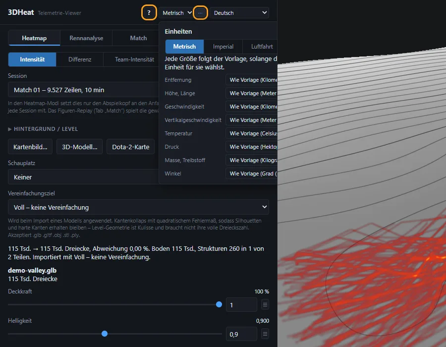
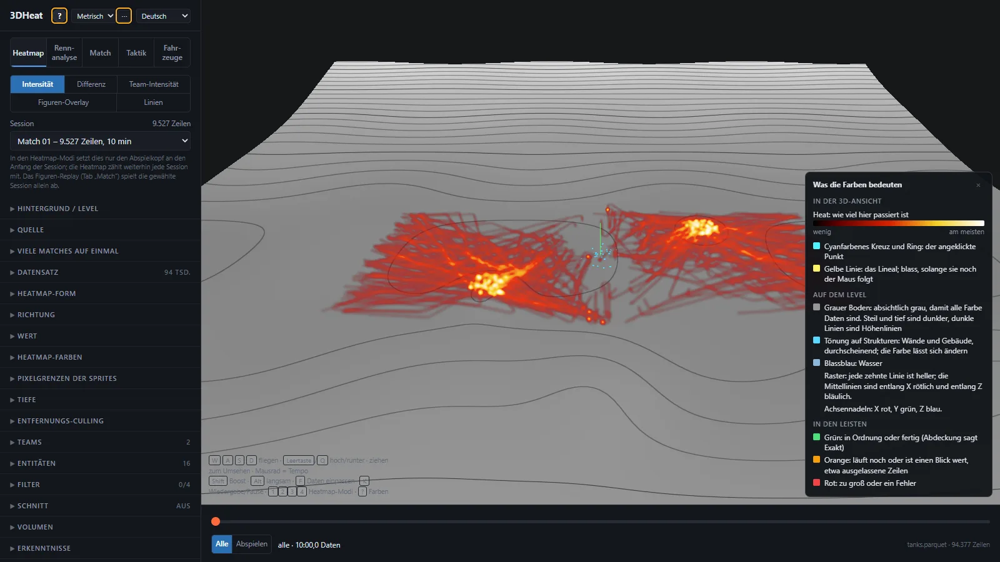
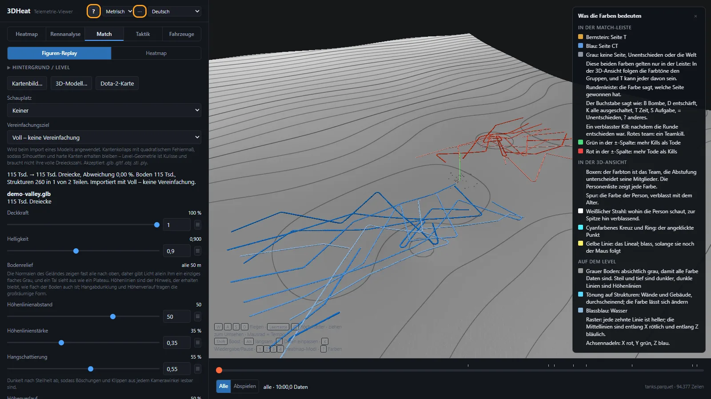

# Einstellungen, Einheiten und Tasten

Die kleinen Regler oben in der Seitenleiste bestimmen, wie der Viewer mit dir spricht: die Sprache, die Einheiten (Meter oder Fuß, km/h oder Knoten) und einen Hilfemodus, der die Farben erklärt. Deine Wahl wird im Browser gemerkt.

## Die Kopfzeile {#the-header}

Oben in der Seitenleiste:

| Regler | Was er tut |
|---|---|
| **?** | Hilfemodus: was jede Farbe bedeutet (auch `?` oder `F1`) |
| Menü **Einheiten** | Metrisch, Imperial, Luftfahrt oder Nautisch |
| Schaltfläche **...** neben **Einheiten** | Öffnet „Wähle eine Einheit für jede Größe“: ein Auswahlmenü pro Größe |
| Menü **Sprache** | Die Sprache des Viewers: [40 Sprachen](languages.md) oder die des Browsers |

Zahlen, die du in ein Feld tippst, dürfen einen Punkt oder ein Komma haben (`0.35` oder `0,35`). Der Viewer liest beides und zeigt Zahlen so, wie die Sprache des Viewers sie schreibt.

## Einheiten {#units}

1. Wähle eine Voreinstellung im Menü **Einheiten**. Alle Größen wechseln gemeinsam.
2. Um nur eine Größe zu ändern, klicke auf die Schaltfläche **...** daneben und wähle eine Einheit für diese Größe. Das Menü zeigt dann ein `*` hinter der Voreinstellung.
3. Eine Größe, die du nicht selbst eingestellt hast, folgt der Voreinstellung. Wähle „Wie Voreinstellung“, um zurückzukehren.

| Größe | Metrisch (Standard) | Imperial | Luftfahrt | Nautisch |
|---|---|---|---|---|
| Entfernung | km | mi | NM | NM |
| Höhe, Länge | m | ft | ft | m |
| Geschwindigkeit | km/h | mph | kt | kt |
| Vertikalgeschwindigkeit | m/s | ft/min | ft/min | m/s |
| Temperatur | °C | °F | °C | °C |
| Druck | hPa | inHg | hPa | hPa |
| Masse, Kraftstoff | kg, l | lb, gal | lb, gal | t, m³ |
| Winkel | Grad | Grad | Grad | Grad |

Weitere Einheiten, die du für eine Größe wählen kannst: Entfernung km, mi, NM; Geschwindigkeit km/h, m/s, kt, mph; Vertikalgeschwindigkeit m/s, ft/min, m/min; Temperatur °C, °F, K; Druck hPa, inHg, mmHg, psi; Masse kg, lb, t; Winkel Grad oder NATO-Mil (6400 auf den Kreis). Die Einheiten sind überall im Viewer gleich: Beschriftungen, Karten, Diagramme, Statistiken.

## Hilfemodus {#help-mode}

Drück `?` oder `F1` oder klick auf den Knopf **?**. Er zeigt *Was die Farben bedeuten*: Legenden für die 3D-Ansicht, die Intensitätsverläufe, Teamfarben, die Farben des Levels, die Statusfarben der Fenster, das Matchfenster und die Rennansicht. Er bleibt an, bis du ihn ausschaltest. Im Tab Match erklärt er auch die Farben des Matchfensters.

## Was der Browser sich merkt {#what-the-browser-remembers}

Diese Einstellungen werden zwischen den Besuchen in deinem Browser gespeichert (nichts wird irgendwohin gesendet):

- die Sprache, die Einheiten und der Hilfemodus;
- die Einstellungen der Wiedergabe für Figur, Symbol, Beschriftung, Kamera und taktische Anzeige;
- die Abspielgeschwindigkeit und die Spiegelung;
- Lesezeichen je Aufzeichnung, Lautstärken je Datensatz, Ebenen von Zielen;
- die Einstellungen der externen KI (der Schlüssel nur, wenn du *Merken* ankreuzt).

Heatmap-Einstellungen, Filter und der Modus beginnen bei jedem Laden neu. Die vollständige, erzeugte Liste steht unter [Gespeicherte Einstellungen](ref-settings-storage.md).

## Tasten, die der Viewer vom Browser übernimmt {#keys-the-viewer-keeps-from-the-browser}

Eine Sitzung mit großen Daten braucht Zeit zum Laden. Deshalb verhindert der Viewer, dass der Browser sie versehentlich verwirft:

- `Strg`/`Cmd` + Buchstaben, die drucken, speichern, öffnen, neu laden, schließen oder neue Fenster öffnen würden, tun außerhalb von Textfeldern nichts. `F1`, `F3`, `F5`, `F6` und `F7` tun nichts.
- Beim Schließen oder Neuladen des Tabs mit geladenen Daten oder einem Level wird vorher nachgefragt.
- Im Vollbild sperrt der Viewer die Tasten, die er nutzt (W, T, N, S, R, P, Q, Esc), damit der Browser sie nicht übernimmt.

Die genaue Liste: [Browser-Tasten](ref-browser-keys.md). Alle eigenen Tasten des Viewers: [Tastatur- und Mausreferenz](keyboard-reference.md).
