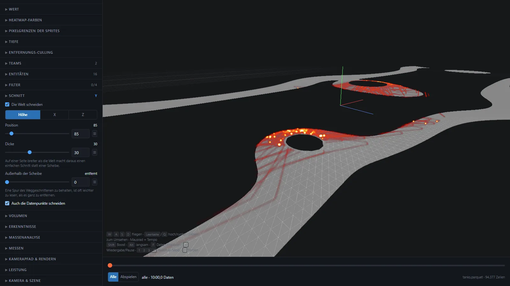

# Schnitt

**Schnitt** schneidet die Welt wie ein Stück Torte, damit du in Gebäude sehen kannst. Nutze ihn, wenn Wände die interessante Intensität verdecken, zum Beispiel um nur ein Stockwerk eines Gebäudes zu sehen.

## Ausprobieren {#try-it}

1. Lade einen Level und einige Daten und öffne **Schnitt**.
2. Setze den Haken bei **Die Welt schneiden**. Die Achse ist **Höhe**.
3. Ziehe **Position** nach oben und unten: die Scheibe wandert durch den Level.
4. Stelle **Dicke** dünn für einen Grundriss ein oder breit für „alles unterhalb hier“.
5. Lass **Außerhalb der Scheibe** auf 0, um den Rest zu entfernen, oder erhöhe ihn, um eine schwache Spur zu behalten.



Die Scheibe schneidet **Level-Geometrie und Datenpunkte zusammen**. Würde man nur den Level schneiden, schwebte die Intensität dort, wo einmal das Gebäude stand. Das Gegenstück ist die [Tiefenverdeckung](depth-and-culling.md). Sobald der Level richtig verdeckt, was dahinter liegt, ist auch das Innere eines Gebäudes verdeckt. Das Fenster wird angezeigt, wenn es etwas zu schneiden gibt (ein Datensatz oder ein 3D-Level). Seine Kopfzeile zeigt die Achse, wenn der Schnitt an ist, sonst *aus*.

```
Seitenansicht     Position = wo die Scheibe liegt
 ----------       Dicke = wie hoch die Scheibe ist
 | Etage 3 |
 |=========|  <--- Scheibe (bleibt)
 | Etage 2 |  <--- außerhalb: entfernt (oder schwach)
 | Etage 1 |
 ----------
```

## Steuerung {#controls}

| Steuerung | Standard | Bedeutung |
|---|---|---|
| **Die Welt schneiden** | aus | Schaltet die Scheibe ein. Steht die Position noch auf ihrem Anfangswert 0 und die Dicke auf dem Anfangswert 500, setzt das Einschalten beide in die Mitte der Achse und auf 15 % ihrer Spannweite. |
| Achse | **Höhe** | *Höhe* (Y), *X* oder *Z*. Ein Wechsel der Achse setzt die Scheibe in die Mitte der neuen Achse. |
| **Position** | die Mitte | Mitte der Scheibe, in Welteinheiten, über die Spannweite der Achse (500 Schritte). |
| **Dicke** | 15 % der Spannweite | Von 1/500 der Spannweite bis zum Doppelten der Spannweite, in logarithmischen Schritten. Zeigt *über die Welt hinaus*, sobald sie so breit ist wie die Spannweite. Dann reicht eine Seite über die Welt hinaus, und es ist ein einfacher Schnitt statt einer Scheibe. |
| **Außerhalb der Scheibe** | 0, *entfernt* | Wie viel von dem, was außerhalb liegt, sichtbar bleibt, 0-100 %. Eine schwache Spur von dem, was weggeschnitten wurde, ist oft leichter zu lesen, als wenn es ganz entfernt ist. |
| **Auch die Datenpunkte schneiden** | an | Aus lässt die Intensität ganz. Sie scheint dann durch den Schnitt hindurch. Das ist nützlich, um zu sehen, was über und unter der Scheibe liegt. |

Die Spannweite einer Achse ist die des 3D-Levels, wenn einer geladen ist. Sonst ist es die des Datensatzes.

Der Schnitt ist unabhängig vom [Entfernungs-Culling](depth-and-culling.md#distance-culling), das entlang der Blickrichtung schneidet und nicht entlang einer Weltachse. Beide wirken zusammen. Jede Änderung an einer Schnitt-Einstellung startet die Heatmap-Akkumulation neu.

## Für Entwickler {#for-developers}

Die Scheibe wird für die Weltposition jeder Zeile im Vertex-Shader geprüft. Eine Zeile außerhalb hat ihren Beitrag mit dem Wert *Außerhalb* multipliziert. Bei 0 wird sie abgelehnt, bevor ein Fragment gezeichnet wird. Die Level-Shader wenden denselben Test auf jedes Fragment des Bodens, der Strukturen und des Wassers an.
