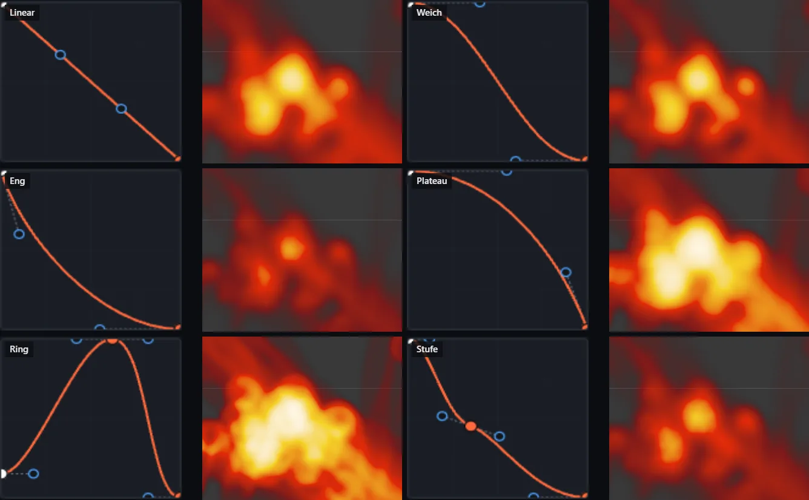

# Sprite-Form

Jede Zeile wird als runder Sprite gezeichnet, der immer zur Kamera zeigt. Seine Größe und das Profil von seiner Mitte bis zu seinem Rand - der **Verlauf** - entscheiden, ob ein Hotspot als enger Punkt, weiche Wolke, Scheibe oder Ring erscheint. Diese Regler stehen im Abschnitt **Heatmap-Form** und **Pixelgrenzen der Sprites** der Seitenleiste und wirken auf [Intensität](heat.md), [Differenz](difference.md), [Team-Intensität](team-heat.md) und, als halbe Breite einer Linie, auf [Linien-Intensität](line-heat.md).

Wenn du einen davon änderst, startet die Akkumulation neu (das Feld muss mit der neuen Form neu gezeichnet werden).

Stell dir jeden Punkt als weichen Lichtfleck vor. Ein kleiner Fleck zeigt einzelne Stellen; ein großer Fleck verschmilzt Nachbarn zu einer Wolke. Die Form entscheidet, wie weich der Rand ist.



## Sprite-Radius {#sprite-radius}

Der Radius des Sprites in **Welteinheiten** (beschriftet in Metern). Standard 6; bei jedem Laden die horizontale Ausdehnung der Daten / 120 - groß genug, dass benachbarte Messwerte entlang eines Weges zu einem Band verschmelzen, statt wie eine Haarlinie zu wirken. Logarithmischer Regler 0,05-2000, Griff bis 50.000.


Dinge in der Ferne wirken kleiner, deshalb schrumpft ein Sprite auf dem Bildschirm mit der Entfernung. Bei der Parallelprojektion ist er überall gleich groß; das ist ein Teil des Grundes, warum die Parallelansicht die richtige ist, um Hotspots zu vergleichen ([Kamera](camera.md#projection)).

## Pixelgrenzen {#pixel-clamps}

**Pixelgrenzen der Sprites** (standardmäßig geschlossen) begrenzen den Radius auf dem Bildschirm, nachdem die Umrechnung oben erfolgt ist.

| Regler | Standard | Bereich (Schrittweite) | Warum |
|---|---|---|---|
| **Min. Pixelradius** | 1 px | 0-16 (512) | Verhindert, dass ferne Daten unter einen Pixel verschwinden. |
| **Max. Pixelradius** | 96 px | 2-1024, logarithmisch (8192) | Der Schutz gegen Überzeichnung. Ein Sprite, der N Pixel bedeckt, kostet N Mischoperationen; ein unbegrenzter Radius nahe der Kamera macht aus einem schnellen Bild ein langsames. Oberhalb der Höhe des Ausschnitts begrenzt er nichts mehr. |

**Gleiche Dichte bei jedem Zoom** (im Abschnitt Heatmap-Form, standardmäßig an) arbeitet mit den Grenzen zusammen. Ein Sprite, den eine Grenze größer (in der Ferne) oder kleiner (nah dran) macht, behält die Wärme, die seine wahre Größe hinzufügen würde; so bedeutet eine Farbe bei jedem Zoom dieselbe Anzahl Zeilen pro Bodenfläche. Ist es aus, fügt ein begrenzter Sprite sein volles Gewicht in seiner begrenzten Größe hinzu, und das Bild ändert sich, während du hineinfliegst.

## Intensität in der Mitte und am Rand {#centre-and-edge-intensity}

Die Wärme, die ein Sprite genau in seiner Mitte hinzufügt (**Intensität in der Mitte**, Standard 1, 0-10, Schrittweite 1000), und an seinem Rand (**Intensität am Rand**, Standard 0, -2-10, Schrittweite 1000). Der Verlaufswert *t* (1 in der Mitte, 0 am Rand, geformt durch den Abfall oder die Kurve unten) mischt zwischen beiden (die Formel steht unter [Für Entwickler](#for-developers)).

Eine **negative Intensität am Rand** lässt den Rand abziehen, was einen kühlen Halo um jeden Hotspot schneidet und Cluster gegeneinander schärft. Die Sichtbarkeit umfasst [Verdeckung](depth-and-culling.md) und den [Schnitt](slice.md); das Ausblenden ist das [Lebensdauer](timeline.md#history)-Ausblenden; das Vorzeichen ist ±1 bei [Differenz](difference.md).

## Verlaufsform: Abfall oder Kurve {#ramp-shape-falloff-or-curve}

Die **Verlaufsform** schaltet zwischen zwei Arten um, *t* über den Sprite zu formen. Mit *d* als Abstand von der Mitte (0) bis zum Rand (1):

### Abfall {#falloff}

Wird angezeigt, wenn *Abfall* gewählt ist (der Standard).

- **Abfall** (Standard 1,6, 0,1-8, Schrittweite 64): `t = (1 - d) ^ Abfall`. 1 ist ein gerader linearer Verlauf; höher zieht die Wärme zur Mitte und verengt den Hotspot; unter 1 wird er zu einer Scheibe abgeflacht.
- **Weicher Verlauf** (Standard an): wendet eine S-förmige Glättungskurve auf *t* an, so dass der Sprite am Rand einblendet, statt an einer sichtbaren Kante zu enden.

### Der Kurven-Editor {#the-curve-editor}

Wird angezeigt, wenn *Kurve* gewählt ist. Ein wörtlicher Querschnitt eines Sprites: Abstand von der Mitte quer (*Mitte* links, *Rand* rechts), Wärme nach oben. Die Kurve ist eine stückweise kubische Bézier-Kurve durch Kontrollpunkte, jeder mit zwei Griffen.

| Aktion | Wirkung |
|---|---|
| Doppelklick auf das Diagramm | Fügt einen Punkt bei diesem Abstand hinzu (zwischen 0,02 und 0,98 gehalten), auf der Kurve und mit der Steigung der Kurve dort, so dass das Hinzufügen nichts ändert, bis du ihn ziehst. |
| Einen Punkt ziehen | Verschiebt ihn. Höhen bleiben zwischen 0 und 1. |
| Einen kleinen Kreis ziehen | Biegt das Segment daneben (verschiebt diesen Griff). |
| Alt-Klick oder Rechtsklick auf einen Punkt | Entfernt ihn. Die beiden Endpunkte lassen sich nicht entfernen. |
| Ein Voreinstellungs-Knopf | Ersetzt die Kurve durch die Voreinstellung. |

Die Endpunkte sind an der Mitte und am Rand festgelegt; ihre Höhe bestimmst weiterhin du.

**Voreinstellungen** ([`curve.ts`](https://github.com/Holdi601/3DHeat/blob/main/src/state/curve.ts)):

| Voreinstellung | Form | Verwendung |
|---|---|---|
| **Linear** | Gerade von 1 bis 0 | Identisch mit *Abfall* 1 bei ausgeschaltetem *Weichem Verlauf*. |
| **Weich** | S-Kurve | Die Standardkurve; was *Weicher Verlauf* bei Abfall 1 ergibt. |
| **Eng** | Ein steiler Kern, ein langer schwacher Rand | Dünn besetzte Daten. |
| **Plateau** | Flach, dann ein schneller Abfall | Wirkt eher wie eine Scheibe als wie ein Klecks. |
| **Ring** | 0,15 in der Mitte, 1 bei 62 % des Radius, 0 am Rand | Ein hohler Sprite: zeigt, wo Wege vorbeiführen, statt wo sie enden. |
| **Stufe** | Zweistufiger Abfall, 0,45 bei 35 % | Trennt einen dichten Kern von seiner Umgebung. |

## Auf die Bodenebene abflachen {#flatten-onto-ground-plane}

**Auf die Bodenebene abflachen** (standardmäßig aus) ignoriert die Höhe jeder Zeile und zeichnet die ganze Wärme auf einer Höhe - dem niedrigsten Y des Datensatzes -, die klassische 2D-Kartenheatmap. Ist es an, sind die Tiefenverdeckung und *Hinter Gelände verbergen* aus (jeder Punkt würde genau auf der Fläche sitzen, gegen die geprüft wird), und der Abschnitt Tiefe sagt das.

## Für Entwickler {#for-developers}

### Formeln {#formulas}

Radius auf dem Bildschirm in Pixeln: `Radius × P[1][1] / w × Höhe des Ausschnitts / 2`, wobei `P` die Projektionsmatrix und `w` die Sichttiefe des Punktes ist.

Die Wärme, die ein Sprite hinzufügt:

```
hinzugefügte Wärme = mix(Rand, Mitte, t) × Stichprobengewicht × Vorzeichen × Ausblenden × Sichtbarkeit
```

### Die Kurve {#the-curve}

Griffe werden waagerecht auf ihr eigenes Segment begrenzt, so dass die Kurve immer eine Funktion des Abstands ist: Zieht man einen Griff weit über den nächsten Punkt hinaus, flacht er sich daran ab, statt die Kurve zurückzufalten, was das Ergebnis davon abhängig machen würde, welche Lösung ein Löser zufällig findet.

### Wie die Kurve gezeichnet wird {#how-the-curve-is-drawn}

Die Kurve wird bei jeder Änderung in eine Tabelle mit 256 Einträgen gebacken, als Textur mit 16-Bit-Fließkomma hochgeladen und pro Fragment mit linearer Filterung abgetastet, mit einer Halbtexel-Einrückung, so dass beide Enden genau bleiben. Eine Bézier-Kurve für x zu lösen braucht Iteration, und die hat im heißesten Shader des Programms nichts verloren; außerdem ist ein Tabellenzugriff billiger als das `pow()`, das der Abfall nutzt. 16 Bit statt 8 Bit, weil 8 Bit als Streifenbildung sichtbar wird, sobald Tausende Sprites summiert sind; 16-Bit-Halbfließkomma ist in WebGL2-Core filterbar, während 32 Bit eine Erweiterung bräuchte.
