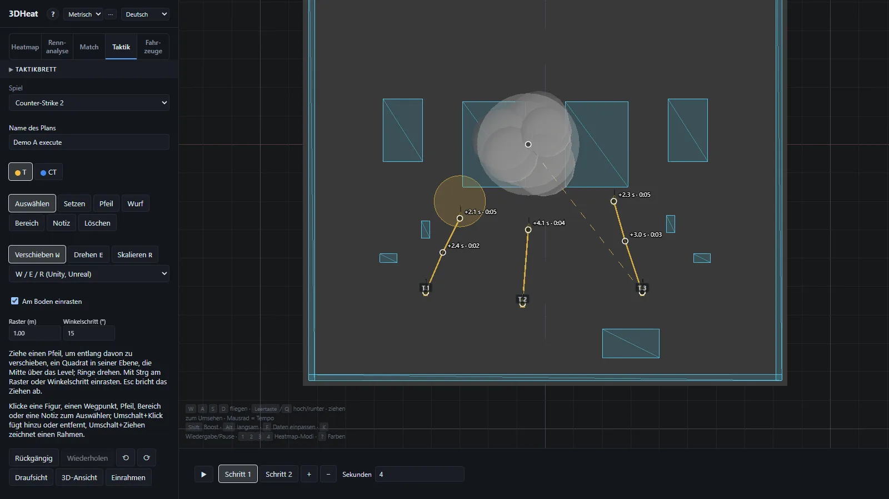

# Taktik-Tafel

Der Reiter **Taktik** ist eine Zeichentafel für einen Teamplan: Du setzt kleine Figuren auf eine Karte, zeichnest Pfeile dafür, wohin sie gehen, und drückst Abspielen, um zuzusehen, wie es geschieht. Nutze ihn, um eine Runde oder einen Angriff zu planen, bevor du spielst. Er teilt sich die Zeichenfläche, die Kamera und das [Level](levels.md) mit den anderen Reitern und sonst nichts; ein Plan sind keine Daten und zeichnen keine Intensität.

## Dein erster Plan {#your-first-plan}

1. Öffne den Reiter **Taktik**. Wähle das **Spiel** (zum Beispiel Counter-Strike 2) und drücke bei Valorant **Valorant-Karten laden** und wähle eine **Karte**. Oder lade zuerst ein [Level](levels.md).
2. Wähle eine **Seite** (sie setzt die Farbe) und drücke **Draufsicht**.
3. Wähle **Ort**, wähle eine Figur unter **Figuren** (mit **Figuren suchen** findest du eine) und klicke auf die Karte. Setze zwei oder drei.
4. Wähle **Pfeil**, klicke auf eine Figur, klicke entlang des Weges, den sie nehmen soll, und drücke **Enter**, um den Pfeil zu beenden.
5. Drücke **+** unter der Ansicht, um Schritt 2 hinzuzufügen. Jede Figur beginnt dort, wo ihr Pfeil endete. Zeichne dort weitere Pfeile.
6. Drücke **▶** (oder `K`), um den Plan vom angezeigten Schritt bis zum Ende abzuspielen.
7. Gib dem Plan einen Namen unter **Name des Plans** und drücke **Speichern**.

## Einen Plan beginnen {#starting-a-plan}

| Bedienelement | Was es tut |
|---|---|
| **Spiel** | Wählt die Seiten und die Figuren, die die Palette anbietet: Counter-Strike 2 (T, CT; Spieler und Hilfsmittel), Valorant (Angriff, Verteidigung; Spieler und allgemeine Fähigkeiten), Battlefield, Squad, Arma (Infanterie, Bodenfahrzeuge, Flugzeuge, Boote), DCS / War Thunder / IL-2 (Strahlflugzeuge, Propellerflugzeuge, Hubschrauber, Luftabwehr, Boden, Schiffe, Waffen) und Andere. Ein Plan, der schon Figuren hat, behält seine Seiten, wenn sich das Spiel ändert. |
| **Name des Plans** | Der Name, unter dem der Plan gespeichert wird. |
| **Karte**, **Valorant-Karten laden** | Mit gewähltem Valorant: **Valorant-Karten laden** holt die Liste der Karten von [valorant-api.com](https://valorant-api.com); **Karte** legt dann das Minimap-Bild der gewählten Karte als Level hin, von oben gerahmt. Das Bild wird beim Wählen geholt und nie mitgeliefert. Der Hinweis von Riot wird gezeigt, solange er auf dem Bildschirm ist (siehe unten). |
| **Seite** | Die Seite, zu der die nächste Figur, der nächste Pfeil oder die nächste Fläche gehört; sie nimmt die Farbe der Seite an. |

Ohne Level ist die Tafel die flache Bodenebene. Lade unter **Level** ein Level, um auf einer echten Karte zu planen: eine CS2-Karte, die mit dem CS2-Werkzeug exportiert wurde, ein Level aus der Bibliothek oder ein Kartenbild.

## Werkzeuge {#tools}

| Werkzeug | Klick | Hinweise |
|---|---|---|
| **Auswählen** | Eine Figur, ein Wegpunkt, ein Pfeil, eine Fläche oder eine Notiz wird ausgewählt. | Shift+Klick fügt hinzu oder entfernt; Shift+Ziehen zieht einen Kasten um das, was dazukommen soll. Die Auswahl bekommt einen Transformationsgriff (siehe unten); `Entf` oder `Rück` entfernt sie. `M` verschiebt die gewählte Figur auf den nächsten Klick. |
| **Ort** | Setzt die gewählte Figur hin. | Eine Figur wird in der Palette **Figuren** gewählt (mit **Figuren suchen**). Ohne Auswahl dreht `R` die nächste Figur um 15°, bevor sie gesetzt wird (`Shift+R` in die andere Richtung). |
| **Pfeil** | Jeder Klick fügt einen Punkt hinzu; Enter, ein Doppelklick oder ein Rechtsklick beendet ihn, Esc verwirft ihn. | **Verschieben**, **Angriff** (breitere Spitze) oder **Beobachten** (eine dünne Linie in Augenhöhe). Ein Pfeil, der auf einer Figur beginnt, ist die Route dieser Figur in diesem Schritt: Beim Abspielen geht die Figur ihn ab, und der nächste Schritt beginnt, wo er endete. |
| **Wurf** | Der Werfer, dann wo es landet. | Ein gestrichelter Bogen von einem zum anderen, und das gewählte Hilfsmittel (Rauch, Blendgranate, Molotow, ...) erscheint dort, wo es landet, und bleibt von diesem Schritt an. |
| **Fläche** | Die Mitte, dann der Rand. | Eine Scheibe in der Farbe der Seite. |
| **Notiz** | Wo die Notiz hinkommt; fragt nach ihrem Text. | Als Nadel gezeigt, darüber ihr Text. |
| **Löschen** | Eine Figur, ein Pfeil, eine Fläche oder eine Notiz. | Entfernt sie von diesem Schritt an; im ersten Schritt entfernt er sie ganz. |

**Rückgängig** und **Wiederholen** (`Strg+Z`; `Strg+Y` oder `Strg+Umschalt+Z`) gehen durch jede Änderung. Eine Zeile unter dem Plan zeigt, wie viele Figuren, Pfeile und Schritte er hat. **Draufsicht** schaut senkrecht hinab (orthografisch), **3D-Ansicht** kehrt zur Perspektive zurück, **Frame** passt den Plan ein, oder das Level, wenn der Plan leer ist.

**Figurengröße** skaliert jede Figur auf der Tafel; 1× ist die wahre Größe, was aus großer Höhe für eine Person ein paar Pixel sind.

## Verschieben, Drehen und Skalieren {#moving-turning-and-scaling}

Alles auf der Tafel lässt sich wie in einem 3D-Editor verschieben: Figuren, Hilfsmittel, Markierungen, einzelne Wegpunkte und ganze Pfeile, Flächen und Notizen. Was ausgewählt ist, bekommt einen Griff in seiner Mitte:

| Modus | Tasten | Griffe |
|---|---|---|
| **Verschieben** | W (oder G) | Ein Pfeil pro Achse (X rot, Y grün und nach oben, Z blau) bewegt entlang ihr; ein Quadrat bewegt in seiner Ebene; die Mitte bewegt sich über das Level unter dem Zeiger. |
| **Drehen** | E (oder R) | Ein Ring pro Achse dreht um sie. Die Ringe einer einzelnen Figur sind ihr eigener Gier-, Nick- und Rollwinkel; eine Gruppe dreht um die Achsen der Welt um ihre Mitte. |
| **Skalieren** | R (oder S) | Spreizt oder sammelt die Auswahl von ihrer Mitte aus entlang einer Achse oder in alle Richtungen; der Radius einer Fläche wächst mit. |

**Tasten** wechseln zwischen W / E / R (Unity, Unreal) und G / R / S (Blender); die Tasten wählen den Modus nur, solange etwas ausgewählt ist, und fliegen sonst die Kamera. `R` bedeutet also **Skalieren** mit den Tasten W / E / R und **Drehen** mit den Tasten G / R / S, wenn etwas ausgewählt ist, und dreht die nächste zu setzende Figur, wenn nichts ausgewählt ist. Alle Tastenkürzel der Tafel stehen in der [Tastatur-Referenz](keyboard-reference.md#tactics-board). Halte **Strg** beim Ziehen, um eine Verschiebung am **Raster** (Meter) oder eine Drehung am **Winkelschritt** einrasten zu lassen. **Am Boden einrasten** (standardmäßig an) setzt bewegte Personen, Fahrzeuge, Markierungen, Wegpunkte und Flächen auf die Oberfläche des Levels; Flugzeuge und Hubschrauber behalten ihre Höhe, und ein Ziehen entlang des Y-Pfeils rastet nie ein. Ein Ziehen am Griff bewegt nie die Kamera. **Esc** bricht ein Ziehen ab, und jede Änderung ist ein Schritt von Rückgängig.

Wegpunkte erscheinen als Punkte auf den Pfeilen des angezeigten Schritts: klicke einen an, um ihn auszuwählen, ziehe ihn, um ihn zu verschieben, Entf, um ihn zu entfernen. Der Abschnitt **Gewählte** zeigt den Ort der Auswahl in Metern, den Gier-, Nick- und Rollwinkel einer Figur in Grad und den Radius einer Fläche, jeweils zum Eintippen.

## Zeitnahme {#timing}

Die Route einer Figur ist zeitlich eingeteilt: Jeder Abschnitt braucht seine Länge über das Level – auf der Oberfläche etwa alle zwei Meter abgetastet, sodass ein Hügel oder eine Treppe zwischen zwei Punkten zählt –, mit der Geschwindigkeit des **Bewegungsmodus** dieser Figur in diesem Spiel, plus jede **Wartezeit** an einem Wegpunkt. Infanterie kriecht, duckt sich, geht (leise), läuft oder sprintet; Fahrzeuge und Boote kriechen, fahren vorsichtig, normal oder mit Eile; Flugzeuge und Hubschrauber fliegen langsam, mit Reisegeschwindigkeit, mit Kampfgeschwindigkeit oder mit Höchstgeschwindigkeit. Ein Modus, den das Spiel nicht hat (CS2 hat keinen Sprint), nimmt den nächsten, den es hat. Wie eine Steigung bremst, hängt vom Spiel ab: In CS2 und Valorant zählt nur die waagerechte Strecke, wie in den Spielen; Militärsimulationen bremsen Infanterie bergauf (Toblers Wanderfunktion) und Fahrzeuge nach Steigung.

Die Geschwindigkeiten stammen aus Tabellen je Spiel mit ihren Quellen (siehe [Bewegungsgeschwindigkeiten](tactics-speeds.md)): CS2 nach der gehaltenen Waffe, aus den Waffendefinitionen des Spiels; Valorant nach Waffe; Battlefield, Squad, Arma und die Flugspiele nach Fahrzeugtyp und Klasse. **Bewegt sich als** wählt das Profil einer Figur (eine Waffe, ein Fahrzeugtyp); **Eigene (m/s)** überschreibt jeden Modus für diese Figur. Die Modi heißen so, wie die Tafel sie zeigt: *Kriechen*, *Ducken*, *Gehen (leise)*, *Laufen*, *Sprint*; *Vorsichtig*, *Normal*, *Eile*; *Langsam*, *Reisegeschwindigkeit*, *Kampf*, *Maximum*.

Jeder Wegpunkt zeigt die Zeit seit dem letzten und die Zeit seit Beginn des Plans („+3,9 s · 0:12“). Die Route der gewählten Figur listet jeden Abschnitt mit seinem Modus, seiner Länge und Zeit, der Wartezeit und der Ankunft. **Ankünfte** unter **Zeitnahme** setzt jede Figur mit Route auf eine gemeinsame Zeitlinie, die erste Ankunft oben. Mit **In Echtzeit abspielen** (standardmäßig an) dauert ein Schritt, bis seine langsamste Route ankommt, und jede Figur bewegt sich mit ihrer eigenen Geschwindigkeit; **Sekunden** ist dann die kürzeste Länge des Schritts. **Leveleinheiten pro Meter** sagt, in was das Level gemessen ist: 39,37 für CS2-Karten (Spieleinheiten), 1 für Karten in Metern.

## Mit Match-Daten vergleichen {#compare-with-match-data}

**Match-Dateien laden…** liest CS2-Match-Tabellen der Karte (die Parquet-Dateien des CS2-Werkzeugs, so viele wie gewünscht; nur die nötigen Spalten, im Hintergrund); **Geladene Daten nutzen** übernimmt die Daten, die im Viewer geladen sind. Dann:

- **Früheste Ankunft auf der Karte** färbt die Karte nach der Zeit seit Rundenbeginn, zu der ein Spieler jeden Ort zuerst erreichte – der Knopf **Schnellste** zeigt die Schnellste über alle Runden, **Typisch (Median)** die mittlere Runde –, grün früh bis rot spät, für eine Seite oder beide. Sie zeigt, was wann möglich ist.
- Die gewählte Route wird mit dem verglichen, was Spieler vom Start (oder vom Rundenbeginn) bis zu ihrem Ende erreicht haben, jedes Ende als Scheibe mit dem eingestellten Radius: „Schnellste beobachtet 14,2 s, p10 15,0 s, Median 18,3 s über 41 Läufe; dein Plan 15,1 s“.
- Die Geschwindigkeiten, mit denen Spieler sich wirklich bewegten – Laufen, Gehen, Ducken, aus den Gehen- und Duck-Spalten der Tabellen – in m/s.

## Schritte {#steps}

Die Leiste unter der Ansicht enthält die Schritte. Ein Plan beginnt mit einem; **+** fügt einen hinzu, und jede Figur beginnt dort, wo ihre Route im letzten Schritt endete; **−** entfernt den angezeigten. **Sekunden** ist, wie lange der angezeigte Schritt beim Abspielen dauert. **▶** (K) spielt vom angezeigten Schritt bis zum Ende ab: Figuren mit Route gehen sie ab, Figuren, die im nächsten Schritt an einen neuen Ort verschoben wurden, gleiten dorthin, der Rest steht. Solange ein Schritt angezeigt wird, ist der Ort jeder Figur im nächsten Schritt als blasser Geist gezeichnet, und die Pfeile des letzten Schritts liegen blass unter diesem.

## Speichern {#saving}

Der Abschnitt **Datei** enthält **Speichern**, **Open** und **Leeren**. **Speichern** schreibt den Plan als `<name>.h3dplan.json` (einfaches JSON: Seiten, Schritte, Figuren mit einem Ort pro Schritt, Pfeile, Flächen, Notizen); **Open** liest einen zurück. Eine Datei einer anderen Version oder eine, die kein Plan ist, wird mit dem Grund abgelehnt. **Leeren** leert den Plan; Rückgängig holt ihn zurück.

## Figuren {#figures}

Jede Figur baut der Viewer selbst: einfache Formen in der veröffentlichten Größe eines Typs, mit den Merkmalen, die sie von ihren Nachbarn unterscheiden – die Laufrollen und der Turm eines Panzers, die Geschütze, Raketen und Radare eines Luftabwehrfahrzeugs, der Flügelgrundriss, das Leitwerk und die Triebwerke eines Flugzeugs, die Rotoren und Stummelflügel eines Hubschraubers. Nichts wird aus einem Spiel übernommen. Ein Design, das ein Spiel erfunden hat, wird als die allgemeine Figur seiner Klasse gezeigt. Wie Daten ihre Figur finden, steht bei [Figuren](figures.md#which-figure-a-unit-gets).

## Hinweis von Riot {#riots-notice}

Valorant-Karten werden nach der Richtlinie „Legal Jibber Jabber“ von Riot Games gezeigt, die freie Community-Projekte erlaubt, sie zu nutzen, und diesen Hinweis überall verlangt, wo sie erscheinen: *3DHeat was created under Riot Games' "Legal Jibber Jabber" policy using assets owned by Riot Games. Riot Games does not endorse or sponsor this project.* Die Fähigkeiten auf der Tafel sind allgemeine Formen, nicht die Kunst von Riot.
