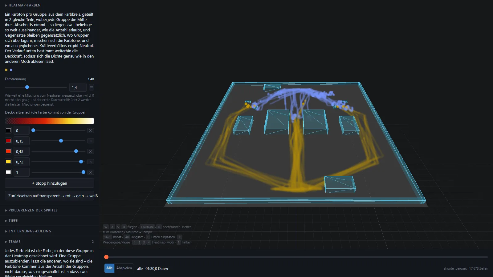

# Team-Intensität

Die Team-Intensität zeigt, wo jedes Team war, jedes Team in seiner eigenen Farbe. Wo sich Teams überlappen, mischen sich die Farben.

**Team-Intensität** (Taste 3) ist das Dichtefeld der [Intensität](heat.md), wobei jede [Gruppe](glossary.md) ihren eigenen Farbton bekommt. Wo sich Gruppen überlappen, mischen sich ihre Farbtöne. Ein ausgeglichener Kampf ergibt neutrales Grau. Die Deckkraft trägt die Dichte weiterhin genau wie in den anderen Modi. Das Bild zeigt so gleichzeitig *wie viel* und *wessen*. Der Modus braucht eine Gruppenspalte.

Er ist nicht das [Figuren-Overlay](box-replay.md). Dieses zeichnet eine Figur je Person. Hier ist es ein Dichtefeld, eingefärbt nach derselben Spalte.

## So benutzt du ihn {#how-to-use-it}

1. Drück `3` (oder wähle **Team-Intensität** in der Modusleiste).
2. Öffne **Heatmap-Farben**. Die Farbfelder zeigen die Farbe jeder Gruppe. Fahre mit der Maus über ein Farbfeld für den Teamnamen.
3. Sieht alles grau aus, erhöhe die **Farbtrennung**.
4. Entferne den Haken bei einer Gruppe in der [Teamliste](teams-list.md), um sie herauszunehmen. Die anderen Farben bleiben, wo sie waren.

## Steuerung {#controls}

Im Abschnitt **Heatmap-Farben**:

| Steuerung | Standard | Bedeutung |
|---|---|---|
| Farbfelder | | Die Farbe jeder Gruppe, für die ersten 12 Gruppen, dann *+N weitere*. Fahre darüber für den Namen der Gruppe und die Farbe. |
| **Farbtrennung** | 1,4 | Wie weit eine Mischung von Neutral weggedrückt wird, 0-4. 0 macht alles grau; 1 ist der echte Durchschnitt. Über etwa 2 verlassen die hellsten Mischungen den darstellbaren Bereich und werden je Kanal begrenzt, was ihren Farbton verschiebt. |
| **Deckkraftverlauf (die Farbe kommt von der Gruppe)** | der Standard-Intensitätsverlauf | Hier wird nur das **Alpha** des Verlaufs genutzt: transparent, wo nichts ist, undurchsichtig oben. Seine Farben werden ignoriert. |

Eine Gruppe, deren Bezeichnung „keine Gruppe“ bedeutet (`0`, leer, `none`, `unknown`, `null` oder `-1`), wird grau gezeichnet.

Alle anderen Steuerungen der Intensität, also Form, Sättigung, Ansprechverhalten, minimale Intensität, Tiefe und Culling, funktionieren wie in [Intensität](heat.md).

Die [Teamliste](teams-list.md) zeigt in diesem Modus die Team-Intensitäts-Farbe jeder Gruppe als Farbfeld. Das Ausblenden einer Gruppe lässt die Farbe jeder anderen Gruppe, wo sie war. Die Farbtöne kommen aus der Gesamtzahl der Gruppen, nicht aus dem, was eingeschaltet ist. So bleiben zwei Bilder vergleichbar.

## Für Entwickler {#for-developers}

### Die Palette {#the-palette}

Aus [`colors.ts`](https://github.com/Holdi601/3DHeat/blob/main/src/render/colors.ts):

- Die Farben liegen auf der **Oklab**-Farbebene mit fester Helligkeit (0,7) und Buntheit (0,115). So ist jede Gruppe gleich hell, und eine rote Gruppe wirkt nicht heißer als eine blaue.
- Bei *n* Gruppen wird der Farbkreis in *n* gleiche Teile geteilt. Gruppe *i* nimmt die **Mitte** ihres Teils, `(i + 0,5) / n` einer Umdrehung. Je zwei Gruppen liegen so weit auseinander, wie es die Anzahl erlaubt, und Gegenüberliegende bleiben gegenüber, egal wie viele es sind.
- Höchstens **16** verschiedene Farbtöne werden verwendet. Bei mehr Gruppen werden die IDs durch wiederholtes Halbieren verteilt (Bit-umgekehrte IDs: 0, ½, ¼, ¾, ⅛, …), damit benachbarte IDs keinen Farbton teilen. Gruppen über 16 teilen sich zwangsläufig einen Farbton.
- Eine Gruppe, deren Bezeichnung „keine Gruppe“ bedeutet - `0`, leer, `none`, `unknown`, `null` oder `-1`, ohne Unterschied zwischen Groß- und Kleinschreibung -, wird **neutral grau** gezeichnet, statt sich einen Abschnitt des Kreises zu nehmen. Nur die erste solche Bezeichnung in der Gruppenliste wird so behandelt.

Die Standardtrennung ist 1,4 statt 1, weil bei 1 eine Mischung aus fünf gleichmäßig verteilten Farbtönen *grau* ist: korrekt und nicht lesbar. Ein wenig über 1 hält Gleichstände ehrlich und macht eine Aufteilung 60/40 sichtbar.

### So funktioniert es {#how-it-works}

Das Heatmap-Ziel hat in diesem Modus vier Kanäle. Jedes Sprite addiert seine Dichte *v* zum ersten Kanal und *v* × die Oklab-Koordinaten *a* und *b* der Gruppe zum zweiten und dritten. Beim Komposit ist die Mischung des Bildpunkts der dichtegewichtete Mittelwert: *a* = G / R, *b* = B / R, skaliert mit der Farbtrennung und in sRGB bei der Helligkeit der Palette umgewandelt. Das Teilen durch die akkumulierte Dichte hält den Farbton unabhängig davon, wie viele Daten da sind. Deshalb wirkt jede Dichte-Steuerung nur auf die Deckkraft.

Das Vier-Kanal-Ziel braucht viermal so viel GPU-Speicher wie das Einkanal-Heatmap-Ziel bei gleicher Auflösung.
