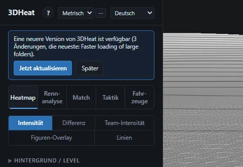

# Updates

Der Viewer sagt dir, wenn es eine neuere Version gibt, und aktualisiert sich nur, wenn du zustimmst. Auf deinem Rechner wird nichts ohne deine Antwort geändert.

## Den Viewer aktualisieren {#update-the-viewer}

1. **In der Seite.** Wenn es eine neuere Version gibt, erscheint ein Kasten unter dem Namen oben in der Seitenleiste: „Eine neuere Version von 3DHeat ist verfügbar“. Klicke auf **Jetzt aktualisieren**. Die Seite lädt sich danach selbst neu. **Später** blendet den Kasten aus, bis du die Seite neu lädst.
2. **Wenn es heißt, restart.bat auszuführen**, schließe das Serverfenster (das schwarze Fenster, das `start.bat` geöffnet hat) und doppelklicke `restart.bat`.
3. **Beim Starten des Viewers.** `start.bat` prüft ebenfalls. Gibt es eine neuere Version, fragt es **Jetzt aktualisieren? [J/N]**. Drücke `J`, um zu aktualisieren. Drücke `N` oder warte 60 Sekunden ohne Antwort, um die Version zu starten, die du hast.



Eine Kopie mit eigenen Änderungen wird nie für dich aktualisiert; der Kasten sagt nur, dass ein Update wartet, und dass du deine Änderungen committen oder stashen und dann `git pull` ausführen sollst. Eine Kopie, die nicht mit Git installiert wurde (etwa eine Zip-Datei), zeigt nichts.

So funktioniert die Prüfung, Schritt für Schritt:

```
Seite ---(nach 4 s, dann alle 6 h)---> Entwicklungsserver ---> git fetch
   zurück?  nein -> es wird nichts angezeigt
            ja   -> eigene Änderungen oder Commits?  ja -> nur Hinweis
                                                     nein -> [Jetzt aktualisieren] -> git pull
                                                            -> neu laden, oder „restart.bat ausführen“
```

## Die Sicherheitsregeln {#the-safety-rules}

- **Nur Fast-Forward** (`git pull --ff-only`): Ein Update führt nie zusammen,
  rebased oder überschreibt etwas.
- **Keine lokalen Änderungen**: Eine Kopie mit nicht committeten Änderungen an verfolgten Dateien
  (`git status --porcelain --untracked-files=no` nicht leer) wird nie automatisch aktualisiert – die
  Arbeit eines Menschen ist nicht dazu da, von einem Update überschrieben zu werden. Sie erfährt
  nur, dass ein Update wartet. Nicht verfolgte Dateien (Daten, Exporte) zählen nicht als Änderungen.
- **Keine lokalen Commits**: Eine Kopie mit Commits, die der Upstream nicht hat („divergiert“), wird nicht
  aktualisiert – ein Fast-Forward kann sie nicht hochbringen, und das Zusammenführen ist Sache von `git pull`
  von Hand. Die Seite und `start.bat` sagen es mit denselben Worten, und `start.bat` startet die Version, die dort liegt.
- **Nur von der Seite selbst**: Die Update-Anfrage des Entwicklungsservers muss einen eigenen Header
  tragen und, wenn der Browser einen `Origin` mitschickt, vom eigenen Host des Servers kommen (unten).
- Nur ein Git-Checkout mit einem Upstream-Branch wird je aktualisiert; alles andere
  (eine Kopie ohne `.git`, kein Git installiert, ein statischer Build) bleibt unberührt und sagt nichts.

## Was start.bat tut {#what-startbat-does}

`start.bat` (doppelklicken; das Fenster ist der Server) macht der Reihe nach:

1. Findet Node.js – im `PATH`, sonst in `%ProgramFiles%\nodejs`,
   `%ProgramFiles(x86)%\nodejs` oder `%LOCALAPPDATA%\Programs\nodejs` – und bietet an,
   es mit `winget install -e --id OpenJS.NodeJS.LTS` zu installieren, wenn es fehlt (gefragt, J/N; danach muss das Fenster neu geöffnet werden, damit Windows den neuen `PATH` übernimmt).
2. **Aktualisiert**, wenn Git installiert ist und der Ordner `.git` hat:
   - `git fetch --quiet` (kein Netz oder kein Upstream: still übersprungen);
   - zählt `git rev-list --count HEAD..@{u}`; nichts zurück: nichts gesagt;
   - lokale Änderungen: „Eine neuere Version von 3DHeat ist verfügbar (N Änderungen), aber diese Kopie hat lokale Änderungen, daher wird sie nicht aktualisiert. Committe oder stashe sie, dann führe git pull aus.“ – und es startet die Version, die dort liegt;
   - eigene Commits (`git rev-list --count @{u}..HEAD` ungleich 0): „Eine neuere Version von 3DHeat ist verfügbar (N Änderungen), aber diese Kopie hat eigene Commits, die die neueste Version nicht hat, daher wird sie nicht aktualisiert. Aktualisiere sie mit git pull.“ – und es startet die Version, die dort liegt;
   - sonst „Eine neuere Version von 3DHeat ist verfügbar (N Änderungen).“ und die Frage **Jetzt aktualisieren? [J/N]**. `N`, oder keine Antwort innerhalb von 60 Sekunden, gibt „Nicht aktualisiert; die Version, die du hast, wird gestartet.“ aus und startet sie. Bei `J`: „Aktualisiere…“, meldet, ob sich `package.json` oder `package-lock.json` ändern,
     führt `git pull --ff-only` aus (schlägt das trotzdem fehl – etwa wegen des Netzes –:
     „Das Update ist nicht durchgegangen; die Version, die du hast, wird gestartet.“), dann `git submodule update --init`
     (die festgelegten Werkzeuge, siehe [Pflege der Dokumentation](maintaining.md#the-tools-under-exporters)), dann `npm install`, wenn sich die Paketdateien geändert haben und `node_modules` existiert, und „Aktualisiert.“
3. Verhindert einen zweiten Serverstart: Lauscht schon etwas auf Port **5273**, sagt es das und verweist auf `restart.bat` / `stop.bat`.
4. Beim ersten Start (kein `node_modules`) fragt es, bevor die Abhängigkeiten geladen werden (etwa 300 MB in `node_modules\`, nichts systemweit).
5. Startet den Entwicklungsserver auf `127.0.0.1:5273` (`--strictPort`) und öffnet den Browser, sobald er bereit ist.

`restart.bat` stoppt den Server (über den Port) und führt `start.bat` erneut aus, es stellt also dieselbe Frage. `stop.bat` stoppt ihn nur.


## Für Entwickler {#for-developers}

### Während er läuft: die Update-Route {#while-it-runs-the-update-route}

Der Entwicklungsserver (Vite-Plugin `heat3d-self-update` in `vite.config.ts`) liefert `/__heat3d/update`. Die Route gibt es nur auf dem Entwicklungsserver – nicht in einem statischen Build und nicht in `vite preview`.

**`GET /__heat3d/update`** antwortet, ob der Checkout zurückliegt:

```json
{ "checkout": true, "upstream": "origin/main", "behind": 3, "ahead": 0, "dirty": false, "latest": "the newest commit's subject" }
```

- `checkout: false`, wenn der Ordner kein Git-Checkout ist;
- sie führt `git fetch --quiet` **höchstens alle 30 Minuten** aus (Anfragen dazwischen antworten mit dem, was zuletzt geholt wurde);
- `behind` / `ahead` aus `git rev-list --count HEAD..@{u}` / `@{u}..HEAD`, `dirty` aus `git status --porcelain --untracked-files=no`, `latest` der Betreff des neuesten Commits des Upstreams;
- ohne Upstream-Branch: `upstream: null` und `behind: 0`.

**`POST /__heat3d/update/apply`** bringt den Checkout auf den neuesten Stand:

1. Abgelehnt mit `403 { ok: false, reason: "forbidden" }`, außer die Anfrage hat den Header `X-Heat3d-Update: 1` und, wenn sie ein `Origin` mitschickt, stimmt dessen Host mit dem `Host` der Anfrage überein. Ein fremdes Formular kann ohne CORS-Preflight keinen eigenen Header senden, und den gewährt dieser Server nie.
2. Nichts zu tun (kein Checkout, kein Upstream, nicht zurückliegend): `{ ok: true, updated: false }`.
3. Lokale Änderungen: `{ ok: false, reason: "dirty" }`; eigene Commits: `{ ok: false, reason: "diverged" }`.
4. Sonst: notiert die Dateien, die sich ändern (`git diff --name-only HEAD @{u}`), führt `git pull --ff-only` aus (Zeitlimit 2 Minuten), dann `git submodule update --init` (Fehler werden ignoriert), `npm install`, wenn sich `package.json` oder `package-lock.json` geändert haben (Zeitlimit 15 Minuten), und antwortet `{ ok: true, updated: true, restart }`. `restart` sagt, warum der laufende Server das Update nicht übernehmen kann: `"dependencies"`, wenn die Abhängigkeiten neu installiert wurden, `"config"`, wenn nur eine `vite.config`-Datei geändert wurde, `false`, wenn kein Neustart nötig ist.
5. Ein fehlgeschlagener git- oder npm-Befehl antwortet mit `{ ok: false, reason: "<der Fehler, höchstens 300 Zeichen>" }`.

Antworten sind JSON mit `Cache-Control: no-store`. Der Server lauscht nur auf `127.0.0.1`, daher ist die Route aus dem Netzwerk nicht erreichbar.

### Der Hinweis in der Seite {#the-notice-in-the-page}

`UpdateBanner`, unter dem Namen oben in der Seitenleiste:

- Er fragt die Route **4 Sekunden** nach dem Laden der Seite (nicht in den ersten Sekunden: die Seite hat einen Datensatz zu laden und eine GPU zu starten) und danach **alle 6 Stunden**, solange die Seite offen bleibt.
- Er zeigt **nichts**, wenn es keine solche Route gibt (ein statischer Build), der Ordner kein Checkout ist oder nichts neuer ist. Ein Hinweis bei jedem Start würde man lernen zu ignorieren.
- Liegt die Kopie zurück, ohne lokale Änderungen: „Eine neuere Version von 3DHeat ist verfügbar (N Änderungen, die neueste: <Betreff>).“ mit **Jetzt aktualisieren** und **Später** (*Später* blendet den Hinweis aus, bis die Seite neu geladen wird).
- Liegt die Kopie zurück, mit lokalen Änderungen: derselbe Satz und „Diese Kopie hat lokale Änderungen, daher wird sie nicht automatisch aktualisiert; committe oder stashe sie, dann führe git pull aus.“ – ohne Schaltfläche.
- **Jetzt aktualisieren** sendet an `/apply` („Aktualisiere…“). Danach:
  - „Aktualisiert. Die Seite wird neu geladen.“ – und sie lädt 1,5 s später neu (der Server liefert schon die neuen Dateien);
  - wenn die Abhängigkeiten neu installiert wurden: „Aktualisiert. Die Abhängigkeiten haben sich geändert: Schließe das Serverfenster und führe **restart.bat** aus, um abzuschließen.“;
  - wenn nur die Einstellungen des Servers geändert wurden: „Aktualisiert. Die Servereinstellungen haben sich geändert: Schließe das Serverfenster und führe **restart.bat** aus, um abzuschließen.“;
  - wenn am Ende doch nichts zu holen ist (`updated: false`, etwa weil `start.bat` die Kopie in der Zwischenzeit aktualisiert hat): „Nichts zu aktualisieren: Diese Kopie ist schon die neueste Version.“ – und kein Neuladen;
  - abgelehnt: der Satz zu lokalen Änderungen, oder „Diese Kopie hat eigene Commits, die die neueste Version nicht hat; aktualisiere sie mit git pull.“, oder „Das Update ist nicht durchgegangen: <Grund>“.
