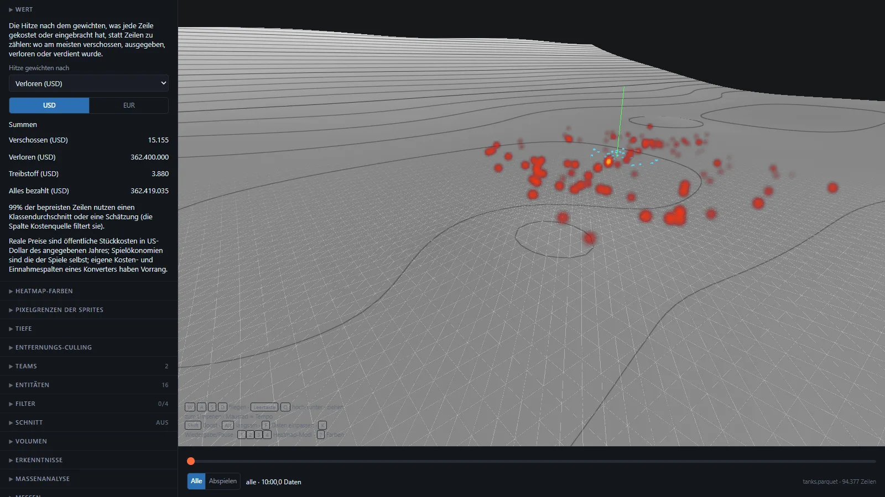

# Wertgewichtung

Jeder Schuss, jede Munition, jedes verlorene Fahrzeug und jeder Liter Kraftstoff hat einen Preis. Der Viewer rechnet aus, was jede Zeile gekostet oder eingebracht hat, und kann die Heatmap danach gewichten. So zeigt die Karte **wo das Geld hinging**, statt wo die Zeilen liegen.

## So benutzt du es {#how-to-use-it}

1. Lade Daten mit Ereignissen (Schüsse, Abschüsse, Tode) und Fahrzeug- oder Waffennamen.
2. Öffne **Wert** in der Heatmap-Seitenleiste.
3. Wähle **Hitze gewichten nach**, zum Beispiel *Verloren (USD)*. Die Heatmap addiert jetzt den Preis jeder Zeile statt 1.
4. Lies **Summen**: die Summe jeder Wertspalte für das, was gezeigt wird (Filter und Zeitfenster gelten).
5. Wo die Preise echtes Geld sind, erscheint ein Schalter **USD / EUR**.

Wähle den leeren ersten Eintrag des Menüs, um wieder Zeilen zu zählen.

## Was gewichtet werden kann {#what-can-be-weighed}

Die Wertspalten werden beim Laden hinzugefügt, je eine pro Art und Währung:

| Art | Zeilen, auf die sie fällt | Wie sie bepreist wird |
|---|---|---|
| **Verschossen** | Schüsse und Abschüsse | die Waffe, sonst ein Mittelwert für die Munitionsart |
| **Ausgegeben** | Kaufen, Erscheinen | Geldspalten des Spiels (zum Beispiel das Kaufmenü eines Shooters) |
| **Verloren** | Tode, Zerstörungen | das eigene Fahrzeug, sonst der Mittelwert seiner Klasse |
| **Zerstört** | Abschüsse | das Zielfahrzeug |
| **Schaden verursacht** | Treffer | ein Anteil am Wert des Ziels |
| **Kraftstoff** | Positionen | verbrauchter Kraftstoff, aus einer Kraftstoffspalte oder aus Klasse und Zeit geschätzt |
| **Alles bezahlt** | | verschossen + ausgegeben + verloren + Kraftstoff |
| **Verdient** | Belohnungen | die eigenen Belohnungsspalten des Spiels (`earn_…`) |
| **Netto** | | verdient minus bezahlt; als vorzeichenbehaftete Heatmap gezeichnet (positiver Verlauf, wo mehr verdient wurde, negativer, wo mehr bezahlt wurde) |

Die Spaltennamen sind `cost_<Art>_<Währung>`, `earn_<Währung>` und `net_<Währung>`. Ein Konverter, der die eigene Währung des Spiels kennt (zum Beispiel ein Replay-Konverter mit den Credits des Spiels), hat Vorrang vor den eingebauten Preistabellen.

## Die Preistabellen {#the-price-tables}

| Tabelle | Währung |
|---|---|
| Reales Militär: Raketen, Bomben, Munition, Gegenmaßnahmen, Flugzeuge, Hubschrauber, Landfahrzeuge, Schiffe, Kraftstoff | USD (EUR = USD × 0,92, der feste Wert `EUR_PER_USD` in [`cost.ts`](https://github.com/Holdi601/3DHeat/blob/main/src/data/cost.ts); er ist kein Live-Kurs) |
| Kaufmenüs von Shootern und Abschussprämien | die Credits des Spiels |
| Panzer- und Schiffsspiele | die Credits des Spiels |
| Strategiespiele (mehrere Ressourcen) | eine Spalte je Ressource plus eine kombinierte |
| Kriegsspiele | Punkte |

Das Spiel wird an Namen in den Daten erkannt. Reale Preise stammen aus öffentlichen Quellen (Haushaltsdokumente, Nachschlagewerke) oder sind als Schätzungen gekennzeichnet. Sie sind nicht an die Inflation angepasst. Die erzeugte Liste der Tabellen steht unter [Werttabellen](ref-value-tables.md).

## Schätzungen {#estimates}

Die zusätzliche Kategoriespalte **Kostenquelle** sagt, wie jede Zeile bepreist wurde: `table`, `class average`, `estimate` oder `none`. Der Abschnitt Wert zeigt, welcher Anteil der bepreisten Zeilen Mittelwerte oder Schätzungen sind. Willst du nur exakt bepreiste Zeilen behalten, entferne bei **Kostenquelle** unter [Filter](filters.md) den Haken bei *estimate* und *class average*.

## Wo der Wert sonst erscheint {#where-else-value-shows}

- [Erkenntnisse](insights.md): die Befunde *Kostspieliger Boden* und *Einbringender Boden*.
- [Aufschlüsselung](breakdown.md): Verdient, Verloren und Netto an Geld je Team, Spieler oder Waffe.
- [Volumes](volumes.md): Wertspalten in der Statistik und im Vergleich.
