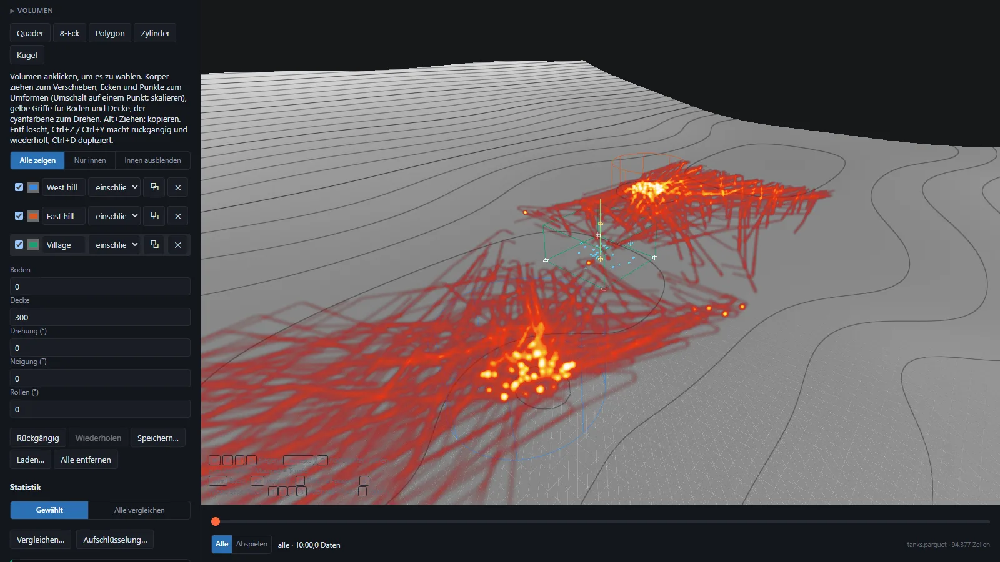
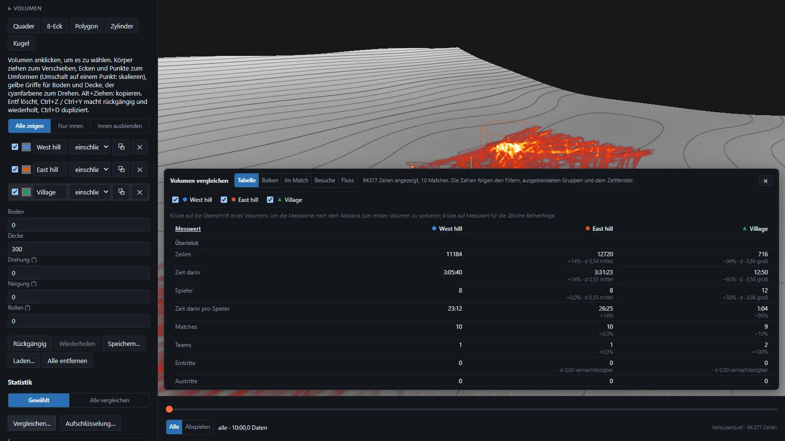
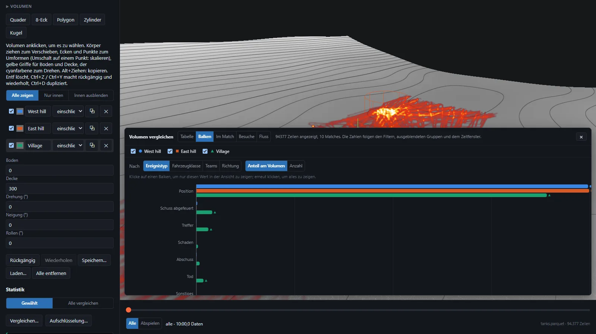

# Volumen und Vergleich

Ein **Volumen** ist ein unsichtbarer Quader (oder Zylinder oder eine Kugel), den du um einen Ort ziehst, um zu fragen: Was ist hier passiert? Damit zählst du Abschüsse an einer Brücke, vergleichst zwei Hügel oder zeigst nur die Aktivität in einem Bereich.

```
 Draufsicht               Du zeichnest eine Form ->  der Viewer zählt,
 +------------+           was darin ist:
 |   ( A )    |            Zeilen, Spieler, Abschüsse, Zeit ...
 |        [B] |           Vergleiche A mit B, nebeneinander.
 +------------+
```



Volumen messen, was in ihnen passiert, filtern die Ansicht auf sie, exportieren ihre Zeilen und lassen sich nebeneinander vergleichen. Siehe auch das [Glossar](glossary.md) für Zeile, Person und Match.

## Ein Volumen zeichnen {#draw-a-volume}

1. Öffne **Volumen** in der Seitenleiste.
2. Wähle ein Werkzeug und zeichne in der 3D-Ansicht oder auf der 2D-Karte. Boden und Decke beginnen bei den Daten darunter. Esc bricht ab.
3. Klicke auf das Volumen, um es zu wählen; dann erscheint seine **Statistik**.

| Werkzeug | So zeichnest du |
|---|---|
| **Quader** | Ziehe ein Rechteck (Umschalt: ein Quadrat). Ein Klick setzt einen Standardquader. |
| **n-Eck** | Ziehe vom Mittelpunkt aus (Umschalt hält es regelmäßig). *Ecken* setzt n, von 3 bis 64 (Voreinstellung 8, daher lautet die Schaltfläche **8-Eck**). |
| **Polygon** | Klicke die Ecken; schließe mit Doppelklick, Enter oder einem Klick auf die erste Ecke. Rücktaste entfernt die letzte Ecke. |
| **Zylinder** | Ziehe den Radius. |
| **Kugel** | Ziehe den Radius; sie steht auf dem Boden. |

## Bearbeiten {#edit}

- Klicke auf ein Volumen, um es zu wählen. Ziehe seinen Körper, um es zu verschieben, die Ecken, um es umzuformen (Umschalt auf einer Ecke skaliert).
- Die **gelben** Griffe setzen Boden und Decke, der **türkise** Griff dreht es.
- Alt+Ziehen kopiert, Entf löscht, Strg+Z / Strg+Y machen rückgängig und wiederholen, Strg+D dupliziert. **Alle entfernen** löscht jedes Volumen.
- Genaue Werte: Boden, Decke, Drehung / Neigung / Rollen (Quader), Radius (Kugeln, Zylinder).

Jede Volumenzeile hat ein Kästchen zum Anzeigen, eine Farbe, einen Namen, **einschließen** oder **ausschließen**, Duplizieren und Löschen. Volumen werden im Browser für jeden Datensatz gespeichert, und **Speichern…** / **Laden…** schreiben und lesen eine Datei `volumes.json`.

## Die Ansicht filtern {#filter-the-view}

| Filter | Wirkung |
|---|---|
| **Alle zeigen** (Voreinstellung) | Volumen messen nur. |
| **Nur innen** | Intensität, Replay und [Trefferanalyse](hit-analysis.md) zeichnen nur, was in den eingeschlossenen Volumen und außerhalb der ausgeschlossenen liegt. |
| **Innen ausblenden** | Das Gegenteil. |

Der GPU-Filter nimmt bis zu 8 Volumen mit insgesamt 64 Umrisspunkten; ein „!“ markiert ein Volumen darüber hinaus. Statistik und Export zählen es trotzdem.

## Statistik {#statistics}

Der Bereich **Statistik** folgt den Filtern, dem Zeitfenster und den ausgeblendeten Gruppen. *Gewählt* zeigt das gewählte Volumen, *Alle vergleichen* stellt jedes Volumen nebeneinander. Er zeigt:

- **Zeilen innen (angezeigt)** und **Zeilen innen (alle Daten)**, **Spieler**, **Teams**, **Matches**, **Zeit darin**, **Eintritte / Austritte**, **Spitzenwärme**, **Mittlere Wärme**, **Volumen / Grundfläche** und ein Histogramm **Wann**;
- pro Spalte: Kategorien mit **Lift** (Anteil innen geteilt durch den Anteil in allen angezeigten Daten), und Zahlen mit Spanne, Median und dem 5.-95.-Perzentil.

**Statistik als CSV / JSON** speichert sie. **Daten innen exportieren** schreibt die Zeilen innen als CSV oder Parquet (standardmäßig *Nur die angezeigten Zeilen* an), ein Volumen oder alle, mit einer Spalte, die sagt, welches Volumen jede Zeile enthält.

## Volumen vergleichen {#compare-volumes}

Bei zwei oder mehr sichtbaren Volumen drücke **Vergleich…**.

1. Zeichne drei Volumen, zum Beispiel Westhügel, Osthügel und Dorf.
2. Drücke unter Statistik auf **Vergleich…**.
3. Unter **Tabelle** liest du bei jedem Wert den Unterschied zum ersten Volumen.
4. Wechsle zu **Balken**, um die Anteile als Balken zu sehen.



| Ansicht | Zeigt |
|---|---|
| **Tabelle** | Zeilen, Zeit darin, Spieler, Matches, Teams, Eintritte, Austritte, Besuche, Besuchsdauer, Abschüsse, Tode, Abschüsse pro Tod, Abschüsse pro Minute, Zeit pro Spieler, Wertspalten; gruppiert nach Ereignissen, Fahrzeugklasse, Spieler oder KI, Team und Blickrichtung. Jeder Wert zeigt seinen Unterschied zum ersten Volumen und eine Effektstärke (vernachlässigbar, klein, mittel, groß). Klicke auf die Überschrift eines Volumens, um nach Abstand zum ersten zu sortieren. |
| **Balken** | Anzahlen oder Anteile nach Ereignis, Klasse, Akteur, Team oder Richtung. Klicke auf einen Balken, um die Ansicht darauf zu filtern. |
| **Im Match** | Ein Diagramm pro Volumen über die Minuten des Matches: Anwesenheit, Zeilen oder Abschüsse. Klicken springt dorthin. |
| **Besuche** | Box- und Violin-Diagramme, wie lange Besuche dauern (logarithmische Skala). |
| **Fluss** | Wohin Spuren nach dem Verlassen jedes Volumens gehen: eine Übergangsmatrix oder Fluss-Bänder. |



## Tipps {#tips}

- Fang bei einem Befund an: In [Erkenntnisse](insights.md) legt **Volumen hier** einen Zylinder um den Ort des Befunds.
- **Aufschlüsselung…** öffnet die [Aufschlüsselung](breakdown.md) für das gewählte Volumen: wer und was darin am besten abschneidet.
- Die [gerichtete Intensität](directional-heat.md) kann die Richtungen innerhalb des gewählten Volumens darstellen.
- Der [Tab Fahrzeuge](hit-analysis.md#restrict-to-an-area) nutzt dieselben Volumen als Gebietsfilter.
