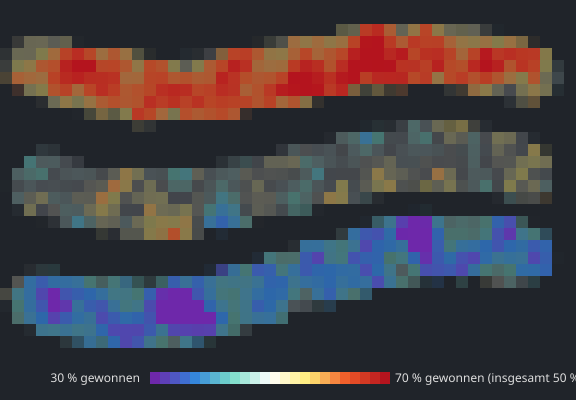

# Siegquote: wie oft ein Ort, ein Weg oder ein Spielzug gewinnt

Wo ein Spieler steht, welchen Weg er nimmt, wohin er seine Granaten wirft – und wie oft seine Seite danach die Runde gewinnt. Die **Siegquoten-Karte** färbt jeden Ort nach dem Anteil der Zeilen dort, die zu Runden gehören, die die Seite der Zeile gewonnen hat. Sie vergleicht ihn mit dem Anteil über alles Angezeigte: warm, wo er höher ist, kalt, wo er niedriger ist, nichts, wo er gleich ist.

*Das Bild zeigt erfundene Daten: drei Wege auf einem leeren Level, 68 %, 50 % und 33 % ihrer Zeilen in gewonnenen Runden.*

Dafür braucht es Daten, die sagen, wer gewonnen hat: die [Ergebnisspalten](data-formats.md#outcome-columns) (`won`, `matchWon`, `roundEndReason`). Die Konverter für CS2 und War Thunder schreiben sie; jede Datei kann sie haben.

## Ausprobieren {#try-it}

1. Lade Matches mit einer Ergebnisspalte und drücke `2` (**Differenz**).
2. Drücke in **Differenz-Aufteilung** auf **Rundensiegquote** (oder **Matchsiegquote**). Das legt die gewonnenen Runden auf **+** und die verlorenen auf **−** und schaltet das Feld auf **Anteil von +**.
3. Lies die Farben. Das Feld nennt den Gesamtanteil: *Insgesamt liegen 52,0 % von 1.200.000 Zeilen auf +.*
4. Grenze es mit den [Filtern](filters.md) ein: eine Seite (T oder CT), ein Ereignistyp (*Position* dafür, wo Leute standen, *Schuss abgefeuert* oder *Abfeuern / Abwurf* dafür, von wo sie geschossen oder geworfen haben), ein Kauf, eine Karte.

Ein Ort, der mit *Position*-Zeilen warm ist, ist ein Ort, dessen Halter meist die Runde gewonnen haben. Mit *Abschuss*-Zeilen ist es ein Ort, an dem die erzielten Abschüsse zu gewonnenen Runden geführt haben.

## Die Einstellungen {#the-settings}

| Einstellung | Was sie tut | Standard |
|---|---|---|
| **Differenz** / **Anteil von +** | die Differenz selbst oder der Anteil der +-Seite an den Zeilen beider Seiten | Differenz |
| **Volle Farbe bei** | wie weit über oder unter dem Gesamtanteil ein Ort in voller Farbe gezeigt wird, in Punkten | ± 20 Punkte |
| **Mindestzahl Zeilen für eine Farbe** | ein Ort mit weniger Zeilen wird nicht gefärbt; ab der Hälfte davon blendet er ein | 12 |
| **Zug zum Gesamtanteil (Zeilen)** | jeder Ort startet mit so vielen Zeilen beim Gesamtanteil, damit ein Ort mit 3 Zeilen, alle gewonnen, nicht als 100 % erscheint | 12 |

Alle drei wirken auf das fertige Bild: Wenn du sie ziehst, startet die Aufsummierung nie neu.

Der Anteil gilt für jede Aufteilung, nicht nur für Siege: *Anteil von +* mit einer Aufteilung nach Seite zeigt, wo die Ts den größeren Teil der Anwesenheit hatten, und mit einer Aufteilung nach den Dateien zweier Karten, wo die Zeilen der einen Datei die der anderen überwiegen.

## Zeilen, nicht Runden {#rows-not-rounds}

Die Karte zählt Zeilen. Ein Spieler, der zwanzig Sekunden an einer Stelle steht, fügt bei jeder Messung eine Zeile hinzu, alle aus einer Runde. Der Beleg an einem Ort sind also die Zeilen in seiner Nähe, nicht die Runden. Darum sind das Minimum und der Zug in Zeilen angegeben, und darum sind sie größer als eine Runde.

Für die Runden selbst:

- **[Aufschlüsselung](breakdown.md)** für eine Stelle, die Ansicht oder ein Volumen: *Siegquote %* zählt die Runde jedes Spielers einmal und zieht sie auf dieselbe Weise zur Gesamtquote des Ortes (4 Runden).
- Statistik der **[Volumen](volumes.md)**: *Siegquote* – die Runden mit einem Spieler im Volumen, jede einmal, gezogen zur Quote über alles Angezeigte, mit den Zahlen.

## Ergebnisfilter {#outcome-filters}

Das Feld [Filter](filters.md) listet die Ergebnisspalten gleich nach den eigenen Spalten des Viewers: **Rundenergebnis** und **Matchergebnis** (*Alle*, *Gewonnen*, *Verloren*) und **Wie die Runde endete** (Eliminierung, Bombe explodiert, Bombe entschärft, Zeit abgelaufen, Aufgabe, Unentschieden, Ziel, Zonen gehalten, Tickets verloren, Alle Fahrzeuge verloren), in der Sprache des Viewers.

## Für Entwickler {#for-developers}

Der Heat-Durchgang schreibt drei Summen in das Vierkanal-Ziel, das die Team-Intensität nutzt: die Intensität `R = Σ|v|`, die Intensität der +-Seite `P` und `S = Σ v²/w`, wobei `w` das Gewicht des Durchgangs ist (Stichprobengewicht mal Frame-Verstärkung). Das Compositing liest den Anteil `P/R` (ein kerngewichteter Mittelwert) und die Zeilen, auf denen er beruht, `n = R²/S` (Kishs effektive Stichprobengröße). Es zieht den Anteil zum Gesamtanteil, `p = (n·P/R + m·r0)/(n + m)`, und färbt `p - r0` über die Spanne auf den Differenz-Farbverläufen.

`n` kürzt jeden Faktor heraus, den alle Zeilen an einem Pixel gemeinsam haben – die Frame-Verstärkung, das Stichprobengewicht, das Flächengewicht eines begrenzten Sprites. So ist das Bild bei jedem Zoom und jeder Stichprobendichte gleich, und Frames aus jeder k-ten Zeile fügen sich zum Ganzen, ohne dass die Farben springen. Der Gesamtanteil kommt aus den Seitenzählungen der CPU, auf Zehntelprozent genau; nichts wird von der GPU zurückgelesen. Die Rechnung und ihre Prüfungen: [`render/rateMap.ts`](https://github.com/Holdi601/3DHeat/blob/main/src/render/rateMap.ts) und sein Test.

Es kostet so viel wie die Team-Intensität: Das Vierkanal-Ziel vervierfacht die Blend-Bandbreite des Heat-Durchgangs, nur solange *Anteil von +* an ist.
