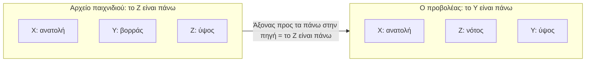

# Άξονες, μονάδες και χρόνος

Τα παιχνίδια και οι χάρτες δεν συμφωνούν για το ποια κατεύθυνση είναι πάνω, πόσο μεγάλη είναι μια μονάδα, ή πώς γράφεται ο χρόνος. Αυτή η σελίδα δείχνει τις τρεις ρυθμίσεις που κάνουν τα δεδομένα σας να στέκονται, να έχουν σωστή κλίμακα και να παίζουν σωστά.

Αν ο χάρτης σας στέκεται σαν τοίχος αντί να είναι ξαπλωμένος σαν δάπεδο, αλλάξτε τον **Άξονα προς τα πάνω στην πηγή**.

Με λάθος **Άξονα προς τα πάνω στην πηγή** ο χάρτης στέκεται σαν τοίχος· με τον σωστό είναι ξαπλωμένος σαν δάπεδο.

## Ο κόσμος στον οποίο σχεδιάζει ο προβολέας {#the-world-the-viewer-draws-in}

Ο κόσμος του προβολέα είναι **Y προς τα πάνω**: τα X και Z είναι το επίπεδο του εδάφους, το Y είναι το ύψος. Οι περισσότερες μηχανές παιχνιδιών είναι **Z προς τα πάνω**: για αυτές τα X και Y είναι το έδαφος και το Z είναι το ύψος. Κάποιες μηχανές είναι επίσης καθρεφτισμένες (αριστερόστροφες). Η αντιστοίχιση λέει πώς οι άξονες του αρχείου μετατρέπονται σε εκείνους του προβολέα. (Τεχνικά ο προβολέας είναι δεξιόστροφος, η σύμβαση του three.js.)

### Άξονας προς τα πάνω {#up-axis}

**Άξονας προς τα πάνω στην πηγή** στην [Αντιστοίχιση στηλών](column-mapping.md):

| Ρύθμιση | Το αρχείο (x, y, z) γίνεται κόσμος (X, Y, Z) |
|---|---|
| *Το Z είναι πάνω (οι περισσότερες μηχανές παιχνιδιών)* - η προεπιλογή | (x, **z**, **y**): το Z του αρχείου γίνεται ύψος και το Y του αρχείου γίνεται το Z του κόσμου |
| *Το Y είναι πάνω (σύμβαση γραφικών)* | (x, y, z) αμετάβλητο |

Για δεδομένα με Z προς τα πάνω, οι τρεις πίνακες ξαναονομάζονται αντί να αντιγράφονται ([`remapAxesInPlace`](https://github.com/Holdi601/3DHeat/blob/main/src/data/ingest.ts)), κάτι που εξοικονομεί εκατοντάδες megabytes σε μεγάλες φορτώσεις. Η εκτίμηση γίνεται από το δείγμα: όποια από τις στήλες Y και Z έχει μικρότερη διασπορά είναι το πάνω.

### Αντιστροφές {#flips}

Τα **Αντιστροφή X**, **Αντιστροφή Y**, **Αντιστροφή Z** αρνούνται τον *άξονα του αρχείου* με αυτό το όνομα, πριν την ξαναονομασία - οπότε με Z προς τα πάνω, η *Αντιστροφή Y* αρνείται ό,τι καταλήγει ως Z του κόσμου. Η αντιστροφή αλλάζει τα φορτωμένα δεδομένα: οι συντεταγμένες που δείχνουν ο [χάρακας](measure.md), η τομή και η θέση της κάμερας είναι οι αντεστραμμένες.

Για να σχεδιάσετε έναν καθρεφτισμένο κόσμο με τη σωστή φορά **χωρίς** να αλλάξετε τα δεδομένα, χρησιμοποιήστε αντί γι' αυτό **Κάμερα και σκηνή → Αντιστροφή άξονα κόσμου** ([Κάμερα](camera.md#invert-world-axis)). Είναι η καλύτερη επιλογή για παιχνίδια των οποίων ο κόσμος είναι αριστερόστροφος, επειδή κάθε συντεταγμένη που δείχνουν τα εργαλεία μένει ίδια με του παιχνιδιού.

### Κλίμακα μονάδας {#unit-scale}

Η **Κλίμακα μονάδας** πολλαπλασιάζει κάθε θέση. Το *1 (m)* βάζει 1, το *0,01 (cm→m)* βάζει 0,01 (οι μονάδες του Unreal Engine είναι εκατοστόμετρα, γι' αυτό χρησιμοποιήστε 0,01· οι μονάδες της μηχανής Source είναι ίντσες, γι' αυτό χρησιμοποιήστε 0,0254· καμία από τις δύο δεν είναι μέτρα), και το πλαίσιο δέχεται οποιαδήποτε τιμή. Ένα πληκτρολογημένο 0 ή μια τιμή που δεν είναι αριθμός αντικαθίσταται με 1.

Ο προβολέας γράφει τις αποστάσεις σε μέτρα (ακτίνα sprite, όρια αποκοπής, χάρακας, ταχύτητα πτήσης), κάτι που ισχύει μόνο όταν η κλιμακωμένη μονάδα του κόσμου είναι μέτρο. Τίποτα δεν χαλάει όταν δεν ισχύει· απλώς οι ετικέτες γράφουν "m" για ό,τι είναι η μονάδα.

## Χρόνος {#time}

### Μονάδες χρόνου {#time-units}

Κανόνας του αντίχειρα: τιμές όπως 17000000000 (δέκα ή περισσότερα ψηφία) είναι χρονική σήμανση Unix· τιμές όπως 0, 0,25, 0,5 είναι δευτερόλεπτα από την αρχή.

| Μονάδα χρόνου (ετικέτα μενού) | Διαβάζεται ως | Εμφανίζεται ώρα ρολογιού |
|---|---|---|
| *Δευτερόλεπτα (σχετικός)* | τιμή × 1 s | όχι |
| *Χιλιοστά του δευτερολέπτου (σχετικός)* | τιμή × 0,001 s | όχι |
| *Μικροδευτερόλεπτα (σχετικός)* | τιμή × 10^-6 s | όχι |
| *Νανοδευτερόλεπτα (σχετικός)* | τιμή × 10^-9 s | όχι |
| *Χρονική σήμανση Unix (s)* | δευτερόλεπτα από 1970-01-01 UTC | ναι |
| *Χρονική σήμανση Unix (ms)* | χιλιοστά του δευτερολέπτου από 1970-01-01 UTC | ναι |
| *Συμβολοσειρά ημερομηνίας ISO-8601* | κείμενο όπως `2026-03-14T18:02:11.250Z`, αναλύεται με το `Date.parse` του προγράμματος περιήγησης | ναι |

Με μια απόλυτη μονάδα (τις τρεις τελευταίες) το σύνολο δεδομένων κρατά τη στιγμή του ρολογιού της πρώτης εγγραφής του, και η χρονολογική γραμμή δείχνει δίπλα στον δείκτη την τρέχουσα ώρα UTC της ημέρας (`HH:MM:SSZ`).

Οι στήλες **`TIMESTAMP` και `DATE` του Parquet** αποκωδικοποιούνται σε πραγματικές στιγμές, οπότε η ρύθμιση μονάδας αγνοείται και το πλαίσιο το λέει. Μια στήλη `DATE` είναι μια ολόκληρη ημέρα: κάθε εγγραφή μιας ημέρας μοιράζεται μία στιγμή και η αναπαραγωγή πηδάει μία ημέρα κάθε φορά, κάτι που προειδοποιεί το πλαίσιο.

**Οι συμβολοσειρές ISO-8601 δουλεύουν σε CSV και Parquet με τον ίδιο τρόπο.** Μια στήλη χρόνου κειμένου με τη μονάδα ISO αναλύεται μία φορά για κάθε διαφορετική συμβολοσειρά· αν καμία δεν αναλύεται, η φόρτωση αποτυγχάνει με το μήνυμα *No parseable ISO-8601 timestamps in the mapped time column.* - και η αντιστοίχιση ήδη αρνείται να ξεκινήσει όταν καμία από τις δειγματοληπτούμενες τιμές δεν αναλύεται. Μια στήλη `TIMESTAMP` του Parquet διαβάζεται ως χρονική σήμανση όποια μονάδα κι αν έχει οριστεί, και μια αριθμητική στήλη Parquet με τη μονάδα ISO διαβάζεται ως χιλιοστά Unix. Μια στήλη χρόνου κειμένου με αριθμητική μονάδα απορρίπτεται πριν τη φόρτωση: κάθε τιμή θα διαβαζόταν ως NaN.

### Πώς αποθηκεύεται ο χρόνος {#how-time-is-stored}

Ενώ τα αρχεία συγχωνεύονται, οι χρόνοι είναι 64 bit δευτερόλεπτα, ώστε μια απόλυτη εποχή να κρατά τη λεπτομέρεια του κλάσματος του δευτερολέπτου. Όταν έχουν έρθει όλα τα αρχεία, ο πιο πρώιμος χρόνος όλης της επιλογής γίνεται 0 και κάθε εγγραφή αποθηκεύει δευτερόλεπτα 32 bit από αυτόν. Ένας κινητής υποδιαστολής 32 bit έχει 24 bit για τη μαντίσσα: διάρκειες έως περίπου μία ημέρα και μισή αναλύονται καλύτερα από 1/100 του δευτερολέπτου, διάρκειες έξι μηνών περίπου σε ένα δευτερόλεπτο. Μια εγγραφή της οποίας ο χρόνος λείπει ή δεν είναι αριθμός τοποθετείται στο 0, την αρχή.

Οι εγγραφές ταξινομούνται έπειτα κατά χρόνο, και αυτό κάνει τη χρονολογική γραμμή φθηνή: ένα παράθυρο χρόνου βρίσκεται με δύο δυαδικές αναζητήσεις (δείτε [Δειγματοληψία και προϋπολογισμοί](sampling-and-budgets.md)).

### Παρελθών χρόνος έναντι ώρας ρολογιού {#elapsed-time-versus-wall-clock}

Μια στήλη χρόνου όπως το `match_time` ή το `round_time` μετράει από την αρχή του κάθε αγώνα. Όταν τη διαλέξετε, κάθε αγώνας μπαίνει σε έναν κοινό άξονα - καλό για να συγκρίνετε τι συμβαίνει στο 3ο λεπτό κάθε αγώνα - και το πλαίσιο το επισημαίνει. Μια στήλη ώρας ρολογιού δείχνει τους αγώνες με τη σειρά που έγιναν πραγματικά, με επικάλυψη όπου επικαλύφθηκαν.

## Κατεύθυνση βλέμματος {#look-direction}

Η κατεύθυνση βλέμματος χρησιμοποιείται μόνο από την [αναπαραγωγή κουτιού](box-replay.md) (οι ακτίνες από κάθε κουτί). Αποθηκεύεται ως δύο γωνίες, yaw και pitch, σε ακτίνια.

- Οι **στήλες yaw / pitch** διαβάζονται όπως είναι, μετατρέπονται από μοίρες αν έχει επιλεγεί *Μοίρες*. Δεν προσαρμόζονται για τον άξονα προς τα πάνω ή τις αντιστροφές.
- Οι **στήλες διανύσματος κατεύθυνσης** περνούν από την ίδια ξαναονομασία και αντιστροφές με τις θέσεις, και μετά γίνονται yaw = atan2(x, -z) και pitch = atan2(y, √(x² + z²)) στους άξονες του κόσμου, ώστε η ακτίνα να δείχνει εκεί που κοιτάζει το κουτί και σε έναν καθρεφτισμένο κόσμο πηγής.

Αν οι στήλες yaw/pitch δείχνουν λάθος φορά μετά από αντιστροφή, διάνυσμα κατεύθυνσης ή προσαρμοσμένες γωνίες, η λύση είναι το διάνυσμα κατεύθυνσης.
