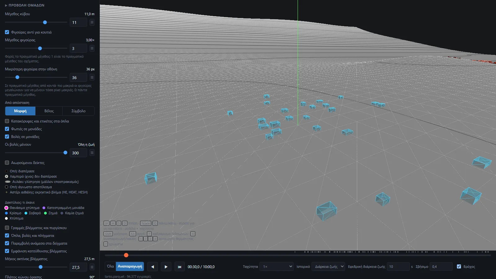

# Επικάλυψη φιγούρων (αναπαραγωγή κουτιού)

Μια μικρή ταινία: μία φιγούρα για κάθε άτομο, που κινείται καθώς περνά ο χρόνος, με ένα ίχνος πίσω της.

Η λειτουργία λέγεται **Επικάλυψη φιγούρων** στη γραμμή λειτουργιών. Αυτή η σελίδα παλιά λεγόταν «αναπαραγωγή κουτιού», επειδή πριν υπάρξουν φιγούρες κάθε άτομο ήταν ένα κουτί· οι όροι «αναπαραγωγή φιγούρας» και «αναπαραγωγή κουτιού» σημαίνουν το ίδιο. Η **Επικάλυψη φιγούρων** δεν έχει πλήκτρο αριθμού: επιλέξτε την από τη γραμμή λειτουργιών. Σχεδιάζει μία φιγούρα (ή κουτί) για κάθε [άτομο](glossary.md), που κινείται κατά μήκος της [χρονολογικής γραμμής](timeline.md), με προαιρετικές ακτίνες βλέμματος και ίχνη. Είναι αναπαραγωγή και όχι πυκνότητα: *ποιος ήταν πού, πότε*. Χρειάζεται στήλη ατόμου· χωρίς στήλη χρόνου, κάθε δείγμα σχεδιάζεται ταυτόχρονα.

## Πώς να τη χρησιμοποιήσετε {#how-to-use-it}

1. Φορτώστε δεδομένα με στήλη ατόμου και στήλη χρόνου.
2. Επιλέξτε **Επικάλυψη φιγούρων** στη γραμμή λειτουργιών.
3. Βάλτε τη χρονολογική γραμμή σε **Αναπαραγωγή** και πατήστε αναπαραγωγή (`K`).
4. Ανοίξτε την **Προβολή ομάδων** για να αλλάξετε το **Μήκος ίχνους**, το μέγεθος των φιγούρων ή τις ακτίνες βλέμματος.

Σε αυτή τη λειτουργία δεν σχεδιάζεται θερμότητα, και ο προσαρμοστικός προϋπολογισμός sprites είναι ανενεργός.

Από προεπιλογή κάθε άτομο σχεδιάζεται ως η φιγούρα του τι είναι και όχι ως κουτί - δείτε τις [Φιγούρες](figures.md) για το ποια φιγούρα παίρνει κάθε μονάδα, και την [Αναπαραγωγή αγώνα](match-replay.md) για τις ετικέτες, την κάμερα παρακολούθησης, τη μέτρηση ανάμεσα σε δύο μονάδες και τη λίστα συμβάντων.

## Το πάνελ Προβολή ομάδων {#the-team-viewer-panel}

Εμφανίζεται στη θέση των πάνελ θερμότητας σε αυτή τη λειτουργία.

| Χειριστήριο | Προεπιλογή | Εύρος (τροχός) | Σημασία |
|---|---|---|---|
| **Φιγούρες αντί για κουτιά** | ενεργό | | Κάθε άτομο ως η φιγούρα του τι είναι: ένας στρατιώτης στο πεζό, το τανκ ή το αεροσκάφος που ονομάζουν τα δεδομένα. Ό,τι τα δεδομένα δεν λένε μένει κουτί. |
| **Μέγεθος φιγούρας** | 1× | | Το 1× είναι το πραγματικό μέγεθος. |
| **Μικρότερη φιγούρα στην οθόνη** | 36 px | 0 = πάντα πραγματικό μέγεθος | Πραγματικό μέγεθος από κοντά· πιο μακριά οι φιγούρες μεγαλώνουν ώστε να μένουν τόσα pixel μήκος. |
| **Όπλα, βολές και πλήγματα** | ενεργό | | Όπλα εν πτήσει με καπνό, ιχνηθέτες, κρούσεις, πλήγματα και θανάτους. Οι ιχνηθέτες που συνάγονται από ένα πλήγμα είναι διακεκομμένοι. |
| **Μέγεθος κύβου** | το μέγεθος της οντότητας, ή έκταση / 500, κατά τη φόρτωση | 0,05-200 m, λογαριθμικό (5000) | Μήκος ακμής κάθε κουτιού. Δείτε [μέγεθος οντότητας](sessions-persons-groups.md#entity-size). |
| **Παρεμβολή ανάμεσα στα δείγματα** | ενεργό | | Ανάμεσα σε δύο δείγματα του ίδιου ατόμου στην ίδια συνεδρία, τοποθετεί το κουτί αναλογικά ανάμεσά τους. Ποτέ πέρα από όριο συνεδρίας. |
| **Εμφάνιση κατεύθυνσης βλέμματος** | ενεργό | | Μια ακτίνα από κάθε κουτί κατά μήκος της κατεύθυνσης βλέμματος του ατόμου (χρειάζεται [στήλες βλέμματος](axes-units-and-time.md#look-direction)). |
| **Μήκος ακτίνας βλέμματος** | μέγεθος οντότητας × 4, ή έκταση / 200, κατά τη φόρτωση | 0,5-500 m, λογαριθμικό (20.000) | Εμφανίζεται όσο είναι ενεργή η κατεύθυνση βλέμματος. |
| **Μήκος ίχνους** | 8 s | 0-300 s (86.400)· 0 = ανενεργό | Δευτερόλεπτα ιστορικού που σχεδιάζονται πίσω από κάθε άτομο. |
| **Σχεδίαση κάθε ακατέργαστου δείγματος** | ανενεργό | | Ένα κουτί για κάθε αποθηκευμένο δείγμα στο παράθυρο, αντί για ένα παρεμβεβλημένο κουτί ανά άτομο. Υποδειγματοληπτείται ώστε να μένει διαδραστικό. |

Οι υποδείξεις στο πάνελ εξηγούν ότι η παρεμβολή και τα ίχνη ενώνουν δείγματα μόνο μέσα σε μία συνεδρία και, όταν η φόρτωση έχει [κοινά ονόματα](sessions-persons-groups.md#names-worn-by-several-things-at-once), πόσα ονόματα σχεδιάζονται ως μεμονωμένα δείγματα.

## Η συνεδρία που παίζεται {#the-session-being-played}

Με στήλη συνεδρίας, ο επιλογέας **Συνεδρία** στην πάνω μεριά της πλαϊνής στήλης ([Συνεδρίες](sessions-persons-groups.md#the-session-picker)) αποφασίζει ποιος αγώνας αναπαράγεται. Επιλέγεται στη φόρτωση αυτός με τη μεγαλύτερη δραστηριότητα. Μόνο οι γραμμές αυτής της συνεδρίας γίνονται κουτιά και ίχνη, και η χρονολογική γραμμή τρέχει στο εύρος της συνεδρίας αντί για ολόκληρο το σύνολο. Το *Όλες οι συνεδρίες* παίζει όλες τις συνεδρίες ταυτόχρονα, πάντα χωρίς να ενώνει δείγματα ανάμεσα σε συνεδρίες.

## Τι σχεδιάζεται και πότε {#what-is-drawn-when}

Από το [`TrackCursor`](https://github.com/Holdi601/3DHeat/blob/main/src/data/tracks.ts):

**Ζωντανά κουτιά** (λειτουργία Αναπαραγωγή, χωρίς ακατέργαστα δείγματα). Για κάθε ορατό άτομο, το τελευταίο του δείγμα στο ή πριν από τον δείκτη:

- Αν το άτομο έχει επόμενο δείγμα, είναι στην ίδια συνεδρία και το όνομα δεν είναι κοινό, το κουτί τοποθετείται ανάμεσα στα δύο δείγματα αναλογικά με τον χρόνο, με το yaw να παρεμβάλλεται από τη μικρότερη διαδρομή και το pitch γραμμικά (όταν η *Παρεμβολή* είναι ενεργή).
- Αλλιώς το κουτί μένει στο τελευταίο δείγμα για τη **Εφεδρική διάρκεια ζωής** της χρονολογικής γραμμής (προεπιλογή 10 s) και μετά αφαιρείται, ώστε οι αποκλεισμένοι παίκτες να μην μένουν.

Η **λειτουργία Όλα** αγνοεί τον δείκτη και σχεδιάζει κάθε δείγμα στο εύρος ως κουτί.

Τα **ακατέργαστα δείγματα** σχεδιάζουν ένα κουτί για κάθε αποθηκευμένο δείγμα στο παράθυρο: το *Εύρος* με το ιστορικό *Παράθυρο*, αλλιώς όλα μέχρι τον δείκτη. Το πολύ 65.536 κουτιά· με περισσότερα δείγματα, σχεδιάζεται κάθε *k*-οστό.

**Ίχνη** (όταν το μήκος ίχνους είναι πάνω από 0 και τα ακατέργαστα δείγματα δεν σχεδιάζονται): μια γραμμή ανάμεσα σε κάθε ζεύγος διαδοχικών δειγμάτων ενός ατόμου μέσα στα τελευταία *μήκος ίχνους* δευτερόλεπτα μέχρι τον δείκτη, που ξεθωριάζει από 80% αδιαφάνεια σε διαφάνεια με την ηλικία. Ένα ίχνος σταματά σε αλλαγή συνεδρίας και δεν σχεδιάζεται για κοινά ονόματα. Το πολύ 131.072 κορυφές· με περισσότερες, οι γραμμές παραλείπονται ομοιόμορφα.

**Ποιος είναι ορατός:** ένα άτομο κρύβεται όταν η ομάδα του είναι απενεργοποιημένη στη [λίστα ομάδων](teams-list.md) (η ομάδα του είναι εκείνη της πρώτης του γραμμής), όταν ένα φίλτρο ομάδας το αποκλείει, ή όταν το πάνελ [Οντότητες](entities.md) έχει επιλογή που δεν το περιλαμβάνει. Τα [φίλτρα](filters.md) στηλών δεν ισχύουν για τα κουτιά.

## Χρώματα {#colours}

Μία οικογένεια αποχρώσεων ανά ομάδα και μία απόχρωση ανά μέλος, ώστε με μια ματιά να βλέπετε σε ποια πλευρά είναι κάποιος ([`teamMemberColor`](https://github.com/Holdi601/3DHeat/blob/main/src/render/colors.ts)). Οι αποχρώσεις των ομάδων κυκλώνουν σε μια σταθερή λίστα δέκα - μπλε, κόκκινο, πράσινο, κεχριμπαρί, βιολετί, κυανό, ματζέντα, λαχανί, πορτοκαλί, indigo - και τα μέλη μιας ομάδας απλώνονται στη φωτεινότητα 42-76% και στον κορεσμό 90-65%.

## Σημειώσεις {#notes}

- Η επικάλυψη φιγούρων ξαναχτίζει τις φιγούρες της μόνο όταν αλλάζει κάτι· ένα αδρανές καρέ ξαναζωγραφίζει τις τελευταίες.
- Η γραμμή *Κύβοι* της [εμφάνισης στατιστικών](performance-and-stats.md) μετράει τα κουτιά στην οθόνη.
- Η επικάλυψη φιγούρων σχεδιάζεται στην ίδια σκηνή με το επίπεδο, οπότε το [βάθος πεδίου](camera.md#depth-of-field) θολώνει τα κουτιά αλλά ποτέ τη θερμότητα.
