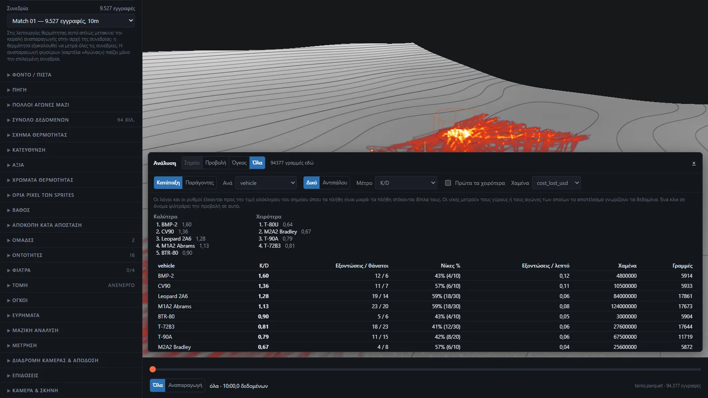
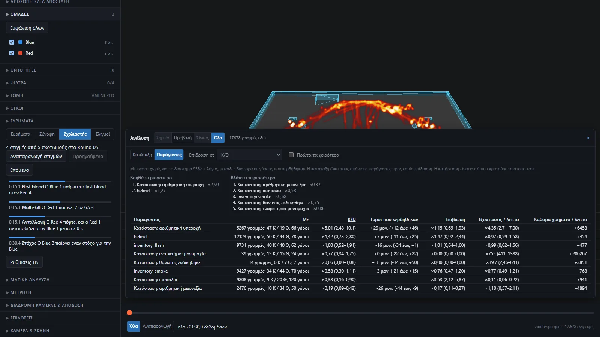

# Ανάλυση: ποιος και τι τα πάει καλύτερα πού

Η **Ανάλυση** απαντά σε μία ερώτηση: σε αυτό το σημείο, ποιο όχημα, παίκτης ή όπλο τα πάει καλύτερα; Χρησιμοποιήστε την για να βρείτε το τανκ που νικά στη γέφυρα, ή για να δείτε αν το κράνος βοηθά πραγματικά.

Κατατάσσει ό,τι συμβαίνει σε ένα μέρος (ένα επιλεγμένο σημείο, η προβολή, ένας όγκος ή όλα όσα εμφανίζονται) με οποιαδήποτε κατηγορία, και μετράει κάθε παράγοντα κατάστασης με και χωρίς αυτόν.

## Δοκιμάστε το {#try-it}

1. Φορτώστε έναν αγώνα με φόνους και θανάτους, και ανοίξτε τους **Όγκους**.
2. Σχεδιάστε έναν όγκο γύρω από το μέρος που σας ενδιαφέρει και επιλέξτε τον.
3. Πατήστε **Ανάλυση...** κάτω από τα Στατιστικά.
4. Στο **Ανά**, διαλέξτε *Όχημα*, και διαλέξτε το μέτρο *K/D* (φόνοι ανά θάνατο).
5. Διαβάστε τη λίστα, με τον καλύτερο πρώτο. Πατήστε **Πρώτα τα χειρότερα** για να την αντιστρέψετε. Κάντε κλικ σε ένα όνομα για να φιλτράρετε την προβολή σε αυτό· κάντε ξανά κλικ για να το αφήσετε.

## Ανοίξτε το {#open-it}

| Από | Περιοχή με την οποία ξεκινά |
| --- | --- |
| **Ανάλυση...** στους [Όγκους](volumes.md) (Στατιστικά) | ο επιλεγμένος όγκος |
| **Ανάλυση εδώ** στην κάρτα επιλογής, αφού κάνετε κλικ σε ένα σημείο | μια σφαίρα γύρω από αυτό το σημείο (**Ακτίνα**, προεπιλογή 3% του μεγέθους των δεδομένων) |
| το πάνελ διαχωρισμού **Διαφορά** | η προβολή |

Η κεφαλίδα αλλάζει την περιοχή: **Σημείο**, **Προβολή** (ό,τι είδε η κάμερα στην τελευταία καταμέτρηση· **Νέα καταμέτρηση** μετά από μετακίνηση), **Όγκος** (διαλέξτε έναν) ή **Όλα**. Η καταμέτρηση γίνεται στο παρασκήνιο· η γραμμή κατάστασης λέει πόσες εγγραφές έχει η περιοχή.

## Κατάταξη {#ranking}

Διαλέξτε με τι κατατάσσετε και ένα μέτρο:

| Μέτρο | Τι είναι |
| --- | --- |
| A, B | εγγραφές σε κάθε πλευρά του χάρτη διαφοράς, χωρισμένες όπως τις χωρίζει η θερμότητα |
| A / B, A - B, A / (A + B) | τα δύο στρώματα το ένα απέναντι στο άλλο |
| K/D | φόνοι απέναντι σε θανάτους |
| Ποσοστό νικών | γύροι (ή αγώνες) που κερδήθηκαν, όπου τα δεδομένα λένε ποιος νίκησε |
| Φόνοι / λεπτό | φόνοι ανά λεπτό παρουσίας (τα κενά των δειγμάτων κίνησης) |
| Κερδισμένα, Χαμένα, Καθαρά χρήματα | αθροίσματα των στηλών `earn_*` και `cost_*`· ένας επιλογέας διαλέγει το νόμισμα |

Φόνοι, θάνατοι, παρουσία, νίκες και χρήματα μετράνε κάθε εγγραφή που δείχνει η προβολή στο μέρος, είτε στη μία είτε στην άλλη πλευρά του διαχωρισμού είτε σε καμία.

Οι λόγοι και οι ρυθμοί τραβιούνται προς την τιμή ολόκληρου του μέρους όταν τα πλήθη είναι μικρά, ώστε 2 φόνοι σε 1 ζωή να μην ανεβάζουν τον πρώτο. Τα πλήθη δείχνονται δίπλα τους.

Μπορείτε να κατατάξετε κατά ομάδες, παίκτες και αγώνες, οποιαδήποτε στήλη κατηγορίας (όχημα, όπλο, πλευρά, τύπος αγοράς, πράκτορας ή κιτ), οποιαδήποτε αριθμητική στήλη σε εύρη (θωράκιση, αξία εξοπλισμού), την **κλάση** μιας στήλης όπλου (τουφέκι, ελεύθερος σκοπευτής, SMG, πιστόλι...) και πόσα κομμάτια **βοηθητικού** περιέχει μια στήλη λίστας όπως το `inventory`.

Το **Δικό** κατατάσσει με τη δική τιμή της εγγραφής. Το **Αντιπάλου** κατατάσσει με την τιμή του άλλου μέρους: το όπλο του θύματος σε φόνο, το όπλο του φονιά σε θάνατο (χρειάζεται στήλη `other` / `victim` που τους ονομάζει).

## Κατάσταση τη στιγμή εκείνη {#state-at-the-time}

Η τιμή μιας εγγραφής είναι η δική της, εκτός αν η εγγραφή δεν καταγράφει καμία (ένα γεγονός χωρίς εξοπλισμό) ή είναι θάνατος (του οποίου η στήλη όπλου μπορεί να ονομάζει το όπλο του φονιά)· τότε είναι ό,τι κουβαλούσε τελευταία φορά νωρίτερα στον αγώνα το ίδιο άτομο.

## Παράγοντες: με έναντι χωρίς {#factors-with-against-without}

Αλλάξτε από **Κατάταξη** σε **Παράγοντες**, διαλέξτε **Επίδραση σε**, και διαβάστε το *Βοηθά περισσότερο* και το *Βλάπτει περισσότερο*:

Η επίδραση κάθε παράγοντα στο K/D, στους νικημένους γύρους, στην επιβίωση (λεπτά ανά θάνατο), στους φόνους ανά λεπτό και στα καθαρά χρήματα ανά λεπτό, με διάστημα εμπιστοσύνης 95%: οι λόγοι ως x, οι νικημένοι γύροι ως διαφορά σε βαθμούς. Η κατάταξη τραβά κάθε εκτίμηση προς το «καμία επίδραση» ανάλογα με την αβεβαιότητά της, οπότε ένας σπάνιος παράγοντας χρειάζεται καθαρή επίδραση για να ανέβει ψηλά· το διάστημα που φαίνεται είναι το μη τραβηγμένο.

Τα δεδομένα με γύρους προσθέτουν τις **καταστάσεις** του κοντινού αγώνα ([Κοντινός αγώνας και γύροι](close-quarters.md)), που υπολογίζονται μία φορά ανά σύνολο δεδομένων: *τυφλωμένος* (η στήλη `state_flashed` της εγγραφής, ή εχθρική λάμψη μέσα σε 15 m τα τελευταία 3 s), *θάνατος ανταποδοθείς*, *εναρκτήρια μονομαχία* και *άνδρας παραπάνω*, *ίσος αριθμός* ή *άνδρας κάτω* (παίκτες ζωντανοί στην πλευρά της εγγραφής απέναντι στον εχθρό). Ένας θάνατος μετράει στην κατάσταση στην οποία βρισκόταν το θύμα του λίγο πριν.

Το πολύ 256 παράγοντες μετρώνται σε ένα πέρασμα.

## Για προγραμματιστές {#for-developers}

### Τράβηγμα μικρών δειγμάτων {#pulling-small-samples}

Η τιμή κατάταξης είναι `(n + m*r0) / (d + m)`: τα `n` και `d` είναι τα πλήθη, το `r0` ο λόγος ολόκληρου του μέρους και το `m` το βάρος αυτής της προϋπόθεσης.

### Για συντάκτες μετατροπέων: ονομασία στηλών παραγόντων {#for-converter-authors-naming-factor-columns}

Ένας μετατροπέας προσθέτει παράγοντα ονομάζοντας τη στήλη του:

| Στήλη | Παράγοντας |
| --- | --- |
| `state_<όνομα>` αριθμός | ενεργός όσο είναι μη μηδενικός (`state_scoped`, `state_suppressor`) |
| `state_<όνομα>` κατηγορία | ένας παράγοντας για κάθε τιμή (`state_ammo` = AP, HE...) |
| `active_<όνομα>` | το ίδιο, για κάτι που ενεργοποιήθηκε ή χρησιμοποιήθηκε πρόσφατα: μια ικανότητα, ένα ultimate, ένα gadget, ένα buff (`active_ult`, `active_stim`) |
| στήλη λίστας (`inventory`, `loadout`, `perks`, `abilities`, `attachments`, `modules`, `buffs`, `debuffs`, `upgrades`, ή ένα όνομα `state_`/`active_` που τελειώνει σε `s`) | ένας παράγοντας για κάθε στοιχείο μιας τιμής `a\|b\|c` |
| σημαίες εξοπλισμού που ήδη είναι συνηθισμένες (`helmet`, `defuser`, `armor`, `scoped`, `airborne`, `duck`, `flashed`...) | ενεργές όσο είναι μη μηδενικές |
| `ammoType`, `shellType`, `ammoName` | η τελευταία βολή που εκτοξεύτηκε |

Αποτελέσματα: μια στήλη `won` 0/1 (η πλευρά της εγγραφής κέρδισε τον γύρο ή τον αγώνα) και μια στήλη `round` - οι [στήλες αποτελέσματος](data-formats.md#outcome-columns)· όπου ένα αρχείο έχει και `won` και `matchWon`, το *Νίκες %* μετρά γύρους. Χρήματα: `earn_<νόμισμα>` και `cost_<είδος>_<νόμισμα>`· ένα εισόδημα μόνο ανά είδος (`earn_round_cs2`, οι ακριβείς ανταμοιβές γύρου ενός μετατροπέα) αντικαθιστά μόνο το εισόδημα του μοντέλου κόστους για εκείνο το είδος (το `round` καλύπτει και τις τοποθετήσεις και τις απενεργοποιήσεις βομβών), και το μοντέλο εξακολουθεί να τιμολογεί τα υπόλοιπα.

Η αντιστοίχιση φορτώνει μόνη της αυτές τις στήλες δίπλα στη δική της λίστα του αρχείου: κάθε στήλη `state_*`, `active_*`, `won`, `round` και λίστας, εκτός από όσες δείχνουν τα στατιστικά ενός αρχείου Parquet ότι κρατούν μία τιμή σε όλη τη διάρκεια (κάθε φορτωμένη στήλη κοστίζει 4 bytes ανά εγγραφή).
