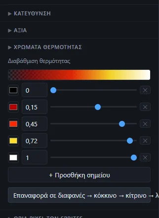

# Χρώμα και έκθεση

Αυτά τα χειριστήρια αποφασίζουν ποια ποσότητα θερμότητας παίρνει ποιο χρώμα. Το **Σημείο κορεσμού** είναι η ποσότητα θερμότητας που μετράει ως λευκό-καυτό.

## Γρήγορες διορθώσεις {#quick-fixes}

- Όλα είναι λευκά: αυξήστε το **Σημείο κορεσμού** ή πατήστε **Αυτόματη έκθεση από το πεδίο**.
- Δεν φαίνεται τίποτα: μειώστε το **Σημείο κορεσμού** ή πατήστε **Αυτόματη έκθεση από το πεδίο**.
- Φαίνονται μόνο λίγες μεμονωμένες κουκκίδες: αυξήστε την **Ελάχιστη θερμότητα**.

Κάθε χειριστήριο σε αυτή τη σελίδα ισχύει όταν η θερμότητα μετατρέπεται σε χρώμα. Όταν σύρετε οποιοδήποτε από αυτά, η εικόνα ζωγραφίζεται αμέσως από την αρχή και **δεν ξεκινά ξανά τη συσσώρευση**.

## Σημείο κορεσμού {#saturation-point}

Το **Σημείο κορεσμού** (ενότητα Σχήμα θερμότητας) είναι η συσσωρευμένη θερμότητα που αντιστοιχεί στο πάνω άκρο της κλίμακας χρωμάτων (με την απόκριση *Γραμμική*· για τις άλλες δείτε παρακάτω). Είναι λογαριθμικός ρυθμιστής 0,1-4000, και η λαβή φτάνει μέχρι 10.000.000, επειδή η συσσωρευμένη θερμότητα αυξάνεται με το πλήθος των γραμμών. Η προεπιλογή είναι 24. Σε κάθε φόρτωση γίνεται πρώτα μια **αναλυτική εκτίμηση** και μετά μέτρηση **από την εικόνα**.

Η σωστή τιμή κάνει τη διαφορά ανάμεσα σε χάρτη θερμότητας και κενή (ή λευκή) οθόνη. Δεν μπορεί να υπολογιστεί με βεβαιότητα, γιατί η τηλεμετρία συγκεντρώνεται τόσο έντονα (μια εμφάνιση, μια πόρτα, ένα σημείο στενώματος) που η σχέση μεταξύ της μέγιστης και της μέσης πυκνότητας αλλάζει κατά μία τάξη μεγέθους ανάμεσα σε σύνολα δεδομένων και ανάμεσα σε γωνίες κάμερας.

## Αυτόματη έκθεση {#auto-exposure}

Η **Αυτόματη έκθεση από το πεδίο** μετράει το πεδίο που παρήγαγε πραγματικά ο shader. Αγνοεί τα κενά pixel, παίρνει το 98ο εκατοστημόριο από τα φωτισμένα pixel και το τοποθετεί στο 85% της απόστασης προς το Σημείο κορεσμού. Έτσι το πάνω μέρος της κλίμακας μένει για τις πραγματικές κορυφές.

Η ενότητα τότε δείχνει *μετρήθηκε το X% του πλαισίου· το 98ο εκατοστημόριο R τοποθετήθηκε κοντά στο πάνω μέρος της κλίμακας*. Με την απόκριση *Κορεσμός*, μια τιμή στο 85% του Σημείου κορεσμού φτάνει περίπου στο 69% της κλίμακας και όχι στο 85%.

Τρέχει και **αυτόματα**:

- 8 καρέ μετά τη φόρτωση ενός συνόλου δεδομένων·
- 8 καρέ αφού αλλάξουν τα [φίλτρα](filters.md) (το φιλτράρισμα κάθε θέσης μέχρι τα εκατό γεγονότα αλλάζει την πυκνότητα κατά τάξεις μεγέθους);
- 8 καρέ αφού αλλάξετε από θερμότητα σημείων σε [θερμότητα γραμμής](line-heat.md), ή αλλάξετε ποιες διαδρομές σχεδιάζει η θερμότητα γραμμής. Αυτό γίνεται επειδή μια γραμμή αφήνει πολύ λιγότερη θερμότητα ανά δείγμα από ένα sprite.

Όταν δεν φωτίζεται τίποτα, η αυτόματη εκτέλεση αφήνει τον κορεσμό όπως είναι. Το κουμπί επιστρέφει στην αναλυτική εκτίμηση και γράφει *δεν φωτίζεται τίποτα για μέτρηση - χρησιμοποιήθηκε η αναλυτική εκτίμηση*.

### Ακολούθηση της προβολής {#follow-the-view}

Η **Ακολούθηση της προβολής** (ενότητα Σχήμα θερμότητας, ενεργή από προεπιλογή) μετρά ξανά κάθε φορά που η κάμερα σταματά. Έτσι μια περιοχή στην οποία πετάτε χρησιμοποιεί ολόκληρη την κλίμακα χρωμάτων και όχι την κλίμακα που μετρήθηκε για ολόκληρο τον χάρτη. Οι μικρές αλλαγές αγνοούνται και η κλίμακα αλλάζει ομαλά, χωρίς άλματα. Λειτουργεί στις τέσσερις λειτουργίες θερμότητας, όχι στην επικάλυψη φιγούρας.

Αποεπιλέξτε την για να κλειδώσετε την κλίμακα και να συγκρίνετε μέρη σε μία κοινή κλίμακα. Αν σύρετε το **Σημείο κορεσμού** με το χέρι, κλειδώνει και αυτό.

## Απόκριση πυκνότητας {#density-response}

**Απόκριση πυκνότητας** - πώς το *k* (θερμότητα / σημείο κορεσμού) αντιστοιχεί στην κλίμακα:

| Απόκριση | Τύπος | Χρήση |
|---|---|---|
| **Κορεσμός** (προεπιλογή) | t = 1 - e^(-k) | Πλησιάζει ασυμπτωτικά το πάνω μέρος της κλίμακας, όπως συμβαίνει με στοιβαγμένα διαφανή sprite. Τίποτα δεν κόβεται σε επίπεδο λευκό, γι' αυτό είναι η ασφαλής προεπιλογή για άγνωστα δεδομένα. |
| **Γραμμική** | t = k | Η μόνη αντιστοίχιση όπου ίσο χρώμα σημαίνει ίσο πλήθος. Χρησιμοποιήστε την για να συγκρίνετε δύο σύνολα δεδομένων ή δύο χρονικά διαστήματα. |
| **Λογαριθμική** | t = log₂(1 + 7k) / 3 | Συμπιέζει μια μακριά ουρά, ώστε ένα ακραίο σημείο συγκέντρωσης να μην ισοπεδώνει όλα τα άλλα στο κάτω μέρος της κλίμακας. Φωτίζει τις αραιές περιοχές. |

## Ελάχιστη θερμότητα {#minimum-heat}

Η **Ελάχιστη θερμότητα** (προεπιλογή ανενεργή, 0-100%): κάθε pixel που έχει οποιαδήποτε θερμότητα ανεβαίνει τουλάχιστον σε αυτό το σημείο της κλίμακας. Αυξήστε την και μειώστε την ακτίνα του sprite για να δείτε *πού συνέβη κάτι ποτέ*. Τα μεμονωμένα σημεία δεδομένων γίνονται έτσι καθαρά ορατά και δεν μένουν λίγο πάνω από το διαφανές. Αφήστε την ανενεργή όταν κρίνετε την πυκνότητα, γιατί ισοπεδώνει το κάτω μέρος της κλίμακας σκόπιμα. Το κατώφλι (k > 0,0001) κρατά τα πραγματικά κενά pixel κενά.

## Ο επεξεργαστής κλίμακας {#the-ramp-editor}

Στην ενότητα **Χρώματα θερμότητας**. Η ετικέτα της λέει σε τι χρησιμεύει η κλίμακα: *Διαβάθμιση θερμότητας* στο Θερμότητα και στις Γραμμές, *Θετική (προσθετικές ομάδες)* στη Διαφορά, *Διαβάθμιση αδιαφάνειας (το χρώμα έρχεται από την ομάδα)* στη [Θερμότητα ομάδων](team-heat.md), όπου χρησιμοποιείται μόνο η άλφα της.



Η μπάρα στο πάνω μέρος δείχνει προεπισκόπηση της κλίμακας. Κάτω από αυτή υπάρχει μία γραμμή για κάθε σημείο:

| Μέρος | Σημασία |
|---|---|
| Δείγμα χρώματος | Το χρώμα του σημείου (ο επιλογέας χρωμάτων του περιηγητή). |
| Αριθμός | Η θέση του σημείου στην κλίμακα, από 0 έως 1 (0 = χωρίς θερμότητα). |
| Ρυθμιστής | Η αδιαφάνεια του σημείου, 0-100%. |
| ✕ | Αφαιρεί το σημείο· είναι ανενεργό όταν μένουν μόνο δύο. |

Το **+ Προσθήκη σημείου** προσθέτει ένα σημείο στη μέση ανάμεσα στα δύο τελευταία σημεία, με το χρώμα και την αδιαφάνεια του τελευταίου. Το **Επαναφορά σε διαφανές → κόκκινο → κίτρινο → λευκό** επαναφέρει την προεπιλογή.

Τα σημεία μπορούν να δοθούν με οποιαδήποτε σειρά· ταξινομούνται όταν χτίζεται η κλίμακα. Η **άλφα** είναι αυτή που αναμειγνύει τη θερμότητα με τη σκηνή, γι' αυτό το μηδενικό άκρο της προεπιλεγμένης κλίμακας είναι πλήρως διαφανές.

### Οι προεπιλεγμένες κλίμακες {#the-default-ramps}

| Θέση | Θετική (Θερμότητα, Γραμμές, Διαφορά +) | Αρνητική (Διαφορά −) |
|---|---|---|
| 0,00 | μαύρο, άλφα 0 | μαύρο, άλφα 0 |
| 0,15 | rgb(180, 0, 0), άλφα 0,55 | rgb(0, 170, 60), άλφα 0,55 |
| 0,45 | rgb(255, 40, 0), άλφα 0,85 | rgb(0, 190, 200), άλφα 0,85 |
| 0,72 | rgb(255, 220, 40), άλφα 0,95 | rgb(40, 80, 255), άλφα 0,95 |
| 1,00 | λευκό, άλφα 1 | rgb(170, 60, 255), άλφα 1 |

## Ενώ κινείται η κάμερα {#while-the-camera-moves}

Όταν κινείται η κάμερα, η συσσώρευση ξεκινά από την αρχή σε κάθε καρέ. Με ενεργή την **Σχεδίαση κάθε εγγραφής σε κάθε καρέ** (η προεπιλογή), κάθε καρέ κίνησης παραμένει ακριβές. Με την επιλογή ανενεργή, ένα καρέ κίνησης δείχνει μία δειγματοληπτική εκτίμηση, με πιο φωτεινές, ζυγισμένες συστάδες, η οποία συγκλίνει στην ομαλότερη πραγματική εικόνα όταν σταματήσετε. Αυτό είναι αναμενόμενο· δείτε τη [Συσσώρευση](accumulation.md).

## Για προγραμματιστές {#for-developers}

### Το στάδιο σύνθεσης {#the-composite-pass}

Αφού συσσωρευτεί η θερμότητα, η τιμή κάθε pixel μετατρέπεται σε χρώμα σε ένα στάδιο σύνθεσης ([`COMPOSITE_FS`](https://github.com/Holdi601/3DHeat/blob/main/src/render/webgl2/shaders.ts)). Τα βήματα είναι:

```
k = |θερμότητα| / σημείο κορεσμού
t = απόκριση(k)                         περιορισμένο στο 0..1
if ελάχιστη θερμότητα > 0 and k > 0.0001:  t = ελάχιστη + (1 - ελάχιστη) × t
χρώμα, άλφα = κλίμακα(t)                (η αρνητική κλίμακα όταν θερμότητα < 0, μόνο στη Διαφορά)
pixel = mix(σκηνή, χρώμα, άλφα)
```

### Η αναλυτική εκτίμηση {#the-analytic-estimate}

Η **αναλυτική εκτίμηση** ([`estimateSaturation`](https://github.com/Holdi601/3DHeat/blob/main/src/data/calibrate.ts)) υποθέτει ότι οι γραμμές απλώνονται στο αποτύπωμα X-Z των δεδομένων: μέση θερμότητα = γραμμές × (π r² / εμβαδόν αποτυπώματος) × 1/3 × ένταση κέντρου (το 1/3 είναι ο μέσος όρος του δίσκου για γραμμική κλίση), επί έναν υποτιθέμενο λόγο μέγιστης προς μέση τιμή 25, περιορισμένο στο 0,1-1.000.000. Χρειάζεται μόνο να είναι μέσα σε μία τάξη μεγέθους σωστή.

### Μέτρηση {#metering}

[`exposure.ts`](https://github.com/Holdi601/3DHeat/blob/main/src/render/exposure.ts):

1. η τιμή θερμότητας διαβάζεται πίσω από την GPU, με υποδειγματοληψία έως 40.000 τιμές·
2. τα κενά pixel (θερμότητα ≤ 0,0001) απορρίπτονται· το μεγαλύτερο μέρος ενός πεδίου θερμότητας είναι κενό, και αν τα συμπεριλάβουμε στον μέσο όρο, όλα θα φαίνονταν υποεκτεθειμένα, όπως ένα φωτόμετρο κάμερας στραμμένο σε μαύρο φόντο·
3. το 98ο εκατοστημόριο των φωτισμένων pixel είναι η αναφορά·
4. το Σημείο κορεσμού γίνεται αναφορά / 0,85, έτσι η αναφορά βρίσκεται στο 85% της απόστασης προς το Σημείο κορεσμού και το πάνω μέρος της κλίμακας μένει για τις πραγματικές κορυφές.

### Ο πίνακας χρωμάτων {#the-colour-table}

Η κλίμακα ψήνεται σε πίνακα RGBA 256 × 2 (η θετική κλίμακα στην πρώτη γραμμή, η αρνητική στη δεύτερη) ([`buildColorLut`](https://github.com/Holdi601/3DHeat/blob/main/src/render/colors.ts)). Τα χρώματα παρεμβάλλονται σε γραμμικό φως και αποθηκεύονται ως sRGB· η αδιαφάνεια παρεμβάλλεται γραμμικά.
