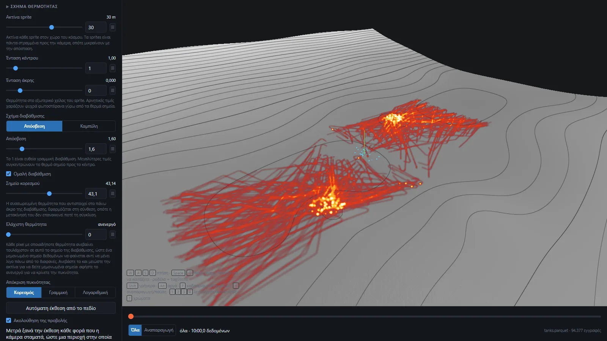
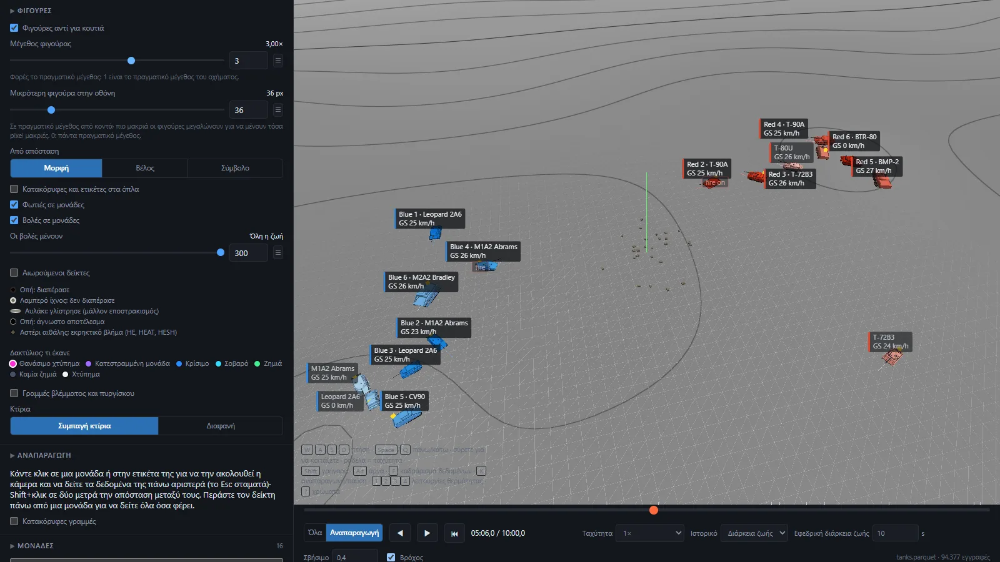

# Δεδομένα επίδειξης: δοκιμάστε τον περιηγητή σε πέντε λεπτά



Δεν έχετε ακόμα δικά σας δεδομένα; Το αποθετήριο φτιάχνει μερικά. Όλα είναι φανταστικά: μια κοιλάδα, μια αυλή και αγώνες τριών επινοημένων στυλ παιχνιδιού, με παίκτες που λέγονται *Blue 1* ή *Red 3*. Όλες οι εικόνες αυτού του ιστότοπου τραβήχτηκαν με αυτά.

## Δημιουργία {#make-it}

```bash
node tools/demo-data.mjs
```

Αυτό γράφει στο `tools/.shots/demo/`:

| Αρχείο | Τι είναι |
|---|---|
| `demo-valley.glb` | μια κοιλάδα 12 km με δύο λόφους και ένα χωριό, ως τρισδιάστατο επίπεδο |
| `demo-yard.glb` | μια τειχισμένη αυλή 160 m με κτίρια, ως τρισδιάστατο επίπεδο |
| `tanks.parquet` | 10 αγώνες τανκ, 8 εναντίον 8: κίνηση, βολές, χτυπήματα με τη θέση στο κύτος, φωτιές, σκοτωμοί, ναυάγια, στόχευση πύργου, νικητές |
| `tanks/match-NN.parquet` | οι ίδιοι αγώνες, ένα αρχείο για κάθε αγώνα, για [πολλοί αγώνες μαζί](many-matches.md) |
| `air.parquet` | μια αερομαχία 4 εναντίον 4 με πυραύλους, flares, σκοτωμούς και αστοχίες |
| `shooter.parquet` | 12 γύροι 5 εναντίον 5 πεζοί: βολές, σκοτωμοί, μια τοποθέτηση, πιστώσεις που κερδήθηκαν και δαπανήθηκαν, κράνη και εξοπλισμός |
| `mass/` | φάκελος με μικρούς αγώνες `.3dheat`, για [μαζική ανάλυση](mass-analysis.md) |
| ένα σύνολο γύρων αγώνα | δύο γύροι ενός αυτοκινήτου σε φανταστική πίστα, για την [Ανάλυση αγώνα](race-analysis.md) |

Κάθε πίνακας δηλώνει τις δικές του στήλες στο υποσέλιδό του, οπότε φορτώνεται χωρίς καμία αντιστοίχιση.

## Δοκιμάστε το {#try-it}

1. Ξεκινήστε τον περιηγητή (`start.bat` στα Windows, ή `npm install` μία φορά και μετά `npm run dev` σε οποιοδήποτε σύστημα) και ανοίξτε το `http://127.0.0.1:5273/`.
2. **Background / level → 3D model…** και επιλέξτε `demo-valley.glb`.
3. **Πηγή → Αρχεία…** και επιλέξτε `tanks.parquet`.
4. Πατήστε `F` για να πλαισιώσετε τα δεδομένα. Βλέπετε τη [θερμότητα](heat.md) δέκα αγώνων.
5. Δοκιμάστε τη γραμμή λειτουργιών: **Διαφορά** (Blue εναντίον Red), **Θερμότητα ομάδων**, **Γραμμές**.
6. Ανοίξτε τα **Ευρήματα** (στην πλαϊνή στήλη του Χάρτη θερμότητας): βρίσκουν τα σημεία όπου έγιναν πολύ περισσότερες βολές, χτυπήματα και καταστροφές απ' ό,τι αλλού, γύρω από τους δύο λόφους.
7. Ανοίξτε την καρτέλα **Αγώνας**· κάτω από **Αγώνες στην αναπαραγωγή** επιλέξτε *Match 01* και πατήστε **Αναπαραγωγή** στο χρονολόγιο: η [επανάληψη](match-replay.md).



Για τον πυροβολισμό, φορτώστε το `demo-yard.glb` και το `shooter.parquet`· για την αερομαχία, το `air.parquet` (οι φιγούρες φαίνονται ευκολότερα στο **Μέγεθος φιγούρας** 4, ένας ρυθμιστής στο panel **Προβολή ομάδων** της πλαϊνής στήλης του Χάρτη θερμότητας).

## Τα στιγμιότυπα οθόνης {#the-screenshots}

Οι εικόνες του ιστότοπου φτιάχνονται από αυτά τα δεδομένα με ένα σενάριο, σε οποιαδήποτε από τις γλώσσες του περιηγητή:

```bash
node tools/demo-data.mjs
HEAT3D_FIGURE_PACK=none npx vite --port 5321 --strictPort --host 127.0.0.1   # PowerShell: $env:HEAT3D_FIGURE_PACK="none"; npx vite ...
node tools/docs-shots.mjs --lang en
```

Ο διακομιστής στιγμιοτύπων τρέχει χωρίς τοπικό πακέτο φιγούρων, οπότε φαίνεται μόνο ο δημόσιος κατάλογος φιγούρων. Οι εικόνες πάνε στο `docs/assets/img/<lang>/`. Βλ. [Συντήρηση της τεκμηρίωσης](maintaining.md).
