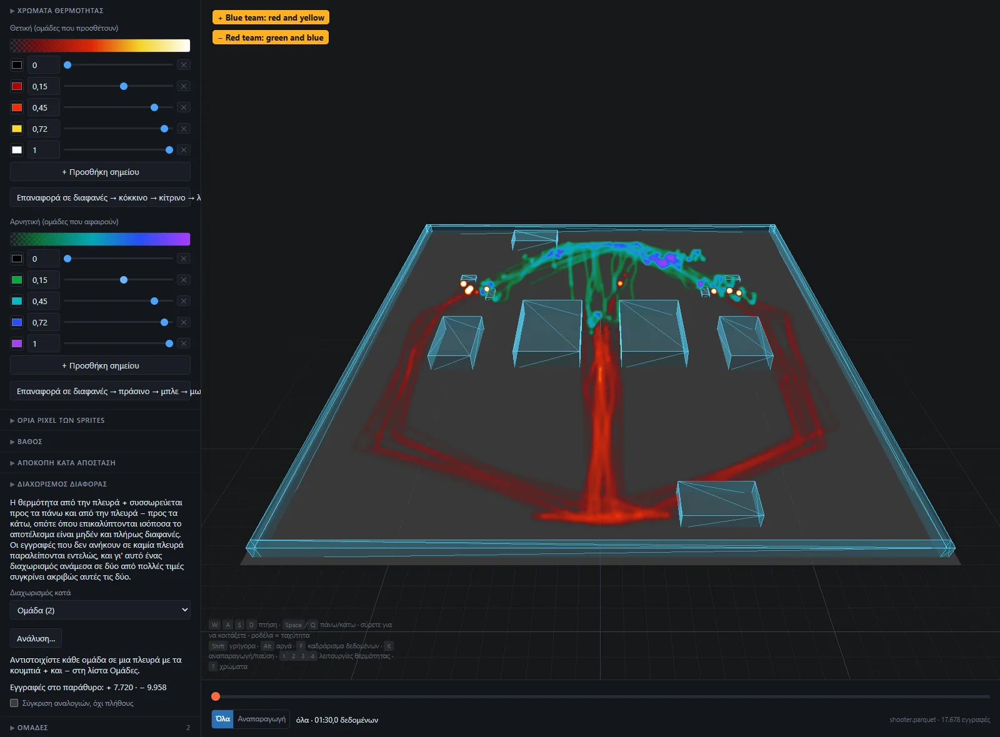

# Διαφορά

Κόκκινο όπου η ομάδα Α ήταν περισσότερη, πράσινο-μπλε όπου ήταν η ομάδα Β, τίποτα όπου ήταν ίσες.

Η **Διαφορά** (πλήκτρο 2) είναι θερμότητα με πρόσημο. Οι γραμμές του ενός πληθυσμού προσθέτουν θερμότητα· οι γραμμές του άλλου την αφαιρούν. Όπου οι δύο επικαλύπτονται ισόποσα, το αποτέλεσμα είναι μηδέν και πλήρως διαφανές· όπου ο ένας κυριαρχεί, φαίνεται στα χρώματα εκείνης της πλευράς - εξ ορισμού ζεστά (διαφανές → κόκκινο → κίτρινο → λευκό) για την πλευρά **+** και ψυχρά (διαφανές → πράσινο → μπλε → μωβ) για την πλευρά **−**.

## Πώς να το χρησιμοποιήσετε {#how-to-use-it}

1. Πατήστε `2` (ή επιλέξτε **Διαφορά** στη γραμμή λειτουργιών).
2. Ανοίξτε τον **Διαχωρισμό διαφοράς** στην πλαϊνή στήλη.
3. Επιλέξτε τι να **Διαχωρίσετε κατά**: συνήθως *Ομάδες*.
4. Βάλτε μία ομάδα (ή τιμή) στο **+** και μία άλλη στο **−**.
5. Διαβάστε τα χρώματα: το ζεστό σημαίνει την πλευρά +, το ψυχρό την πλευρά −. Το πάνελ προειδοποιεί αν μία πλευρά δεν έχει γραμμές (βλ. [Μηνύματα που μπορεί να δείτε](#messages-you-may-see)).

*Ποιες* δύο ομάδες πληθυσμού είναι όλο το ερώτημα· έτσι ο διαχωρισμός μπορεί να γίνει σε οποιαδήποτε κρατημένη στήλη, όχι μόνο σε ομάδες. Οι γραμμές που πέφτουν σε **καμία** από τις δύο πλευρές **αφήνονται έξω**, δεν μετρούν ως μηδέν: αυτό κάνει έναν διαχωρισμό πάνω από δύο από τις πολλές τιμές να συγκρίνει ακριβώς αυτές τις δύο, και συνδυάζεται με τα [φίλτρα](filters.md) - φιλτράρετε σε έναν χάρτη, και μετά διαχωρίστε αυτό ανά έκδοση.

Η λειτουργία θέλει δύο πλευρές: μια στήλη ομάδας με τουλάχιστον δύο ομάδες, ή έναν διαχωρισμό πάνω σε στήλη που κρατιέται για φιλτράρισμα. Σε δεδομένα με λιγότερες από δύο ομάδες, η φόρτωση ξεκινά με διαχωρισμό στήλης - πρώτα τη στήλη *Source file* μιας φόρτωσης πολλών αρχείων, αλλιώς την πρώτη στήλη κατηγορίας με δύο τιμές, αλλιώς την πρώτη αριθμητική στήλη με εύρος - ώστε το *σύγκριση δύο φορτώσεων* να δουλεύει και σε δεδομένα χωρίς καμία ομάδα. Μόνο δεδομένα χωρίς τίποτα από αυτά κάνουν τη λειτουργία μη διαθέσιμη· το ίδιο ισχύει για διαχωρισμό στήλης που έμεινε χωρίς τίποτα στη μία πλευρά.

## Το πάνελ Διαχωρισμός διαφοράς {#the-difference-split-panel}

Εμφανίζεται στη λειτουργία Διαφορά, κάτω από τα πάνελ θερμότητας.

Το **Διαχωρισμός κατά** προσφέρει:

| Επιλογή | Εμφανίζεται ως | Κανόνας διαχωρισμού |
|---|---|---|
| Ομάδες | *Ομάδα (N)* (όταν υπάρχει στήλη ομάδας) | Κάθε ομάδα στο +, το − ή σε καμία, όπως ορίζεται στη [Λίστα ομάδων](teams-list.md) |
| Μια στήλη κατηγορίας | *στήλη (N τιμές)* | Τιμές στο +, στο − ή σε καμία |
| Μια αριθμητική στήλη | *στήλη (αριθμητική)* | Ένα εύρος τιμών για κάθε πλευρά |
| Το αρχείο προέλευσης | *Source file - σύγκριση δύο φορτώσεων* (όταν φορτώθηκαν πολλά αρχεία) | Αρχεία στο +, στο − ή σε καμία |

Προσφέρονται μόνο στήλες που κρατήθηκαν με το *Κράτηση για φιλτράρισμα* κατά τη φόρτωση.

### Σύγκριση αναλογιών, όχι πλήθους {#compare-shares-not-counts}

Το **Σύγκριση αναλογιών, όχι πλήθους** (προεπιλογή ανενεργό) σταθμίζει κάθε πλευρά με ένα διά το δικό της πλήθος γραμμών, ώστε μια πλευρά με πενταπλάσιες γραμμές να μην κερδίζει μόνο από τους αριθμούς. Το χρώμα δείχνει τότε πού κάθε πλευρά είναι αναλογικά πιο συχνή από την άλλη. Χρησιμοποιήστε το όταν οι δύο πλευρές έχουν πολύ διαφορετικό όγκο δεδομένων, για παράδειγμα δύο συνεδρίες διαφορετικής διάρκειας.

### Μηνύματα που μπορεί να δείτε {#messages-you-may-see}

Το πάνελ προειδοποιεί όταν η εικόνα δεν είναι πραγματική διαφορά:

| Μήνυμα | Σημασία |
|---|---|
| *N + / M −* (ή *N + / M − / K αχρησιμοποίητες*) | Πόσες τιμές είναι σε κάθε πλευρά (και σε καμία). |
| Καμία γραμμή στο παράθυρο δεν είναι στην πλευρά **+** | Σχεδιάζεται μόνο η πλευρά **−**. Μετακινήστε το παράθυρο της χρονογραμμής ή αλλάξτε τον διαχωρισμό. |
| Καμία γραμμή στο παράθυρο δεν είναι στην πλευρά **−** | Σχεδιάζεται μόνο η πλευρά **+**. |
| Καμία τιμή δεν είναι σε καμία πλευρά | Η διαφορά δεν σχεδιάζει τίποτα. Βάλτε τουλάχιστον μία τιμή στο **+** ή στο **−**. |
| *στήλη* δεν μπορεί να διαχωριστεί έτσι | Η επιλεγμένη στήλη δεν ταιριάζει στον διαχωρισμό. Επιλέξτε ξανά τη στήλη. |
| Η στήλη διαχωρισμού δεν χώρεσε στη μνήμη της κάρτας γραφικών για N από M κομμάτια | Αυτές οι γραμμές δεν σχεδιάζονται. Αυξήστε τον προϋπολογισμό της GPU στο Απόδοση → Προϋπολογισμοί πόρων, ή φορτώστε λιγότερες γραμμές. |

### Ανά ομάδα {#by-group}

Το πάνελ απλώς δείχνει στη [Λίστα ομάδων](teams-list.md), όπου κάθε ομάδα έχει ένα κουμπί **+** και ένα **−**. Σε κάθε φόρτωση, το πρώτο μισό των ομάδων (με στρογγυλοποίηση προς τα πάνω) μπαίνει στο +, οι υπόλοιπες στο −· το **Ισόποσος διαχωρισμός** στη Λίστα ομάδων κάνει το ίδιο ξανά. Μια ομάδα εκτός και των δύο πλευρών, ή κρυμμένη με το πλαίσιό της, δεν συνεισφέρει τίποτα.

### Ανά τιμές κατηγορίας {#by-category-values}

| Μέρος | Σημασία |
|---|---|
| `a + / b − / c αχρησιμοποίητες` | Πόσες τιμές είναι σε κάθε πλευρά και σε καμία. |
| **Εκκαθάριση** | Βάζει κάθε τιμή σε καμία πλευρά. |
| Λίστα τιμών | Κάθε τιμή με ένα κουμπί **+** και ένα **−** (πατήστε ξανά το ενεργό για να φύγει από εκείνη την πλευρά). Μια κενή τιμή εμφανίζεται ως *(λείπει)*. |
| Σημείωση ορίου | Εμφανίζονται μόνο οι πρώτες 200 τιμές: *Εμφανίζονται οι πρώτες 200 από N τιμές. Μια τόσο πλατιά στήλη καλύτερα να στενεύεται πρώτα με ένα φίλτρο, ή να διαχωρίζεται κατά εύρος αν οι τιμές της είναι ταξινομημένες.* |

Η επιλογή της στήλης βάζει την πρώτη της τιμή στο + και τη δεύτερη στο −. Όταν καμία πλευρά δεν έχει τιμή, ο διαχωρισμός πέφτει σε ομάδες αντί να δείχνει άδειο πλαίσιο. Το *Source file* δουλεύει με τον ίδιο τρόπο, μία τιμή ανά αρχείο· έτσι συγκρίνονται δύο εξαγωγές, δύο δοκιμαστικές εκτελέσεις ή δύο εκδόσεις.

### Ανά εύρος {#by-range}

| Μέρος | Σημασία |
|---|---|
| Υπόδειξη | Το ελάχιστο και το μέγιστο της στήλης. |
| **Θετικό εύρος (+)**, **από** / **έως** | Οι γραμμές με τιμή σε αυτό το εύρος, με τα δύο άκρα μέσα, προσθέτουν. |
| **Αρνητικό εύρος (−)**, **από** / **έως** | Οι γραμμές σε αυτό το εύρος αφαιρούν. |
| **Διαχωρισμός στο μέσο** | Βάζει το + στο [ελάχιστο, μέσο] και το − στο [μέσο, μέγιστο] - αυτό κάνει και η επιλογή της στήλης. |

Μια τιμή και στα δύο εύρη μετράει ως +. Τα εύρη δεν χρειάζεται να καλύπτουν τη στήλη· οι τιμές εκτός και των δύο μένουν έξω. Το *τα δύο πρώτα λεπτά έναντι των δύο τελευταίων* είναι διαχωρισμός εύρους σε στήλη που μοιάζει με χρόνο.

## Χρώματα {#colours}

Η ενότητα **Χρώματα θερμότητας** δείχνει σε αυτή τη λειτουργία δύο επεξεργαστές κλίμακας: **Θετική (ομάδες που προσθέτουν)** και **Αρνητική (ομάδες που αφαιρούν)**, με το καθένα το δικό του κουμπί επαναφοράς (*Επαναφορά σε διαφανές → κόκκινο → κίτρινο → λευκό*, *Επαναφορά σε διαφανές → πράσινο → μπλε → μωβ*). Το σύνθετο χρώμα παίρνει την απόλυτη τιμή της καθαρής θερμότητας μέσα από το [σημείο κορεσμού και την απόκριση](colour-and-exposure.md), και διαλέγει την αρνητική κλίμακα όπου η καθαρή τιμή είναι κάτω από το μηδέν. Βλ. [Χρώμα και έκθεση](colour-and-exposure.md#the-ramp-editor).

Χρησιμοποιήστε την *Γραμμική* απόκριση πυκνότητας όταν μετράει το μέγεθος της διαφοράς: είναι η μόνη απόκριση όπου το ίδιο χρώμα σημαίνει ίδιο πλήθος.

## Για προγραμματιστές {#for-developers}

Κάθε γραμμή παίρνει πρόσημο +1, -1 ή 0 στον shader κορυφών ([`POINT_HEAT_VS`](https://github.com/Holdi601/3DHeat/blob/main/src/render/webgl2/shaders.ts))· το 0 απορρίπτει τη γραμμή πριν σχεδιαστεί οποιοδήποτε fragment.

- Ανά ομάδα, το πρόσημο έρχεται από έναν πίνακα 4.096 θέσεων με δείκτη το αναγνωριστικό ομάδας της γραμμής (το αναγνωριστικό ομάδας ταξιδεύει στο τέταρτο κανάλι του texel θέσης της γραμμής).
- Ανά κατηγορία, το πρόσημο έρχεται από έναν δεύτερο πίνακα 4.096 θέσεων, γεμισμένο ανά τιμή κατηγορίας, και η τιμή της γραμμής διαβάζεται από το texel φίλτρου της στήλης· μια τιμή πέρα από το τέλος του πίνακα απορρίπτεται και στα δύο backend.
- Ανά εύρος, η τιμή της γραμμής συγκρίνεται με τα δύο εύρη.

Η αλλαγή του διαχωρισμού ξεκινά ξανά τη συσσώρευση.

**Οι κρυμμένες ομάδες μένουν κρυμμένες με κάθε διαχωρισμό.** Κάτω από διαχωρισμό ανά στήλη ο πίνακας ομάδων δεν κρατά πια προσήμους· κρατά 1 για μια εμφανιζόμενη ομάδα και 0 για μια κρυμμένη ([`frameSignTables`](https://github.com/Holdi601/3DHeat/blob/main/src/render/filterTables.ts)), και και οι δύο πίνακες φτάνουν στον shader μαζί - δύο γραμμές μιας υφής προσήμων στο WebGL2, δύο μισά ενός buffer αποθήκευσης στο WebGPU. Μια γραμμή σχεδιάζεται μόνο όταν η ομάδα της εμφανίζεται *και* η τιμή της στήλης της είναι σε μια πλευρά. Άρα μια ομάδα που αποεπιλέχθηκε στη [Λίστα ομάδων](teams-list.md), ή που αφέθηκε έξω από την εστίαση πλευράς της καρτέλας Αγώνας, δεν συνεισφέρει τίποτα όποιον τρόπο και αν διαχωριστεί η διαφορά.
