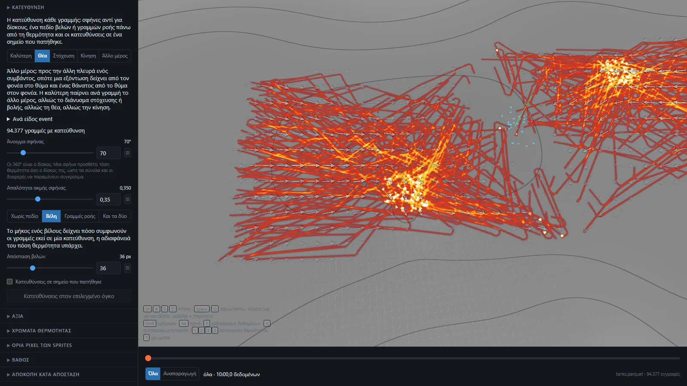

# Κατευθυντική θερμότητα

Η απλή θερμότητα δείχνει **πού** συμβαίνουν τα πράγματα. Η κατευθυντική θερμότητα δείχνει και **προς τα πού**: προς τα πού κοιτούσαν οι άνθρωποι, πού σημάδευαν, πού κινούνταν, ή πού ήταν η άλλη πλευρά μιας μάχης.

Ένα κανονικό sprite είναι ολόκληρος δίσκος (360 μοίρες). Με **Άνοιγμα σφήνας** 70 μοιρών το ίδιο sprite γίνεται μια στενή σφήνα που δείχνει προς την κατεύθυνση που κοιτούσε η εγγραφή, και προσθέτει την ίδια συνολική θερμότητα.

## Πώς να τη χρησιμοποιήσετε {#how-to-use-it}

1. Φορτώστε δεδομένα με κατεύθυνση μέσα τους (δείτε [Τι δίνει κατεύθυνση σε μια εγγραφή](#what-gives-a-row-a-direction)).
2. Επιλέξτε **Θερμότητα**, **Διαφορά** ή **Θερμότητα ομάδων** στη γραμμή λειτουργιών.
3. Ανοίξτε την ενότητα **Κατεύθυνση** στην πλαϊνή στήλη.
4. Επιλέξτε μια **πηγή** (ποια κατεύθυνση να χρησιμοποιηθεί), και μετά ενεργοποιήστε το σχέδιο:
   - χαμηλώστε το **Άνοιγμα σφήνας** κάτω από 360° για να σχεδιάζεται κάθε εγγραφή ως σφήνα που δείχνει τον δρόμο της αντί για δίσκο·
   - επιλέξτε ένα **Πεδίο** για να σχεδιαστούν βέλη ή γραμμές ροής πάνω από τη θερμότητα·
   - επιλέξτε **Κατευθύνσεις σε σημείο που πατήθηκε** και κάντε κλικ στη θερμότητα για να πάρετε ένα πολικό γράφημα εκείνου του σημείου.

Η γραμμή κατάστασης λέει πόσες εγγραφές έχουν κατεύθυνση από την επιλεγμένη πηγή.

## Ρυθμίσεις {#settings}

| Ρύθμιση | Προεπιλογή | Τι κάνει |
|---|---|---|
| Πηγή: **Καλύτερα**, **Προβολή**, **Στόχευση**, **Κίνηση**, **Άλλο μέρος** | Καλύτερα | Ποια κατεύθυνση παίρνει κάθε εγγραφή. Το *Καλύτερα* παίρνει, για κάθε εγγραφή, το άλλο μέρος, αλλιώς τη στόχευση, αλλιώς την προβολή, αλλιώς την κίνηση. |
| **Ανά είδος γεγονότος** | όπως παραπάνω | Διαφορετική πηγή για κάθε είδος γεγονότος, για παράδειγμα *Άλλο μέρος* για φόνους και *Προβολή* για θέσεις. Εμφανίζεται όταν τα δεδομένα έχουν στήλη γεγονότων με το πολύ 40 τιμές. |
| **Άνοιγμα σφήνας** | 360° | Το 360° είναι ο κανονικός δίσκος (ανενεργό). Μικρότερο είναι μια στενότερη σφήνα. Μια σφήνα προσθέτει όση θερμότητα έχει ο δίσκος της, οπότε τα σύνολα και οι διαφορές μένουν συγκρίσιμα. |
| **Απαλότητα ακμής σφήνας** | 0,35 | 0 είναι σφήνα με αιχμηρή ακμή, 1 ένας απαλός ανεμιστήρας. |
| **Πεδίο**: Χωρίς πεδίο, Βέλη, Γραμμές ροής, Και τα δύο | Χωρίς πεδίο | Βέλη: το μήκος ενός βέλους δείχνει πόσο συμφωνούν οι εγγραφές εκεί σε μία κατεύθυνση, και η αδιαφάνειά του πόση θερμότητα υπάρχει. Τα βέλη φαίνονται μόνο όπου υπάρχει θερμότητα. |
| **Απόσταση βελών** | 28 px | Απόσταση ανάμεσα στα βέλη στην οθόνη. |
| **Κίνηση στις γραμμές ροής** | ενεργό | Οι γραμμές ροής κινούνται όσο είναι ενεργές. |
| **Κατευθύνσεις σε σημείο που πατήθηκε** | ανενεργό | Κάντε κλικ στη θερμότητα για να δείτε τις κατευθύνσεις εκεί (παρακάτω). |
| **Κατευθύνσεις στον επιλεγμένο όγκο** | | Το ίδιο γράφημα για όλα όσα βρίσκονται μέσα στον επιλεγμένο [όγκο](volumes.md). |

## Το πολικό γράφημα σε ένα σημείο {#the-polar-chart-at-a-spot}

Με ενεργό το **Κατευθύνσεις σε σημείο που πατήθηκε**, κάντε κλικ στη θερμότητα. Οι εγγραφές κοντά σε αυτό το σημείο (μέσα σε 1,5 ακτίνες sprite) συγκεντρώνονται σε ρόδακα 24 τμημάτων των 15°:

- **πορτοκαλί** πέταλα: εξερχόμενες κατευθύνσεις (προς τα πού δείχνουν οι εγγραφές)·
- **μπλε** πέταλα: εισερχόμενες κατευθύνσεις (από πού ήρθαν)·
- το **εμβαδόν** ενός πετάλου μεγαλώνει με το πλήθος του· ένα βέλος δείχνει την κύρια κατεύθυνση·
- οι γραμμές κάτω από το γράφημα δίνουν την κύρια φορά, πόσο συμφωνούν οι εγγραφές (R, από 0 έως 1), την διασπορά σε μοίρες, και το πλήθος των εγγραφών.

Το 0° είναι πάνω στο γράφημα, δηλαδή ο παγκόσμιος −Z (ο βορράς για ηχογραφήσεις Tacview). Το σημείο σημειώνεται και στην τρισδιάστατη προβολή με ένα βέλος και έναν δακτύλιο.

## Τι δίνει κατεύθυνση σε μια εγγραφή {#what-gives-a-row-a-direction}

| Πηγή | Χρειάζεται στα δεδομένα |
|---|---|
| Προβολή | μια στήλη yaw (αντιστοιχισμένη ως κατεύθυνση βλέμματος): `yaw`, `heading`, `azimuth`, `view_yaw`, `rot_z` |
| Στόχευση | ζεύγη αριθμών όπως `aim_x`/`aim_y`, `shot_x`/`shot_y`, `fire_x`/`fire_y`, `hit_dir_x`/`hit_dir_y` (με προαιρετικό `…_z`) |
| Κίνηση | τίποτα επιπλέον: το βήμα από το προηγούμενο δείγμα του ίδιου ατόμου (το πολύ 10 s νωρίτερα, στην ίδια συνεδρία) |
| Άλλο μέρος | μια στήλη που ονομάζει την άλλη πλευρά ενός γεγονότος (`other`, `victim`, `target`, `killer`, `attacker`, `shooter`, `other_player` ...) με τιμές ονόματα ατόμων· ένας φόνος δείχνει από τον φονιά προς το θύμα, ένας θάνατος από το θύμα προς τον φονιά |

## Συμβουλές {#tips}

- Οι σφήνες χρειάζονται κάποιο μέγεθος στην οθόνη· κάτω από λίγα pixel σχεδιάζονται ξανά ως δίσκοι.
- Χρησιμοποιήστε το *Άλλο μέρος* στις εγγραφές φόνων για να δείτε **από πού** κερδήθηκαν οι μάχες, και το *Προβολή* στις εγγραφές θέσης για να δείτε **πού κοιτούν οι άνθρωποι**.
- Με τη **Διαφορά**, οι σφήνες των δύο πλευρών δείχνουν προς τις δικές τους κατευθύνσεις, οπότε οι αμφισβητούμενες γραμμές πυρός ξεχωρίζουν.
