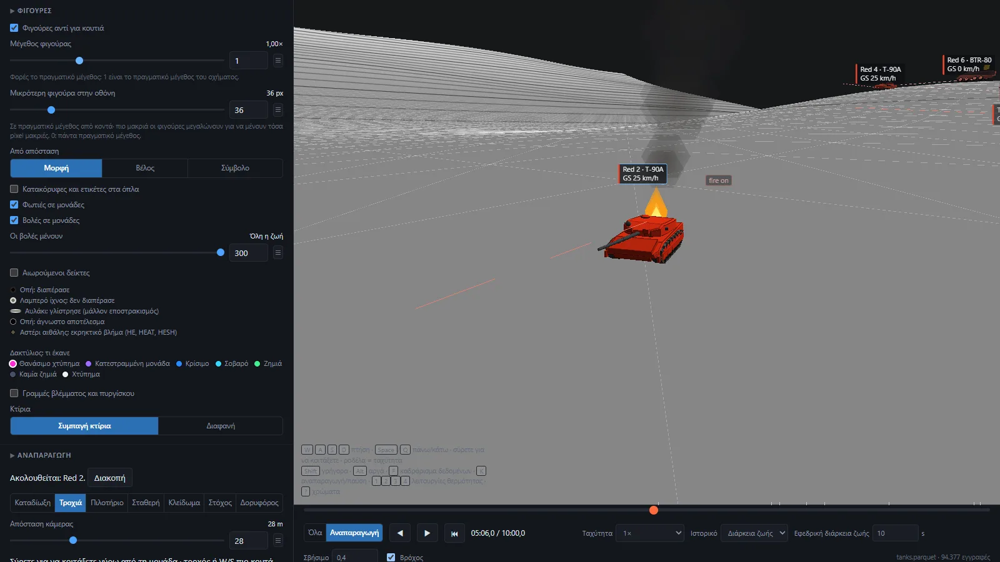

# Φιγούρες

Μια **φιγούρα** είναι ένα μικρό τρισδιάστατο μοντέλο του τι είναι πραγματικά μια μονάδα: ένα τανκ, ένα τζετ, ένα πλοίο, ένας στρατιώτης. Η [επανάληψη](match-replay.md) σχεδιάζει κάθε μονάδα ως τη φιγούρα της σε πραγματικό μέγεθος, αντί για απλό κουτί.

Υπάρχουν περίπου 2.000 ονομασμένα οχήματα, αεροσκάφη, πλοία, όπλα και στρατιώτες, όλα φτιαγμένα από τον ίδιο τον περιηγητή.

## Τι υπάρχει στον κατάλογο {#what-is-in-the-catalogue}

| Τομέας | Παραδείγματα |
|---|---|
| Άνθρωποι | στρατιώτης όρθιος, σκυμμένος, ξαπλωμένος· ελεύθερος σκοπευτής, αντιαρματικός, γιατρός, πλήρωμα |
| Έδαφος | τανκ, οχήματα πεζικού, αντιαεροπορικά, πυροβολικό, φορτηγά και αυτοκίνητα, τρένα και τραμ |
| Αέρας | μαχητικά, αεροσκάφη επίθεσης, βομβαρδιστικά, μεταγωγικά, ελικόπτερα, από διπλάνα μέχρι σύγχρονα τζετ |
| Θάλασσα | πολεμικά πλοία ανά κατηγορία, αεροπλανοφόρα, υποβρύχια, σκάφη, εμπορικά |
| Όπλα | πύραυλοι, ρουκέτες, βόμβες, τορπίλες, φωτοβολίδες και ρίψεις εκτροπής |
| Σημάδια | καπνός, λάμψη και φωτιά από χειροβομβίδες, τοποθετημένες βόμβες, σημαίες, σημεία εμφάνισης, σημεία πορείας |

## Πώς φτιάχνονται οι φιγούρες {#how-the-figures-are-made}

- **Φτιαγμένες από δημοσιευμένες διαστάσεις.** Οι περισσότερες φιγούρες φτιάχνονται από τον κατασκευαστή φιγούρων του ίδιου του περιηγητή από δημόσιους αριθμούς: μήκος, πλάτος, ύψος, τροχούς, πυργίσκο και κανόνι, πτέρυγες και ουρά. Το σχήμα τους ρυθμίζεται έπειτα σε δημόσιες φωτογραφίες, σχέδια και δημοσιευμένες διαστάσεις. Δεν χρησιμοποιούνται μοντέλα κανενός παιχνιδιού.
- **Ελεύθερα μοντέλα.** Μερικές φιγούρες χρησιμοποιούν ελεύθερα τρισδιάστατα μοντέλα (CC0 ή CC BY) όπου είναι πιο πιστά, μερικές φορές συνδυασμένα με το κατασκευασμένο σκαρί. Οι δημιουργοί των έργων CC BY αναφέρονται στις [Ευχαριστίες για τις φιγούρες](figure-credits.md)· τα έργα CC0 δεν χρειάζονται αναφορά και δεν απαριθμούνται εκεί.
- Κάθε φιγούρα έχει πλήρη, χονδρική και μακρινή έκδοση (επίπεδα λεπτομέρειας, LOD), ώστε να σχεδιάζονται χιλιάδες μαζί.

## Ποια φιγούρα παίρνει μια μονάδα {#which-figure-a-unit-gets}

Ο περιηγητής κοιτάζει τις στήλες των ίδιων των δεδομένων:

1. **Ονόματα** — στήλες με ονόματα *Name*, *Vehicle*, *Unit*, *Unit type*, *Model*, *Aircraft*, *Plane*, *Tank*, *Ship*, *Craft*, *Loadout*, *Kit* ή *Figure* — ταιριάζονται με τον κατάλογο: ακριβώς, μέσω περίπου 4.000 ψευδωνύμων (αναγνωριστικά μονάδων από πολλά παιχνίδια), με τη μακρύτερη γνωστή αρχή (το `F-16C_50` είναι το F-16C), ή με το συντομότερο όνομα φιγούρας που αρχίζει με αυτό.
2. Ένα όνομα του οποίου η φιγούρα δεν ταιριάζει με τον **τύπο** της μονάδας δεν χρησιμοποιείται (ένα φορτηγό που λέγεται *Typhoon* δεν είναι το μαχητικό).
3. **Τύποι** — στήλες με ονόματα *Type*, *Class*, *Kind*, *Category*, *Icon*, *Role* ή *Domain* — δίνουν φιγούρα κατηγορίας: ετικέτες Tacview (`Air+FixedWing`, `Ground+Heavy+Armor+Vehicle+Tank`, `Sea+Watercraft+Warship`, `Weapon+Missile`), εικονίδια χαρτών ή απλές λέξεις (tank, helicopter, infantry).
4. Δεδομένα με κανένα από τα δύο είναι δεδομένα ανθρώπων: όλοι είναι στρατιώτες.

Άρα ο πιο εύκολος τρόπος για τις σωστές φιγούρες είναι μια στήλη `vehicle` με τα πραγματικά ονόματα, ή μια στήλη `type` με ετικέτες Tacview.

**Η μονάδα μου εμφανίζεται ως κουτί ή ως στρατιώτης.** Προσθέστε στήλη `vehicle` με το πραγματικό όνομα, ή στήλη `type` με ετικέτα Tacview. Αφήστε το ποντίκι πάνω στη μονάδα για να δείτε ποιο όνομα ταίριαξε. Δεδομένα που έχουν τέτοιες στήλες αλλά δεν λένε τίποτα για μια μονάδα την αφήνουν ως κουτί· δεδομένα χωρίς καμία από αυτές σχεδιάζονται ως στρατιώτες.

## Ρυθμίσεις {#settings}

Η ενότητα **Φιγούρες** της πλαϊνής στήλης της αναπαραγωγής ορίζει το μέγεθος, το μικρότερο μέγεθος στην οθόνη, το τι γίνονται οι μακρινές μονάδες (φιγούρα, βέλος, σύμβολο), και τα εφέ που σχεδιάζονται πάνω τους. Βλ. [Επανάληψη αγώνα](match-replay.md#figures). Καπνός, φωτιά και άλλα εφέ με χρόνο: [Φιγούρες στην επικάλυψη φιγούρων](figure-replay.md).

## Ένα προαιρετικό τοπικό πακέτο φιγούρων {#an-optional-local-figure-pack}

Μπορείτε να κρατάτε ένα προαιρετικό πακέτο δικών σας φιγούρων στον δικό σας υπολογιστή. Οι φιγούρες του παίρνουν τη θέση των φιγούρων του καταλόγου με τα ίδια ονόματα. Δεν είναι ποτέ μέρος του αποθετηρίου ή μιας δημοσιευμένης έκδοσης· χωρίς αυτό, τίποτα δεν αλλάζει.
