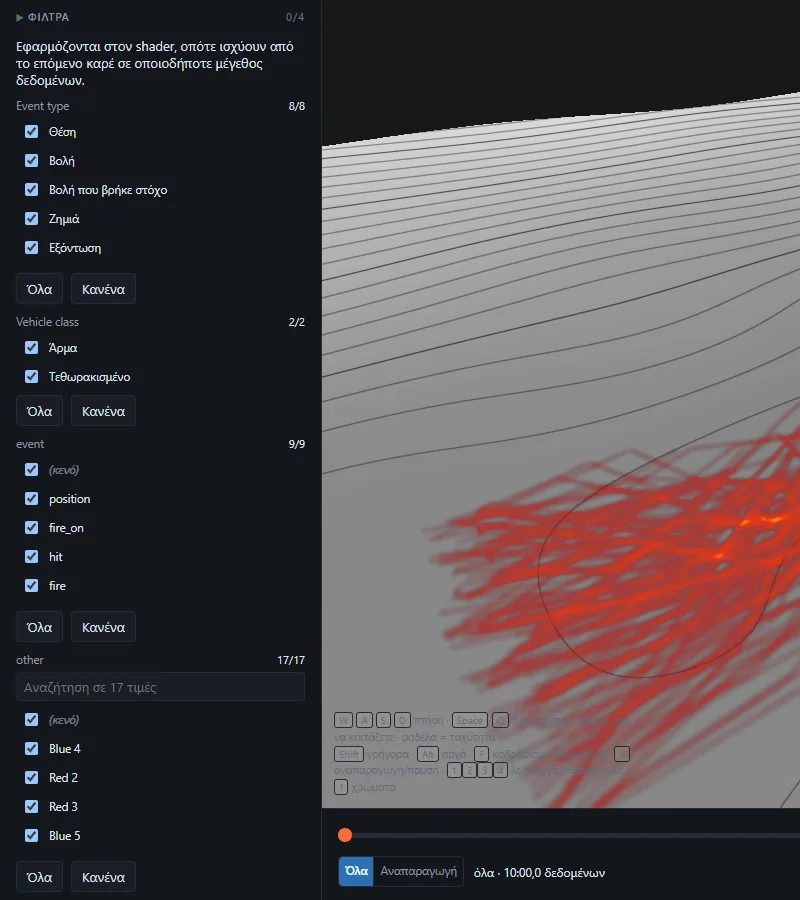
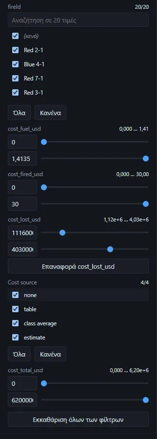

# Φίλτρα

Τα **Φίλτρα** κρύβουν τις γραμμές που δεν σας ενδιαφέρουν, όπως μια κλάση οχήματος ή ένα είδος συμβάντος, και η εικόνα ενημερώνεται αμέσως. Το πάνελ εμφανίζει τις στήλες που κρατήθηκαν κατά τη φόρτωση κάτω από το *Keep for filtering* ([Αντιστοίχιση στηλών](column-mapping.md)), και το *Source file* όταν φορτώθηκαν πολλά αρχεία.

## Δοκιμάστε το {#try-it}

1. Φορτώστε ένα σύνολο δεδομένων και ανοίξτε τα **Φίλτρα** στην πλαϊνή στήλη.
2. Στην **Κλάση οχήματος**, ξετικάρετε το *Tank*. Η εικόνα αλλάζει αμέσως.
3. Πατήστε **Εκκαθάριση όλων των φίλτρων** για να το αναιρέσετε.

Οι πρώτες γραμμές είναι οι δικές της στήλες του περιηγητή (παρακάτω). Οι γραμμές μετά από αυτές προέρχονται από το αρχείο σας.

## Στήλες που προσθέτει ο περιηγητής {#columns-the-viewer-adds}

Κατά τη φόρτωση ο περιηγητής βρίσκει τέσσερις δικές του στήλες και τις εμφανίζει **πρώτες**, με ονόματα και τιμές στη γλώσσα σας, ώστε το ίδιο φίλτρο να δουλεύει για κάθε παιχνίδι και κάθε πηγή δεδομένων:

| Στήλη | Τιμές | Υπολογίζεται από |
|---|---|---|
| **Τύπος συμβάντος** | 23 είδη: Θέση, Βολή, Εκτόξευση (πύραυλος, ρουκέτα, βόμβα), Χτύπημα, Αστοχία (το όπλο τελείωσε κοντά σε κανένα στόχο), Έκρηξη, Ζημιά, Σκοτωμός, Θάνατος, Καταστροφή, Συντριβή, Εκτίναξη / διαφυγή, Εμφάνιση, Εξαφάνιση, Απογείωση, Προσγείωση, Επαφή με το έδαφος, Στάση στο έδαφος, Επανεφοδιασμός / ανεφοδιασμός, Κατάληψη / στόχος, Δόλωμα, Μήνυμα, Άλλο | μια στήλη με όνομα `event`, `events`, `event_type` ή `event_name`· οι δικές λέξεις κάθε παιχνιδιού (`shot`, `burst`, `fired`, `struck`, `flare`, `plant` ...) αντιστοιχίζονται σε αυτά τα είδη. Ο πλήρης πίνακας: [Τύποι και κλάσεις γεγονότων](ref-event-types.md). |
| **Παίκτης ή ΤΝ** | Παίκτης, ΤΝ | μια στήλη `ai`, `is_ai`, `bot` ή `actor`· αλλιώς `is_player` / `human`· αλλιώς ένα αναγνωριστικό λογαριασμού (`user_id`, `steam_id`· κενό ή 0 είναι ΤΝ)· για εγγραφές Tacview, αν το αντικείμενο έχει πιλότο |
| **Κλάση οχήματος** | 17 κλάσεις: Μαχητικό, Αεροσκάφος επίθεσης, Βομβαρδιστικό, Άλλο αεροσκάφος, Ελικόπτερο, Tank, Θωρακισμένο όχημα, Αντιαεροπορικά, Πυροβολικό, Φορτηγό / αυτοκίνητο, Πλοίο, Υποβρύχιο, Πεζικό, Όπλο, Δόλωμα, Κατασκευή, Άλλο | το όνομα του οχήματος ή της μονάδας (αντιστοιχίζεται με τον [κατάλογο φιγούρων](figures.md)) και στήλες τύπου |
| **Κλάση στόχου** | οι ίδιες κλάσεις | το όχημα του αντιπάλου (`other_vehicle`, `target_vehicle`, `victim_type` ...) |

Αμέσως μετά έρχονται οι [στήλες αποτελέσματος](data-formats.md#outcome-columns), όπου τις έχουν τα δεδομένα: **Αποτέλεσμα γύρου** και **Αποτέλεσμα αγώνα** (*Οποιοδήποτε*, *Νίκη*, *Ήττα*) και **Πώς έληξε ο γύρος**, με τις τιμές στη γλώσσα σας. Φιλτράρετε με αυτές, ή χωρίστε τη θερμότητα με αυτές ως [χάρτη ποσοστού νικών](win-rate.md).

Εμφανίζονται μόνο τα είδη που υπάρχουν. Οι στήλες αξίας (`cost_*`, `earn_*`, `net_*` και *Cost source*, βλ. [Στάθμιση τιμών](value-weighting.md)) φιλτράρονται όπως κάθε αριθμητική στήλη· για παράδειγμα, ξετικάρετε το *estimate* στο *Cost source* για να κρατήσετε μόνο τις γραμμές με τιμή.

Μια λίστα κατηγορίας με περισσότερες από 12 τιμές παίρνει πλαίσιο αναζήτησης (*Search n values*) και ένα κουμπί **Μόνο αυτά** που επιτρέπει ακριβώς τις τιμές που ταιριάζουν.

Ποιες στήλες μπορούν να φιλτραριστούν αποφασίζεται κατά τη φόρτωση, γιατί τότε πρέπει να διαβαστούν. Χωρίς καμία κρατημένη στήλη το πάνελ το λέει και δείχνει το *Keep for filtering*.

## Γρήγορα φίλτρα Rainbow Six Siege {#rainbow-six-siege-quick-filters}

Με φορτωμένο έναν αγώνα Rainbow Six Siege, το πάνελ ξεκινά με κουμπιά που ορίζουν τα φίλτρα με ένα κλικ: **Τρύπες από σφαίρες και σημάδια** (τα σημάδια που μένουν στο επίπεδο), **Σημάδια με σκοπευτή** και **Σημάδια με κατηγορία όπλου** (εκείνα για τα οποία βρέθηκε ένας σκοπευτής, ή ένα όπλο από την εξόντωση του σκοπευτή την ίδια στιγμή· χωρίστε ή φιλτράρετέ τα περισσότερο με `byOperator` ή `byItemClass`), **Απόπειρες τοποθέτησης και εξουδετέρωσης**, **Διακοπείσες απόπειρες** (ξεκίνησαν αλλά δεν τελείωσαν, εκεί όπου σταμάτησε ο παίκτης) και **Ενισχύσεις** (όπου ενισχύθηκε ένας τοίχος ή μια καταπακτή, στον αμυνόμενο που συμπεραίνει ο μετατροπέας). Το καθένα αντικαθιστά το φίλτρο στη στήλη συμβάντων και κρατά τα υπόλοιπα· το **Εκκαθάριση όλων των φίλτρων** το αναιρεί. Οι στήλες περιγράφονται στην τεκμηρίωση του μετατροπέα.

## Αριθμητικές στήλες (εύρος) {#numeric-columns-range}

| Τμήμα | Σημασία |
|---|---|
| Όνομα, και `min ... max` | Η στήλη, και το τρέχον εύρος (ολόκληρο το εύρος της στήλης όσο δεν έχει οριστεί φίλτρο). |
| Πρώτη γραμμή: πλαίσιο αριθμού και slider | Το κάτω όριο. Σύροντας το slider πάνω από το άνω όριο, σπρώχνει και το άνω όριο μαζί του. |
| Δεύτερη γραμμή: πλαίσιο αριθμού και slider | Το άνω όριο. Σύροντας κάτω από το κάτω όριο, σπρώχνει και αυτό. |
| **Επαναφορά *στήλης*** | Αφαιρεί αυτό το φίλτρο. |

Τα sliders καλύπτουν από το ελάχιστο έως το μέγιστο της στήλης σε 1.000 βήματα· τα πλαίσια αριθμού δέχονται οποιαδήποτε τιμή. Μια γραμμή περνά όταν η τιμή της βρίσκεται μέσα στο εύρος, με τα δύο άκρα συμπεριλαμβανόμενα. Οι μεγάλες τιμές εμφανίζονται με εκθέτη (`1.23e6`).

## Στήλες κατηγοριών {#category-columns}

| Τμήμα | Σημασία |
|---|---|
| Όνομα, και `επιτρεπόμενες/σύνολο` | Η στήλη, και πόσες από τις τιμές της επιτρέπονται. |
| Λίστα τιμών | Ένα πλαίσιο ελέγχου για κάθε τιμή· μια κενή τιμή εμφανίζεται ως *(empty)*. |
| **Όλα** / **Κανένα** | Επιτρέπει κάθε τιμή / καμία τιμή. |

Όταν επιτρέπονται όλες οι τιμές, το φίλτρο αφαιρείται.

## Κανόνες {#rules}

- **Τέσσερα φίλτρα τη φορά.** Η κεφαλίδα δείχνει `ενεργά/4`. Ένα πέμπτο φίλτρο δεν εφαρμόζεται, και το πάνελ το λέει. Μια επιλογή στις [Οντότητες](entities.md) (ή η εστίαση παίκτη της καρτέλας Αγώνας) χρησιμοποιεί κι αυτή ένα από τα τέσσερα. Ένα φίλτρο που καλύπτει ολόκληρη τη στήλη δεν χρησιμοποιεί κανένα.
- **Μια στήλη κατηγορίας έχει το πολύ 4.096 τιμές**· μια πιο πλατιά δεν κρατιέται κατά τη φόρτωση.
- **Τα φίλτρα συνδυάζονται με AND**, και με την ορατότητα ομάδων, τον διαχωρισμό διαφοράς, το χρονικό παράθυρο, την αποκοπή απόστασης και την [τομή](slice.md).
- **Η αλλαγή ενός φίλτρου ξεκινά ξανά τη συσσώρευση** και ξαναμετράει την έκθεση λίγα καρέ αργότερα, επειδή το φιλτράρισμα μπορεί να αλλάξει πολύ την πυκνότητα ([Χρώμα και έκθεση](colour-and-exposure.md#auto-exposure)).
- **Η Εκκαθάριση όλων των φίλτρων** αφαιρεί κάθε φίλτρο στήλης. Η ορατότητα ομάδων και οι επιλογές παικτών που έχουν οριστεί αλλού μένουν.
- Τα φίλτρα στηλών αλλάζουν τις λειτουργίες θερμότητας. Δεν αλλάζουν τις φιγούρες της [επανάληψης φιγούρων](box-replay.md), που ακολουθούν την ορατότητα ομάδων και την επιλογή Οντοτήτων. Η επιλογή Οντοτήτων αλλάζει και τα δύο.
- Στη [θερμότητα γραμμών](line-heat.md) ένα φίλτρο ελέγχεται πάνω στη γραμμή στην οποία *τελειώνει* κάθε τμήμα.
- Σε κάθε νέο σύνολο δεδομένων, όλα τα φίλτρα καθαρίζονται.

## Για προγραμματιστές {#for-developers}

**Θέσεις.** Κάθε ενεργό φίλτρο παίρνει μία από τις τέσσερις θέσεις GPU ([`MAX_FILTER_SLOTS`](https://github.com/Holdi601/3DHeat/blob/main/src/render/types.ts)), μια υφή 4 byte ανά γραμμή. Οι θέσεις δίνονται στα φίλτρα με τη σειρά της τελευταίας αλλαγής τους ([`filterSlots`](https://github.com/Holdi601/3DHeat/blob/main/src/render/filterTables.ts), κοινή για τον shader και τα δύο πάνελ). Πέρα από τέσσερα, ένα σφάλμα λέει *Εφαρμόζονται μόνο τα πρώτα 4 φίλτρα. Αφαιρέστε ένα - τα υπόλοιπα αγνοούνται, δεν συνδυάζονται σιωπηλά*, και τα ονόματα των επιπλέον φίλτρων γράφουν *στήλη (δεν εφαρμόζεται)*. Τα φίλτρα τρέχουν ανά γραμμή στον vertex shader, οπότε η αλλαγή ορίου δεν χρειάζεται νέα ανάλυση ούτε νέα αποστολή.

**Φίλτρα που το πάνελ δεν δείχνει.** Υπάρχουν άλλα δύο είδη στην κατάσταση της εφαρμογής ([`FilterSpec`](https://github.com/Holdi601/3DHeat/blob/main/src/state/types.ts)):

- ένα φίλτρο **ομάδων**, που ορίζει η καρτέλα Αγώνας όταν εστιάζει σε μία πλευρά. Κρύβει τις άλλες ομάδες σε κάθε λειτουργία, και τον [διαχωρισμό διαφοράς](difference.md) πάνω σε στήλη συμπεριλαμβανομένου.
- ένα φίλτρο **προσώπων**, που ορίζει το πάνελ [Οντότητες](entities.md) και η καρτέλα Αγώνας όταν εστιάζει σε έναν παίκτη. Περιορίζει την επανάληψη φιγούρων και τις λειτουργίες θερμότητας. Στη θερμότητα είναι ένα φίλτρο κατηγορίας πάνω στα id προσώπων και παίρνει μία από τις τέσσερις θέσεις. Η μάσκα του έχει 65.536 id ([`FILTER_MASK_CAPACITY`](https://github.com/Holdi601/3DHeat/blob/main/src/render/types.ts))· ένα πρόσωπο πέρα από αυτό δεν σχεδιάζεται στη θερμότητα όσο το φίλτρο είναι ενεργό, ακόμα κι αν είναι επιλεγμένο. Η επανάληψη φιγούρων εξακολουθεί να το δείχνει.
