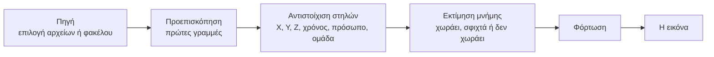

# Εισαγωγή δεδομένων

Πριν το 3DHeat μπορέσει να σχεδιάσει οτιδήποτε χρειάζεται έναν πίνακα: κάθε γραμμή λέει πού βρισκόταν κάτι και, αν το έχετε, πότε και ποιος ήταν. Αυτή η ενότητα δείχνει πώς ένα αρχείο γίνεται εικόνα. Δεν έχετε ακόμα δεδομένα; Δοκιμάστε τα [δεδομένα επίδειξης](demo-data.md).

**Κάντε αυτό τώρα:**

1. Στην πλαϊνή στήλη του Χάρτη θερμότητας ανοίξτε την **Πηγή** και πατήστε **Αρχεία…** (ή σύρετε ένα αρχείο ή φάκελο στη ζώνη αποθέσεων).
2. Κοιτάξτε την **Αντιστοίχιση στηλών**: τα κουτάκια είναι συνήθως ήδη συμπληρωμένα.
3. Ελέγξτε ότι η **Εκτίμηση μνήμης** λέει *χωράει*.
4. Πατήστε **Φόρτωση**.

Όλα όσα δείχνει η καρτέλα Χάρτης θερμότητας προέρχονται από ένα **σύνολο δεδομένων**: έναν πίνακα γραμμών, με καθεμία μια θέση και, προαιρετικά, έναν χρόνο, ένα πρόσωπο, μια ομάδα, μια συνεδρία, μια κατεύθυνση βλέμματος και όσες επιπλέον στήλες κρατιούνται για φιλτράρισμα. Αυτή η ενότητα εξηγεί πώς φτιάχνεται ένα σύνολο δεδομένων.

## Η διαδρομή από τα αρχεία στην εικόνα {#the-path-from-files-to-picture}

1. **Επιλογή αρχείων** στο panel **Πηγή**: ένα αρχείο, πολλά, ένα δέντρο φακέλων ή με σύρσιμο. Γίνονται δεκτά Parquet, CSV, Tacview, διαδρομές GPS και άλλα· η πλήρης λίστα είναι στις [Μορφές δεδομένων](data-formats.md#files). Βλ. [Φόρτωση αρχείων](loading-files.md).
2. **Προεπισκόπηση.** Ανοίγει το πρώτο αρχείο της επιλογής: τα ονόματα των στηλών του, οι πρώτες 50 γραμμές, ποιες στήλες φαίνονται αριθμητικές και (για Parquet) ο λογικός τύπος κάθε στήλης και οι οδηγίες ανάγνωσης του ίδιου του αρχείου, η καταχώριση `heat3d` στο τέλος του.
3. **Αυτόματη αντιστοίχιση.** Οι στήλες ανατίθενται σε ρόλους - X, Y, Z, χρόνος, πρόσωπο, συνεδρία, ομάδα, κατεύθυνση βλέμματος - και μια χούφτα κρατιούνται για φιλτράρισμα. Κάθε εικασία φαίνεται στο panel **Αντιστοίχιση στηλών** και μπορεί να αλλάξει. Βλ. [Αντιστοίχιση στηλών](column-mapping.md) και [Άξονες, μονάδες και χρόνος](axes-units-and-time.md).
4. **Καταμέτρηση.** Διαβάζεται το πλήθος γραμμών κάθε αρχείου (ακριβώς από τα υποσέλιδα Parquet, κατ' εκτίμηση για CSV), ώστε το panel να λέει πριν από τη φόρτωση πόση μνήμη χρειάζεται και αν χωράει. Αν όχι, προτείνει φόρτωση κάθε *N*-οστής γραμμής. Βλ. [Μνήμη και προϋπολογισμοί](memory-and-budgets.md).
5. **Φόρτωση.** Ένας εργάτης παρασκηνίου αναλύει μόνο τις αντιστοιχισμένες στήλες κάθε αρχείου - πολλά αρχεία ταυτόχρονα, μέχρι τον προϋπολογισμό των [νημάτων ανάλυσης](memory-and-budgets.md#parser-threads) - και τα ενώνει, με τη σειρά της επιλογής, σε ένα σύνολο δεδομένων: ένα κοινό λεξικό προσώπων, ομάδων και συνεδριών για όλα τα αρχεία, μία κοινή αρχή χρόνου, όλες οι γραμμές ταξινομημένες κατά χρόνο. Βλ. [Συνεδρίες, πρόσωπα και ομάδες](sessions-persons-groups.md).
6. **Αποστολή.** Το κύριο νήμα ανακοινώνει «Αποστολή N εγγραφών στη GPU» για ένα καρέ και μετά γεμίζει τις γραμμές στη μνήμη της GPU μέσα στον προϋπολογισμό της. Βλ. [Παραμονή μνήμης GPU](gpu-memory.md).
7. **Πρώτη εικόνα.** Η κάμερα πλαισιώνει τα δεδομένα, η ακτίνα του sprite και ο κορεσμός ορίζονται από την έκταση και το πλήθος των γραμμών, και μετά από 8 καρέ απόδοσης ο κορεσμός μετράται από την ίδια την εικόνα ([Χρώμα και έκθεση](colour-and-exposure.md)).

## Απαιτήσεις, που ελέγχονται πριν από τη φόρτωση {#requirements-checked-before-a-load}

| Τι χρειάζεται | Τι συμβαίνει χωρίς αυτό |
|---|---|
| **Τουλάχιστον δύο από τα X / Y / Z** | Η φόρτωση αρνείται. Με ακριβώς δύο, ο τρίτος άξονας είναι 0 και τα δεδομένα σχεδιάζονται ως επίπεδο στη σκηνή 3D - που είναι ό,τι θέλει ένας χάρτης θερμότητας από ψηλά. |
| Στήλη χρόνου | Προαιρετική. Χωρίς αυτήν το χρονολόγιο είναι ανενεργό, η προβολή μένει στη λειτουργία **Όλα** και η πλαϊνή στήλη το λέει. |
| Στήλη προσώπου | Προαιρετική. Χρειάζεται για την [επικάλυψη φιγούρων](box-replay.md) (μια φιγούρα για κάθε πρόσωπο), τη [θερμότητα γραμμών](line-heat.md) (η διαδρομή κάθε προσώπου), την παρεμβολή, τα ίχνη και το ιστορικό **Διάρκεια ζωής**. |
| Στήλη ομάδας | Προαιρετική. Χρειάζεται για τη [θερμότητα ομάδας](team-heat.md) και τη λειτουργία [διαφοράς](difference.md) (τουλάχιστον δύο ομάδες). |

Μια λειτουργία που τα φορτωμένα δεδομένα δεν μπορούν να υποστηρίξουν είναι γκρι στη γραμμή λειτουργιών· όταν το δείξετε με τον δείκτη, λέει γιατί.

## Χωρίς δικά σας δεδομένα {#without-your-own-data}

Το panel **Σύνολο δεδομένων** (κάτω από την **Πηγή**) έχει μια [γεννήτρια συνθετικών δεδομένων](synthetic-generator.md) που φτιάχνει ένα σύνολο δεδομένων σε σχήμα battle royale, όποιου μεγέθους θέλετε· χρήσιμο για να δοκιμάσετε τον περιηγητή και για να ελέγξετε τι αντέχει ένας υπολογιστής.

## Σελίδες αυτής της ενότητας {#pages-in-this-section}

- [Φόρτωση αρχείων](loading-files.md) - επιλογείς, φάκελοι, σύρσιμο και απόθεση, συγχώνευση πολλών αρχείων, ο κανόνας του αρχείου κινήσεων, πρόοδος και ακύρωση
- [Αντιστοίχιση στηλών](column-mapping.md) - κάθε πεδίο του panel αντιστοίχισης, πώς η αυτόματη αντιστοίχιση μαντεύει, οι υποδείξεις `heat3d`
- [Άξονες, μονάδες και χρόνος](axes-units-and-time.md) - άξονας προς τα πάνω, αντιστροφές, κλίμακα μονάδων, μονάδες χρόνου, κατεύθυνση βλέμματος
- [Συνεδρίες, πρόσωπα και ομάδες](sessions-persons-groups.md) - τι κάνει το καθένα, τα όρια, κοινά ονόματα, μέγεθος οντοτήτων, το panel Σύνολο δεδομένων
- [Γεννήτρια συνθετικών δεδομένων](synthetic-generator.md)
- [Μνήμη και προϋπολογισμοί](memory-and-budgets.md) - μοντέλο αποτυπώματος, έλεγχος χωρητικότητας, αραίωση, όριο ταξινόμησης, προϋπολογισμοί πόρων
