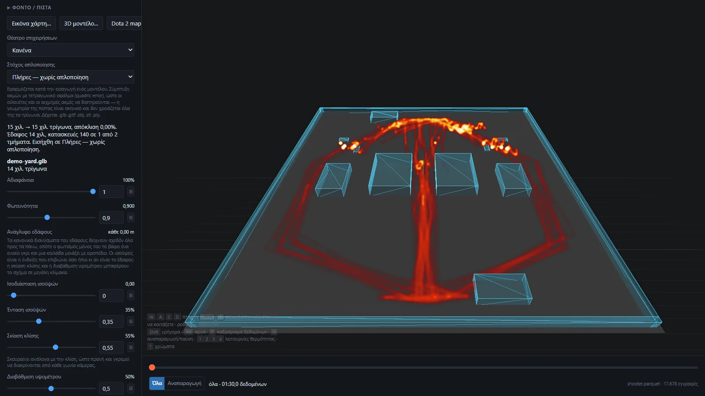
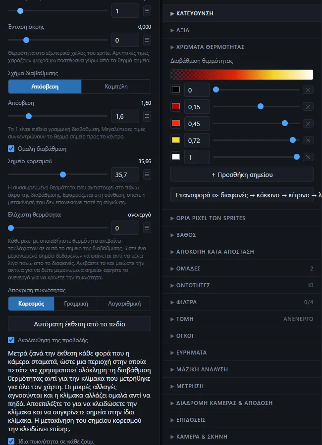

# Θερμότητα

Η θερμότητα βάφει τα σημεία όπου συνέβησαν πολλά πράγματα: κόκκινο εκεί όπου συνέβη λίγο, λευκό-πύρινο εκεί όπου συνέβη πολύ. Απαντά στο «πού συμβαίνει αυτό, και πόσο;».

Η **Θερμότητα** (πλήκτρο 1) είναι η προεπιλεγμένη λειτουργία. Κάθε ορατή [γραμμή](glossary.md) συνεισφέρει ένα στρογγυλό [sprite](glossary.md) που κοιτάζει την κάμερα· τα επικαλυπτόμενα sprites προστίθενται σε buffer κινητής υποδιαστολής· το άθροισμα αντιστοιχίζεται μέσω μιας διαβάθμισης χρωμάτων - εξ ορισμού διαφανές → κόκκινο → κίτρινο → λευκό - και σχεδιάζεται πάνω από τη σκηνή.

Η εικόνα δείχνει τη θερμότητα ενός γύρου shooter σε επίπεδο με κτίρια: τα θερμά σημεία βρίσκονται στα δωμάτια και στις σκάλες, όχι μόνο στο έδαφος.

## Πώς να το χρησιμοποιήσετε {#how-to-use-it}

1. Φορτώστε δεδομένα και πατήστε `1` (ή επιλέξτε **Θερμότητα** στη γραμμή λειτουργιών).
2. Αν όλα είναι λευκά ή κενά, πατήστε **Αυτόματη έκθεση από το πεδίο** στην ενότητα **Σχήμα θερμότητας**.
3. Αλλάξτε την **Ακτίνα sprite** μέχρι οι γειτονικές τελείες να ενωθούν σε ζώνες: μικρότερη δείχνει μεμονωμένα σημεία, μεγαλύτερη δείχνει περιοχές.
4. Ανοίξτε τα **Χρώματα θερμότητας** για να αλλάξετε τα χρώματα, ή το **Βάθος** για να αφήσετε λόφους και τοίχους να κρύβουν τη θερμότητα πίσω τους.

Τα ίδια panels διαμορφώνουν τη [Διαφορά](difference.md), τη [Θερμότητα ομάδων](team-heat.md) και τη [Θερμότητα γραμμών](line-heat.md)· διαφέρουν σε αυτό που προστίθεται (με πρόσημο, χρωματισμένο ή κατά μήκος γραμμών), όχι στον τρόπο.

## Τα panels και οι προεπιλογές τους {#the-panels-and-their-defaults}

Κάθε στοιχείο ελέγχου παρακάτω αντιστοιχεί σε μία παράμετρο του shader, οπότε η αλλαγή του κοστίζει μόνο ένα ξανασχεδίασμα. Τα sliders έχουν ένα πλαίσιο πληκτρολόγησης δίπλα τους και μια λαβή σύρσης (η μικρή λαβή δεξιά: σύρετε πάνω ή κάτω, πιο μακριά είναι πιο γρήγορα, Shift για λεπτή ρύθμιση)· όπου η γραμμή του slider τελειώνει πριν από ένα πραγματικό όριο, η λαβή μπορεί να προχωρήσει πέρα από αυτήν μέχρι το *ανώτατο όριο σύρσης* που δίνεται εδώ. Οι τιμές με σήμανση *κατά τη φόρτωση* υπολογίζονται ξανά για κάθε νέο σύνολο δεδομένων.

### Σχήμα θερμότητας (ανοιχτό) {#heat-shape-open}

| Στοιχείο ελέγχου | Προεπιλογή | Εύρος (ανώτατο όριο σύρσης) | Λεπτομέρειες |
|---|---|---|---|
| **Ακτίνα sprite** | 6 m· κατά τη φόρτωση έκταση / 120 | 0,05-2000 m, λογαριθμική (50.000) | [Σχήμα sprite](sprite-shape.md#sprite-radius) |
| **Ένταση κέντρου** | 1 | 0-10 (1000) | [Σχήμα sprite](sprite-shape.md#centre-and-edge-intensity) |
| **Ένταση άκρης** | 0 | -2-10 (1000) | [Σχήμα sprite](sprite-shape.md#centre-and-edge-intensity) |
| **Σχήμα διαβάθμισης** | *Falloff* | *Falloff* / *Curve* | [Σχήμα sprite](sprite-shape.md#ramp-shape-falloff-or-curve) |
| **Απόσβεση** (μόνο στο Falloff) | 1,6 | 0,1-8 (64) | [Σχήμα sprite](sprite-shape.md#falloff) |
| **Ομαλή διαβάθμιση** (μόνο στο Falloff) | ενεργό | | [Σχήμα sprite](sprite-shape.md#falloff) |
| Επεξεργαστής καμπύλης (μόνο στο Curve) | προκαθορισμένο *Smooth* | | [Σχήμα sprite](sprite-shape.md#the-curve-editor) |
| **Σημείο κορεσμού** | 24· κατά τη φόρτωση εκτίμηση, και μετά μέτρηση | 0,1-4000, λογαριθμική (10.000.000) | [Χρώμα και έκθεση](colour-and-exposure.md#saturation-point) |
| **Ελάχιστη θερμότητα** | ανενεργή (0) | 0-100% | [Χρώμα και έκθεση](colour-and-exposure.md#minimum-heat) |
| **Απόκριση πυκνότητας** | *Saturating* | *Saturating* / *Linear* / *Log* | [Χρώμα και έκθεση](colour-and-exposure.md#density-response) |
| **Αυτόματη έκθεση από το πεδίο** | | κουμπί | [Χρώμα και έκθεση](colour-and-exposure.md#auto-exposure) |
| **Ακολούθηση της προβολής** | ενεργό | | Μετράει ξανά την έκθεση κάθε φορά που η κάμερα σταματά, ώστε μια περιοχή στην οποία πετάτε να χρησιμοποιεί ολόκληρη τη διαβάθμιση χρωμάτων. Οι μικρές αλλαγές αγνοούνται και η κλίμακα ολισθαίνει ομαλά. Απενεργοποιήστε την, ή σύρετε το **Σημείο κορεσμού**, για να κλειδώσετε την κλίμακα και να συγκρίνετε τόπους σε μία κλίμακα. [Χρώμα και έκθεση](colour-and-exposure.md#follow-the-view) |
| **Ίδια πυκνότητα σε κάθε ζουμ** | ενεργό | | Ένα χρώμα σημαίνει τον ίδιο αριθμό γραμμών ανά έκταση εδάφους όσο κι αν είστε κοντά. Ένα sprite που τα όρια pixel το μεγεθύνουν (μακριά) ή το συρρικνώνουν (κοντά) κρατά τη θερμότητα που θα πρόσθετε στο πραγματικό του μέγεθος, ώστε μια εικόνα εκτεθειμένη από μακριά να μην ξεθωριάζει όταν πετάτε μέσα της. Εκτός, ένα περιορισμένο sprite προσθέτει ολόκληρο το βάρος του στο περιορισμένο μέγεθός του. [Σχήμα sprite](sprite-shape.md#pixel-clamps) |
| **Ισοπέδωση στο επίπεδο του εδάφους** | ανενεργή | | [Σχήμα sprite](sprite-shape.md#flatten-onto-ground-plane) |

### Χρώματα θερμότητας (κλειστό) {#heat-colours-closed}

| Στοιχείο ελέγχου | Προεπιλογή | Λεπτομέρειες |
|---|---|---|
| Δείγματα ομάδων και **Διαχωρισμός χρωμάτων** (μόνο Θερμότητα ομάδων) | 1,4 | [Θερμότητα ομάδων](team-heat.md) |
| Επεξεργαστής **Διαβάθμιση θερμότητας** (*Θετική (ομάδες που προσθέτουν)* στη Διαφορά, *Διαβάθμιση αδιαφάνειας* στη Θερμότητα ομάδων) | διαφανές → κόκκινο → κίτρινο → λευκό | [Χρώμα και έκθεση](colour-and-exposure.md#the-ramp-editor) |
| **Επαναφορά σε διαφανές → κόκκινο → κίτρινο → λευκό** | | |
| Διαβάθμιση **Αρνητική (ομάδες που αφαιρούν)** (μόνο Διαφορά) | διαφανές → πράσινο → μπλε → μωβ | [Διαφορά](difference.md#colours) |

### Όρια pixel του sprite (κλειστό) {#sprite-pixel-clamps-closed}

| Στοιχείο ελέγχου | Προεπιλογή | Εύρος (ανώτατο όριο σύρσης) | Λεπτομέρειες |
|---|---|---|---|
| **Ελάχ. ακτίνα σε pixel** | 1 px | 0-16 (512) | [Σχήμα sprite](sprite-shape.md#pixel-clamps) |
| **Μέγ. ακτίνα σε pixel** | 96 px | 2-1024, λογαριθμική (8192) | [Σχήμα sprite](sprite-shape.md#pixel-clamps) |

### Βάθος (ανοιχτό) {#depth-open}

| Στοιχείο ελέγχου | Προεπιλογή | Λεπτομέρειες |
|---|---|---|
| **Απόκρυψη πίσω από το έδαφος** | ενεργή | [Βάθος και αποκοπή](depth-and-culling.md#hide-behind-terrain) |
| **Κρυμμένο πίσω από γεωμετρία** | 0,8 (*80% πιο σκούρο*) | [Βάθος και αποκοπή](depth-and-culling.md#hidden-behind-geometry) |

### Αποκοπή απόστασης (κλειστό) {#distance-culling-closed}

| Στοιχείο ελέγχου | Προεπιλογή | Εύρος (ανώτατο όριο σύρσης) | Λεπτομέρειες |
|---|---|---|---|
| **Κοντά** | ανενεργή (0) | 0,5-5000 m, λογαριθμική, το κάτω άκρο της γραμμής = ανενεργή (200.000) | [Βάθος και αποκοπή](depth-and-culling.md#distance-culling) |
| **Μακριά** | ανενεργή (0) | 1-200.000 m, λογαριθμική, κάτω άκρο = ανενεργή (10.000.000) | [Βάθος και αποκοπή](depth-and-culling.md#distance-culling) |
| **Αποκοπή σε επίπεδο** | ενεργή | | [Βάθος και αποκοπή](depth-and-culling.md#distance-culling) |
| **Αποκοπή και της πίστας** | ενεργή | | [Βάθος και αποκοπή](depth-and-culling.md#distance-culling) |

Πλήκτρα: το `[` και το `]` σπρώχνουν το μακρινό όριο μέσα και έξω, το `\` το εναλλάσσει ([Βάθος και αποκοπή](depth-and-culling.md#keyboard)).

### Κατεύθυνση και Τιμή {#direction-and-value}

Δύο ακόμα ενότητες βρίσκονται κάτω από το Σχήμα θερμότητας. Η **Κατεύθυνση** σχεδιάζει κάθε γραμμή ως σφήνα και προσθέτει βέλη: βλ. [Κατευθυντική θερμότητα](directional-heat.md). Η **Τιμή** σταθμίζει τη θερμότητα με το τι κόστισε ή απέφερε κάθε γραμμή: βλ. [Στάθμιση τιμών](value-weighting.md).

## Τι αποθηκεύεται {#what-is-saved}

Οι ρυθμίσεις θερμότητας δεν αποθηκεύονται ανάμεσα σε συνεδρίες: η επαναφόρτωση της σελίδας επαναφέρει τις προεπιλογές. Δύο πράγματα κρατιούνται στον περιηγητή: η τελευταία ταχύτητα αναπαραγωγής (`heat3d.speed`, βλ. [Χρονολόγιο και αναπαραγωγή](timeline.md)) και οι ρυθμίσεις των μακρινών φιγούρων της [επικάλυψης φιγούρων](box-replay.md) (στυλ συμβόλου, μέγεθος, σημάδια χτυπημάτων και ό,τι άλλο). Το ίδιο ισχύει για τη γλώσσα, τους [αντεστραμμένους άξονες του κόσμου](camera.md#invert-world-axis), τα ονόματα αυτοκινήτων που θυμάται η καρτέλα αγώνα και τη [βιβλιοθήκη επιπέδων](level-library.md). Η πλήρης λίστα είναι στις [Αποθηκευμένες ρυθμίσεις](ref-settings-storage.md).
