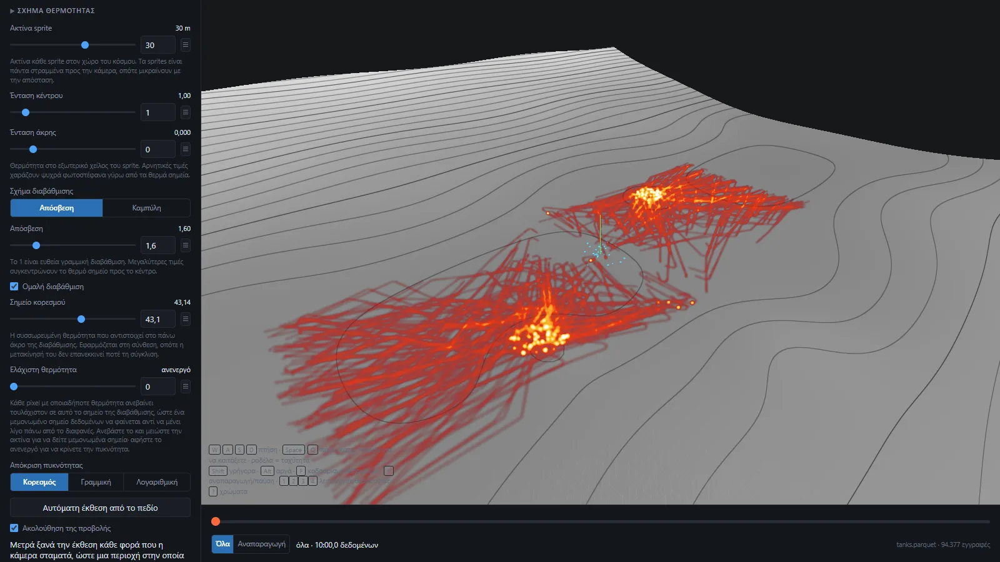
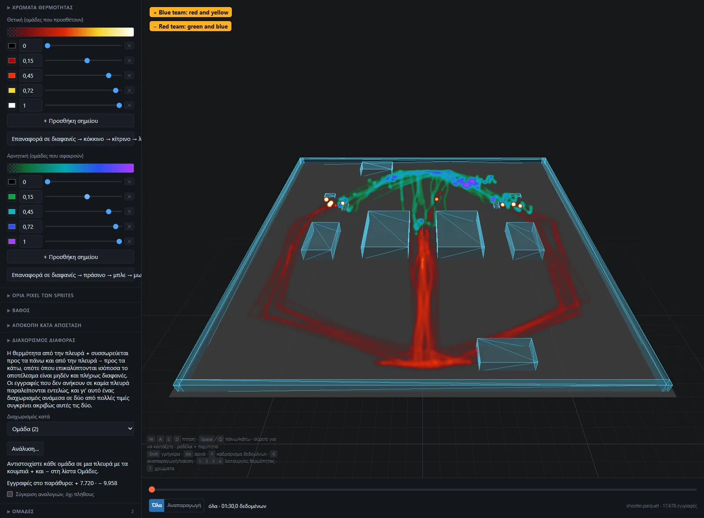
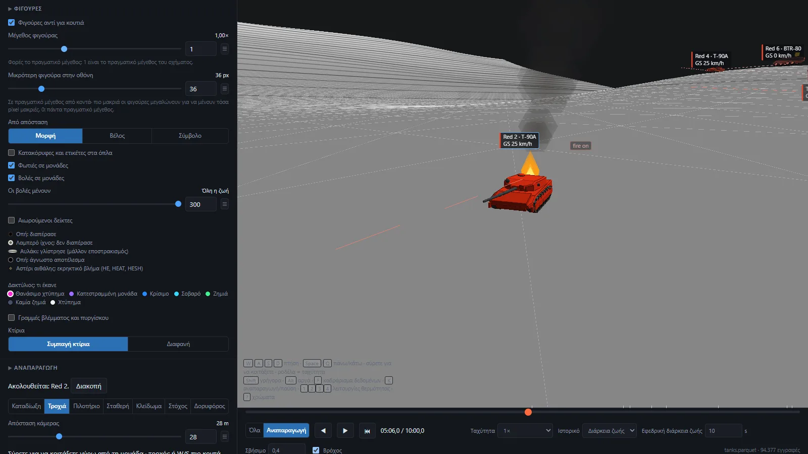
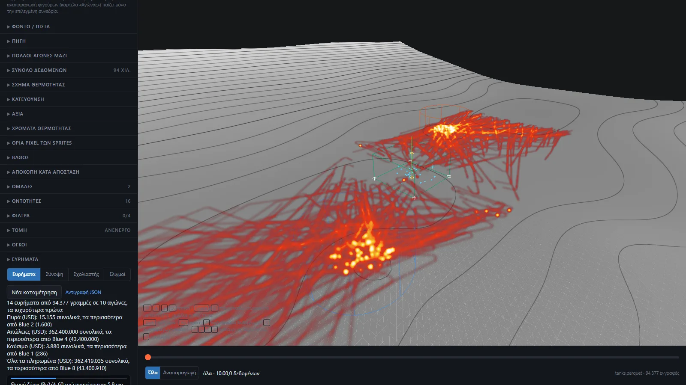
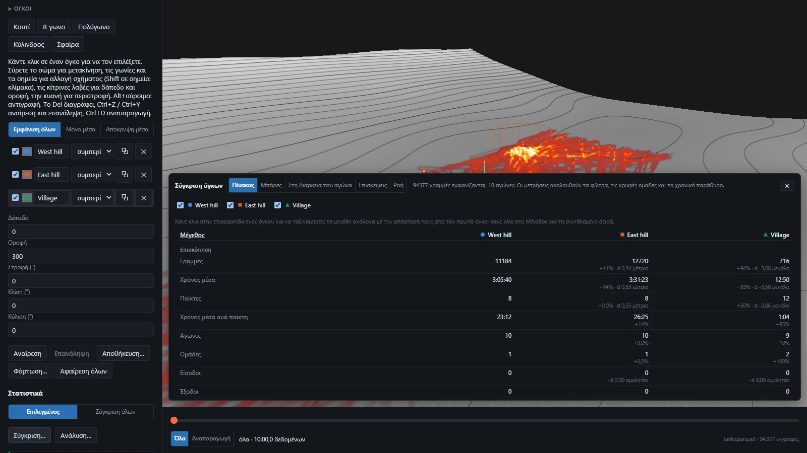
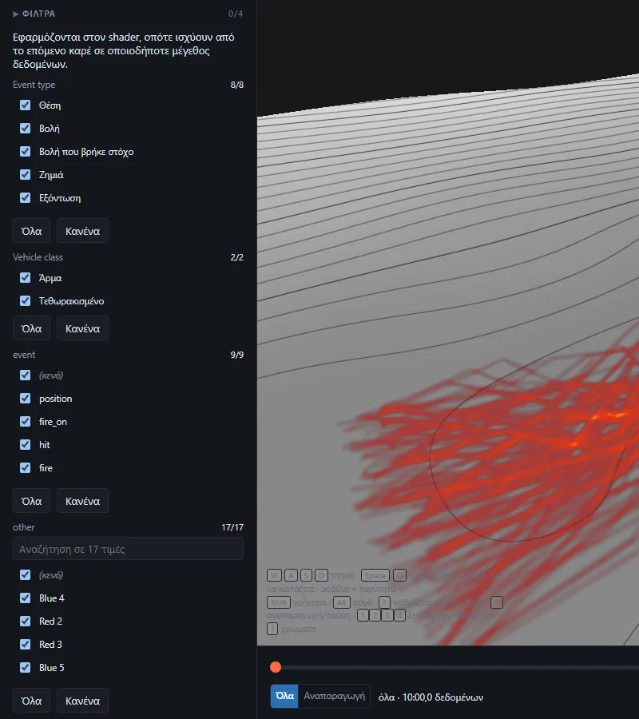
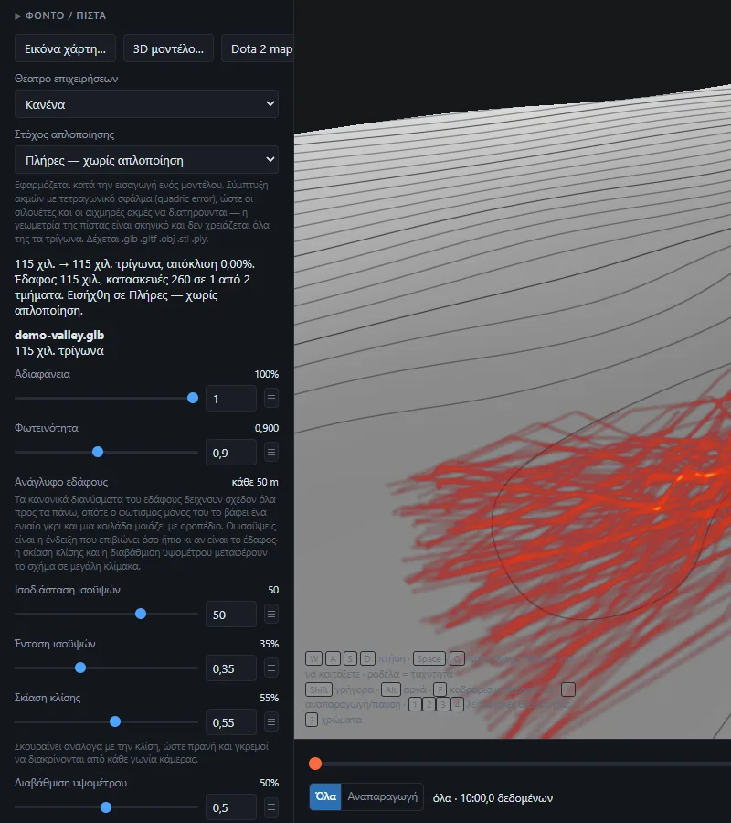

# 3DHeat

Το 3DHeat δείχνει πού συνέβησαν τα πράγματα σε ένα παιχνίδι - πού πήγαν οι παίκτες, πού μάχηξαν και πού έπεσαν - ως λαμπερά χρώματα μέσα στα οποία μπορείτε να πετάξετε, ή ως μικρές τρισδιάστατες φιγούρες που ξαναπαίζουν τον αγώνα.

Φορτώστε θέσεις - CSV, Parquet, εγγραφές Tacview, επαναλήψεις που έχουν μετατραπεί, ένα αρχείο, έναν φάκελο ή χιλιάδες αγώνες - και δείτε τις ως **χάρτη θερμότητας μέσα στον οποίο μπορείτε να πετάξετε**, ως **φιγούρες που ξαναπαίζουν τον αγώνα**, ως γραμμές κατά μήκος των διαδρομών που ακολούθησαν οι άνθρωποι, ή ως έναν πληθυσμό απέναντι σε έναν άλλο. Βρίσκει μόνο του τα σημεία που ξεχωρίζουν, και τρέχει εξ ολοκλήρου μέσα στον περιηγητή σας: τίποτα δεν ανεβαίνει πουθενά. Το 3DHeat και όλα τα εργαλεία του είναι δωρεάν και ανοιχτού κώδικα, με άδεια [MIT](https://github.com/Holdi601/3DHeat/blob/main/LICENSE).



**Νέος εδώ;** Δημιουργήστε τα [δεδομένα επίδειξης](demo-data.md) και ακολουθήστε τα επτά βήματά τους. Κάθε εικόνα αυτού του ιστότοπου τραβήχτηκε με αυτά.

## Τι κάνει {#what-it-does}

| | |
|---|---|
|  | **[Λειτουργίες θερμότητας](heat-modes.md)** - θερμότητα, [διαφορά](difference.md) (κόκκινο όπου η μία πλευρά ήταν περισσότερο, πράσινο-μπλε όπου ήταν η άλλη), [θερμότητα ομάδας](team-heat.md), [θερμότητα γραμμών](line-heat.md)· [κατευθυντική θερμότητα](directional-heat.md) με σφήνες, πεδία βελών και πολικά διαγράμματα· θερμότητα [σταθμισμένη με αξία](value-weighting.md): τι κοστίζουν τα όπλα, τα οχήματα και τα καύσιμα. |
|  | **[Επανάληψη αγώνα](match-replay.md)** - κάθε μονάδα ως τη [φιγούρα](figures.md) αυτού που είναι, σύμβολα NATO ή ρωσικά σε απόσταση, πύραυλοι και ιχνηθέτες, σημάδια χτυπημάτων, ναυάγια, φωτιές, πύργοι, στόχοι, κάμερες τύπου Tacview και τακτική οθόνη· [πολλοί αγώνες μαζί](many-matches.md). |
|  | **[Ευρήματα](insights.md)** - ισχυρές θέσεις, επικίνδυνο έδαφος, παγίδες εμφάνισης, στενά και ξεχωριστοί παίκτες, βρεθέντα και κατατεταγμένα με τα τεκμήρια· γραπτή ανασκόπηση, προαιρετικά από ΤΝ της επιλογής σας· ένας σχολιαστής (caster) για έναν αγώνα· ο [φακός γνώσης](knowledge.md). |
|  | **[Όγκοι](volumes.md)** - σχεδιάστε κουτιά, πρίσματα, κυλίνδρους και σφαίρες, φιλτράρετε μέσα τους, μετρήστε τι συμβαίνει μέσα τους, εξάγετέ το και συγκρίνετε τόπους δίπλα-δίπλα· [ανάλυση ανά κατηγορία](breakdown.md) του ποιος και τι τα πάει καλύτερα σε έναν τόπο. |
|  | **[Φίλτρα](filters.md)** - ανά τύπο γεγονότος, παίκτη ή AI, κλάση οχήματος, αξία, οποιαδήποτε στήλη, στην κάρτα γραφικών σε κάθε μέγεθος δεδομένων. |
|  | **[Επίπεδα](levels.md)** - εικόνες χαρτών, τρισδιάστατα επίπεδα φτιαγμένα με τα [εργαλεία δεδομένων](#related-repositories), απλοποίηση, το [φόντο κόσμου](world-backdrop.md) με πραγματικό ανάγλυφο για δεδομένα πτήσης. |

Επίσης: η καρτέλα [Ανάλυση αγώνα](race-analysis.md) για γύρους αγωνιστικών παιχνιδιών, η καρτέλα [Αγώνας](match-analysis.md) για συνόψεις Counter-Strike 2, ο [πίνακας τακτικής](tactics-board.md) για σχέδια σε ένα επίπεδο, η [ανάλυση χτυπημάτων (καρτέλα Οχήματα)](hit-analysis.md) ανά όχημα, η [μαζική ανάλυση](mass-analysis.md) χιλιάδων αγώνων, οι [διαδρομές κάμερας και βίντεο](camera-path-and-video.md), [40 γλώσσες](languages.md), [μετρικές ή αγγλοσαξονικές μονάδες](settings.md).

## Οι καρτέλες {#the-tabs}

Οι καρτέλες βρίσκονται στο πάνω μέρος της πλαϊνής στήλης, κάτω από το όνομα, τις μονάδες και το μενού γλώσσας.

| Καρτέλα | Για τι χρησιμεύει |
|---|---|
| **Χάρτης θερμότητας** | Οποιοσδήποτε πίνακας θέσεων: οι λειτουργίες θερμότητας, η επικάλυψη φιγούρων, τα φίλτρα, οι όγκοι, τα συμπεράσματα, τα επίπεδα, η μέτρηση και το βίντεο. |
| **Ανάλυση αγώνα** | Δύο ή περισσότεροι γύροι της ίδιας πίστας: πού χάνεται χρόνος, γιατί, και τι να αλλάξετε. |
| **Αγώνας** | Η επανάληψη του αγώνα με φιγούρες και οι συνόψεις αγώνων Counter-Strike 2. |
| **Τακτική** | Σχέδια σε ένα επίπεδο: φιγούρες, διαδρομές, ρίψεις εξοπλισμού, περιοχές και σημειώσεις σε βήματα που παίζουν. |
| **Οχήματα** | Πού χτυπήθηκε κάθε μονάδα, από ποιον και με τι. |

## Εγκατάσταση και εκτέλεση {#install-and-run}

Το 3DHeat είναι δωρεάν για χρήση, αλλαγή και διανομή (άδεια MIT), και το ίδιο ισχύει για κάθε εργαλείο που αναφέρεται στα [Σχετικά αποθετήρια](#related-repositories).

### Windows, ο εύκολος τρόπος {#windows-the-easy-way}

Η ρίζα του αποθετηρίου περιέχει τρία αρχεία batch.

| Αρχείο | Τι κάνει |
|---|---|
| `start.bat` | Ξεκινά τον περιηγητή. Βρίσκει το Node.js ακόμα κι όταν δεν είναι στο `PATH` (ψάχνει στα `%ProgramFiles%\nodejs`, `%ProgramFiles(x86)%\nodejs` και `%LOCALAPPDATA%\Programs\nodejs`), και όταν το Node.js λείπει προσφέρεται να εγκαταστήσει την έκδοση LTS με `winget install -e --id OpenJS.NodeJS.LTS`. Στην πρώτη εκτέλεση ρωτά πριν κατεβάσει τις εξαρτήσεις (περίπου 300 MB μέσα στον φάκελο `node_modules\`, τίποτα σε επίπεδο συστήματος). Αρνείται να ξεκινήσει όταν κάτι ακούει ήδη στη θύρα 5273, και σας στέλνει στο `restart.bat`. Όταν ο φάκελος είναι αντίγραφο git χωρίς τοπικές αλλαγές και υπάρχει νεότερη έκδοση, ρωτά αν θέλετε ενημέρωση (Y/N· χωρίς απάντηση σε 60 δευτερόλεπτα κρατά αυτή την έκδοση· βλ. [Ενημερώσεις](updates.md)). Έπειτα τρέχει τον διακομιστή ανάπτυξης στο `http://127.0.0.1:5273/` και ανοίγει τον περιηγητή. **Το παράθυρο είναι ο διακομιστής**: αφήστε το ανοιχτό, κλείστε το ή πατήστε Ctrl+C για να σταματήσει. |
| `restart.bat` | Εκτελεί `stop.bat quiet` και μετά `start.bat`. Χρειάζεται μόνο μετά από αλλαγή στο `vite.config.ts`, προσθήκη εξάρτησης ή όταν ο διακομιστής έχει κολλήσει· οι αλλαγές στον πηγαίο κώδικα φορτώνονται αυτόματα. |
| `stop.bat` | Σταματά ό,τι ακούει στη θύρα 5273, με τον αναγνωριστικό της διεργασίας που βρίσκει μέσω του `netstat`, ποτέ με βάση το όνομα εικόνας, ώστε οι άλλες διεργασίες Node.js του υπολογιστή να μένουν ανέγγιχτες. Περιμένει περίπου δύο δευτερόλεπτα να ελευθερωθεί η υποδοχή. Με το όρισμα `quiet` δεν σταματά στο τέλος. |

### Με το χέρι (οποιοδήποτε λειτουργικό) {#by-hand-any-os}

```bash
git clone --recursive https://github.com/Holdi601/3DHeat.git
cd 3DHeat
npm install
npm run dev      # http://127.0.0.1:5273
```

Ο φάκελος `exporters/` περιέχει τα ξεχωριστά εργαλεία δεδομένων ως υπομονάδες git, το καθένα το δικό του αποθετήριο· μετά από ένα απλό clone εκτελέστε `git submodule update --init`. Ο ίδιος ο περιηγητής δεν τα χρειάζεται για να τρέξει. Ο φάκελος `exporters/ext/` περιέχει τους προαιρετικούς μετατροπείς (War Thunder, World of Tanks, World of Warships, επαναλήψεις Squad· χάρτες DCS και IL-2), χωριστά ώστε ένα πρόβλημα με έναν από αυτούς να μην επηρεάζει τίποτα άλλο.

Κανένα δεδομένο παιχνιδιού δεν συνοδεύει τίποτα από αυτά: τα επίπεδα, οι χάρτες και οι εγγραφές φτιάχνονται στον δικό σας υπολογιστή με τα εργαλεία, από παιχνίδια που σας ανήκουν.

### Σενάρια npm {#npm-scripts}

| Σενάριο | Τι εκτελεί |
|---|---|
| `npm run dev` | Ο διακομιστής ανάπτυξης Vite στη θύρα 5273, δεμένος στο `127.0.0.1`. |
| `npm run build` | Έλεγχος τύπων (`tsc --noEmit`) και πακέτο παραγωγής στο `dist/`. |
| `npm run preview` | Σερβίρει το πακέτο παραγωγής. |
| `npm run typecheck` | Μόνο ο έλεγχος τύπων. |
| `npm test` / `npm run test:watch` | Δοκιμές μονάδων και ολοκλήρωσης (vitest). |
| `npm run smoke` | Τρέχει την πραγματική εφαρμογή σε headless Chromium και ελέγχει ότι ο καμβάς έχει εικονοστοιχεία με χρώμα δεδομένων· τα στιγμιότυπα πάνε στο `tools/.smoke/`. Θέλει να τρέχει ήδη ο διακομιστής ανάπτυξης. |
| `npm run smoke:f16` | Η ίδια σουίτα με `?heat=f16`, που αναγκάζει τη διαδρομή συσσώρευσης half-float (βλ. [Συσσώρευση half-float](half-float-accumulation.md)). |
| `npm run bench` | Μέτρηση εισαγωγής δεδομένων, γράφει το `tools/.smoke/ingest-bench.json`. |
| `npm run test:heavy` | Δοκιμές που χρειάζονται μεγάλα αρχεία πραγματικών δεδομένων· παρακάμπτονται μόνες τους όταν λείπουν τα αρχεία. |
| `npm run inspect -- <file.parquet>` | Τυπώνει το σχήμα ενός αρχείου Parquet και μερικές γραμμές (`tools/inspect-parquet.mjs`). |

### Τι προσθέτει ο διακομιστής ανάπτυξης {#what-the-dev-server-adds}

Ο περιηγητής είναι μια στατική ιστοσελίδα, αλλά ο διακομιστής ανάπτυξης (βλ. `vite.config.ts`) προσθέτει δύο τοπικές διαδρομές που δεν έχει μια στατική εγκατάσταση του `dist/`:

- Το `/__host/memory` αναφέρει τη συνολική και την ελεύθερη μνήμη RAM του υπολογιστή και, όπου μπορεί να τη διαβάσει, τη μνήμη της κάρτας γραφικών (από το `nvidia-smi`, ή στα Windows από την καταχώριση μητρώου του προσαρμογέα οθόνης). Έτσι οι [προϋπολογισμοί μνήμης](memory-and-budgets.md) χρησιμοποιούν πραγματικά νούμερα αντί για τις περιορισμένες εκτιμήσεις του περιηγητή.
- Το `/__heat3d/update` ελέγχει αν το αντίγραφο εργασίας είναι πίσω και μπορεί να το ενημερώσει με fast-forward ([Ενημερώσεις](updates.md)).

Ο διακομιστής δένεται μόνο στο `127.0.0.1`, οπότε καμία από τις δύο διαδρομές δεν είναι προσβάσιμη από το δίκτυο. Ανοίξτε τον ως `http://127.0.0.1:5273`: το `localhost` μπορεί να επιλυθεί στη διεύθυνση IPv6 `::1`, όπου δεν ακούει τίποτα. Δεν στέλνει κεφαλίδες cross-origin isolation (COOP/COEP): τίποτα στον περιηγητή δεν χρησιμοποιεί `SharedArrayBuffer`, και οι workers παραδίδουν τα δεδομένα τους με μεταφορά, που δεν χρειάζεται τέτοιες κεφαλίδες.

## Απαιτήσεις περιηγητή και GPU {#browser-and-gpu-requirements}

- **Περιηγητής με WebGPU ή WebGL2.** Δοκιμάζεται πρώτα το WebGPU (το έχουν Chrome και Edge)· χωρίς αυτό χρησιμοποιείται το backend WebGL2. Το WebGL2 πρέπει να προσφέρει το `EXT_color_buffer_float` (απόδοση σε υφές float), αλλιώς ο περιηγητής δείχνει «Δεν είναι δυνατή η αρχικοποίηση της μηχανής απόδοσης.» Βλ. [Οι δύο μηχανές απόδοσης](backends.md). Ο περιηγητής αναπτύσσεται και δοκιμάζεται στο Chromium· τα άλλα προγράμματα περιήγησης δεν έχουν επαληθευτεί.
- **Ενεργοποιημένη υλική επιτάχυνση.** Όταν ο περιηγητής σχεδιάζει με την CPU (SwiftShader, llvmpipe, το Microsoft Basic Render Driver και παρόμοια), ένα κόκκινο banner στο πάνω μέρος της πλαϊνής στήλης το λέει και δείχνει πώς να το διορθώσετε. Βλ. [Ανίχνευση λογισμικής απόδοσης](software-rendering.md).
- **Μια ξεχωριστή κάρτα γραφικών βοηθά, αλλά δεν είναι απαραίτητη.** Και τα δύο backends ζητούν τον προσαρμογέα υψηλής απόδοσης. Το ποσό δεδομένων που μπορεί να κρατηθεί στην GPU είναι προϋπολογισμός που βλέπετε και αλλάζετε ([Μνήμη και προϋπολογισμοί](memory-and-budgets.md)).
- **Οι προαιρετικές δυνατότητες** χρησιμοποιούν επιπλέον API του περιηγητή: η απόδοση βίντεο χρειάζεται το WebCodecs `VideoEncoder` με VP9 ή VP8 ([Διαδρομή κάμερας και βίντεο](camera-path-and-video.md))· η απλοποίηση πλεγμάτων επιπέδων χρειάζεται WebAssembly· η ρίψη φακέλων χρησιμοποιεί το File and Directory Entries API· η βιβλιοθήκη επιπέδων χρησιμοποιεί το IndexedDB· τα gamepads χρησιμοποιούν το Gamepad API.

## Χάρτης τεκμηρίωσης {#documentation-map}

**Αρχή**: [Δεδομένα επίδειξης](demo-data.md) · [Εισαγωγή δεδομένων](getting-data-in.md) ([φόρτωση αρχείων](loading-files.md), [αντιστοίχιση στηλών](column-mapping.md), [άξονες, μονάδες και χρόνος](axes-units-and-time.md), [συνεδρίες, πρόσωπα και ομάδες](sessions-persons-groups.md), [Tacview](tacview-acmi.md), [μετατροπείς](converters.md), [.3dheat](container.md), [μνήμη και προϋπολογισμοί](memory-and-budgets.md))

**Δείτε**: [Λειτουργίες θερμότητας](heat-modes.md) ([θερμότητα](heat.md), [σχήμα sprite](sprite-shape.md), [χρώμα και έκθεση](colour-and-exposure.md), [βάθος και αποκοπή](depth-and-culling.md), [διαφορά](difference.md), [θερμότητα ομάδας](team-heat.md), [θερμότητα γραμμών](line-heat.md), [επικάλυψη φιγούρων](box-replay.md), [κατευθυντική θερμότητα](directional-heat.md), [στάθμιση τιμών](value-weighting.md)) · [Χρονολόγιο και αναπαραγωγή](timeline.md) · [Επίπεδα](levels.md) ([εικόνες χαρτών](map-images.md), [Επίπεδα 3D](model-levels.md), [Εμφάνιση επιπέδου](level-appearance.md), [Βιβλιοθήκη επιπέδων](level-library.md), [φόντο κόσμου](world-backdrop.md), [Φόντο κόσμου - πηγές και όροι](world-backdrop-sources.md)) · [Κάμερα και έλεγχοι](camera.md) ([Gamepad και HOTAS](gamepad.md), [Αναφορά πληκτρολογίου και ποντικιού](keyboard-reference.md)) · [Διαδρομή κάμερας και βίντεο](camera-path-and-video.md)

**Ανάλυση**: [Φίλτρα και εργαλεία](filters-and-tools.md) ([φίλτρα](filters.md), [Λίστα ομάδων](teams-list.md), [οντότητες](entities.md), [τομή](slice.md), [μέτρηση](measure.md), [Όγκοι και σύγκριση](volumes.md), [ανάλυση ανά κατηγορία](breakdown.md)) · [Ευρήματα](insights.md) ([φακός γνώσης](knowledge.md)) · [Μαζική ανάλυση](mass-analysis.md)

**Αναπαραγωγή**: [Επανάληψη αγώνα](match-replay.md) · [Πολλοί αγώνες μαζί](many-matches.md) · [Φιγούρες](figures.md) ([Φιγούρες στην επικάλυψη φιγούρων](figure-replay.md), [Πιστώσεις φιγούρων](figure-credits.md)) · [Ισοδυναμία με Tacview](tacview-parity.md) · [Ανάλυση χτυπημάτων (καρτέλα Οχήματα)](hit-analysis.md)

**Άλλες καρτέλες**: [Ανάλυση αγώνα](race-analysis.md) ([Αναλυτικά αγώνα: η μέθοδος](race-analytics.md), [Άλλα παιχνίδια αγώνων](other-games.md)) · [Ανάλυση αγώνα (CS2)](match-analysis.md) · [Πίνακας τακτικής](tactics-board.md) ([Ταχύτητες κίνησης](tactics-speeds.md))

**Ο περιηγητής**: [Γλωσσάρι](glossary.md) · [Ρυθμίσεις, μονάδες και πλήκτρα](settings.md) · [Γλώσσες](languages.md) · [Ενημερώσεις](updates.md) · [Εσωτερικά απόδοσης](rendering-internals.md) ([Οι δύο μηχανές απόδοσης](backends.md), [Συσσώρευση](accumulation.md), [δειγματοληψία και προϋπολογισμοί](sampling-and-budgets.md), [Συσσώρευση half-float](half-float-accumulation.md), [Παραμονή μνήμης GPU](gpu-memory.md), [Ανίχνευση λογισμικής απόδοσης](software-rendering.md), [Πίνακας απόδοσης και στατιστικά](performance-and-stats.md)) · [Αναφορά μορφών δεδομένων](data-formats.md) · [Αναφορά](reference.md) · [Συντήρηση της τεκμηρίωσης](maintaining.md)

## Σχετικά αποθετήρια {#related-repositories}

Ο περιηγητής διαβάζει δεδομένα· αυτά τα εργαλεία τα φτιάχνουν. Το καθένα είναι δικό του δημόσιο αποθετήριο (MIT) με τη δική του τεκμηρίωση. Κανένα δεν συνοδεύεται από δεδομένα παιχνιδιών: τα επίπεδα, οι χάρτες και οι εγγραφές φτιάχνονται στον δικό σας υπολογιστή, από παιχνίδια που σας ανήκουν.

| Αποθετήριο | Τι κάνει | Χρήσιμο για | Τεκμηρίωση |
|---|---|---|---|
| [3DHeat-GameFiles](https://github.com/Holdi601/3DHeat-GameFiles) | Διαβάζει πίστες και επίπεδα από τα αρχεία που συνοδεύουν τα παιχνίδια (Forza Horizon, BeamNG, Assetto Corsa Rally· αναγνώστες για Unreal, Unity, Frostbite και Source 2) σε μορφή glTF | ένα τρισδιάστατο επίπεδο κάτω από τη θερμότητα ή την επανάληψή σας | [ιστότοπος](https://holdi601.github.io/3DHeat-GameFiles/) |
| [3DHeat-GameCapture](https://github.com/Holdi601/3DHeat-GameCapture) | Καταγράφει τηλεμετρία γύρων από τις διεπαφές που δημοσιεύουν τα αγωνιστικά παιχνίδια, και ξαναφτιάχνει επίπεδα από βίντεο παιχνιδιού | γύρους για την Ανάλυση αγώνα· ένα επίπεδο όπου δεν μπορούν να διαβαστούν αρχεία | [ιστότοπος](https://holdi601.github.io/3DHeat-GameCapture/) |
| [3DHeat-UnrealExporter](https://github.com/Holdi601/3DHeat-UnrealExporter) | Πρόσθετο του Unreal Editor που εξάγει ένα επίπεδο ως ένα αρχείο glTF | επίπεδα από δικά σας έργα Unreal | [ιστότοπος](https://holdi601.github.io/3DHeat-UnrealExporter/) |
| [3DHeat-CS2](https://github.com/Holdi601/3DHeat-CS2) | Demos του Counter-Strike 2 σε πίνακες χαρτών θερμότητας και συνόψεις αγώνων, χάρτες CS2 σε γεωμετρία | θερμότητα CS2, επαναλήψεις και την καρτέλα Αγώνας | [ιστότοπος](https://holdi601.github.io/3DHeat-CS2/) |
| [3DHeat-Watcher](https://github.com/Holdi601/3DHeat-Watcher) | Καταγράφει το παιχνίδι σας στο παρασκήνιο από όσα δημοσιεύουν τα παιχνίδια: τηλεμετρία, ενσωματώσεις κατάστασης παιχνιδιού, αρχεία καταγραφής, επαναλήψεις | τα δικά σας στατιστικά χωρίς να κάνετε τίποτα με το χέρι | [ιστότοπος](https://holdi601.github.io/3DHeat-Watcher/) |
| [3DHeat-Ext-WarThunder](https://github.com/Holdi601/3DHeat-Ext-WarThunder) | Επαναλήψεις του War Thunder (`.wrpl`) σε πίνακες: διαδρομές αέρος και εδάφους, βολές, χτυπήματα, σκοτωμούς, πύργους, στόχους | επαναλήψεις War Thunder, σημάδια χτυπημάτων και συμπεράσματα | [ιστότοπος](https://holdi601.github.io/3DHeat-Ext-WarThunder/) |
| [3DHeat-Ext-WoT](https://github.com/Holdi601/3DHeat-Ext-WoT) | Επαναλήψεις του World of Tanks σε πίνακες: η θέση κάθε οχήματος, θάνατοι και σκοτωμοί | θερμότητα και επαναλήψεις World of Tanks | [ιστότοπος](https://holdi601.github.io/3DHeat-Ext-WoT/) |
| [3DHeat-Ext-WoWs](https://github.com/Holdi601/3DHeat-Ext-WoWs) | Επαναλήψεις του World of Warships σε πίνακες: η θέση κάθε πλοίου και οι βυθίσεις | θερμότητα και επαναλήψεις World of Warships | [ιστότοπος](https://holdi601.github.io/3DHeat-Ext-WoWs/) |
| [3DHeat-Ext-Squad](https://github.com/Holdi601/3DHeat-Ext-Squad) | Demos διακομιστών Squad σε πίνακες: η θέση, η ομάδα και το τάγμα κάθε παίκτη | θερμότητα και επαναλήψεις Squad | [ιστότοπος](https://holdi601.github.io/3DHeat-Ext-Squad/) |
| [3DHeat-Ext-DCS](https://github.com/Holdi601/3DHeat-Ext-DCS) | Εδάφη του DCS World από τη δική σας εγκατάσταση σε επίπεδα: έδαφος, δρόμοι, πόλεις, αεροδρόμια, χωράφια, νερό | DCS και εγγραφές Tacview πάνω στο πραγματικό τους έδαφος | [ιστότοπος](https://holdi601.github.io/3DHeat-Ext-DCS/) |
| [3DHeat-Ext-IL2](https://github.com/Holdi601/3DHeat-Ext-IL2) | Χάρτες του IL-2 Great Battles σε επίπεδα | εγγραφές IL-2 πάνω στον χάρτη τους | [ιστότοπος](https://holdi601.github.io/3DHeat-Ext-IL2/) |

## Συνοπτικά, η δομή του κώδικα {#source-layout-briefly}

| Φάκελος | Περιεχόμενο |
|---|---|
| [`src/data/`](https://github.com/Holdi601/3DHeat/tree/main/src/data) | Επιλογή αρχείων, εισαγωγή CSV και Parquet, αυτόματη αντιστοίχιση, επικύρωση, μοντέλο μνήμης, κατασκευή συνόλων δεδομένων, ανάλυση μοντέλων, ταξινόμηση, απλοποίηση, βιβλιοθήκη επιπέδων |
| [`src/render/`](https://github.com/Holdi601/3DHeat/tree/main/src/render) | Ο βρόχος καρέ (`engine.ts`), δειγματοληψία, και τα δύο backends, κάμερα, gamepad, μέτρηση, διαδρομή κάμερας, εγγραφή βίντεο |
| [`src/state/`](https://github.com/Holdi601/3DHeat/tree/main/src/state) | Η κατάσταση της εφαρμογής (`store.ts`) με κάθε προεπιλογή, οι τύποι του πεδίου (`types.ts`), η καμπύλη του sprite |
| [`src/ui/`](https://github.com/Holdi601/3DHeat/tree/main/src/ui) | Τα πάνελ της πλαϊνής στήλης, το χρονολόγιο, τα overlays |
| [`src/race/`](https://github.com/Holdi601/3DHeat/tree/main/src/race), [`src/match/`](https://github.com/Holdi601/3DHeat/tree/main/src/match) | Οι καρτέλες Ανάλυση αγώνα και Αγώνας |
| [`src/i18n/`](https://github.com/Holdi601/3DHeat/tree/main/src/i18n) | Μεταφράσεις |
| [`src/insights/`](https://github.com/Holdi601/3DHeat/tree/main/src/insights) | Ευρήματα: ανιχνευτές, ανασκόπηση, σχολιαστής, παροχείς ΤΝ, ο φακός γνώσης |
| [`src/mass/`](https://github.com/Holdi601/3DHeat/tree/main/src/mass) | Μαζική ανάλυση σε πολλούς αγώνες |
| [`src/volumes/`](https://github.com/Holdi601/3DHeat/tree/main/src/volumes) | Όγκοι, τα στατιστικά τους, εξαγωγή και σύγκριση |
| [`src/breakdown/`](https://github.com/Holdi601/3DHeat/tree/main/src/breakdown) | Ανάλυση και παράγοντες |
| [`src/overlay/`](https://github.com/Holdi601/3DHeat/tree/main/src/overlay) | Η επικάλυψη πολλών αγώνων |
| [`src/figures/`](https://github.com/Holdi601/3DHeat/tree/main/src/figures) | Ο κατάλογος φιγούρων και ο κατασκευαστής του |
| [`src/vehicle/`](https://github.com/Holdi601/3DHeat/tree/main/src/vehicle) | Ανάλυση χτυπημάτων (καρτέλα Οχήματα) |
| [`src/tactics/`](https://github.com/Holdi601/3DHeat/tree/main/src/tactics) | Ο πίνακας τακτικής |
| [`src/world/`](https://github.com/Holdi601/3DHeat/tree/main/src/world) | Το φόντο κόσμου |
| [`src/units/`](https://github.com/Holdi601/3DHeat/tree/main/src/units) | Μονάδες μέτρησης |
