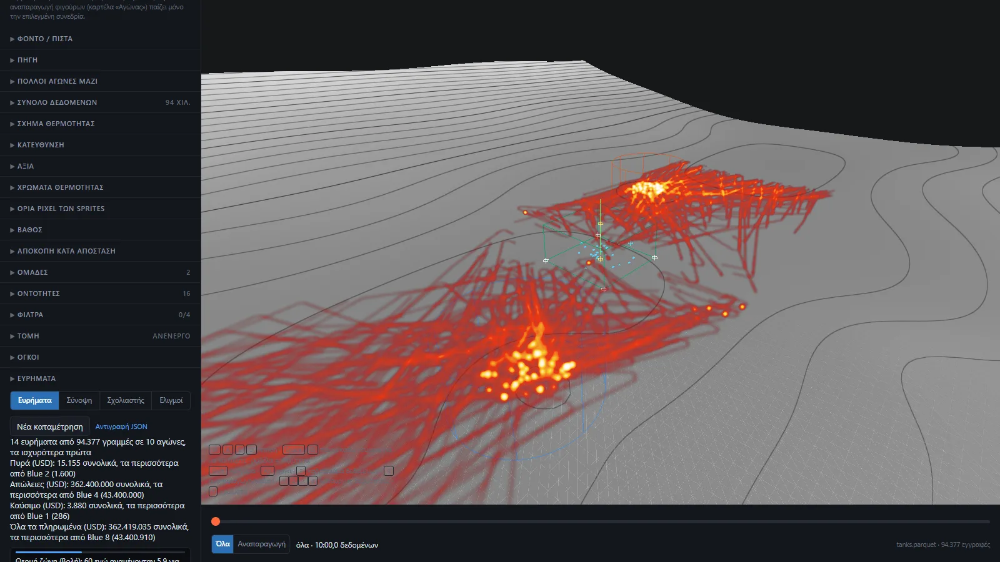
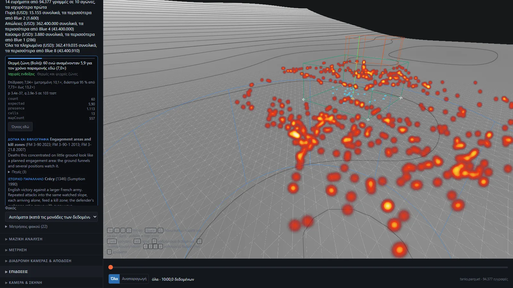
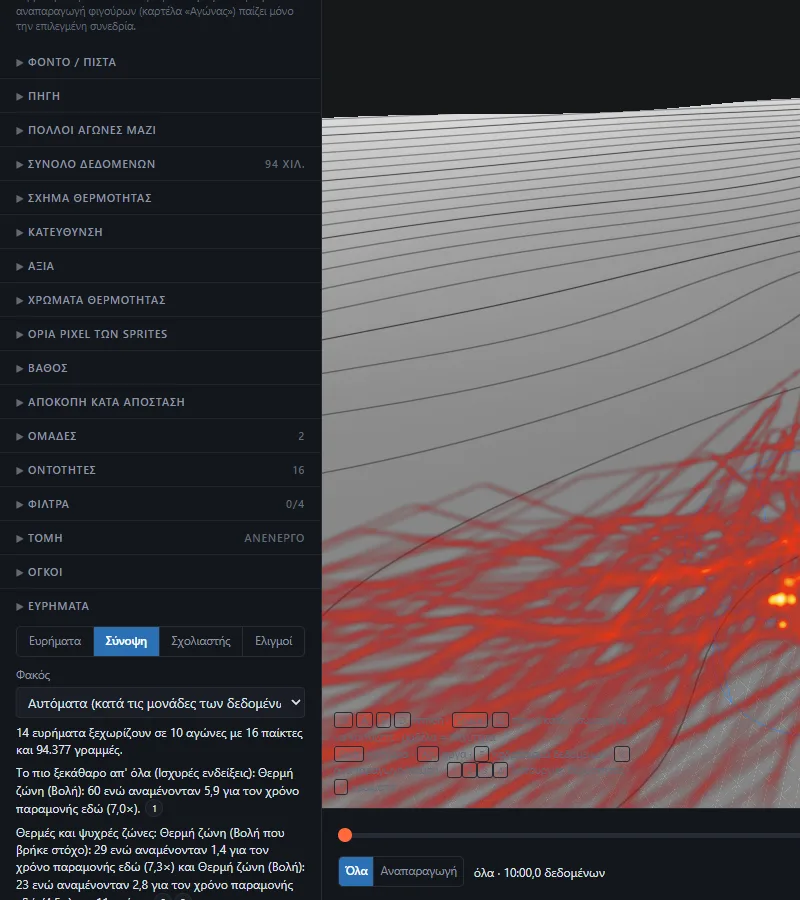
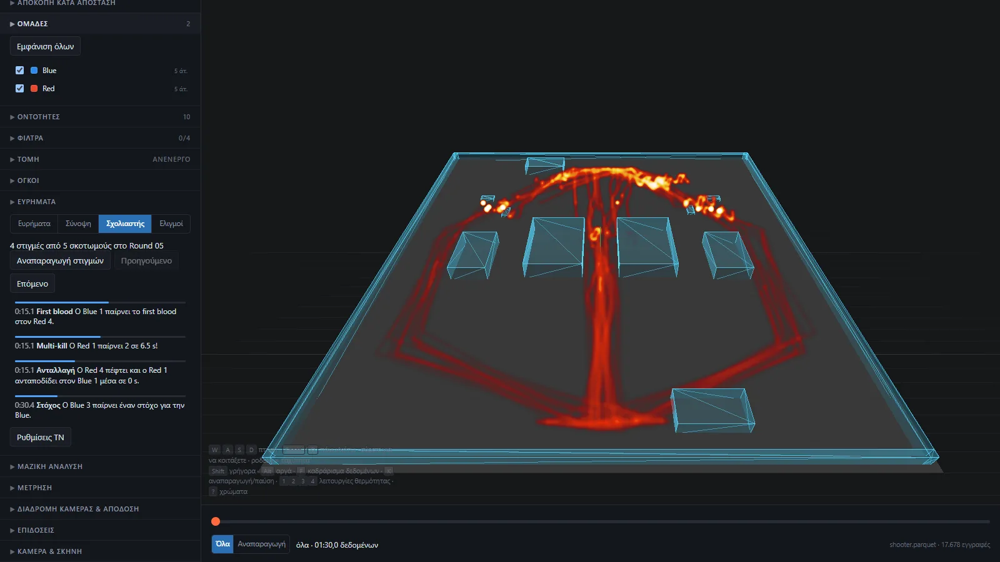

# Ευρήματα

Τα **Ευρήματα** ψάχνουν μέσα στα φορτωμένα δεδομένα για ό,τι ξεχωρίζει - ισχυρές θέσεις, επικίνδυνο έδαφος, παγίδες εμφάνισης, στενά περάσματα, παίκτες που υπερέχουν πολύ των συνομηλίκων τους - και σας το λένε, το ισχυρότερο πρώτα, με τα τεκμήρια. Χρησιμοποιήστε τα για να μάθετε σε ένα λεπτό πού κερδήθηκε ή χάθηκε ένας αγώνας. Μπορούν στη συνέχεια να γράψουν μια σύνοψη, και σε μία μόνο επανάληψη μπορούν να δράσουν ως σχολιαστής που πηδά στις μεγάλες στιγμές.

Όλα μετρώνται μέσα στον περιηγητή σας. Τίποτα δεν φεύγει από τον υπολογιστή σας, εκτός αν ενεργοποιήσετε εξωτερική ΤΝ (βλ. [Εξωτερική ΤΝ](#external-ai)).

Η ενότητα **Ευρήματα** βρίσκεται στην πλαϊνή στήλη των καρτελών Χάρτης θερμότητας και Αγώνας. Έχει τρεις καρτέλες: **Ευρήματα**, **Σύνοψη** και **Σχολιαστής**.

## Ευρήματα {#findings}

1. Φορτώστε δεδομένα και ανοίξτε τα **Ευρήματα**. Πατήστε **Εύρεση ευρημάτων** («Καταμέτρηση… n%» δείχνει την πρόοδο).
2. Διαβάστε τη λίστα. Κάθε εύρημα έχει μια μπάρα ισχύος, μια πρόταση, πόσο καλά είναι τεκμηριωμένο (*Ισχυρά τεκμήρια*, *Καλά τεκμήρια* ή *Κάποια τεκμήρια*), τον ανιχνευτή που το βρήκε, και την κλάση οχήματος όπου έχει σημασία.
3. **Κάντε κλικ σε ένα εύρημα**: ο περιηγητής εφαρμόζει τα φίλτρα του, πετά την κάμερα στον τόπο και πηδά στον χρόνο, και ανοίγει τις λεπτομέρειες: το αποτέλεσμα με το διάστημα εμπιστοσύνης 95%, τις τιμές p και q, τα μετρημένα τεκμήρια, και το **Όγκος εδώ**, που σχεδιάζει έναν [όγκο](volumes.md) γύρω από τον τόπο.
4. Το **Επαναφορά φίλτρων** επαναφέρει τα δικά σας φίλτρα. Το **Αντιγραφή JSON** αντιγράφει ολόκληρη την αναφορά.

Η καταμέτρηση χρησιμοποιεί τα τρέχοντα φίλτρα, τις κρυφές ομάδες και τον επιλεγμένο αγώνα σε ολόκληρο το χρονικό εύρος. Όταν αλλάξετε μετά τα φίλτρα, μια σημείωση το λέει· πατήστε **Νέα καταμέτρηση**.

Οι γραμμές στην κορυφή της λίστας (για παράδειγμα τα σύνολα χρημάτων) συνοψίζουν ολόκληρα τα δεδομένα πριν από τα ευρήματα.

### Οι ανιχνευτές {#the-detectors}

| Ανιχνευτής | Τι βρίσκει | Χρειάζεται στα δεδομένα |
|---|---|---|
| **Θέσεις ισχύος** | Τόπους με πολύ καλύτερες πιθανότητες φόνου προς θάνατο από τον υπόλοιπο χάρτη, και *ασφαλές έδαφος* όπου λίγοι πεθαίνουν για τον χρόνο που περνούν | γεγονότα φόνου και θανάτου |
| **Θερμές και ψυχρές ζώνες** | Τόπους όπου ένα είδος γεγονότος (βολές, χτυπήματα, καταλήψεις ...) συμβαίνει πολύ περισσότερο ή λιγότερο απ' ό,τι προβλέπει ο χρόνος που περνάει εκεί | μια στήλη γεγονότων |
| **Ανοιχτό έδαφος και κάλυψη** | Θανάτους στο ανοιχτό κοντά σε γεωμετρία επιπέδου, και αργή κίνηση έναντι γρήγορης | θάνατοι· ένα τρισδιάστατο επίπεδο για το μέρος της γεωμετρίας |
| **Spawns** | Ισχυρά spawns, παγίδες εμφάνισης, ασφαλή spawns, χρόνο μέχρι την πρώτη επαφή | χρόνος και πρόσωπα |
| **Κλάση ανά σημείο** | Μια κλάση οχήματος, ή παίκτες έναντι ΤΝ, που τα πάνε πολύ καλύτερα ή χειρότερα σε μια περιοχή | φόνοι μαζί με στήλη κλάσης οχήματος ή παίκτη/ΤΝ |
| **Παίκτες** | Παίκτες που σκοτώνουν ή πεθαίνουν πολύ περισσότερο ή λιγότερο από άλλους της ίδιας κλάσης | πρόσωπα και φόνοι |
| **Στενά περάσματα και πλευρικές διαδρομές** | Στενά περάσματα (πολύ περισσότερες διελεύσεις από το γύρω έδαφος) και πλευρικές διαδρομές (σπάνια χρησιμοποιούνται, αλλά οδηγούν σε φόνους) | πρόσωπα |
| **Τιμή** | *Ακριβό έδαφος* και *Κερδοφόρο έδαφος* | [στήλες αξίας](value-weighting.md) |
| **Τι αποφάσισε τους γύρους** | Τι ξεχώρισε τους κερδισμένους γύρους από τους χαμένους, και οι παίκτες που πρόσθεσαν ή κόστισαν την περισσότερη πιθανότητα νίκης (δείτε [Ποιος κέρδισε](#who-won-what-decided-the-rounds)) | γύροι, εξοντώσεις και θάνατοι, και οι [στήλες αποτελέσματος](data-formats.md#outcome-columns) (`won`) |

Οι ανιχνευτές που δεν μπορούν να τρέξουν στα δεδομένα αναγράφονται στο κάτω μέρος με τον λόγο.

### Πώς κατατάσσονται τα ευρήματα {#how-findings-are-ranked}

Κάθε τόπος ή ομάδα ελέγχεται απέναντι στον υπόλοιπο χάρτη (δοκιμές ακριβούς διωνυμικής ή ρυθμού). Ο ρυθμός ψευδών ανακαλύψεων κρατιέται στο 5% (Benjamini-Hochberg). Η τύχη μπορεί να μοιάζει με μοτίβο· αυτό κρατά χαμηλά τους ψευδείς συναγερμούς: μεταξύ των ευρημάτων που εμφανίζονται, αναμένεται το πολύ περίπου ένα στα είκοσι να είναι τύχη. Τα αποτελέσματα από λίγα γεγονότα έλκονται προς το «κανένα αποτέλεσμα» πριν από την κατάταξη. Εμφανίζονται το πολύ 60 ευρήματα, και κάθε ανιχνευτής παίρνει μερικούς τόπους κοντά στην κορυφή.

### Ποιος κέρδισε: τι αποφάσισε τους γύρους {#who-won-what-decided-the-rounds}

Όταν τα δεδομένα λένε ποιος κέρδισε κάθε γύρο (η [στήλη αποτελέσματος](data-formats.md#outcome-columns) `won`: CS2, Rainbow Six Siege, War Thunder ...), το αποτέλεσμα είναι αυτό για το οποίο μιλούν τα Ευρήματα. Για κάθε πλευρά χωρίζει τους γύρους ανάλογα με το τι συνέβη σε αυτούς και συγκρίνει τα ποσοστά νικών:

| Παράγοντας | Οι γύροι της πλευράς με αυτόν | ... και χωρίς αυτόν |
|---|---|---|
| Πρώτη μονομαχία | έκανε την πρώτη εξόντωση | σκοτώθηκε πρώτη |
| Αγορά | η αγορά της ήταν καλύτερη από της άλλης πλευράς | χειρότερη |
| Πρώτος θάνατος που ανταποδόθηκε | ο πρώτος της θάνατος ανταποδόθηκε μέσα σε 5 s | δεν ανταποδόθηκε |
| Τοποθέτηση | τοποθέτησε τη βόμβα | καμία τοποθέτηση |
| Εξοπλισμός | περισσότερες χειροβομβίδες από τον συνηθισμένο της γύρο | λιγότερες |
| Νωρίς επαφή | η πρώτη μονομαχία ήρθε πριν από τον διάμεσο χρόνο του αγώνα | αργότερα |
| Ένα σημείο κρατήθηκε | ένας παίκτης στάθηκε στο σημείο 5 s ή περισσότερο | κανείς |
| Ένα σημείο έφτασε νωρίς | ένας παίκτης έφτασε εκεί στα πρώτα 25 s (η διαδρομή) | κανείς |

Κάθε σύγκριση είναι μια διαφορά δύο ποσοστών νικών με το διάστημα 95% της (Newcombe), το ακριβές p του Fisher και ένα q πάνω σε όλους τους παράγοντες που δοκιμάστηκαν (Benjamini-Hochberg). Ένας κλάδος με λιγότερους από 8 γύρους σημειώνεται *λίγοι γύροι*. Όσοι περνούν κάτω από τον ρυθμό ψευδών ανακαλύψεων 5% γίνονται ευρήματα· οι ισχυρότεροι κατατάσσονται πάνω από τα ευρήματα των άλλων ανιχνευτών (ένα εύρημα αποτελέσματος μετρά 1,35 φορές όσο ένα με το ίδιο αποτέλεσμα και τα ίδια τεκμήρια).

Ένα φανταστικό παράδειγμα σε 40 γύρους:

> Η **T** κέρδισε το 79% των 19 γύρων όπου κράτησε το **Mid**, έναντι 24% των 21 χωρίς αυτό (55 μονάδες, 95% από 26 έως 74) - q 0,004.

Παρακολουθεί επίσης την **πιθανότητα νίκης** του γύρου - την πιθανότητα που είχε κάθε πλευρά σε κάθε στιγμή, από τους ζωντανούς, την τοποθέτηση και το ρολόι: προσαρμοσμένη στους γύρους όταν είναι 30 ή περισσότεροι, αλλιώς από ένα σταθερό προηγούμενο μοντέλο (και το κείμενο λέει ποιο). Από αυτή προκύπτουν τα **σημεία καμπής** (οι εξοντώσεις και οι τοποθετήσεις που άλλαξαν περισσότερο την πιθανότητα) και η **προστιθέμενη πιθανότητα νίκης** κάθε παίκτη: οι εξοντώσεις και οι τοποθετήσεις του μετρούν υπέρ του, οι θάνατοί του κατά, σε αξία γύρων στον αγώνα, κατά μέσο όρο ανά γύρο με το διάστημά της, ελεγμένη απέναντι στο μηδέν. Τα σημεία παίρνουν το ίδιο ισοζύγιο: ποια πλευρά κέρδισε τα περισσότερα στις μονομαχίες που έγιναν εκεί.

Τα δεδομένα χρειάζονται γύρους, εξοντώσεις και θανάτους με τις δύο πλευρές, και τη στήλη `won`· ονομασμένα σημεία (`place`) για τα σημεία που κρατήθηκαν, μια στήλη `buy` για την αγορά.

## Σύνοψη {#debrief}

Η καρτέλα **Σύνοψη** γράφει τα ευρήματα σε μια σύντομη περιγραφή: μια εισαγωγή, το πιο καθαρό εύρημα, ένα για την τακτική, ένα για την εξισορρόπηση, μετά - όταν τα δεδομένα λένε ποιος κέρδισε - τι αποφάσισε τους γύρους, τα υπόλοιπα ομαδοποιημένα ανά ανιχνευτή, και πόσα στηρίζονται σε ασθενέστερα τεκμήρια.

Το τι αποφάσισε τους γύρους έρχεται σε τέσσερις παραγράφους: το σκορ και από πού προέρχονται οι πιθανότητες νίκης· οι ισχυρότεροι παράγοντες με τους αριθμούς, το διάστημα και το q τους (όταν κανένας δεν περνά τον ρυθμό ψευδών ανακαλύψεων, το κείμενο λέει *τίποτα βέβαιο ακόμη* και παρ' όλα αυτά ονομάζει τον ισχυρότερο)· τα τρία μεγαλύτερα σημεία καμπής· και οι παίκτες που πρόσθεσαν και κόστισαν την περισσότερη πιθανότητα νίκης, με τα σημεία που κέρδισαν τα περισσότερα. Ένα φανταστικό παράδειγμα:

> Η T κέρδισε 23 και η CT κέρδισε 17 από 40 γύρους με γνωστό αποτέλεσμα (T: 58%, 95% από 42% έως 72%). Οι πιθανότητες νίκης προέρχονται από ένα μοντέλο προσαρμοσμένο σε αυτούς τους γύρους.
>
> Τι ξεχώρισε τους κερδισμένους γύρους από τους χαμένους: η T κέρδισε το 79% των 19 γύρων όπου κράτησε το Mid, έναντι 24% των 21 χωρίς αυτό (55 μονάδες, 95% από 26 έως 74) (q 0,004), ...
>
> Σημεία καμπής: γύρος 17 στα 48 s, μια εξόντωση της CT στο B site ανέβασε την πιθανότητά της από 31% σε 58%, και πήρε τον γύρο, ...

Κάθε παράγραφος έχει αριθμημένα κουμπιά που δείχνουν τα ευρήματά της. Το **Αντιγραφή κειμένου** το αντιγράφει.

Ο ενσωματωμένος αφηγητής δουλεύει εκτός σύνδεσης, στη γλώσσα σας. Ο επιλογέας **Φακός** πάνω του (βλ. [Ο φακός γνώσης](knowledge.md)) αποφασίζει ποια βιβλιογραφία αναφέρουν οι παράγραφοι.

### Εξωτερική ΤΝ {#external-ai}

Το **Ρυθμίσεις ΤΝ** σας επιτρέπει να αφήσετε ένα μοντέλο ΤΝ της επιλογής σας να γράψει τη σύνοψη:

| Ρύθμιση | Σημασία |
|---|---|
| **Πάροχος** | Anthropic (Claude), OpenAI (ChatGPT), OpenRouter, Ollama (τοπικό), LM Studio (τοπικό), διακομιστής llama.cpp (τοπικό), ή οποιοδήποτε τελικό σημείο συμβατό με το OpenAI |
| **Βασικό URL**, **Μοντέλο** | Συμπληρώνονται από τον πάροχο· το **Λίστα μοντέλων** ρωτά τον διακομιστή |
| **Κλειδί API** | Στέλνεται μόνο στο βασικό URL. Δεν καταγράφεται ποτέ, και δεν αποθηκεύεται σε προβολές, εξαγωγές ή αρχεία `.3dheat`. Οι περισσότεροι τοπικοί διακομιστές δεν χρειάζονται κανένα. |
| **Θυμήσου το κλειδί σε αυτό το πρόγραμμα περιήγησης** | Προεπιλογή ανενεργό: το κλειδί ξεχνιέται όταν κλείσει η σελίδα |
| **Χρήση εξωτερικής ΤΝ** | Προεπιλογή ανενεργό |
| **Αποστολή ονομάτων παικτών** | Προεπιλογή ανενεργό: οι παίκτες στέλνονται ως P1, P2 ... |

Μετά γράψτε μια προαιρετική ερώτηση και πατήστε **Γράψε με ΤΝ**. Στέλνονται μόνο τα ευρήματα και τα νούμερά τους - ποτέ οι γραμμές των δεδομένων σας. Η απάντηση έρχεται σταδιακά· τα ευρήματα που αναφέρονται γίνονται κουμπιά. Όταν τα δεδομένα λένε ποιος κέρδισε, το μοντέλο καθοδηγείται να ξεκινήσει με το τι αποφάσισε τους γύρους, με το διάστημα και το q κάθε αριθμού, και να λέει πότε ένας παράγοντας στηρίζεται σε λίγους γύρους ή πότε οι πιθανότητες νίκης προέρχονται από το προηγούμενο μοντέλο.

## Σχολιαστής {#caster}

Για **έναν αγώνα** (διαλέξτε έναν αν έχουν φορτωθεί περισσότεροι), ο **Σχολιαστής** βρίσκει τις στιγμές που αξίζει να δείτε: πρώτο αίμα, πολλαπλούς φόνους, ανταλλαγές, κλατς, αλλαγές στους στόχους, επιστροφές, παίκτες που ξεχωρίζουν, μακρινές βολές, και **σημεία καμπής** - τις εξοντώσεις που άλλαξαν περισσότερο την πιθανότητα μιας πλευράς να κερδίσει τον γύρο (με βάση τους παίκτες που έμειναν ζωντανοί σε κάθε πλευρά, σε γύρους χωρίς επανεμφάνιση).

Όταν τα δεδομένα λένε ποιος κέρδισε κάθε γύρο, κάθε στιγμή το λέει: *«Η Anna ρίχνει τον Ben: η πιθανότητα της T να κερδίσει τον γύρο ανεβαίνει από 38% σε 62% - και παίρνουν τον γύρο.»* Μια στιγμή της πλευράς που τελικά κέρδισε μετρά περισσότερο όταν ο σχολιαστής διαλέγει ποιες θα κρατήσει, και μια επιστροφή μετριέται σε κερδισμένους γύρους.

- Κάντε κλικ σε μια στιγμή: η προβολή περνά στην επανάληψη, πηδά λίγο πριν από αυτήν, πετά εκεί και ακολουθεί τον παίκτη.
- Το **Αναπαραγωγή στιγμών** παίζει την καθεμία ως το τέλος της και προχωρά· τα **Προηγούμενο** / **Επόμενο** περνούν από τις στιγμές.
- Με εξωτερική ΤΝ ενεργή, το **Σχολιασμός από ΤΝ** γράφει σχολιασμό από τη λίστα στιγμών (είδη, χρόνοι, ονόματα ή ψευδώνυμα, ομάδες, κλάσεις, αποστάσεις).

Χρειάζεται πρόσωπα και γεγονότα φόνου/θανάτου (ή καταλήψεων)· μια στήλη `other`/`victim` κάνει τις ανταλλαγές και τις μακρινές βολές δυνατές.

## Ο φακός γνώσης {#knowledge-lens}

Ένα εύρημα μπορεί να διαβαστεί μέσα από έναν **φακό** καθιερωμένης γνώσης: στρατιωτικό δόγμα, αερομαχία και ναυτική μάχη, αστικές επιχειρήσεις, σχεδιασμός παιχνιδιών και esports (ή *Auto*, που επιλέγεται από τις μονάδες των δεδομένων). Ένα ανοιχτό εύρημα τότε δείχνει την πλησιέστερη καταχώριση **δόγματος και βιβλιογραφίας** και ένα **ιστορικό παράλληλο**, με αναφορές, και το **Μετρήσεις φακού** υπολογίζει μέτρα από αυτή τη βιβλιογραφία πάνω στα δεδομένα (προσαρμογές Lanchester, λόγοι ανταλλαγής, λόγοι δυνάμεων, πεδία πυρός, βασικό έδαφος, ανταλλαγές, πρωτοβουλία). Η σύνοψη και η προτροπή της ΤΝ τα περιλαμβάνουν. Όλα τα σχετικά: [Ο φακός γνώσης](knowledge.md).

Οι μετρήσεις φακού μετράνε επίσης πώς συμπεριφέρονται οι παίκτες ως πλήθος και ως ομάδα - ευθυγράμμιση και περιπλάνηση, καθοδήγηση διαδρομών, διάδρομοι και ίχνη, συνωστισμός, αρχηγοί και ακόλουθοι, καθυστερημένοι, το σημείο θραύσης υπό απώλειες, ο κίνδυνος μετά από έναν χαμένο θάνατο, σειρές, συμφωνία αγορών και η αντίδραση σε εισερχόμενα πυρά - το καθένα απέναντι στο δικό του μοντέλο αναφοράς: [Συλλογική συμπεριφορά](collective-behaviour.md).

## Δεδομένα που κάνουν τα ευρήματα να λειτουργούν {#data-that-makes-insights-work}

- θέσεις με **χρόνο**, μια στήλη **προσώπου** και μια στήλη **ομάδας**·
- μια στήλη **γεγονότων** με φόνους και θανάτους (`kill`, `death`), και άλλα (`hit`, `fire`, `capture` ...)·
- μια στήλη **άλλου μέρους** (`other`, `victim`) για ανταλλαγές και κατευθύνσεις·
- μια στήλη **οχήματος** ή **τύπου** για κλάσεις· μια στήλη `ai` για παίκτες έναντι ΤΝ·
- μια στήλη **συνεδρίας** / **αγώνα** / **γύρου** όταν υπάρχουν περισσότεροι αγώνες.

Το [δεδομένα επίδειξης](demo-data.md) τα έχει όλα.
