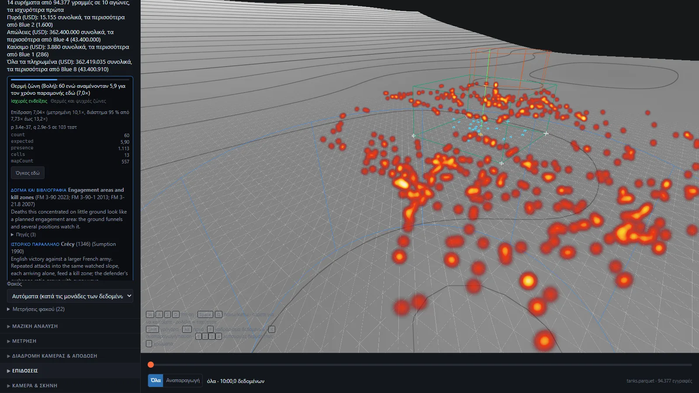

# Ο φακός γνώσης

Όταν τα [Ευρήματα](insights.md) βρίσκουν κάτι, αυτό το μέρος το εξηγεί με ιδέες από την στρατιωτική ιστορία, τον σχεδιασμό παιχνιδιών και την ανάλυση του αθλητισμού, και λέει το βιβλίο ή την εργασία από την οποία προέρχεται. Χρησιμοποιήστε το για να μάθετε *γιατί* έχει σημασία ένα μοτίβο, και όχι μόνο ότι υπάρχει.

## Δοκιμάστε το {#try-it}

1. Φορτώστε δεδομένα και ανοίξτε τα **Ευρήματα**, και πατήστε **Εύρεση ευρημάτων**.
2. Κάντε κλικ σε ένα εύρημα για να το ανοίξετε.
3. Διαβάστε το **Δόγμα και βιβλιογραφία** και το **Ιστορικό παράλληλο**· οι πλήρεις αναφορές είναι διπλωμένες από κάτω.
4. Αλλάξτε τον **Φακό** (π.χ. σε *Στρατιωτικό δόγμα*) για να διαβάσετε το ίδιο εύρημα μέσα από άλλο σώμα βιβλιογραφίας.

## Πώς δουλεύει {#how-it-works}

Το πάνελ Ευρήματα κρίνει τα ευρήματά του όπως θα έκανε ένας επαγγελματίας αναλυτής: μέσα από το στρατιωτικό δόγμα και την έρευνα επιχειρήσεων, τις ιστορικές μάχες, και τη βιβλιογραφία για τον σχεδιασμό παιχνιδιών, τον σχεδιασμό επιπέδων και την ανάλυση δεδομένων. Το κάνει εκτός σύνδεσης, από μια επιμελημένη βάση γνώσης μέσα στον θεατή, και δίνει το ίδιο υλικό σε ένα εξωτερικό μοντέλο όταν εκείνο γράφει τη σύνοψη.

## Τι δείχνει το πάνελ {#what-the-panel-shows}

- Ο **Φακός** επιλέγει το σώμα βιβλιογραφίας μέσα από το οποίο διαβάζονται τα ευρήματα: *Αυτόματος* (επιλέγεται από τα είδη μονάδων των δεδομένων: αεροσκάφη, πλοία, οχήματα εδάφους, πεζικό), *Στρατιωτικό δόγμα*, *Αεροπορική μάχη*, *Ναυτικό*, *Αστικό*, *Σχεδιασμός παιχνιδιών και ισορροπία*, *Esports*. Οι καταχωρίσεις εκτός του επιλεγμένου φακού μένουν έξω.
- Κάθε ανοιγμένο εύρημα δείχνει την πιο κοντινή του καταχώριση **δόγματος και βιβλιογραφίας** και το πιο κοντινό του **ιστορικό παράλληλο**, με τις πλήρεις αναφορές διπλωμένες από κάτω.
- Οι **Μετρήσεις φακού** απαριθμούν τα μέτρα της έρευνας επιχειρήσεων που υπολογίζονται πάνω στις ίδιες γραμμές (παρακάτω), το καθένα με τη σημασία του και τη βιβλιογραφία του.
- Η **Σύνοψη** προσθέτει γραμμές για τα κορυφαία ευρήματα και τις μετρήσεις φακού: «Δόγμα και βιβλιογραφία: ...» και «Ιστορικό παράλληλο: ...», με παραπομπές συγγραφέα-έτους και τις αναφορές διπλωμένες από κάτω.
- Το **Γράψε με ΤΝ** στέλνει τις πιο σχετικές καταχωρίσεις (σύνοψη, μάθημα, τα ευρήματα που σχετίζονται, πλήρεις αναφορές) μαζί με την αναφορά, και ζητά από το μοντέλο να τις παραπέμψει με αναγνωριστικό - `{concept.lanchester-square}` - και να μη χρησιμοποιήσει άλλες πηγές.

Οι ετικέτες είναι μεταφρασμένες· η ίδια η γνώση είναι στα αγγλικά.

## Μετρήσεις φακού {#lens-metrics}

Υπολογίζονται στον εργάτη ευρημάτων, στο ίδιο πέρασμα πάνω στις γραμμές με τους ανιχνευτές (`src/insights/lensMetrics.ts`). Κάθε μία λείπει όταν τα δεδομένα δεν μπορούν να τη φέρουν.

| Μέτρο | Τι μετράει | Χρειάζεται |
|---|---|---|
| Προσαρμογή Lanchester | Οι απώλειες κάθε πλευράς ανά 20 s, παλινδρομημένες πάνω στις ζωντανές δυνάμεις και των δύο πλευρών (Poisson, σφάλματα οιονεί πιθανοφάνειας)· οι εκθέτες της δικής της και της εχθρικής δύναμης, ελεγμένοι έναντι του τετραγωνικού νόμου (στοχευμένα πυρά) και του γραμμικού νόμου (πυρά περιοχής) | χρόνος, ομάδες, φόνοι και θάνατοι |
| Λόγος ανταλλαγής | Φόνοι ανά θάνατο ανά πλευρά και ανά τόπο· το μερίδιο των θανάτων στον πιο θανάσιμο χώρο εδάφους που κατέχει το 5% του χρόνου, σε σύγκριση με το μερίδιο που δίνει η τύχη μόνο με τόσους θανάτους· Gini των θανάτων ως προς τον χρόνο· Moran's I των ρυθμών θανάτου | φόνοι και θάνατοι |
| Τοπικός λόγος δύναμης | Φίλιες και εχθρικές μονάδες ζωντανές μέσα στην εμβέλεια εμπλοκής κάθε φόνου (η εμβέλεια ορίζεται από τα δεδομένα: διπλάσια η διάμεση απόσταση από τον πλησιέστερο εχθρό)· το μερίδιο των φόνων από την τοπικά υπέρτερη πλευρά, και η υπεροχή της πάνω από όση προβλέπουν μόνο οι αριθμοί | χρόνος, ομάδες, άτομα |
| Πεδία βολής | Οπτικά πεδία των πιο πολυσύχναστων τόπων φόνων σε επιφάνεια εμποδίων 2,5D (η γεωμετρία του επιπέδου ως το ύψος του τοίχου, ή το έδαφος που διανύθηκε) έναντι του μέσου τόπου, και η βαθμολογική συσχέτιση του μεριδίου όρασης και του μεριδίου φόνων· ένα φορτωμένο επίπεδο την κάνει πιο καθαρή· όχι για τον αέρα | θέσεις· ένα φορτωμένο επίπεδο την κάνει ακριβέστερη |
| Κατάσταση ενέργειας | Ειδική ενέργεια (ύψος συν το ύψος που θα αγόραζε η ταχύτητα) των αεροπορικών φονιάδων και των θυμάτων τους, συγκρινόμενη με τη στατιστική Mann-Whitney | κλάσεις αεροσκαφών, χρόνος, υψόμετρο |
| Κρίσιμο έδαφος | Πόσο συχνά ένας τόπος είναι ανάμεσα στους τρεις πιο πολυσύχναστους τόπους φόνων ενός αγώνα | αρκετοί αγώνες |
| Αμοιβαία υποστήριξη (ανταλλαγές) | Θάνατοι που ανταποδίδονται με φόνο συμπαίκτη, μέσα στην εμβέλεια εμπλοκής και σε 5 s | χρόνος, ομάδες |
| Πρώτο χτύπημα | Εμπλοκές - φόνοι ομαδοποιημένοι ανά αγώνα, ανά 20 s ησυχίας και ανά τρεις εμβέλειες εμπλοκής απόστασης - που τις κερδίζει η πλευρά που σημείωσε πρώτη | χρόνος, ομάδες |
| Μοντέλο σάλβου | Η εξίσωση σάλβου του Hughes, προσαρμοσμένη σε περιόδους 20 s πλοίων σε επαφή: πλοία εκτός μάχης ανά επιτιθέμενο πλοίο, και σωσμένα ανά αμυνόμενο πλοίο· προσαρμογή Lanchester μόνο στα πλοία | κλάσεις πλοίων, χρόνος, ομάδες |
| Αποτελεσματικότητα μάχης | Φόνοι ανά ώρα-μονάδας δράσης κάθε πλευράς, και ο λόγος των δύο μεγαλύτερων (μια τιμή αποτελεσματικότητας μάχης κατά Dupuy) με το διάστημα 95%, και το μερίδιο φόνων κάθε πλευράς σε ίσους τοπικούς αριθμούς | χρόνος, ομάδες |
| Εμβέλειες εμπλοκής | Απόσταση από τον πλησιέστερο εχθρό στους φόνους, στις εκτοξεύσεις και στον πρώτο πυροβολισμό κάθε ζωής (από την ανίχνευση ως την εμπλοκή), ανά είδος μονάδας | χρόνος, ομάδες· εκτοξεύσεις όπου τις έχουν τα δεδομένα |
| Αλυσίδα φόνου | Δευτερόλεπτα από την τελευταία εκτόξευση του φονιά ως τον φόνο, και από τον πρώτο πυροβολισμό της μάχης ως τον φόνο | χρόνος· εκτοξεύσεις ή συμβάντα πυροβολισμού |
| Συγκέντρωση ή διασπορά | Σε κάθε περίοδο 20 s, η διασπορά των δύο μεγαλύτερων πλευρών και το μερίδιο των φόνων που πήρε η πιο συμπαγής | χρόνος, ομάδες |
| Εξορμήσεις | Ανά πλευρά: εξορμήσεις (απογειώσεις ή εμφανίσεις αεροσκαφών), προσγειώσεις, αεροσκάφη που χάθηκαν και φόνοι από αεροσκάφη· ρυθμός απώλειας και φόνοι ανά εξόρμηση | κλάσεις αεροσκαφών· απογειώσεις ή εμφανίσεις |

Τα δεδομένα με γύρους προσθέτουν τα μέτρα της μάχης από κοντά και των esports - πιθανότητα νίκης γύρου, αξία ενεργειών, πρώτες μονομαχίες, ανταλλαγές, αυτός που προχωρά έναντι αυτού που κρατά, σκοπευτικό, διασταυρούμενα πυρά, βοηθήματα, υπεροχή ανθρώπων, καθαρισμοί, διατάξεις, μετά την τοποθέτηση, θανάσιμα χωνιά και επίδραση παίκτη: βλ. [Μάχη από κοντά και γύροι](close-quarters.md).

Οι ομάδες ατόμων και οι πλευρές προσθέτουν τα μέτρα συλλογικής συμπεριφοράς της επιστήμης πλήθους, της συλλογικής κίνησης, της συμπεριφορικής οικονομίας και της στρατιωτικής ψυχολογίας - ευθυγράμμιση και περιστροφή, κοπάδι διαδρομών, λωρίδες και ίχνη, συνωστισμός, ηγέτες και ακόλουθοι, καθυστερημένοι, το σημείο θραύσης, ο κίνδυνος μετά από απώλειες, σειρές, συμφωνία αγοράς και καταστολή, το καθένα με το δικό του μηδενικό μοντέλο: βλ. [Συλλογική συμπεριφορά](collective-behaviour.md).

Τα όπλα, τα δολώματα και τα κτίρια δεν μετράνε ως μονάδες. Όπου οι γραμμές όπλων ονομάζουν τη μονάδα που εκτόξευσε (μια στήλη `Shooter` ή `Launcher`, όπως έχουν τα δεδομένα από τον Tacview), η εκτόξευση πιστώνεται σε αυτή τη μονάδα, με αντιστοίχιση με το όνομα ή το αναγνωριστικό αντικειμένου της.

## Πώς τα ευρήματα συναντούν τη βιβλιογραφία {#how-findings-meet-the-literature}

Οι καταχωρίσεις και τα ευρήματα συναντιούνται μέσω μιας **ταξινομίας μοτίβων** (`src/insights/knowledge/patterns.ts`): συγκέντρωση, τοπική υπεροχή, στοχευμένα και περιοχής πυρά, σημεία στενώματος, ζώνες θανάτου, πεδία βολής, αντίστροφη πλαγιά, πλευρική επίθεση, αμοιβαία υποστήριξη, ενεργειακό πλεονέκτημα, πίεση εμφάνισης, ισορροπία και ούτω καθεξής. Κάθε είδος ανιχνευτή και κάθε μέτρο φακού λέει ποια μοτίβα δείχνουν οι αριθμοί του (`src/insights/lens.ts`)· κάθε καταχώριση γνώσης λέει ποια μοτίβα αφορά, με βάρος. Η συνάφεια μιας καταχώρισης με ένα εύρημα είναι η σταθμισμένη επικάλυψη, κλιμακωμένη με το πόσο καλά ταιριάζει ο τομέας της καταχώρισης (ξηρά, αέρας, θάλασσα, αστικό) με τα δεδομένα, και με τη δική ποσότητα του ευρήματος. Η αιτιολογία που εμφανίζεται είναι οι αριθμοί του ευρήματος σε μία πρόταση, ακολουθούμενη από το μάθημα της καταχώρισης.

## Κατάλογος {#catalogue}

Κάθε μοτίβο, έννοια, μέθοδος, ιστορική περίπτωση, αρχή σχεδιασμού και μελέτη, με τη βιβλιογραφία: βλ. τον [Κατάλογο γνώσης](knowledge-catalogue.md).

## Για προγραμματιστές {#for-developers}

### Προσθήκη καταχωρίσεων {#adding-entries}

1. Διαλέξτε το αρχείο ανά τύπο: `concepts.ts` και `concepts-more.ts`, `methods.ts`, `cases.ts`, `cases-land.ts`, `cases-air-sea.ts`, `cases-esports.ts`, `design.ts` (αρχές σχεδιασμού) ή `studies.ts` μέσα στο `src/insights/knowledge/`.
2. Δώστε ένα νέο αναγνωριστικό `<τύπος>.<slug>` (ποτέ μην ξαναχρησιμοποιείτε ένα), τους φακούς του, τους τομείς του, και τα μοτίβα που αφορά με βάρη 0..1. Προσθέστε μοτίβο στο `patterns.ts` μόνο όταν ένα εύρημα μπορεί να το δείξει, και αντιστοιχίστε το από ένα εύρημα ή μέτρο στο `lens.ts`.
3. Γράψτε τη σύνοψη και το μάθημα **με δικά σας λόγια**. Παραθέματα μόνο από έργα κοινού κτήματος (`pd: true` στην αναφορά), και σύντομα.
4. Παραπέμψτε: προσθέστε κάθε νέο έργο στο `refs.ts` με συγγραφείς, έτος, τίτλο και εκδότη (περιοδικό με τόμο και σελίδες)· ένα URL ή DOI όπου υπάρχει δημόσια καταχώριση.
5. Τρέξτε `npx vitest run src/insights/lens.test.ts` (μοναδικά αναγνωριστικά, γνωστά μοτίβα, λύνονται οι αναφορές, παραθέματα κοινού κτήματος, περιπτώσεις με ημερομηνία και αποτέλεσμα) και `node tools/knowledge-doc.mjs` για να ανανεώσετε τον [κατάλογο](knowledge-catalogue.md).
