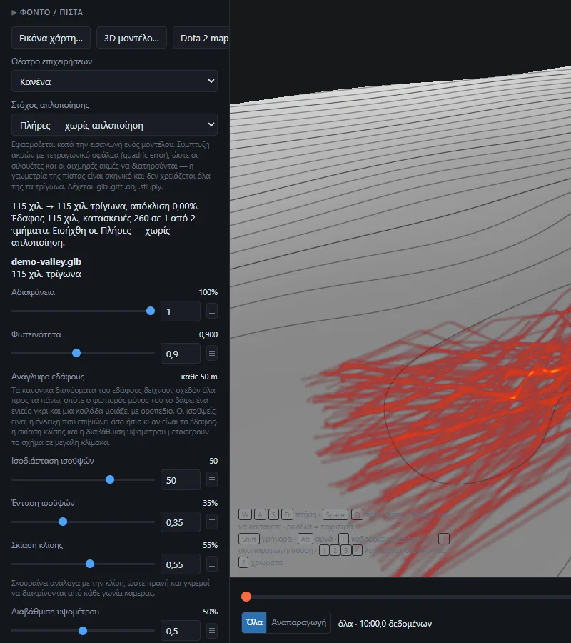

# Επίπεδα και γεωμετρία φόντου

Ένα επίπεδο είναι ο τρισδιάστατος τόπος όπου έγινε το παιχνίδι - ένας χάρτης, μια πόλη, μια πίστα. Βάλτε ένα πίσω από τα δεδομένα σας και βλέπετε *πού* είναι η θερμότητα. Το πλαίσιο **Φόντο / πίστα** (δείτε το [Γλωσσάρι](glossary.md) για το «επίπεδο») σας δίνει τρία είδη πλαισίου:

- μια **εικόνα χάρτη**, γεωαναφερμένη με δύο άγκυρες - δείτε [Εικόνες χάρτη](map-images.md)·
- ένα **τρισδιάστατο επίπεδο** - `.glb`, `.gltf`, `.obj`, `.stl` ή `.ply` - χωρισμένο σε έδαφος, κατασκευές και νερό και απλοποιημένο κατά την εισαγωγή - δείτε [Τρισδιάστατα επίπεδα](model-levels.md) και [Εμφάνιση επιπέδου](level-appearance.md)·
- ένα **φόντο κόσμου** - για ηχογράφηση που λέει πού βρίσκεται στη γη (ένα αρχείο Tacview ACMI), το πραγματικό έδαφος, οι δρόμοι, το νερό, τα αεροδρόμια και τα κτίρια, κατεβασμένα από ανοιχτά δεδομένα - δείτε [Πραγματικός κόσμος ως φόντο](world-backdrop.md).

Χωρίς τίποτα φορτωμένο, η σκηνή είναι σκοτεινή με έναν κάνναβο και έγχρωμους άξονες (**Κάνναβος** και **Άξονες** στο [Κάμερα και σκηνή](camera.md)), και το πλαίσιο γράφει *Δεν έχει φορτωθεί τίποτα - η σκηνή δείχνει κάνναβο και άξονες. Προσθέστε μια εικόνα χάρτη ή ένα πλέγμα επιπέδου για να δώσετε πλαίσιο στη θερμότητα.*

Το επίπεδο είναι κοινό και για τις τρεις καρτέλες: ένας γύρος που φορτώθηκε στην καρτέλα Ανάλυση αγώνα είναι το ίδιο επίπεδο που δείχνει ο χάρτης θερμότητας.

## Βάλτε ένα επίπεδο πίσω από τα δεδομένα σας {#put-a-level-behind-your-data}

1. Φορτώστε πρώτα τα δεδομένα σας ([Εισαγωγή δεδομένων](getting-data-in.md)), ώστε το επίπεδο να προσαρμοστεί σε αυτά.
2. Ανοίξτε το **Φόντο / πίστα** στην πλαϊνή στήλη.
3. Πατήστε **Εικόνα χάρτη…** για μια εικόνα ή **3D μοντέλο…** για ένα τρισδιάστατο επίπεδο, και διαλέξτε το αρχείο. Για ηχογράφηση του πραγματικού κόσμου, χρησιμοποιήστε αντί γι' αυτό το **Πραγματικός κόσμος ως φόντο** ή το **Θέατρο επιχειρήσεων**.
4. Περιμένετε να τελειώσει η γραμμή προόδου. Ένα μεγάλο μοντέλο απλοποιείται πρώτα (δείτε το **Στόχος απλοποίησης** παρακάτω).
5. Πατήστε **F** στην προβολή για να χωρέσετε τα πάντα. Χρησιμοποιήστε την **Αδιαφάνεια** και τη **Φωτεινότητα** μέχρι η θερμότητα να ξεχωρίζει από το επίπεδο.
6. Πατήστε **Αποθήκευση στη βιβλιοθήκη** αν θα ξαναχρησιμοποιήσετε το επίπεδο ([Βιβλιοθήκη επιπέδων](level-library.md)).

## Τι κάνει ένα επίπεδο για τη θερμότητα {#what-a-level-does-for-the-heat}

- **Κρύβει**: τα σημεία δεδομένων πίσω του αμαυρώνονται ανά επιφάνεια, και τα σημεία πίσω από το έδαφος κρύβονται ([Βάθος και αποκοπή](depth-and-culling.md)). Χωρίς επίπεδο, δεν υπάρχει απόκρυψη.
- Κόβεται από την [Τομή](slice.md) και, με το *Αποκοπή και της πίστας*, από την [αποκοπή κατά απόσταση](depth-and-culling.md#distance-culling), μαζί με τη θερμότητα.
- Είναι το μόνο πράγμα που θολώνει το [βάθος πεδίου](camera.md#depth-of-field), εκτός από τον κάνναβο και τα κουτιά.
- Ένα τρισδιάστατο επίπεδο **φαρδαίνει το μακρινό επίπεδο της κάμερας** όταν είναι μεγαλύτερο από τα δεδομένα: το κοντινό και το μακρινό επίπεδο βαθμονομούνται από το σύνολο δεδομένων, και ένας εξαγόμενος χάρτης πολλών χιλιομέτρων αλλιώς θα βρισκόταν εξ ολοκλήρου πίσω από το μακρινό επίπεδο, αφήνοντας άδεια προβολή. Το μακρινό επίπεδο γίνεται 3 × η οριζόντια έκταση του επιπέδου όταν είναι μεγαλύτερη, το κοντινό επίπεδο μετακινείται μαζί του (τουλάχιστον μακρινό / 100.000) για να διατηρείται η ακρίβεια βάθους από την οποία εξαρτάται η απόκρυψη, και η ταχύτητα πτήσης αυξάνεται σε τουλάχιστον έκταση / 12. Φαρδαίνει μόνο, ποτέ δεν στενεύει.

## Το πλαίσιο, από πάνω προς τα κάτω {#the-panel-top-to-bottom}

| Μέρος | Λεπτομέρειες |
|---|---|
| **Εικόνα χάρτη…**, **3D μοντέλο…** | Φορτώνει ένα· αντικαθιστά το τρέχον επίπεδο. |
| **Πραγματικός κόσμος ως φόντο**, **Διαγραφή πλακιδίων χάρτη** | Μόνο για σύνολο δεδομένων με γεωγραφική αναφορά: χτίζει τον πραγματικό τόπο από κάτω ως επίπεδο, ή διαγράφει τα κατεβασμένα πλακίδια. [Πραγματικός κόσμος ως φόντο](world-backdrop.md) |
| **Στόχος απλοποίησης** | Ο προϋπολογισμός τριγώνων για την επόμενη εισαγωγή μοντέλου: *Πλήρες - χωρίς απλοποίηση* (προεπιλογή), *Υψηλό - 8M*, *Μεσαίο - 3M*, *Χαμηλό - 800k*, *Σιλουέτα - 100k*. [Τρισδιάστατα επίπεδα](model-levels.md#simplification) |
| Πρόοδος και **Ακύρωση** | Όσο αποκωδικοποιείται ή εισάγεται. |
| Σημείωση εισαγωγής | Τρίγωνα πριν και μετά, η διάσπαση σε έδαφος / κατασκευές / νερό, το επίπεδο λεπτομέρειας που χρησιμοποιήθηκε. |
| Όνομα και μέγεθος | `πλάτος×ύψος px · x × z m/px` για εικόνα, `N τρίγωνα (από M)` για μοντέλο. |
| **Αδιαφάνεια**, **Φωτεινότητα** | Και για τα δύο είδη. |
| Χειριστήρια εικόνας | **Αποκορεσμός**, **Αναστροφή βορρά/νότου**, **Τοποθέτηση** (δύο άγκυρες), **Προσαρμογή στα όρια των δεδομένων**, **Υψόμετρο**. [Εικόνες χάρτη](map-images.md) |
| Χειριστήρια μοντέλου | Ανάγλυφο εδάφους, νερό, τρίγωνα εδάφους, συρμάτινο μοντέλο, υφή, καταγεγραμμένο χρώμα, κατασκευές, ταξινόμηση μερών. [Εμφάνιση επιπέδου](level-appearance.md) |
| **Αποθήκευση στη βιβλιοθήκη**, **Αφαίρεση** | [Βιβλιοθήκη επιπέδων](level-library.md)· η Αφαίρεση ξεφορτώνει το επίπεδο. |
| **Βιβλιοθήκη** | Τα επίπεδα που έχουν αποθηκευτεί σε αυτόν τον περιηγητή. [Βιβλιοθήκη επιπέδων](level-library.md) |

## Σελίδες σε αυτή την ενότητα {#pages-in-this-section}

- [Εικόνες χάρτη](map-images.md)
- [Τρισδιάστατα επίπεδα](model-levels.md) - μορφές, μέρη, ταξινόμηση, απλοποίηση, υφές
- [Εμφάνιση επιπέδου](level-appearance.md) - κάθε χειριστήριο για τρισδιάστατο επίπεδο
- [Βιβλιοθήκη επιπέδων](level-library.md)
- [Πραγματικός κόσμος ως φόντο](world-backdrop.md) - ο πραγματικός κόσμος κάτω από μια ηχογράφηση, από ανοιχτά δεδομένα

Το πώς βγαίνουν τα επίπεδα από παιχνίδια και μηχανές είναι δουλειά των ξεχωριστών εργαλείων εξαγωγής (δείτε το [README](https://github.com/Holdi601/3DHeat/blob/main/README.md) του αποθετηρίου)· το συμβόλαιο που γράφουν συνοψίζεται στο [Τρισδιάστατα επίπεδα](model-levels.md#the-exporter-contract).
