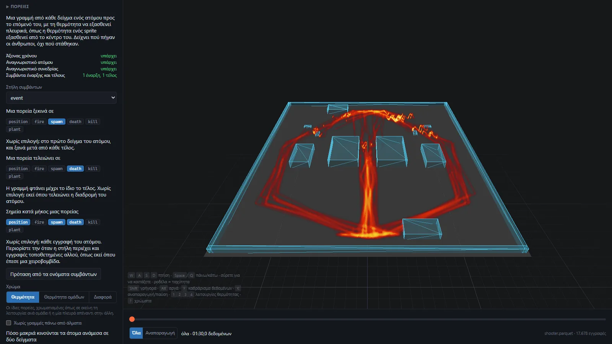

# Γραμμική θερμότητα

Η θερμότητα δείχνει πού στέκονταν οι άνθρωποι. Οι γραμμές δείχνουν τις διαδρομές που περπάτησαν.

**Γραμμές** (πλήκτρο 4) είναι η γραμμική θερμότητα: μια γραμμή από κάθε δείγμα ενός [ατόμου](glossary.md) ως το επόμενό του, σκορπισμένη με την ίδια εξασθένηση που έχει ένα [sprite](glossary.md) - κατά πλάτος της γραμμής αντί γύρω από ένα σημείο. Δείχνει πού *πήγαν* οι άνθρωποι και όχι πού στέκονταν: ένας διάδρομος που διάβηκε μία φορά φαίνεται εξίσου με ένα δωμάτιο στο οποίο κάθισαν, και τα αραιά δείγματα ενός γρήγορου παίκτη ενώνονται σε μια συνεχή διαδρομή αντί για ένα διακεκομμένο ίχνος. Θέλει στήλη ατόμου και στήλη χρόνου.

## Πώς να το χρησιμοποιήσετε {#how-to-use-it}

1. Πατήστε `4` (ή επιλέξτε **Γραμμές** στη γραμμή λειτουργιών).
2. Ανοίξτε τις **Διαδρομές** και ελέγξτε τη πράσινη λίστα: πρέπει να υπάρχουν ο άξονας χρόνου και το αναγνωριστικό ατόμου.
3. Πατήστε **Πρόταση από τα ονόματα συμβάντων** για να συμπληρωθεί όπου αρχίζουν και τελειώνουν οι διαδρομές.
4. Διαβάστε τη γραμμή στατιστικών: «N διαδρομές, M από αυτές φτάνουν σε τέλος».
5. Αν οι γραμμές πηδούν πάνω στον χάρτη, προσαρμόστε το **Μεγαλύτερο βήμα** (βλ. [Το όριο άλματος](#the-jump-limit)).

Μια γραμμή έχει νόημα μόνο ανάμεσα σε μια αρχή και ένα τέλος, γι' αυτό το πάνελ **Διαδρομές** λέει τι οριοθετεί μια διαδρομή. Όλα από [Οι κανόνες μιας διαδρομής](#the-rules-of-a-route) και μετά είναι λεπτομέρειες που μπορείτε να παραλείψετε.

## Το πάνελ Διαδρομές {#the-routes-panel}

Εμφανίζεται πάνω από τα πάνελ θερμότητας στη λειτουργία Γραμμές.

### Τι έχουν τα δεδομένα {#what-the-data-has}

Μια λίστα ελέγχου, πράσινη όταν υπάρχει και κεχριμπαρένια όταν δεν υπάρχει:

| Γραμμή | Καταστάσεις |
|---|---|
| **Άξονας χρόνου** | *υπάρχει* / *λείπει - χρειάζεται* |
| **Αναγνωριστικό ατόμου** | *υπάρχει* / *λείπει - χρειάζεται* |
| **Αναγνωριστικό συνεδρίας** | *υπάρχει* / *κανένα - όλες οι γραμμές είναι μία συνεδρία* |
| **Συμβάντα έναρξης και τέλους** | *N έναρξεις, M τέλη* / *δεν έχει επιλεγεί κανένα - ολόκληρες διαδρομές* (πράσινο μόνο με στήλη συμβάντων και τουλάχιστον μία έναρξη και ένα τέλος) |

### Στοιχεία ελέγχου {#controls}

| Στοιχείο ελέγχου | Σημασία |
|---|---|
| **Στήλη συμβάντων** | Στήλη κατηγορίας της οποίας οι τιμές είναι συμβάντα (γέννηση, θάνατος, θέση, ...). *Καμία - ολόκληρες διαδρομές*: η διαδρομή κάθε ατόμου σε κάθε συνεδρία είναι μία διαδρομή, χωρισμένη όπου η διαδρομή έχει κενό. Προσφέρονται μόνο στήλες που κρατήθηκαν για φιλτράρισμα στη φόρτωση. |
| **Μια διαδρομή αρχίζει σε** | Τιμές συμβάντων που ξεκινούν μια διαδρομή (γέννηση, επανεμφάνιση, ρίψη). Όταν δεν επιλέγεται καμία: μια διαδρομή αρχίζει από το πρώτο δείγμα του ατόμου, και ξανά μετά από κάθε τέλος. |
| **Μια διαδρομή τελειώνει σε** | Τιμές συμβάντων που τελειώνουν μια διαδρομή (θάνατος, εξαγωγή, τηλεμεταφορά). Η γραμμή φτάνει μέχρι την ίδια τη γραμμή του τέλους. Όταν δεν επιλέγεται καμία: μια διαδρομή τελειώνει εκεί όπου τελειώνει η διαδρομή του ατόμου. |
| **Σημεία κατά μήκος μιας διαδρομής** | Τιμές συμβάντων των οποίων οι γραμμές βρίσκονται κατά μήκος της διαδρομής. Όταν δεν επιλέγεται καμία: κάθε γραμμή του ατόμου. Στενέψτε το όταν η στήλη κρατά και γραμμές που βρίσκονται αλλού, όπως πού έπεσε μια χειροβομβίδα. |
| **Πρόταση από τα ονόματα συμβάντων** | Γεμίζει τις τρεις λίστες από τα ονόματα των τιμών (παρακάτω). |
| **Χρώμα** | *Θερμότητα*, *Θερμότητα ομάδας* ή *Διαφορά*. Οι ίδιες διαδρομές με τον χρωματισμό αυτής της λειτουργίας: κάθε ομάδα στη δική της απόχρωση, ή η μία πλευρά απέναντι στην άλλη, με τη λίστα ομάδων, τον διαχωρισμό και τις κλίμακες να δουλεύουν όπως σε εκείνες τις λειτουργίες. Προεπιλογή *Θερμότητα*. Η θερμότητα ομάδας και η διαφορά θέλουν στήλη ομάδας. |
| **Χωρίς γραμμές πάνω από άλματα** / **Μεγαλύτερο βήμα** | Το επόμενο δείγμα ενός ατόμου που είναι πιο μακριά από αυτό είναι επανεμφάνιση, τηλεμεταφορά ή πτώση, και όχι μέρος όπου πήγε· έτσι καμία γραμμή δεν ενώνει τα δύο. Συμπληρώνεται στη φόρτωση όταν τα δεδομένα δείχνουν σαφές κενό (παρακάτω), και είναι κλειστό όταν δεν δείχνουν. Δουλεύει με ή χωρίς στήλη συμβάντων. |
| Γραμμή στατιστικών | `N διαδρομές, M από αυτές φτάνουν σε τέλος, K τμήματα`, ενημερώνεται αρκετές φορές το δευτερόλεπτο. |

Κάθε λίστα είναι μια σειρά από τσιπ εναλλαγής, ένα για κάθε τιμή, η πιο συχνή πρώτη· όταν περνάτε πάνω από ένα τσιπ, φαίνεται το πλήθος των γραμμών του. Προσφέρονται το πολύ 120 τιμές (*N ακόμη τιμές δεν φαίνονται*).

Όταν επιλέγετε άλλη στήλη συμβάντων, εφαρμόζεται η πρόταση μόνο αν η πρόταση επιλέγει αυτή ακριβώς τη στήλη· αλλιώς ξεκινά με άδειες λίστες.

### Η πρόταση {#the-suggestion}

Σε κάθε φόρτωση, και στο **Πρόταση από τα ονόματα συμβάντων** ([`suggestLineSettings`](https://github.com/Holdi601/3DHeat/blob/main/src/data/lines.ts)):

- **Στήλη συμβάντων:** η πρώτη κατηγορία που κρατιέται με όνομα `event`, `eventname` ή `eventtype`· αλλιώς `kind`, `type` ή `action`· αλλιώς οποιαδήποτε που περιέχει *event*, *kind*, *action* ή *type*.
- **Έναρξεις:** τιμές που περιέχουν *spawn, deploy, join, enter, start, begin, respawn, revive, land/landed/landing, drop* - εκτός αν ταιριάζουν και σε λέξη τέλους.
- **Τέλη:** τιμές που περιέχουν *death, died, dead, kill/killed, eliminat…, extract, evac, teleport, leave, left, disconnect, quit, exit, end, finish, downed* - εκτός από τις τιμές `kill` και `kills` (ο φόνος είναι κάτι που κάνει ο φονιάς, όχι το τέλος της διαδρομής του).
- **Σημεία:** τιμές που είναι ακριβώς *position, location, player location, move, movement, tick, sample* ή *pos*· όταν βρεθεί κάποια, οι έναρξεις και τα τέλη προστίθενται και στα σημεία. Όταν δεν βρεθεί καμία, τα σημεία μένουν κενά (κάθε γραμμή).

### Το όριο άλματος {#the-jump-limit}

Όπου οι άνθρωποι κάνουν άλματα, τα μήκη των βημάτων χωρίζονται σε δύο ομάδες με σχεδόν τίποτα ανάμεσά τους: αυτό που καλύπτει ένα άτομο ανάμεσα σε δύο δείγματα, και το πλάτος του χάρτη. Στη φόρτωση ([`suggestMaxJump`](https://github.com/Holdi601/3DHeat/blob/main/src/data/lines.ts)) τα βήματα μετρώνται ανά διπλασιασμό του τετραγώνου του μήκους τους, έως 16 εκατομμύρια, και το όριο μπαίνει στη μέση της πρώτης περιοχής πάνω από τη διάμεσο που έχει πλάτος τουλάχιστον έναν διπλασιασμό μήκους, έχει κάτω από 0,02% των βημάτων ανά κλάση, και έχει βήματα πέρα από αυτήν. Αν δεν υπάρχει τέτοια περιοχή, δεν κόβεται τίποτα, γιατί δεν θα ξεχωρίζει ένα άλμα από ένα γρήγορο αυτοκίνητο· όταν ενεργοποιείτε το όριο με το χέρι, ξεκινά από το ένα δέκατο της διαγωνίου των δεδομένων.

Το γράφημα πάνω από το όριο δείχνει πόσο μακριά είναι πραγματικά τα βήματα, με μια γραμμή στο όριο: οι μπάρες δεξιά του δεν σχεδιάζονται. Και οι δύο άξονες είναι λογαριθμικοί, γιατί τα άλματα μπορεί να είναι το ένα εκατοστό των βημάτων και χίλιες φορές μακρύτερα. Περάστε πάνω από μια μπάρα για το εύρος και το μερίδιό της· κάντε κλικ στο γράφημα για να βάλετε εκεί το όριο. Από κάτω, το μερίδιο των βημάτων πάνω από το όριο.

## Οι κανόνες μιας διαδρομής {#the-rules-of-a-route}

Οι γραμμές διατρέχονται με τη σειρά του χρόνου, ανά άτομο ([`buildLines`](https://github.com/Holdi601/3DHeat/blob/main/src/data/lines.ts)):

1. Οι γραμμές ενός [κοινού ονόματος](sessions-persons-groups.md#names-worn-by-several-things-at-once) παραλείπονται εντελώς.
2. Όταν έχουν επιλεγεί σημεία, μια γραμμή που δεν είναι έναρξη, τέλος ή σημείο παραλείπεται.
3. Οι γραμμές ακολουθούνται ανά άτομο και ανά συνεδρία, ώστε ένα άτομο του οποίου οι συνεδρίες μπλέκονται χρονικά να έχει μία διαδρομή σε κάθε μία. Μια διαδρομή κλείνει όταν η προηγούμενη γραμμή δεν είχε επόμενη (η [διάρκεια ζωής](sessions-persons-groups.md#person) του είναι «καμία»)· μια διαδρομή δεν περνά ποτέ όριο συνεδρίας ή κενό που η φόρτωση αποφάσισε ότι δεν έχει επόμενο δείγμα. Σε ποια διαδρομή ανήκει μια γραμμή υπολογίζεται μία φορά και κρατιέται, 4 byte ανά γραμμή, ώστε η αλλαγή του μεγαλύτερου βήματος να μην επαναλαμβάνει αυτό το μέρος.
4. Μια γραμμή **έναρξης** κλείνει όποια διαδρομή είναι ανοιχτή και ανοίγει νέα εκεί.
5. Όταν έχουν επιλεγεί έναρξεις, μια γραμμή έξω από διαδρομή αγνοείται. Χωρίς έναρξεις, κάθε γραμμή που δεν είναι τέλος και βρίσκεται έξω από διαδρομή ανοίγει μία.
6. Κάθε άλλη γραμμή μέσα σε διαδρομή προσθέτει ένα **τμήμα** από την προηγούμενη γραμμή της διαδρομής ως αυτήν.
7. Μια γραμμή **τέλους** που επεκτείνει μια διαδρομή την κλείνει μετά το τμήμα της· η διαδρομή αυτή μετράει ως *φτάνει σε τέλος*.
8. Ένα βήμα μεγαλύτερο από το **Μεγαλύτερο βήμα** κλείνει τη διαδρομή εκεί όπου ήταν, και μια νέα αρχίζει στο απέναντι άκρο, εκτός αν εκείνη η γραμμή είναι τέλος. Δεν σχεδιάζεται γραμμή πάνω από αυτό, και η γραμμή στατιστικών το μετράει.

Κάθε τμήμα αποθηκεύεται στη γραμμή του *τέλους* του, ώστε τα τμήματα να μένουν σε σειρά χρόνου, και η [χρονογραμμή](timeline.md), ο δειγματολήπτης, τα [φίλτρα](filters.md), η ορατότητα των ομάδων και το πρόσημο της διαφοράς δουλεύουν πάνω τους όπως πάνω στα σημεία. Ένα φίλτρο εφαρμόζεται επομένως στη γραμμή όπου τελειώνει ένα τμήμα.

## Αναπαραγωγή {#playback}

Στη λειτουργία **Όλα** σχεδιάζεται κάθε διαδρομή ολόκληρη. Στη λειτουργία **Αναπαραγωγή** κάθε άτομο είναι ένα σημείο που κινείται ανάμεσα στα δείγματά του, και σύρει τη διαδρομή του πίσω του:

- ένα τμήμα που αρχίζει μετά τον δείκτη δεν σχεδιάζεται·
- το τμήμα όπου βρίσκεται το άτομο τη στιγμή σχεδιάζεται ως την παρεμβαλλόμενη θέση του, με τέλος στην κεφαλή του·
- η θερμότητα ξεθωριάζει στην **ουρά**: με το ιστορικό *Αθροιστικό* η ουρά είναι απεριόριστη και όλη η διαδρομή ως εκείνη τη στιγμή μένει· με το *Παράθυρο* ξεθωριάζει μέσα στη *Διάρκεια* (προεπιλογή 30 s). Με τη *Διάρκεια ζωής* η ουρά είναι επίσης η *Διάρκεια*, και στη λειτουργία Γραμμές η χρονογραμμή δείχνει το κουτί *Διάρκειας* για εκείνο το ιστορικό (στη θέση του *Εφεδρική ζωή* και του *Εξασθένηση*, που η γραμμική θερμότητα δεν χρησιμοποιεί).

Όσο παίζει, κάθε καρέ σχεδιάζεται ολόκληρο και δεν συσσωρεύεται, γιατί οι κεφαλές κινούνται σε κάθε καρέ και ένας κινούμενος μέσος όρος θα τις έκανε λωρίδες.

## Για προγραμματιστές {#for-developers}

### Μνήμη {#memory}

Οι διαδρομές χτίζονται στο κύριο νήμα όταν μπαίνετε στη λειτουργία Γραμμές (ή όταν αλλάζουν οι ρυθμίσεις διαδρομών) και ελευθερώνονται όταν φεύγετε: 5 byte ανά γραμμή στη μνήμη και 8 byte ανά γραμμή στην κάρτα γραφικών (η αρχική θέση κάθε τμήματος, κβαντισμένη σε 16 bit ανά άξονα μέσα στο κουτί περιορισμού των δεδομένων, και οι σημαίες του).

### Πώς σχεδιάζεται μια γραμμή {#how-a-line-is-drawn}

Και τα δύο backend σχεδιάζουν κάθε τμήμα από τη γραμμή του τέλους ως **18 κορυφές** ([`lineHeatVs`](https://github.com/Holdi601/3DHeat/blob/main/src/render/webgl2/shaders.ts) και το αντίστοιχο WGSL του):

- Το μισό πλάτος σε κάθε άκρο είναι η [ακτίνα του sprite](sprite-shape.md#sprite-radius) στην απόσταση εκείνου του άκρου, με τα όρια εικονοστοιχείων. Μια γραμμή στενότερη από 2,5 px σχεδιάζεται 2,5 px πλατιά, με τη θερμότητά της μειωμένη ανάλογα, ώστε οι λεπτές γραμμές ούτε να εξαφανίζονται ούτε να φωτίζονται υπερβολικά.
- Η θερμότητα εξασθενεί **κατά πλάτος** της γραμμής με την ίδια καμπύλη με ένα sprite - εξασθένηση ή καμπύλη, κέντρο και ένταση στην άκρη.
- Τα στρογγυλά άκρα σχεδιάζονται **μόνο** εκεί όπου μια διαδρομή αρχίζει ή τελειώνει, ώστε οι αρθρώσεις ανάμεσα σε διαδοχικά τμήματα να μην γίνονται σειρά από μαργαριτάρια.
- Η γεωμετρία χτίζεται στον χώρο της οθόνης και παρεμβάλλεται γραμμικά εκεί, ώστε η εξασθένηση να μένει κεντραρισμένη πάνω στη γραμμή όπως και να μπαίνει στο βάθος. Ένα τμήμα που περνά το κοντινό επίπεδο κόβεται εκεί και δεν πετιέται.

Η θερμότητα των σημείων και της γραμμικής θερμότητας αφήνει πολύ διαφορετικές ποσότητες θερμότητας ανά γραμμή, γι' αυτό ο κορεσμός μετράται ξανά όταν αλλάζετε ανάμεσά τους ([Χρώμα και έκθεση](colour-and-exposure.md#auto-exposure)).
