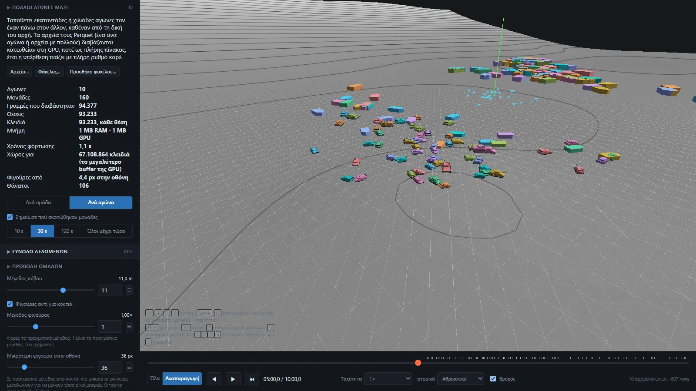

# Πολλοί αγώνες μαζί

Το **Πολλοί αγώνες μαζί** παίζει πολλούς αγώνες ο ένας πάνω στον άλλο, ώστε να βλέπετε πού πηγαίνουν συνήθως οι παίκτες κάθε αγώνα. Χρησιμοποιήστε το για να συγκρίνετε εκατοντάδες ή χιλιάδες αγώνες σε μία εικόνα.

Κάθε αγώνας ξεκινά από τη δική του αρχή και οι μονάδες του κινούνται ως φιγούρες. Τα αρχεία πηγαίνουν κατευθείαν στην κάρτα γραφικών και δεν χτίζεται κανένας πλήρης πίνακας, οπότε παίζει ομαλά όπου μια συνηθισμένη φόρτωση θα έμενε χωρίς μνήμη.

## Πώς χρησιμοποιείται {#how-to-use-it}

1. Ανοίξτε το **Πολλοί αγώνες μαζί** στην πλαϊνή στήλη της Θερμότητας.
2. Πατήστε **Αρχεία…** (διαλέξτε πολλά αρχεία), **Φάκελος…** (ένας φάκελος και οι υποφάκελοί του) ή **Προσθήκη φακέλου…** (προσθήκη σε ό,τι είναι φορτωμένο).
3. Ο περιηγητής μεταβαίνει στην επικάλυψη φιγούρων και ξεκινά από την αρχή. Πατήστε **Αναπαραγωγή**.

Κάθε αρχείο είναι ένας αγώνας (ή περιέχει περισσότερους). Λειτουργούν αρχεία Parquet και εμπορευματοκιβώτια [`.3dheat`](container.md). Ένα αρχείο χρειάζεται στήλη θέσης, χρόνου και μονάδας· οι στήλες ονόματος, τύπου και πλευράς διατηρούνται. Τα άλλα αρχεία, και τα βοηθητικά αρχεία των μετατροπέων (πτήση, μηνύματα, γεγονότα, συνομιλία, στόχοι), παραλείπονται. Για έναν συνηθισμένο πίνακα, βλ. [Εισαγωγή δεδομένων](getting-data-in.md).

## Ρυθμίσεις {#settings}

| Ρύθμιση | Τι κάνει |
|---|---|
| **Ανά ομάδα** / **Ανά αγώνα** | Χρωματισμός ανά πλευρά, ή ένα χρώμα ανά αγώνα. |
| **Σημείωσε πού σκοτώθηκαν μονάδες** | Ένα σημάδι εκεί που σκοτώθηκε κάθε μονάδα, για 10 s, 30 s, 120 s, ή για όλα μέχρι τώρα. |

Το πάνελ δείχνει πόσοι αγώνες, μονάδες, γραμμές και θέσεις διαβάστηκαν, τη μνήμη που χρησιμοποιήθηκε και τον χρόνο φόρτωσης. Το *Room for* είναι πόσες ακόμα θέσεις μπορεί να πάρει η κάρτα γραφικών. Το *Figures from* είναι το μέγεθος στην οθόνη κάτω από το οποίο μια μονάδα σχεδιάζεται ως μικρό βέλος αντί για τη φιγούρα της.

Η εμφάνιση των φιγούρων χρησιμοποιεί τα ίδια στοιχεία ελέγχου με την [επανάληψη αγώνα](match-replay.md#figures): **Μέγεθος φιγούρας**, **Μικρότερη φιγούρα στην οθόνη** και **Από απόσταση**.

## Συμβουλές {#tips}

- Όταν όλα δεν χωρούν στη μνήμη, οι θέσεις αραιώνουν (κρατιέται μόνο μία θέση κάθε λίγα μέτρα) και το πάνελ το λέει.
- Οι λειτουργίες θερμότητας δουλεύουν και πάνω στα δεδομένα της επικάλυψης.
- Για στατιστικά πάνω από χιλιάδες αγώνες χωρίς να τους σχεδιάσετε, βλ. [Μαζική ανάλυση](mass-analysis.md).
