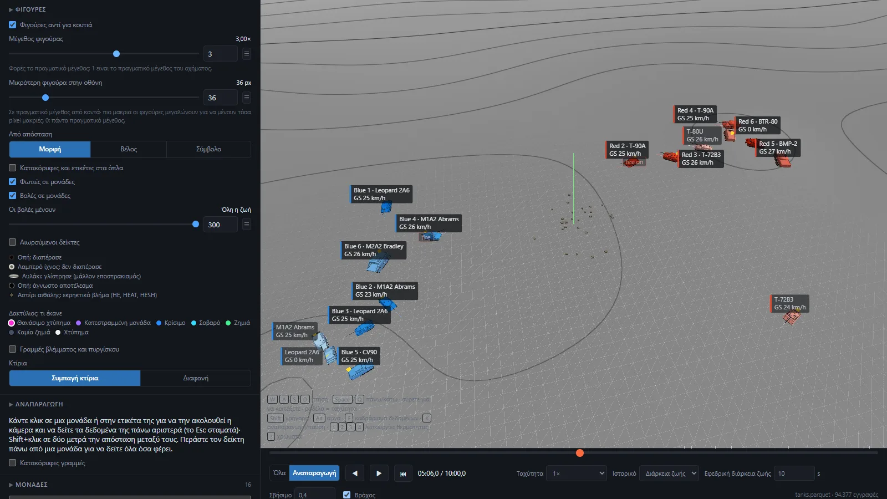
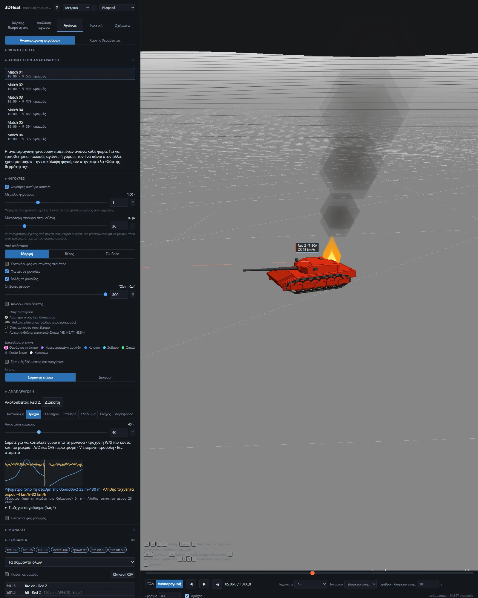
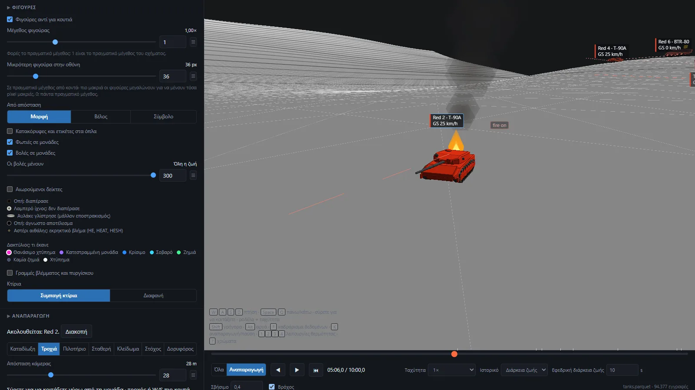
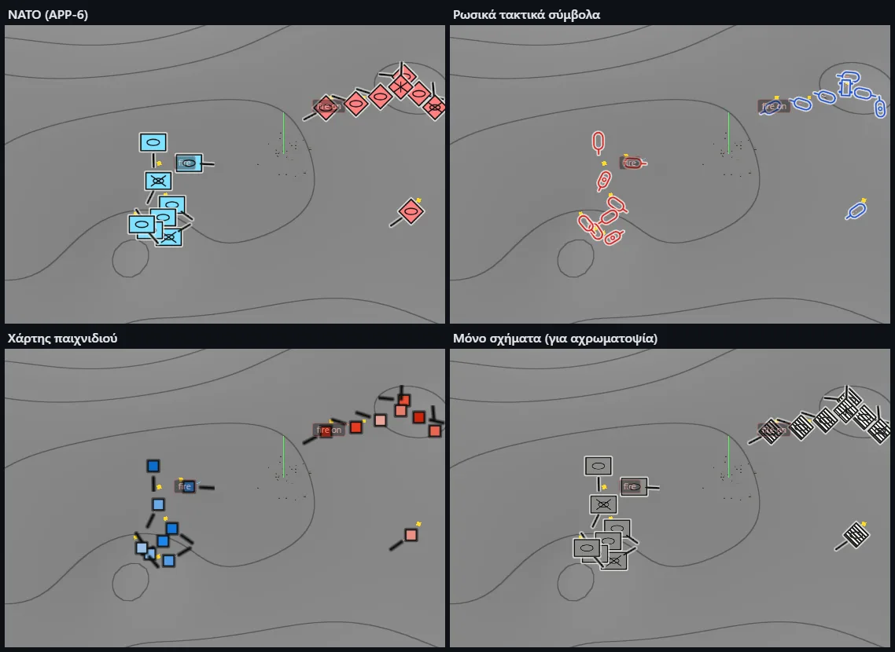
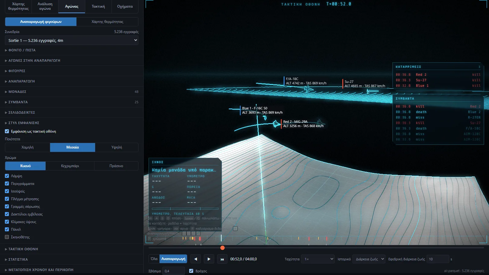
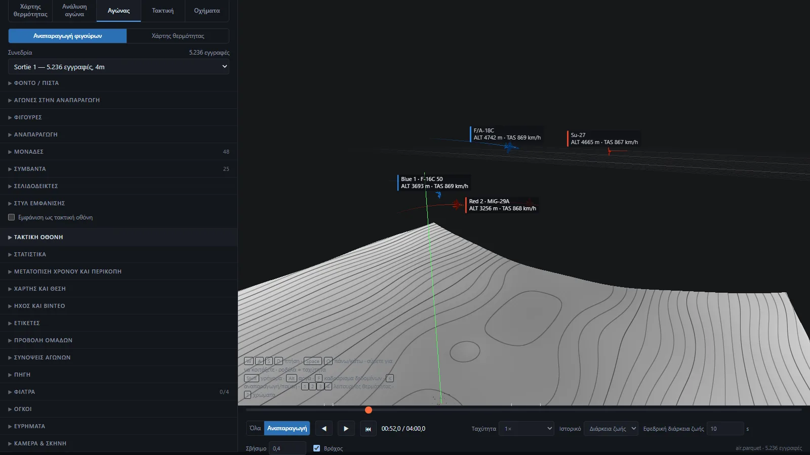

# Αναπαραγωγή αγώνα

Η αναπαραγωγή είναι μια ταινία του αγώνα όπου κάθε παίκτης σχεδιάζεται ως αυτό που οδηγούσε. Χρησιμοποιήστε την για να δείτε ξανά μια μάχη, να ακολουθήσετε μια μονάδα και να δείτε ποιος χτύπησε ποιον.

Οι βολές, τα πλήγματα, οι φωτιές και τα ναυάγια σχεδιάζονται πάνω στις μονάδες και στους στόχους του επιπέδου. Οι κάμερες, οι ετικέτες και μια τακτική οθόνη σας βοηθούν να διαβάσετε τη μάχη. Ξέρετε το Tacview; Η [ισοδυναμία με το Tacview](tacview-parity.md) δείχνει πού βρίσκεται καθένα από τα εργαλεία του.

## Ξεκινήστε μια αναπαραγωγή {#start-a-replay}

1. Φορτώστε μια ηχογράφηση με **Πηγή → Αρχεία…** ή αφήνοντάς την στο πάνελ Πηγή (οποιοσδήποτε πίνακας με στήλη **ατόμου** και στήλη **χρόνου**, ένα αρχείο Tacview, ένα μετατρεμένο replay, έναν αγώνα [`.3dheat`](container.md)). Δείτε [Εισαγωγή δεδομένων](getting-data-in.md).
2. Ανοίξτε την καρτέλα **Αγώνας** και διαλέξτε **Αναπαραγωγή φιγούρων**, ή διαλέξτε **Επικάλυψη φιγούρων** στη γραμμή λειτουργιών της καρτέλας Χάρτης θερμότητας.
3. Στο **Αγώνες στην αναπαραγωγή** διαλέξτε έναν αγώνα, όλους μαζί, ή μερικούς.
4. Πατήστε **Αναπαραγωγή** στη χρονολογική γραμμή (ή `K`). Σύρετε τη χρονολογική γραμμή για να πηδήξετε.

Οι φιγούρες αντικαθιστούν τα κουτιά για κάθε μονάδα της οποίας το όνομα ή ο τύπος είναι γνωστός (δείτε [Φιγούρες](figures.md)). Τα δεδομένα χωρίς στήλη ονόματος ή τύπου σχεδιάζονται ως στρατιώτες.

## Φιγούρες {#figures}

| Ρύθμιση (ενότητα **Φιγούρες**) | Προεπιλογή | Τι κάνει |
|---|---|---|
| **Φιγούρες αντί για κουτιά** | ενεργό | Το ανενεργό σχεδιάζει απλά κουτιά. |
| **Μέγεθος φιγούρας** (φορές το πραγματικό μέγεθος) | 1 | Το 1 είναι το πραγματικό μέγεθος· 0,25 έως 20 φορές (λογαριθμική κλίμακα). Το μεγαλύτερο βοηθά από μακριά. |
| **Μικρότερη φιγούρα στην οθόνη** | 36 px | Οι μακρινές φιγούρες μεγαλώνουν ώστε να μένουν τόσο μακριές, 0 έως 200 px· το 0 κρατά το πραγματικό μέγεθος. |
| **Από απόσταση**: Φιγούρα, Βέλος, Σύμβολο | Φιγούρα | Τι γίνεται μια μακρινή μονάδα. |
| **Σύμβολα** | NATO (APP-6) | NATO (APP-6), ρωσικά τακτικά σύμβολα, εικονίδια **Χάρτη παιχνιδιού**, ή **Μόνο σχήματα (για αχρωματοψία)**. |
| **Μέγεθος συμβόλου**, **Η πλευρά μου**, **Εχθρική / Ουδέτερη**, **Γραμμές πορείας** | 28 px (12 έως 64), αυτόματο, εχθρική, ενεργό | Πώς φαίνονται τα σύμβολα και ποια πλευρά είναι φιλική. |
| **Κατακόρυφες γραμμές** | ενεργό | Μια γραμμή από κάθε μονάδα κατευθείαν προς το έδαφος, ώστε τα ύψη να διαβάζονται σε 3D. |
| **Κατακόρυφες και ετικέτες στα όπλα** | ανενεργό | Γραμμές προς το έδαφος και ετικέτες σε βλήματα και βόμβες. |
| **Φωτιές σε μονάδες** | ενεργό | Φλόγες από τη στιγμή που μια μονάδα παίρνει φωτιά μέχρι να σβήσει. |
| **Βολές σε μονάδες** | ενεργό | Σημάδια όπου χτύπησαν οι βολές (παρακάτω). **Οι βολές μένουν**: 1 έως 300 δευτερόλεπτα, ή **Όλη η ζωή**. **Αιωρούμενοι δείκτες**: σημάδια που σχεδιάζονται πάνω από την επιφάνεια. |
| **Γραμμές βλέμματος και πυργίσκου** | ανενεργό | Διακεκομμένες: πού κοιτάζει ο παίκτης· συμπαγείς: πού δείχνει το κανόνι. |
| **Κτίρια** | συμπαγή | Συμπαγή ή διάφανα κτίρια, όταν το επίπεδο τα βάφει. |

### Σύμβολα σε απόσταση {#symbols-at-a-distance}

Όταν μια μονάδα θα ήταν μικρότερη από τη **Μικρότερη φιγούρα στην οθόνη**, μπορεί να γίνει σύμβολο που παραμένει ευανάγνωστο. Το σχήμα λέει το είδος (για παράδειγμα ένα στρογγυλεμένο κουτί με σήμα ερπύστριας για θωρακισμένο)· το χρώμα λέει την πλευρά. Ανοίξτε το μενού **Σύμβολα** για να αλλάξετε το στυλ.

### Σημάδια χτυπημάτων, ναυάγια και φωτιές {#hit-marks-wrecks-and-fires}

- Τα **σημάδια πλήξης** μπαίνουν πάνω στην επιφάνεια που συνάντησε η βολή, στην κλίμακα της φιγούρας. Η όψη τους λέει τι συνέβη: τρύπα (πέρασε), λαμπερή πιτσιλιά (δεν πέρασε), αυλάκι (αναπήδησε), αστέρι από αιθάλη (εκρηκτική βλήμα). Ένας έγχρωμος δακτύλιος λέει τι έκανε: θανατηφόρα βολή, μονάδα καταστράφηκε, κρίσιμη, σοβαρή, ζημιά, χωρίς ζημιά, πλήξη. Περάστε από πάνω ένα σημάδι για το όνομα της βολής.
- Μια καταστραμμένη μονάδα σχεδιάζεται **καμένη** ως ναυάγιο, από τον θάνατό της μέχρι να επανεμφανιστεί ή να αφαιρεθεί· το σύμβολό της διαγράφεται.
- Οι **φωτιές** καίνε μια μονάδα από τη στιγμή που πιάνει φωτιά μέχρι να σβηστεί.
- Οι **πυργίσκοι** γυρίζουν προς εκεί που δείχνουν τα δεδομένα ότι δείχνει το κανόνι (ή, χωρίς αυτά, προς εκεί που κοιτάζει ο παίκτης).

### Όπλα, δολώματα και ιχνηθέτες {#weapons-decoys-and-tracers}

Με ενεργά τα **Όπλα, βολές και πλήγματα** (ενότητα Προβολή ομάδων): οι πύραυλοι, οι ρουκέτες, οι βόμβες και οι τορπίλες πετούν ως δικές τους φιγούρες με ίχνος καπνού· οι σφαίρες και τα βλήματα είναι ιχνηθέτες· οι πλήξεις και οι εκρήξεις αναβοσβήνουν. Ένας ιχνηθέτης που σχεδιάζεται **διακεκομμένος** υπολογίστηκε από μια πλήξη, επειδή τα δεδομένα δεν είχαν τη βολή. Οι φωτοβολίδες και οι ρίψεις ραδιοπαρεμβολής (chaff) σχεδιάζονται ως δολώματα· κρύβονται από τη λίστα μονάδων εκτός αν είναι τσεκαρισμένο το *Δολώματα και βλήματα*.

## Κάμερες {#cameras}

Κάντε κλικ σε μια μονάδα ή στην ετικέτα της για να την **ακολουθήσετε**· η ενότητα **Αναπαραγωγή** προσφέρει **Καταδίωξη**, **Τροχιά**, **Πιλοτήριο** (με οθόνη κεφαλής, `H`), **Σταθερή**, **Κλείδωμα**, **Στόχος** και **Δορυφόρος**. Το `V` τις εναλλάσσει, και η **Απόσταση κάμερας** ορίζει πόσο μακριά. Το Esc σταματά.

- **Προβολή δύο μονάδων**: διαλέξτε έναν **Στόχο** (ή Ctrl/Alt-κλικ σε μια μονάδα) για να την κοιτάξετε από την ακολουθούμενη· η **Ανταλλαγή** τις αντιμεταθέτει.
- **Μέτρο**: Shift-κλικ σε δύο μονάδες για τη διεύθυνση, την απόσταση και τη διαφορά ύψους ανάμεσά τους.
- **Χάρτης 2D** (`M`): γωνία ή πλήρης προβολή, με ίχνη και ονόματα.
- **Σελιδοδείκτες** (`B`): αποθηκεύουν τη στιγμή και την κάμερα· τα δικά της φόνους, θανάτους και σημάδια της ηχογράφησης εμφανίζονται επίσης.
- **Συμβάντα**: κάθε συμβάν με τη σειρά του χρόνου· ένα κλικ πηδάει εκεί. Τα `Page Up` / `Page Down` πηδούν από συμβάν σε συμβάν· η **Παύση σε συμβάν** σταματά σε κάθε ένα.

## Τακτική οθόνη {#tactical-display}

Η ενότητα **Τακτική οθόνη** σχεδιάζει, για καμία μονάδα, τις επιλεγμένες, όλες ή ένα είδος (αεροσκάφη, έδαφος, πλοία, όπλα): διανύσματα ταχύτητας και τη διαδρομή μπροστά, γραμμές μύτης και άνωσης, κώνους ραντάρ, κλειδώματα, συνδέσεις δεδομένων, ζώνες και γραμμές εμπλοκής, γραμμές οπτικής επαφής, πού κοιτάζουν οι παίκτες (κώνοι θέασης), στόχευση πυργίσκων, και την καταγεγραμμένη κάμερα.

### Ύφος οθόνης {#display-style}

Το `T` (ή ο διακόπτης **Εμφάνιση ως τακτική οθόνη**) αλλάζει την όψη σε στυλ οθόνης ραντάρ: λάμψη, περιγράμματα, ισοϋψείς, πλέγμα μέτρησης, γραμμές σάρωσης, κύκλοι εμβέλειας, κλίμακες υψομέτρου, πάνελ με φόνους και συμβάντα, και έναν **Σκηνοθέτη** που μετακινεί την κάμερα στα συμβάντα μόνος του.

## Στόχοι {#objectives}

Όταν ένας αγώνας έρχεται με τους στόχους του, η ενότητα **Στόχοι** τους σχεδιάζει πάνω στο επίπεδο: ζώνες κατάληψης (με ιδιοκτήτη και πρόοδο κατάληψης), σημεία εμφάνισης, αεροδρόμια, περιοχές και στόχοι βομβαρδισμού, με κάθε στρώμα να μπορεί να ανοιγοκλείνει, με ετικέτες. Φαίνονται μέσα από το έδαφος. Με φορτωμένα πολλά τρόπου παιχνιδιού, το **Λειτουργία** φιλτράρει τους αγώνες ανά τρόπο. Οι στόχοι προέρχονται από το αρχείο αγώνα ενός μετατροπέα δίπλα στην ηχογράφηση ή μέσα σε ένα κοντέινερ [`.3dheat`](container.md).

## Ετικέτες και στατιστικά {#labels-and-statistics}

- **Ετικέτες**: κανόνες ανά είδος (**Επιλεγμένες**, **Αεροσκάφη**, **Έδαφος**, **Πλοία**, **Όπλα**, **ΤΝ**): εμφανίζονται ή όχι, ποιες τιμές, και μια **Προτεραιότητα** για το ποιος παίρνει τον χώρο όταν οι ετικέτες επικαλύπτονται. Το **Οι ετικέτες χωριστά** μετακινεί μια ετικέτα δίπλα στη μονάδα της όταν καλύπτει άλλη, και την αφήνει έξω όπου δεν υπάρχει χώρος. Το **Μέγεθος ετικετών** είναι 60 έως 250%. Το **Επαναφορά σε όνομα, όχημα, ύψος και ταχύτητα** επαναφέρει τους κανόνες.
  - Οι μονάδες εδάφους ξεκινούν με όνομα, όχημα και ταχύτητα.
  - Τα αεροσκάφη ξεκινούν με όνομα, όχημα, ύψος και ταχύτητα.
  - Τα πλοία ξεκινούν με όνομα, όχημα, ταχύτητα και πορεία.
  - Περάστε από πάνω μια μονάδα για να δείτε κάθε τιμή που έχει.
- **Στατιστικά**: ανά ομάδα και μονάδα: φόνοι, θάνατοι, βολές, πλήξεις, λόγος πλήξεων, απογειώσεις, προσγειώσεις, χρόνος στον αέρα, μέγιστη ταχύτητα, ύψος και G, απόσταση. Εξαγωγή σε CSV.
- **Γραφήματα**: οι τιμές μιας μονάδας μέσα στον χρόνο, δύο μονάδες συγκρινόμενες, ή μία τιμή απέναντι σε μία άλλη.

## Πολλοί αγώνες μαζί {#many-matches-at-once}

Για να βάλετε εκατοντάδες ή χιλιάδες αγώνες ο ένας πάνω στον άλλο, δείτε [Πολλοί αγώνες μαζί](many-matches.md). Λεπτομέρειες φιγούρων (καπνός, φωτιά, άλλα χρονισμένα εφέ): [Φιγούρες στην επικάλυψη φιγούρων](figure-replay.md). Λίστα δυνατοτήτων του Tacview: [Ισοδυναμία με το Tacview](tacview-parity.md), υποσελίδα αυτής της σελίδας.
