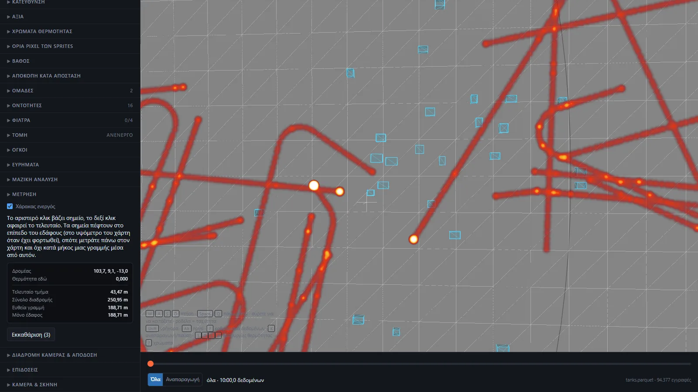

# Μέτρο

Το **Μέτρο** κάνει το ποντίκι χάρακα και σας λέει πόσο πολυσύχναστο είναι το σημείο κάτω από τον δρομέα. Χρησιμοποιήστε το για να μάθετε πόσο απέχουν δύο σημεία, ή πόση κίνηση έχει ένα σημείο.

## Δοκιμάστε το {#try-it}

1. Ανοίξτε το **Μέτρο** στην πλαϊνή στήλη και τικάρετε το **Χάρακας ενεργός**.
2. Κάντε αριστερό κλικ σε τρία σημεία του χάρτη. Κάθε κλικ ρίχνει ένα σημείο.
3. Διαβάστε το **Σύνολο διαδρομής** (το μήκος ολόκληρης της διαδρομής) και το **Τελευταίο τμήμα** (το τελευταίο σκέλος).
4. Κάντε δεξί κλικ για να αφαιρέσετε το τελευταίο σημείο, ή πατήστε **Καθαρισμός (3)** για να αφαιρέσετε όλα.

| Ενέργεια | Αποτέλεσμα |
|---|---|
| Αριστερό κλικ | Ρίχνει ένα σημείο όπου ο δρομέας συναντά το επίπεδο του εδάφους. Ένα κλικ που μετακινήθηκε πάνω από 4 pixel ανάμεσα στο πάτημα και στην απελευθέρωση είναι σύρσιμο της κάμερας, όχι σημείο. |
| Δεξί κλικ | Αφαιρεί το τελευταίο σημείο. |
| Κίνηση | Η θέση του δρομέα και η θερμότητα κάτω από αυτόν ενημερώνονται ζωντανά. |

Η κάμερα συνεχίζει να δουλεύει όσο είναι ενεργός ο χάρακας: το σύρσιμο εξακολουθεί να κοιτάζει γύρω, τα πλήκτρα εξακολουθούν να πετούν. Όσο είναι ενεργός, ο χάρακας παίρνει κάθε κλικ, οπότε η [επιλογή με κλικ](camera.md#click-to-pick) περιμένει μέχρι να κλείσει.

**Το επίπεδο του εδάφους** είναι η υψομετρική εικόνα του [χάρτη](map-images.md) όταν έχει φορτωθεί εικόνα χάρτη, αλλιώς το μικρότερο Y των δεδομένων (0 χωρίς αυτό). Τα σημεία πέφτουν πάνω του, οπότε ο χάρακας μετράει πάνω στον χάρτη και όχι κατά μήκος μιας γραμμής που τον διαπερνά. Με τρισδιάστατο επίπεδο, το επίπεδο παραμένει το μικρότερο Y των δεδομένων και όχι η επιφάνεια του επιπέδου· για ένα σημείο στην πραγματική επιφάνεια, κλείστε τον χάρακα και κάντε κλικ πάνω της ([επιλογή με κλικ](camera.md#click-to-pick)), που διαβάζει τις συντεταγμένες από τα ίδια τα τρίγωνα του επιπέδου.

## Ενδείξεις {#readouts}

| Γραμμή | Τι σημαίνει |
|---|---|
| **Δρομέας** | Τα X, Y, Z του κόσμου του σημείου κάτω από τον δρομέα, πάνω στο επίπεδο. |
| **Θερμότητα εδώ** | Πόση θερμότητα υπάρχει στο pixel του δρομέα. Ένας μεγαλύτερος αριθμός σημαίνει περισσότερη κίνηση σε εκείνο το σημείο. Είναι η τιμή που τροφοδοτείται στη βαθμίδα χρωμάτων πριν τη διαιρέσει το σημείο κορεσμού, οπότε μπορείτε να τη συγκρίνετε με το [Σημείο κορεσμού](colour-and-exposure.md#saturation-point). |
| **Τελευταίο τμήμα** | Απόσταση από το τελευταίο σημείο ως τον δρομέα (ή ανάμεσα στα δύο τελευταία σημεία). |
| **Σύνολο διαδρομής** | Μήκος της πολυγωνικής γραμμής που περνά από κάθε σημείο και από τον δρομέα. |
| **Ευθεία γραμμή** | Τρισδιάστατη απόσταση από το πρώτο σημείο ως τον δρομέα (ή το τελευταίο σημείο). |
| **Μόνο έδαφος** | Το ίδιο, μόνο στα X και Z. |
| **Καθαρισμός (N)** | Αφαιρεί όλα τα σημεία. |

Οι αποστάσεις δείχνονται σε εκατοστά κάτω από 1 μονάδα, σε μέτρα κάτω από 1.000 και σε χιλιόμετρα πάνω από αυτό· με την υπόθεση ότι μία μονάδα του κόσμου είναι ένα μέτρο ([Άξονες, μονάδες και χρόνος](axes-units-and-time.md#unit-scale)). Οι συντεταγμένες είναι συντεταγμένες του κόσμου, και ισχύουν και όταν ένας άξονας [αντιστρέφεται για εμφάνιση](camera.md#invert-world-axis).

Τα σημεία και η γραμμή ανάμεσά τους σχεδιάζονται ως επικάλυψη στην προβολή, με μέγεθος από το βήμα του πλέγματος. Τα σημεία του χάρακα δεν αποθηκεύονται στις προβολές· μένουν όταν φορτώνετε άλλα δεδομένα.

## Για προγραμματιστές {#for-developers}

Η **Θερμότητα εδώ** διαβάζεται από τη GPU το πολύ κάθε 120 ms, γιατί η ανάγνωση ενός μόνο pixel σταματά τη ροή της pipeline. Χρησιμοποιεί την ίδια διαδρομή με το `engine.readHeatProbe()`: διαιρείται με το κέρδος με το οποίο γράφτηκε το καρέ, οπότε στη διαδρομή συσσώρευσης half-float (`?heat=f16`) είναι στις ίδιες μονάδες με έναν στόχο 32 bit ([Συσσώρευση half-float](half-float-accumulation.md)).
