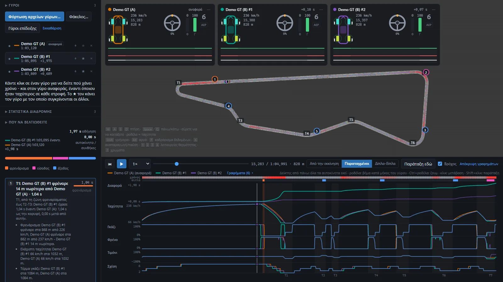

# Ανάλυση αγώνα

Οδηγήσατε την ίδια πίστα δύο φορές. Η καρτέλα **Ανάλυση αγώνα** παίζει και τις δύο διαδρομές μαζί σε 3D, δείχνει πού ήταν πιο αργός ένας γύρος και σας λέει γιατί. Δεν έχετε ακόμα γύρους; Πατήστε **Γύροι επίδειξης**.

Η καρτέλα συγκρίνει δύο ή περισσότερους γύρους μιας πίστας. Μοιράζεται με τον χάρτη θερμότητας τον καμβά, την κάμερα και το φορτωμένο μοντέλο της πίστας (**Φόντο / πίστα**)· όλα τα άλλα είναι δικά της: η δική της πλαϊνή στήλη και η δική της μπάρα κάτω από την προβολή. Λέξεις όπως *γύρος*, *αναφορά* και *κορυφή στροφής* είναι στο [γλωσσάρι](glossary.md).

Αυτή η σελίδα είναι ο χάρτης της καρτέλας. Κάθε μέρος έχει τη δική του σελίδα:

| Σελίδα | Τι καλύπτει |
|---|---|
| [Φόρτωση γύρων](race-loading-laps.md) | κάθε μορφή αρχείου, φάκελοι και πίστες, ονόματα αυτοκινήτων, γύροι επίδειξης, η λίστα γύρων, αναφορά και εστίαση |
| [Επανάληψη και η σκηνή 3D](race-replay-and-scene.md) | η μπάρα μεταφοράς, οι τρεις λειτουργίες επανάληψης, η ευθυγράμμιση των αυτοκινήτων, η κάμερα καταδίωξης, γραμμές, χάρτες, αυτοκίνητα, ετικέτες, καθρεφτισμένοι κόσμοι |
| [Γραφήματα και HUD](race-charts-and-hud.md) | τα γραφήματα απόστασης, ο επιλογέας γραφημάτων, το πέρασμα του δείκτη και το ζουμ, οι κάρτες αυτοκινήτων, ο πίνακας καναλιών |
| [Γεγονότα ελέγχου οχήματος](race-control-events.md) | κλειδώματα, πατινάρισμα τροχών, υπερστροφή, περιστροφές, υποστροφή, χτυπήματα, συντριβές, ABS/TC, χειρόφρενο, αέρας - πώς ανιχνεύεται το καθένα, με κάθε κατώφλι |
| [Ανάλυση στροφή προς στροφή](race-corner-analysis.md) | ευθυγράμμιση κατά απόσταση, στροφές και τμήματα, ο χρονικός λογαριασμός μιας στροφής, κάθε αιτία και η σειρά με την οποία δοκιμάζονται, το σχήμα της γραμμής και η συμβουλή |
| [Προφίλ αυτοκινήτων και σύγκριση](race-car-profiles.md) | τι μπορεί να κάνει κάθε αυτοκίνητο, μετρημένο από τους γύρους του· *Σύγκριση αυτοκινήτων*· τι αποφασίζει το αυτοκίνητο σε κάθε στροφή |
| [Στατιστικά διαδρομής](race-course-statistics.md) | πολλοί γύροι της ίδιας πίστας: λάθη ανά στροφή και ανά είδος, ο χάρτης λαθών, εξαγωγή θερμικού χάρτη, όρια απόδοσης |
| [Αναλυτικά αγώνα: η μέθοδος](race-analytics.md) | η έρευνα πίσω από τους κανόνες, με πηγές |
| [Άλλα παιχνίδια αγώνων](other-games.md) | τι κάνει ο περιηγητής με γύρους από κάθε παιχνίδι: ολίσθηση και drift που υπολογίζονται όπου ένα παιχνίδι δεν τα στέλνει, καθρεφτισμένοι κόσμοι, τα επιπλέον κανάλια |

## Η οθόνη {#the-screen}

**Πλαϊνή στήλη**, από πάνω προς τα κάτω (οι ενότητες μπορούν να διπλωθούν):

1. **Γύροι** - φόρτωση, λίστα, εμφάνιση/απόκρυψη, αναφορά, εστίαση, καταδίωξη. Βλ. [Φόρτωση γύρων](race-loading-laps.md).
2. **Στατιστικά διαδρομής** - μόνο από τρεις φορτωμένους γύρους και πάνω. Βλ. [Στατιστικά διαδρομής](race-course-statistics.md).
3. **Πού να βελτιωθείτε** - τα ευρήματα του εστιασμένου γύρου, στροφή προς στροφή. Βλ. [Ανάλυση στροφή προς στροφή](race-corner-analysis.md).
4. **Στροφή προς στροφή** (ή *Στροφή προς στροφή - κλάση X* όταν υπάρχουν πολλές κλάσεις) - ο ταχύτερος γύρος από κάθε στροφή και η γραμμή του. Εμφανίζεται με δύο ή περισσότερους γύρους.
5. **Έλεγχος αυτοκινήτου** - τα κλειδώματα, οι ολισθήσεις, οι υποστροφές και τα χτυπήματα του εστιασμένου γύρου. Βλ. [Γεγονότα ελέγχου οχήματος](race-control-events.md).
6. **Σύγκριση αυτοκινήτων** (ή **Το αυτοκίνητο** με ένα αυτοκίνητο) - βλ. [Προφίλ αυτοκινήτων και σύγκριση](race-car-profiles.md).
7. **Προβολή** - ποιος χάρτης ζωγραφίζεται στην πίστα και τι σχεδιάζεται. Βλ. [Επανάληψη και η σκηνή 3D](race-replay-and-scene.md).
8. Τα κοινά panels **Φόντο / πίστα** και **Κάμερα & σκηνή** (μοντέλο πίστας, αντιστροφή αξόνων, κάμερα)· τεκμηριώνονται με τον χάρτη θερμότητας και στη σελίδα [Κάμερα](camera.md).

**Η προβολή** δείχνει την πίστα, τις διαδρομές που οδηγήθηκαν, τον χάρτη, τα αυτοκίνητα, τις ετικέτες καρφιτσωμένες στην πίστα, και μέχρι έξι κάρτες αυτοκινήτων πάνω αριστερά (βλ. [Γραφήματα και HUD](race-charts-and-hud.md)). Χωρίς φορτωμένους γύρους γράφει «Δεν έχουν φορτωθεί γύροι - Αφήστε εδώ δύο ή περισσότερα αρχεία γύρων ή φορτώστε τους γύρους επίδειξης από την πλαϊνή στήλη.»

**Η μπάρα κάτω από την προβολή** περιέχει τα στοιχεία μεταφοράς της επανάληψης και, αν δεν είναι κρυμμένα, τα γραφήματα απόστασης.

## Γρήγορη εκκίνηση {#quick-start}

1. Ανοίξτε την καρτέλα **Ανάλυση αγώνα** (δίπλα στον **Χάρτη θερμότητας** στην κορυφή της πλαϊνής στήλης).
2. Φέρτε γύρους. Πατήστε **Γύροι επίδειξης** για να δείτε τι κάνει η καρτέλα με τρεις φανταστικούς γύρους. Για δικούς σας γύρους, καταγράψτε τους πρώτα ([μορφές αρχείων και εγγραφείς](race-loading-laps.md#file-formats)), και μετά πατήστε **Φόρτωση αρχείων γύρων…** ή **Φάκελος…**, ή σύρετε αρχεία ή φακέλους πάνω στην προβολή.
3. Ο ταχύτερος πλήρης γύρος γίνεται η αναφορά· ο βραδύτερος από τους άλλους γύρους εστιάζεται. Κάντε κλικ σε οποιονδήποτε γύρο της λίστας για να τον εστιάσετε· το ★ κάνει έναν γύρο αναφορά.
4. Διαβάστε το **Πού να βελτιωθείτε**. Κάντε κλικ σε ένα εύρημα: τα αυτοκίνητα ευθυγραμμίζονται 40 m πριν από αυτό, η κάμερα το πλαισιώνει, η επανάληψη παίζει μέσα από αυτό και ανοίγουν οι μετρήσεις.
5. Περάστε με τον δείκτη πάνω από τα γραφήματα για να μετακινήσετε κάθε αυτοκίνητο σε εκείνο το μέτρο· Shift+κλικ για να τα ευθυγραμμίσετε εκεί.

## Πλήκτρα {#keyboard}

Όσο είναι ανοιχτή η καρτέλα Αγώνα:

| Πλήκτρο | Κάνει |
|---|---|
| **K** | παύση / αναπαραγωγή της επανάληψης |
| **Home** | πίσω στην αρχή της επανάληψης |
| πλήκτρα αριθμών | τίποτα (στον χάρτη θερμότητας αλλάζουν λειτουργίες) |

Τα πλήκτρα που πληκτρολογούνται σε πεδίο κειμένου ή αναπτυσσόμενη λίστα αγνοούνται. Τα πλήκτρα κάμερας δουλεύουν όπως στον χάρτη θερμότητας (**W A S D**, **Space** πάνω, **Q** κάτω, **Shift** πιο γρήγορα, **Alt** πιο αργά, ποντίκι για να κοιτάξετε· όλα στη [Κάμερα](camera.md))· το **F** πλαισιώνει τους φορτωμένους γύρους (όπως κάνει και η φόρτωση γύρων).

## Πολλοί γύροι {#many-laps}

- Όλοι οι φορτωμένοι γύροι αναλύονται και μετριούνται· δεκάδες θέλουν ένα-δύο δευτερόλεπτα.
- Πέρα από **8** γύρους (`SHOW_ALL_UP_TO`), οι γύροι που προστίθενται σχεδιάζονται μόνο όταν είναι η αναφορά, ο εστιασμένος γύρος ή ο καλύτερος γύρος της κλάσης του εστιασμένου. Τα *Εμφάνιση όλων* / *Μόνο όσους κοιτάζετε* αλλάζουν.
- Πέρα από **10** ορατά αυτοκίνητα (`PLAIN_PAST`), οι γύροι που δεν κοιτάζετε (ούτε η εστίαση, ούτε το καταδιωκόμενο αυτοκίνητο, ούτε η αναφορά) σχεδιάζονται με γραμμές αραιωμένες σε ένα σημείο κάθε 6 m αντί για 1,5 m, και με απλά αυτοκίνητα.
- Τα γραφήματα σχεδιάζουν το πολύ **8** γύρους· το HUD δείχνει το πολύ **6** κάρτες.
- Τα στατιστικά της διαδρομής εμφανίζονται από **3** γύρους.

Λεπτομέρειες: [Στατιστικά διαδρομής](race-course-statistics.md#performance-with-many-laps).

## Προεπιλεγμένες ρυθμίσεις προβολής {#default-view-settings}

| Ρύθμιση | Προεπιλογή |
|---|---|
| Χάρτης | Χάρτης χρόνου |
| Οδηγημένες γραμμές, Αυτοκίνητα, Ελαστικά & ανάρτηση, Ετικέτες, Πίστα από τους γύρους | ενεργά |
| Όλες οι τιμές στις κάρτες | ανενεργό |
| Μέγεθος αυτοκινήτου | 1× |
| Γραφήματα | εμφανίζονται |
| Λειτουργία επανάληψης | Από την εκκίνηση |
| Ταχύτητα επανάληψης | 1× |
| Βρόχος | ενεργός |

Τίποτα από αυτά δεν αποθηκεύεται· η επαναφόρτωση ξεκινά από τις προεπιλογές. Ό,τι θυμάται ο περιηγητής: η γλώσσα, και τα ονόματα αυτοκινήτων που μαθαίνονται από αρχεία γύρων (βλ. [Φόρτωση γύρων](race-loading-laps.md#car-names)).

## Για προγραμματιστές {#for-developers}

### Τι συμβαίνει όταν φορτώνονται γύροι {#what-happens-when-laps-are-loaded}

Κάθε φορά που αλλάζει το σύνολο των γύρων, η αναφορά ή η γλώσσα, ολόκληρη η ανάλυση γίνεται ξανά (`analyse` στο [`src/race/analysis.ts`](https://github.com/Holdi601/3DHeat/blob/main/src/race/analysis.ts)):

1. Παράγωγα κανάλια προστίθενται σε κάθε γύρο όπου το παιχνίδι δεν τα στέλνει: γωνία drift, ολίσθηση τροχών από τις ταχύτητες των τροχών, στον αέρα, χαλαρό έδαφος, ταχύτητα στροφής ([`derive.ts`](https://github.com/Holdi601/3DHeat/blob/main/src/race/derive.ts)).
2. Η αναφορά επιλέγεται και κάθε γύρος προβάλλεται στη διαδρομή του και δειγματοληπτείται ξανά κάθε 2 m ([`align.ts`](https://github.com/Holdi601/3DHeat/blob/main/src/race/align.ts)).
3. Βρίσκεται αν ο κόσμος του παιχνιδιού είναι καθρεφτισμένος, από τους γύρους ([`handedness.ts`](https://github.com/Holdi601/3DHeat/blob/main/src/race/handedness.ts)).
4. Οι στροφές βρίσκονται στην αναφορά και ομαδοποιούνται σε τμήματα από μια ζώνη πέδησης ως την επόμενη ([`segments.ts`](https://github.com/Holdi601/3DHeat/blob/main/src/race/segments.ts)).
5. Ανά αυτοκίνητο: η περιβάλλουσά του (πρόσφυση, πέδηση, έλξη ανά ταχύτητα), το προφίλ του, οι καμπύλες ελαστικών του ([`envelope.ts`](https://github.com/Holdi601/3DHeat/blob/main/src/race/envelope.ts), [`profile.ts`](https://github.com/Holdi601/3DHeat/blob/main/src/race/profile.ts), [`control.ts`](https://github.com/Holdi601/3DHeat/blob/main/src/race/control.ts)).
6. Ανά γύρο και τμήμα: τι έκανε (σημείο πέδησης, πιο αργό σημείο, πλήρες γκάζι, ...) και η γραμμή που οδήγησε ([`line.ts`](https://github.com/Holdi601/3DHeat/blob/main/src/race/line.ts)).
7. Ανά γύρο: τα γεγονότα ελέγχου οχήματος, το καθένα απέναντι στον γύρο με τον οποίο συγκρίνεται εκεί.
8. Ανά γύρο και τμήμα: ο χρονικός λογαριασμός απέναντι στον γύρο σύγκρισής του και το εύρημα με λόγια.
9. Ο χάρτης χρόνου και ο χάρτης αιτιών ανά γύρο.

Τα κείμενα παράγονται στην τρέχουσα γλώσσα· η αλλαγή γλώσσας εκτελεί ξανά την ανάλυση (και μετονομάζει τους γύρους επίδειξης). Μια αποτυχία της ανάλυσης φαίνεται κάτω από τα κουμπιά **Γύροι** ως σφάλμα, και οι γύροι μένουν φορτωμένοι.

### Αρχεία πηγαίου κώδικα {#source-files}

| Αρχείο | Ρόλος |
|---|---|
| `src/race/adapters.ts`, `ibt.ts` | ανάγνωση αρχείων γύρων |
| `src/race/lap.ts`, `carNames.ts`, `synthetic.ts` | ο τύπος γύρου, η ονομασία, οι γύροι επίδειξης |
| `src/race/derive.ts`, `handedness.ts` | παράγωγα κανάλια, καθρεφτισμένοι κόσμοι |
| `src/race/align.ts`, `segments.ts`, `line.ts` | άξονας απόστασης, στροφές, γραμμές |
| `src/race/analysis.ts` | οι συγκρινόμενες στροφές, οι αιτίες, τα ευρήματα |
| `src/race/envelope.ts`, `profile.ts` | τι μπορεί να κάνει ένα αυτοκίνητο |
| `src/race/control.ts`, `impacts.ts` | έλεγχος οχήματος, χτυπήματα και συντριβές |
| `src/race/stats.ts` | πολλοί γύροι |
| `src/race/replay.ts`, `scene.ts`, `glyph.ts`, `geometry.ts` | επανάληψη και σχεδίαση |
| `src/race/schema.ts`, `graphs.ts` | ο πίνακας καναλιών, οι γραμμές των γραφημάτων |
| `src/ui/race/*` | η πλαϊνή στήλη, τα γραφήματα, το HUD, οι ετικέτες |
| `src/state/raceStore.ts` | η κατάσταση της καρτέλας και το ρολόι της επανάληψης |
