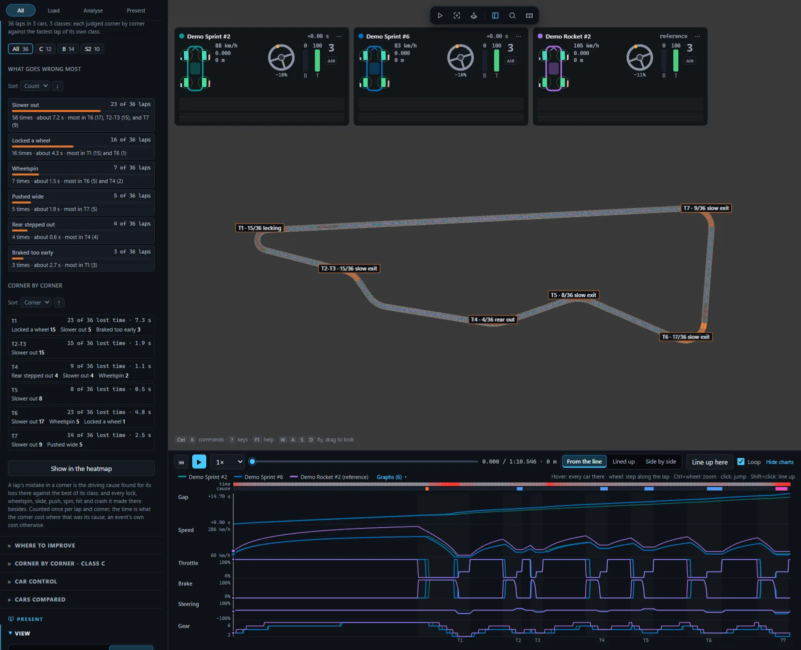

# Στατιστικά διαδρομής

Φορτώστε πολλούς γύρους μιας διαδρομής και ο θεατής μετράει τα λάθη: ποια στροφή κοστίζει τον περισσότερο χρόνο, σε πόσους από τους γύρους πήγε στραβά εκεί, και γιατί. Χρησιμοποιήστε το για να βρείτε τη στροφή που αξίζει να εξασκηθείτε.

Δοκιμάστε το: το **Γύροι επίδειξης** δίνει τρεις γύρους, αρκετούς ώστε να εμφανιστεί αυτή η ενότητα.

Φορτώστε ολόκληρο τον φάκελο μιας διαδρομής (δεκάδες γύροι, πολλά αυτοκίνητα, πολλές κατηγορίες επιδόσεων) και κάθε γύρος κρίνεται και μετράει. Αυτή η σελίδα καλύπτει τη σύγκριση ανά κατηγορία, τι μετράει ως λάθος, την ενότητα **Στατιστικά διαδρομής**, τον χάρτη λαθών, την εξαγωγή στον χάρτη θερμότητας, τις διαδρομές από πολλές πίστες και τα όρια απόδοσης με πολλούς γύρους.

## Σε σύγκριση με τον καλύτερο της δικής του κατηγορίας {#against-the-best-of-its-own-class}

Ένας γύρος συγκρίνεται στροφή προς στροφή με τον **ταχύτερο πλήρη γύρο της δικής του κατηγορίας επιδόσεων** (το σημείο αναφοράς, στην κατηγορία του σημείου αναφοράς). Ο ίδιος ο γύρος συγκρίνεται με όποιον ήταν ο ταχύτερος της κατηγορίας του σε κάθε στροφή, ή με κάθε γύρο όταν είναι μόνος στην κατηγορία του. Τα αυτοκίνητα ομαδοποιούνται με την κατηγορία επιδόσεων του παιχνιδιού (στο Forza, από D έως X· το C και το S2 είναι δύο από αυτές). Το σημείο φρεναρίσματος ενός αυτοκινήτου κατηγορίας C απέναντι σε ένα S2 δεν λέει τίποτα για την οδήγηση. Ο χάρτης χρόνου, τα κενά στη λίστα των γύρων και ο πίνακας *Στροφή προς στροφή* ακολουθούν την ίδια σύγκριση (βλ. [με ποιον συγκρίνεται κάθε γύρος](race-corner-analysis.md#who-each-lap-is-compared-with)).

Τα στατιστικά βασίζονται στην ανάλυση κάθε γύρου, δεν είναι κάτι ξεχωριστό δίπλα της.

## Τι μετράει ως λάθος {#what-counts-as-a-mistake}

Ένα **περιστατικό** είναι το λάθος ενός γύρου σε μία στροφή (τμήμα). Τα λάθη ενός γύρου σε μια στροφή είναι:

1. **Η αιτία οδήγησης** που βρήκε η ανάλυση για την απώλειά του εκεί: ένα εύρημα που είναι απώλεια, αποδίδεται στον οδηγό (όχι στο αυτοκίνητο ή στην κατάσταση), και κοστίζει **0,05 s** ή περισσότερο σε σύγκριση με τον γύρο αναφοράς του. Το κόστος του είναι η απώλεια της στροφής.
2. **Κάθε σφάλμα ελέγχου του αυτοκινήτου** που έκανε εκεί και που δεν έκανε ο άλλος γύρος (μη κοινό), και κοστίζει **0,03 s** ή περισσότερο: κλείδωμα, σπινάρισμα, πίσω μέρος που φεύγει, σπρώξιμο, περιστροφή. Το κόστος του είναι το δικό του.
3. **Κάθε χτύπημα και κάθε σύγκρουση**, κοινά ή όχι, όσο κι αν κόστισαν.

Μια στροφή μπορεί να έχει πολλά. Κάθε είδος μετράει **μία φορά ανά γύρο και στροφή**. Τα κέρδη, το μερίδιο του αυτοκινήτου και η αργότερη άφιξη που αποφασίστηκε στην προηγούμενη στροφή δεν είναι λάθη.

### Από τα ευρήματα στα λάθη {#from-findings-to-mistakes}

| Εύρημα | Λάθος |
|---|---|
| πολύ γρήγορα μέσα, αργά έξω, από φρενάρισμα περισσότερα από λίγα μέτρα αργότερα από τον άλλο | Φρέναρε πολύ αργά |
| φρέναρε νωρίς | Φρέναρε πολύ νωρίς |
| φρέναρε απαλά | Φρέναρε πολύ απαλά |
| ένα μπλόκαρισμα ως αιτία | Μπλόκαρε τροχό |
| ρόλαρε | Ρόλαρε |
| πρόσφυση στο περιθώριο, πιο αργά ως την κορυφή, φρένο εκεί που ο άλλος μόνο σήκωσε το πόδι | Πολύ αργά στη μέση |
| πολύ κλειστή γραμμή | Πολύ κλειστή γραμμή |
| έφυγε προς τα έξω | Έφυγε προς τα έξω |
| γύρισε το αυτοκίνητο λιγότερο / πολύ | Λάθος γύρισμα του αυτοκινήτου |
| πήρε το γκάζι αργότερα, γκάζι πλήρες αργότερα, δίστασε | Αργά στο γκάζι |
| πιο αργά έξω από τη στροφή | Πιο αργή έξοδος |
| σπινάρισμα | Σπινάρισμα |
| το πίσω μέρος έφυγε, πλάγια στη μέση | Έφυγε από πίσω |
| πήγε έξω | Άνοιξε στην έξοδο |
| έχασε ταχύτητα | Έφαγε ταχύτητα |
| σήκωσε το πόδι (στην είσοδο ή στην ευθεία) | Σήκωσε το πόδι |
| σχεδόν στάση, περιστροφή, χτύπημα ή σύγκρουση ως αιτία | Έκανε τετ-α-κε / Χτύπησε κάπου / Συγκρούστηκε, όταν τα συμβάντα του γύρου εκεί το δείχνουν (πρώτα σύγκρουση, μετά περιστροφή, μετά χτύπημα)· αλλιώς Σχεδόν σταμάτησε |
| μεγαλύτερη πτήση | Πέταξε πολύ μακριά |

Τα δύο μοτίβα μετράνε ως η αιτία που βρέθηκε μέσα τους, με τον ίδιο πίνακα. Το *Έδωσε περισσότερα στην είσοδο απ' όσα κέρδισε η έξοδος* είναι το λάθος της αιτίας της καταχώρισής του: το νωρίς φρενάρισμα είναι *Φρέναρε πολύ νωρίς*, ένα μπλόκαρισμα *Μπλόκαρε τροχό*, το ρόλαρισμα *Ρόλαρε*, η πρόσφυση που έμεινε αχρησιμοποίητη *Πολύ αργά στη μέση*. Το *Πολύ γρήγορα μέσα, αργά έξω* είναι *Φρέναρε πολύ αργά* όταν ο γύρος φρέναρε αργότερα από τον άλλο· αλλιώς είναι το λάθος της αιτίας της εξόδου του: *Αργά στο γκάζι*, *Σπινάρισμα*, *Έφυγε από πίσω*, *Άνοιξε στην έξοδο*, *Πιο αργή έξοδος*. Ένα μοτίβο του οποίου η αιτία είναι του αυτοκινήτου, ή μια αργότερη άφιξη, δεν μετράει.

Δεν μετράνε: η αργότερη άφιξη, η εκκίνηση, κάθε εύρημα *αυτοκινήτου* (έλξη, πρόσφυση, φρένα, οδήγηση) και κάθε κέρδος ή στροφή χωρίς απώλεια.

### Τα είδη, με τη σειρά τους {#the-kinds-in-their-order}

Φρενάρισμα: *Φρέναρε πολύ αργά*, *Φρέναρε πολύ νωρίς*, *Φρέναρε πολύ απαλά*, *Μπλόκαρε τροχό*. Είσοδος: *Ρόλαρε*, *Πολύ αργά στη μέση*, *Πολύ κλειστή γραμμή*, *Έφυγε προς τα έξω*, *Λάθος γύρισμα του αυτοκινήτου*. Έξοδος: *Αργά στο γκάζι*, *Πιο αργή έξοδος*, *Σπινάρισμα*, *Έφυγε από πίσω*, *Άνοιξε στην έξοδο*, *Έφαγε ταχύτητα*. Ευθεία: *Σήκωσε το πόδι*. Περιστατικά: *Έκανε τετ-α-κε*, *Χτύπησε κάπου*, *Συγκρούστηκε*, *Σχεδόν σταμάτησε*, *Πέταξε πολύ μακριά*.

## Η ενότητα Στατιστικά διαδρομής {#the-course-statistics-section}

Εμφανίζεται από **3** γύρους και πάνω, ανάμεσα στο **Γύροι** και το **Πού να βελτιωθείτε**.

- **Η σύνοψη**: «40 γύροι σε 9 αυτοκίνητα, 3 κατηγορίες: κάθε στροφή κρίνεται με τον ταχύτερο γύρο της δικής της κατηγορίας.» (τα αυτοκίνητα μετριούνται με τον αριθμό του ή με το όνομά τους).
- **Τσιπ κατηγοριών** (όταν υπάρχουν πολλές κατηγορίες): **Όλα** και ένα τσιπ για κάθε κατηγορία, το καθένα με το πλήθος των γύρων του, με τη σειρά του παιχνιδιού (D, C, B, A, S1, S2, R, X, και μετά οι άλλες). Ένα κλικ σε κατηγορία κρατά μόνο τους γύρους της. Το **Shift+κλικ** προσθέτει ή αφαιρεί μία. Όλα όσα βλέπετε από κάτω (οι λίστες, ο χάρτης, η εξαγωγή στον χάρτη θερμότητας) ακολουθούν τις κατηγορίες που επιλέξατε.
- **Τι πηγαίνει στραβά συχνότερα**: κάθε είδος λάθους, πρώτα αυτό που κάνουν περισσότεροι γύροι (μετά αυτό με τις περισσότερες φορές, μετά αυτό με το μεγαλύτερο κόστος), το πολύ 8. Το **Όλα N είδη** δείχνει τα υπόλοιπα, το **Λιγότερα** τα κρύβει ξανά. Κάθε γραμμή: το όνομά της, «N από M γύρους», μια μπάρα με αυτό το μερίδιο, και «K φορές · περίπου X s · κυρίως στη T3 (5), T7 (4), T1 (2)»: πόσο συχνά έγινε (ανά γύρο και στροφή), πόσο κόστισε συνολικά, και οι τρεις στροφές όπου τα περισσότερα γύρια το έκαναν. **Κάντε κλικ σε μια γραμμή** για να την δείτε στον χάρτη λαθών (και ανοίγει ο χάρτης)· ένα ακόμη κλικ δείχνει όλα τα λάθη.
- **Στροφή προς στροφή** (ή *Στροφή προς στροφή - <λάθος>* όταν έχετε επιλέξει ένα): ανά τμήμα, «N από M έχασαν χρόνο · X s». Είναι οι γύροι που πέρασαν ολόκληρη τη στροφή, εκείνοι που έχασαν **0,05 s** ή περισσότερο εκεί απέναντι στον καλύτερο της κατηγορίας τους, και όλος ο χρόνος που έχασαν. Όταν είναι διπλωμένη, δείχνει τα τρία πιο συχνά λάθη της με το πλήθος των γύρων τους. **Κάντε κλικ σε μια στροφή** για να την ανοίξετε, να την καδράρετε με την κάμερα και να περάσετε στον χάρτη λαθών: για κάθε λάθος (ή μόνο για το επιλεγμένο) μια γραμμή όπως «12 από 40 γύρους φρέναραν πολύ νωρίς εδώ. Σε 9 διαφορετικά αυτοκίνητα, περίπου 0,21 s το καθένα», και οι γύροι που το έκαναν, **με τον χειρότερο πρώτο**, με το κόστος του καθενός. Το πολύ 8, και «+N ακόμη» για τα υπόλοιπα. **Κάντε κλικ σε έναν γύρο** για να τον επιλέξετε και να ξαναδείτε εκείνο το λάθος (ευθυγραμμισμένο 40 m πριν από αυτό).
- **Εμφάνιση στον χάρτη θερμότητας**: βλ. παρακάτω. Εμφανίζεται «Χτίζεται ο χάρτης θερμότητας…» όσο τρέχει· είναι απενεργοποιημένο όταν δεν υπάρχουν λάθη.

## Ο χάρτης λαθών {#the-mistake-map}

Το **Προβολή → Χάρτης λαθών** βάφει κατά μήκος της διαδρομής αναφοράς πόσοι από τους γύρους (των κατηγοριών που επιλέξατε) έκαναν λάθος σε κάθε μέτρο: όλων των ειδών, ή μόνο του είδους που επιλέξατε στα στατιστικά. Κάθε γύρος μετράει μία φορά ανά μέτρο. Η περιοχή κάθε περιστατικού (εκεί όπου ήταν η αιτία ή το συμβάν του) πλαταίνει κατά 6 m από κάθε πλευρά, ώστε ένα σύντομο να φαίνεται. Πλατύτερο και πιο έντονο όπου έκαναν λάθος περισσότεροι γύροι: πλάτος `3 + 10 · (γύροι εδώ / οι περισσότεροι γύροι πουθενά)` μέτρα, χρώμα από σκούρο καφέ σε έντονο πορτοκαλί· μια γκρι λωρίδα 2 m όπου δεν έκανε λάθος κανείς. Υπόμνημα: *λίγοι γύροι ↔ οι περισσότεροι γύροι*.

Με τις **Ετικέτες** ανοιχτές, η κορυφή κάθε στροφής φέρει το πιο συχνό της λάθος: «T3 · 12/40 πρόωρο φρενάρισμα» (γύροι που το έκαναν / γύροι που πέρασαν τη στροφή), «T3 · 12/40» όταν έχετε επιλέξει ένα είδος, «T3 · καθαρή» όταν δεν έχετε επιλέξει. Όταν περνάτε το ποντίκι πάνω από μια ετικέτα, βλέπετε τις απώλειες της στροφής και τα πέντε πιο συχνά λάθη της· με κλικ ανοίγει ή κλείνει εκείνη η στροφή στα στατιστικά.

## Εμφάνιση στον χάρτη θερμότητας {#show-in-the-heatmap}

Το **Εμφάνιση στον χάρτη θερμότητας** δίνει το ίδιο στην καρτέλα του χάρτη θερμότητας ως σύνολο δεδομένων με όνομα «Λάθη στο <πίστα>» (ή «Λάθη στη διαδρομή»), ώστε όλο το σετ εργαλείων του χάρτη θερμότητας (λειτουργίες θερμότητας, φίλτρα, χρονογραμμή, τομές) να δουλεύει πάνω στο πού πηγαίνουν στραβά οι γύροι.

Είναι ένα CSV που χτίζεται στη μνήμη (`mistakeTable`), με μία γραμμή για κάθε σημείο του πλέγματος (κάθε 2 m) κάθε περιστατικού, στη **δική θέση του γύρου** εκεί:

| Στήλη | Περιεχόμενο |
|---|---|
| `x`, `y`, `z` | η θέση του γύρου σε εκείνο το μέτρο (συντεταγμένες παιχνιδιού) |
| `elapsed` | ο χρόνος του γύρου εκεί, σε s |
| `lap` | η ετικέτα του γύρου |
| `car` | το όνομα του αυτοκινήτου (ή «car 1234») |
| `mistake` | το όνομα του λάθους, στην τρέχουσα γλώσσα |
| `car_class` | η κατηγορία, `-` όταν δεν υπάρχει |
| `corner` | η ετικέτα της στροφής, `T3` |
| `cost` | το κόστος του περιστατικού, σε s |

Φορτώνεται μέσα από τον δικό του φορτωτή του χάρτη θερμότητας, με υποδείξεις αντιστοίχισης: Y προς τα πάνω, χωρίς αντιστροφές αξόνων, κλίμακα 1· ο χρόνος `elapsed` σε δευτερόλεπτα· **άτομο** = `car`, **ομάδα** = `mistake`, **συνεδρία** = `lap`· χωρίς κατεύθυνση βλέμματος· οι `car_class`, `corner` και `cost` κρατιούνται ως στήλες φίλτρου. Η καρτέλα τότε πάει στον **Χάρτη θερμότητας** και καδράρει τα δεδομένα. Εξάγονται μόνο οι κατηγορίες που επιλέξατε στα στατιστικά.

## Διαδρομές από πολλές πίστες {#courses-from-several-tracks}

Οι γύροι αναλύονται **μία διαδρομή τη φορά**. Ένας φάκελος με γύρους από πολλές διαδρομές (ολόκληρη η βιβλιοθήκη γύρων) προσφέρει κάθε διαδρομή για φόρτωση χωριστά (με το πλήθος των γύρων της, τις περισσότερες πρώτα)· οι γύροι από εκτελέσεις που δεν τελείωσαν (ο φάκελος `unfinished/` του FH Companion) πηγαίνουν με τη διαδρομή τους, σημειωμένοι ως *μερικοί*. Γύροι από πολλές ονομασμένες πίστες που επιλέγονται ως αρχεία προσφέρονται με τον ίδιο τρόπο, και οι γύροι χωρίς όνομα πίστας πηγαίνουν με όποια είναι επιλεγμένη. Η φόρτωση γύρων άλλης ονομασμένης πίστας αντικαθιστά όσους είναι ήδη φορτωμένοι. Λεπτομέρειες: [Φόρτωση γύρων](race-loading-laps.md#folders-and-courses).

## Απόδοση με πολλούς γύρους {#performance-with-many-laps}

Δεκάδες γύροι αναλύονται σε ένα ή δύο δευτερόλεπτα (όλοι, πάντα). Αυτό που σχεδιάζεται περιορίζεται, ώστε η προβολή να μένει στον ρυθμό των καρέ:

| Όριο | Τιμή | Αποτέλεσμα |
|---|---|---|
| γύροι που σχεδιάζονται από προεπιλογή | 8 (`SHOW_ALL_UP_TO`) | πάνω από 8 φορτωμένους γύρους, οι νέοι γύροι κρύβονται, εκτός αν είναι η αναφορά, ο επιλεγμένος γύρος ή ο καλύτερος της κατηγορίας του. Το **Εμφάνιση όλων** σχεδιάζει κάθε γύρο· το **Μόνο όσοι εξετάζονται** επιστρέφει. Η επιλογή ενός γύρου τον εμφανίζει ξανά μαζί με τον καλύτερο της κατηγορίας του |
| απλά αυτοκίνητα και λεπτές γραμμές | πάνω από 10 ορατούς (`PLAIN_PAST`) | οι γύροι εκτός από τον επιλεγμένο, το αυτοκίνητο που κυνηγάτε και την αναφορά: ένα σημείο γραμμής κάθε 6 m (αντί για 1,5 m), αυτοκίνητα απλά |
| γύροι στα γραφήματα | 8 (`CHART_LAPS`) | πρώτα ο επιλεγμένος, ο καλύτερος της κατηγορίας του και η αναφορά· «+N ακόμη σχεδιασμένοι, χωρίς γράφημα» |
| κάρτες HUD | 6 | οι πρώτοι έξι ορατοί γύροι |
| στατιστικά | από 3 γύρους | η ενότητα κρύβεται κάτω από αυτό |
| καταγεγραμμένα ευρήματα | 12 οδηγού, 8 αυτοκινήτου/συνθηκών, 10 κερδών | ανά επιλεγμένο γύρο |
| εμφανιζόμενα ζεύγη αυτοκινήτων | 3 | πάνω από 3 ζεύγη, ένα ζεύγος με επιλογέα |

Τα περιστατικά λαθών υπολογίζονται μία φορά ανά ανάλυση και αποθηκεύονται· η πυκνότητα του χάρτη λαθών αποθηκεύεται ανά επιλογή κατηγοριών και είδους.

## Για προγραμματιστές {#for-developers}

Κώδικας: [`src/race/stats.ts`](https://github.com/Holdi601/3DHeat/blob/main/src/race/stats.ts),
[`src/ui/race/StatsSection.tsx`](https://github.com/Holdi601/3DHeat/blob/main/src/ui/race/StatsSection.tsx),
το `openMistakesInHeatmap` στο [`src/ui/race/actions.ts`](https://github.com/Holdi601/3DHeat/blob/main/src/ui/race/actions.ts).
