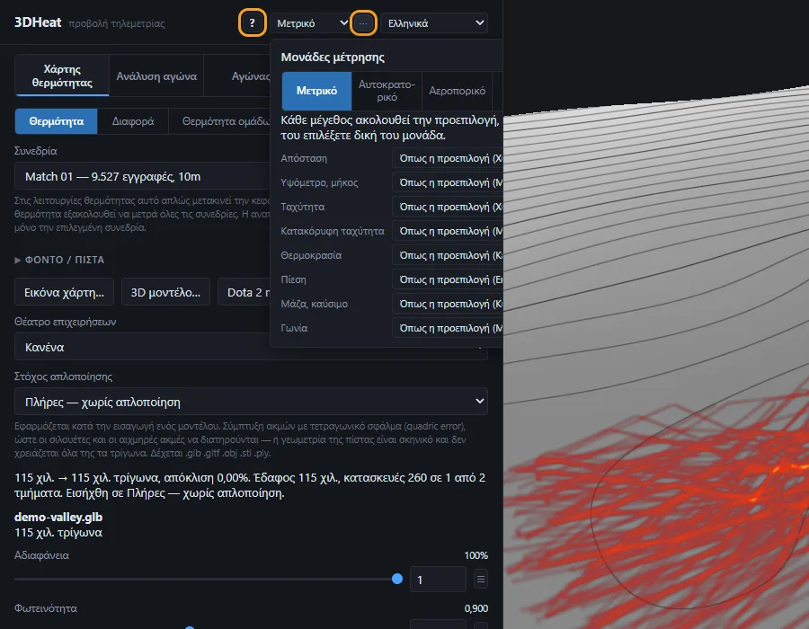

# Ρυθμίσεις, μονάδες και πλήκτρα

Τα μικρά στοιχεία ελέγχου στο πάνω μέρος της πλαϊνής στήλης αλλάζουν τον τρόπο που σας μιλάει ο περιηγητής: τη γλώσσα, τις μονάδες (μέτρα ή πόδια, km/h ή κόμβοι) και μια λειτουργία βοήθειας που εξηγεί τα χρώματα. Οι επιλογές σας θυμούνται στο πρόγραμμα περιήγησής σας.

## Η κεφαλίδα {#the-header}

Στο πάνω μέρος της πλαϊνής στήλης:

| Στοιχείο ελέγχου | Τι κάνει |
|---|---|
| **?** | Λειτουργία βοήθειας: τι σημαίνει κάθε χρώμα (επίσης `?` ή `F1`) |
| Μενού **Μονάδες** | Μετρικό, Αυτοκρατορικό, Αεροπορικό ή Ναυτικό |
| Κουμπί **...** δίπλα στις **Μονάδες** | Ανοίγει το «Επιλέξτε μονάδα για κάθε μέγεθος»: ένα αναπτυσσόμενο μενού για κάθε μέγεθος |
| Μενού **Γλώσσα** | Η γλώσσα του περιηγητή: [40 γλώσσες](languages.md), ή αυτή του προγράμματος περιήγησης |

Οι αριθμοί που πληκτρολογείτε σε ένα πλαίσιο μπορούν να έχουν τελεία ή κόμμα (`0.35` ή `0,35`). Ο περιηγητής διαβάζει και τα δύο και δείχνει τους αριθμούς όπως τους γράφει η γλώσσα του.

## Μονάδες {#units}

1. Διαλέξτε μια προεπιλογή στο μενού **Μονάδες**. Όλα τα μεγέθη αλλάζουν μαζί.
2. Για να αλλάξετε μόνο ένα μέγεθος, πατήστε το κουμπί **...** δίπλα του και διαλέξτε μονάδα για αυτό το μέγεθος. Το μενού τότε δείχνει ένα `*` μετά την προεπιλογή.
3. Ένα μέγεθος που δεν έχετε ορίσει ακολουθεί την προεπιλογή. Διαλέξτε «As preset» για να επιστρέψετε.

| Μέγεθος | Μετρικό (προεπιλογή) | Αυτοκρατορικό | Αεροπορικό | Ναυτικό |
|---|---|---|---|---|
| Απόσταση | km | mi | NM | NM |
| Ύψος, μήκος | m | ft | ft | m |
| Ταχύτητα | km/h | mph | kt | kt |
| Κατακόρυφη ταχύτητα | m/s | ft/min | ft/min | m/s |
| Θερμοκρασία | °C | °F | °C | °C |
| Πίεση | hPa | inHg | hPa | hPa |
| Μάζα, καύσιμο | kg, l | lb, gal | lb, gal | t, m³ |
| Γωνία | μοίρες | μοίρες | μοίρες | μοίρες |

Άλλες μονάδες που μπορείτε να διαλέξετε για ένα μέγεθος: απόσταση km, mi, NM· ταχύτητα km/h, m/s, kt, mph· κατακόρυφη ταχύτητα m/s, ft/min, m/min· θερμοκρασία °C, °F, K· πίεση hPa, inHg, mmHg, psi· μάζα kg, lb, t· γωνία μοίρες ή NATO mils (6400 στον κύκλο). Οι μονάδες είναι ίδιες παντού στον περιηγητή: ετικέτες, κάρτες, γραφήματα, στατιστικά.

## Λειτουργία βοήθειας {#help-mode}

Πατήστε `?` ή `F1`, ή κάντε κλικ στο κουμπί **?**. Δείχνει το *What the colours mean*: υπομνήματα για την τρισδιάστατη προβολή, τις βαθμίδες θερμότητας, τα χρώματα των ομάδων, τα χρώματα του επιπέδου, τα χρώματα κατάστασης των πάνελ, το πάνελ αγώνα και την προβολή αγώνα. Μένει ενεργή μέχρι να την κλείσετε. Στην καρτέλα Match εξηγεί και τα χρώματα του πάνελ αγώνα.

## Τι θυμάται το πρόγραμμα περιήγησης {#what-the-browser-remembers}

Αυτές οι ρυθμίσεις κρατιούνται στο πρόγραμμα περιήγησής σας ανάμεσα στις επισκέψεις (τίποτα δεν στέλνεται πουθενά):

- τη γλώσσα, τις μονάδες και τη λειτουργία βοήθειας·
- τις ρυθμίσεις φιγούρας, συμβόλων, ετικετών, κάμερας και τακτικής οθόνης της αναπαραγωγής·
- την ταχύτητα αναπαραγωγής και τον καθρέφτισμα·
- σελιδοδείκτες ανά εγγραφή, όγκους ανά σύνολο δεδομένων, επίπεδα στόχων·
- τις εξωτερικές ρυθμίσεις AI (το κλειδί μόνο αν τικάρετε το *Remember*).

Οι ρυθμίσεις θερμότητας, τα φίλτρα και η λειτουργία ξεκινούν από την αρχή με κάθε φόρτωση. Η πλήρης, παραγόμενη λίστα: [Αποθηκευμένες ρυθμίσεις](ref-settings-storage.md).

## Πλήκτρα που κρατά ο περιηγητής από το πρόγραμμα περιήγησης {#keys-the-viewer-keeps-from-the-browser}

Μια συνεδρία με μεγάλα δεδομένα χρειάζεται χρόνο για να φορτώσει, οπότε ο περιηγητής εμποδίζει το πρόγραμμα περιήγησης να την πετάξει κατά λάθος:

- Τα `Ctrl`/`Cmd` + γράμματα που θα τύπωναν, θα αποθήκευαν, θα άνοιγαν, θα ανανέωναν, θα έκλειαν ή θα άνοιγαν νέα παράθυρα δεν κάνουν τίποτα έξω από πλαίσια κειμένου· το `F1`, το `F3`, το `F5`, το `F6` και το `F7` δεν κάνουν τίποτα.
- Το κλείσιμο ή η ανανέωση της καρτέλας με φορτωμένα δεδομένα ή επίπεδο ρωτά πρώτα.
- Σε πλήρη οθόνη ο περιηγητής κλειδώνει τα πλήκτρα που χρησιμοποιεί (W, T, N, S, R, P, Q, Esc), ώστε να μην τα πάρει το πρόγραμμα περιήγησης.

Η ακριβής λίστα: [Πλήκτρα προγράμματος περιήγησης](ref-browser-keys.md). Όλα τα πλήκτρα του περιηγητή: [Αναφορά πληκτρολογίου και ποντικιού](keyboard-reference.md).
