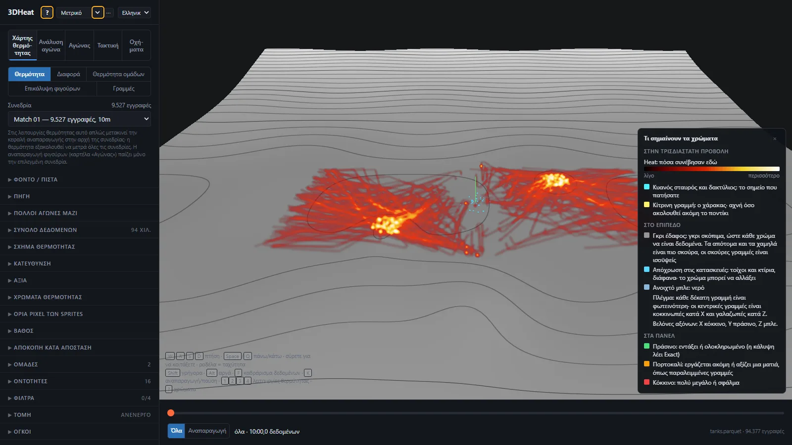
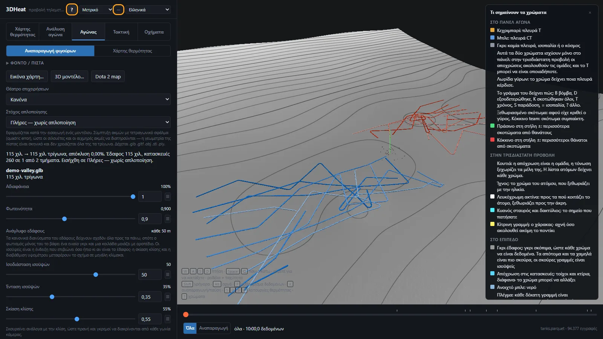

# Ρυθμίσεις, μονάδες και πλήκτρα

Τα μικρά στοιχεία ελέγχου στην κορυφή της πλαϊνής στήλης αλλάζουν τον τρόπο που σας μιλάει ο περιηγητής: τη γλώσσα, τις μονάδες (μέτρα ή πόδια, χλμ/ώρα ή κόμβοι) και μια λειτουργία βοήθειας που εξηγεί τα χρώματα. Οι επιλογές σας θυμούνται στον περιηγητή σας.

## Η κεφαλίδα {#the-header}

Στην κορυφή της πλαϊνής στήλης:

| Στοιχείο ελέγχου | Τι κάνει |
|---|---|
| **?** | Λειτουργία βοήθειας: τι σημαίνει κάθε χρώμα (επίσης `?` ή `F1`) |
| Μενού **Μονάδες** | Μετρικό, Αυτοκρατορικό, Αεροπορικό ή Ναυτικό |
| Κουμπί **...** δίπλα στις **Μονάδες** | Ανοίγει το «Επιλέξτε μονάδα για κάθε μέγεθος»: ένα αναπτυσσόμενο μενού για κάθε μέγεθος |
| Μενού **Γλώσσα** | Η γλώσσα του περιηγητή: [40 γλώσσες](languages.md), ή αυτή του προγράμματος περιήγησης |

Οι αριθμοί που πληκτρολογείτε σε ένα πλαίσιο μπορούν να έχουν τελεία ή κόμμα (`0.35` ή `0,35`). Ο περιηγητής διαβάζει και τα δύο και δείχνει τους αριθμούς όπως τους γράφει η γλώσσα του.

## Μονάδες {#units}

1. Διαλέξτε μια προεπιλογή στο μενού **Μονάδες**. Όλα τα μεγέθη αλλάζουν μαζί.
2. Για να αλλάξετε μόνο ένα μέγεθος, πατήστε το κουμπί **...** δίπλα του και διαλέξτε μονάδα γι' αυτό. Το μενού δείχνει τότε ένα `*` μετά την προεπιλογή.
3. Ένα μέγεθος που δεν έχετε ορίσει ακολουθεί την προεπιλογή. Επιλέξτε «Όπως η προεπιλογή» για να επιστρέψετε.

| Μέγεθος | Μετρικό (προεπιλογή) | Αυτοκρατορικό | Αεροπορικό | Ναυτικό |
|---|---|---|---|---|
| Απόσταση | km | mi | NM | NM |
| Υψόμετρο, μήκος | m | ft | ft | m |
| Ταχύτητα | km/h | mph | kt | kt |
| Κάθετη ταχύτητα | m/s | ft/min | ft/min | m/s |
| Θερμοκρασία | °C | °F | °C | °C |
| Πίεση | hPa | inHg | hPa | hPa |
| Μάζα, καύσιμο | kg, l | lb, gal | lb, gal | t, m³ |
| Γωνία | μοίρες | μοίρες | μοίρες | μοίρες |

Άλλες μονάδες που μπορείτε να διαλέξετε για ένα μέγεθος: απόσταση km, mi, NM· ταχύτητα km/h, m/s, kt, mph· κάθετη ταχύτητα m/s, ft/min, m/min· θερμοκρασία °C, °F, K· πίεση hPa, inHg, mmHg, psi· μάζα kg, lb, t· γωνία μοίρες ή NATO mils (6400 σε κύκλο). Οι μονάδες είναι ίδιες παντού στον περιηγητή: ετικέτες, κάρτες, γραφήματα, στατιστικά.

## Λειτουργία βοήθειας {#help-mode}

Πατήστε `?` ή `F1`, ή κάντε κλικ στο κουμπί **?**. Εμφανίζει το *Τι σημαίνουν τα χρώματα*: υπομνήματα για την τρισδιάστατη προβολή, τις διαβαθμίσεις θερμότητας, τα χρώματα ομάδων, τα χρώματα του επιπέδου, τα χρώματα κατάστασης των panels, το panel αγώνα και την προβολή αγώνα. Μένει ενεργή μέχρι να την κλείσετε. Στην καρτέλα Αγώνας εξηγεί και τα χρώματα του panel αγώνα.

## Τι θυμάται ο περιηγητής {#what-the-browser-remembers}

Αυτές οι ρυθμίσεις κρατιούνται στον περιηγητή σας ανάμεσα στις επισκέψεις (τίποτα δεν στέλνεται πουθενά):

- η γλώσσα, οι μονάδες και η λειτουργία βοήθειας·
- οι ρυθμίσεις φιγούρας, συμβόλου, ετικέτας, κάμερας και τακτικής οθόνης της επανάληψης·
- η ταχύτητα αναπαραγωγής και η καθρέφτιση·
- οι σελιδοδείκτες ανά εγγραφή, οι όγκοι ανά σύνολο δεδομένων, τα στρώματα στόχων·
- οι ρυθμίσεις εξωτερικής ΤΝ (το κλειδί μόνο αν επιλέξετε *Θυμήσου*).

Οι ρυθμίσεις θερμότητας, τα φίλτρα και η λειτουργία ξεκινούν από την αρχή με κάθε φόρτωση. Η πλήρης, αυτόματα παραγόμενη λίστα: [Αποθηκευμένες ρυθμίσεις](ref-settings-storage.md).

## Πλήκτρα που διατηρεί ο περιηγητής από το πρόγραμμα περιήγησης {#keys-the-viewer-keeps-from-the-browser}

Μια συνεδρία με μεγάλα δεδομένα θέλει χρόνο για να φορτώσει, οπότε ο περιηγητής εμποδίζει το πρόγραμμα περιήγησης να τη πετάξει κατά λάθος:

- Τα `Ctrl`/`Cmd` + γράμματα που θα τύπωναν, αποθήκευαν, άνοιγαν, ανανέωναν, έκλειναν ή άνοιγαν νέα παράθυρα δεν κάνουν τίποτα εκτός πεδίων κειμένου· τα `F1`, `F3`, `F5`, `F6` και `F7` δεν κάνουν τίποτα.
- Το κλείσιμο ή η ανανέωση της καρτέλας με φορτωμένα δεδομένα ή επίπεδο ζητά πρώτα επιβεβαίωση.
- Σε πλήρη οθόνη ο περιηγητής κλειδώνει τα πλήκτρα που χρησιμοποιεί (W, T, N, S, R, P, Q, Esc), ώστε το πρόγραμμα περιήγησης να μην τα πάρει.

Η πλήρης λίστα: [Πλήκτρα περιηγητή](ref-browser-keys.md). Όλα τα πλήκτρα του περιηγητή: [Αναφορά πληκτρολογίου και ποντικιού](keyboard-reference.md).
