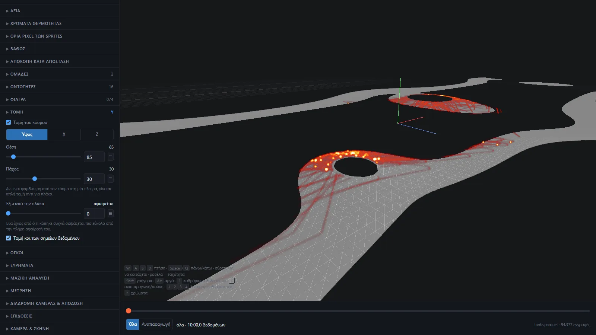

# Τομή

Η **Τομή** κόβει τον κόσμο σαν κομμάτι τούρτας, ώστε να βλέπετε μέσα στα κτίρια. Χρησιμοποιήστε την όταν οι τοίχοι κρύβουν τη θερμότητα που σας ενδιαφέρει, για παράδειγμα για να δείτε έναν όροφο ενός κτιρίου.

## Δοκιμάστε το {#try-it}

1. Φορτώστε ένα επίπεδο και κάποια δεδομένα, και ανοίξτε την **Τομή**.
2. Τικάρετε το **Τομή του κόσμου**. Ο άξονας είναι το **Ύψος**.
3. Σύρετε το **Θέση** πάνω και κάτω: η πλάκα κινείται μέσα στο επίπεδο.
4. Κάντε το **Πάχος** λεπτό για κάτοψη, ή φαρδύ για «όλα όσα είναι κάτω από εδώ».
5. Κρατήστε το **Έξω από την πλάκα** στο 0 για να αφαιρεθεί το υπόλοιπο, ή ανεβάστε το για να κρατήσετε ένα αχνό ίχνος.



Η πλάκα κόβει **τη γεωμετρία του επιπέδου και τα σημεία δεδομένων μαζί**. Αν κόβατε μόνο το επίπεδο, η θερμότητα θα έμενε να επιπλέει εκεί όπου ήταν το κτίριο. Είναι το αντίστοιχο της [απόκρυψης βάθους](depth-and-culling.md): όταν το επίπεδο κρύβει σωστά ό,τι βρίσκεται πίσω του, κρύβεται και το εσωτερικό ενός κτιρίου. Το πάνελ εμφανίζεται όταν υπάρχει κάτι να κοπεί (ένα σύνολο δεδομένων ή ένα τρισδιάστατο επίπεδο)· η κεφαλίδα του δείχνει τον άξονα όταν είναι ενεργό, αλλιώς *off*.

```
side view         Position = where the slab is
 ----------       Thickness = how tall the slab is
 | floor 3 |
 |=========|  <--- slab (kept)
 | floor 2 |  <--- outside: removed (or faint)
 | floor 1 |
 ----------
```

## Στοιχεία ελέγχου {#controls}

| Στοιχείο ελέγχου | Προεπιλογή | Τι σημαίνει |
|---|---|---|
| **Τομή του κόσμου** | κλειστό | Ανοίγει την πλάκα. Όσο η θέση είναι ακόμα στην αρχική της τιμή 0 και το πάχος στην αρχική του τιμή 500, το άνοιγμα τα μεταφέρει στη μέση του άξονα και στο 15% της έκτασής του. |
| Άξονας | **Ύψος** | *Ύψος* (Y), *X* ή *Z*. Η αλλαγή άξονα μεταφέρει την πλάκα στη μέση του νέου άξονα. |
| **Θέση** | η μέση | Το κέντρο της πλάκας, σε μονάδες κόσμου, σε όλη την έκταση του άξονα (βήματα των 500). |
| **Πάχος** | 15% της έκτασης | Από το 1/500 της έκτασης έως το διπλάσιο της έκτασης, σε λογαριθμικά βήματα. Όταν γίνει τόσο πλατύ όσο η έκταση, διαβάζεται *past the world*: τότε η μία πλευρά φτάνει πέρα από τον κόσμο και είναι απλή κοπή και όχι πλάκα. |
| **Έξω από την πλάκα** | 0, *removed* | Πόσο από όσα βρίσκονται έξω μένουν ορατά, 0-100%. Ένα αχνό ίχνος του κομμένου μέρους είναι συχνά πιο εύκολο να διαβαστεί από το να αφαιρεθεί εντελώς. |
| **Τομή και των σημείων δεδομένων** | ενεργό | Το κλειστό αφήνει τη θερμότητα ακέραιη, οπότε φαίνεται μέσα από την τομή· χρήσιμο για να δείτε τι βρίσκεται πάνω και κάτω από την πλάκα. |

Η έκταση ενός άξονα είναι αυτή του τρισδιάστατου επιπέδου όταν έχει φορτωθεί ένα, αλλιώς αυτή του συνόλου δεδομένων.

Η τομή είναι ανεξάρτητη από το [κόψιμο απόστασης](depth-and-culling.md#distance-culling), που κόβει κατά την κατεύθυνση της προβολής και όχι κατά έναν άξονα του κόσμου· και τα δύο συνδυάζονται. Κάθε αλλαγή σε ρύθμιση της τομής επανεκκινεί τη συσσώρευση θερμότητας.

## Για προγραμματιστές {#for-developers}

Η πλάκα ελέγχεται στη θέση κόσμου κάθε γραμμής μέσα στον vertex shader: μια γραμμή έξω από αυτήν έχει τη συνεισφορά της πολλαπλασιασμένη με την τιμή *Έξω*, οπότε στο 0 απορρίπτεται πριν σχεδιαστεί οποιοδήποτε fragment. Οι shaders του επιπέδου εφαρμόζουν τον ίδιο έλεγχο σε κάθε fragment του εδάφους, των κατασκευών και του νερού.
