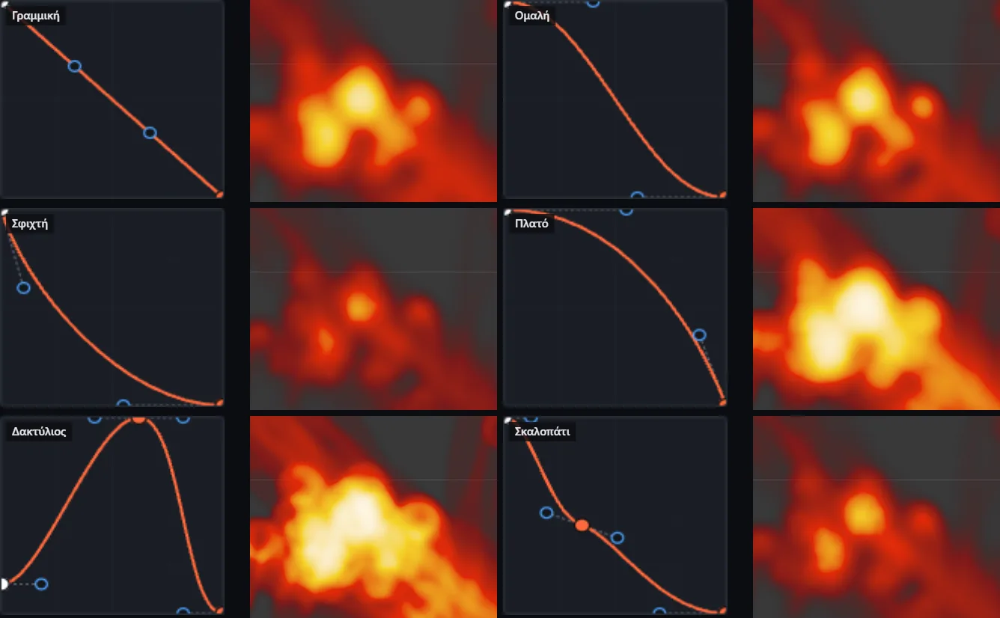

# Σχήμα sprite

Κάθε γραμμή σχεδιάζεται ως στρογγυλό sprite που πάντα κοιτάζει την κάμερα. Το μέγεθός του και το προφίλ από το κέντρο του ως την άκρη του - η **διαβάθμιση** - αποφασίζουν αν ένα σημείο συγκέντρωσης φαίνεται ως σφιχτή κουκκίδα, μαλακό σύννεφο, δίσκος ή δακτύλιος. Αυτά τα χειριστήρια βρίσκονται στις ενότητες **Σχήμα θερμότητας** και **Όρια pixel των sprites** της πλαϊνής στήλης, και ισχύουν για τη [Θερμότητα](heat.md), τη [Διαφορά](difference.md), τη [Θερμότητα ομάδων](team-heat.md) και, ως μισό πλάτος μιας γραμμής, για τη [Θερμότητα γραμμής](line-heat.md).

Όταν αλλάζετε οποιοδήποτε από αυτά, η συσσώρευση ξεκινά ξανά (το πεδίο πρέπει να ξανασχεδιαστεί με το νέο σχήμα).

Σκεφτείτε κάθε κουκκίδα ως ένα μαλακό σύννεφο φωτός. Ένα μικρό σύννεφο δείχνει μεμονωμένα σημεία· ένα μεγάλο σύννεφο ενώνει τους γείτονες σε ένα σύνολο. Το σχήμα αποφασίζει πόσο μαλακή είναι η άκρη του.



## Ακτίνα sprite {#sprite-radius}

Η ακτίνα του sprite σε **μονάδες κόσμου** (με ετικέτα μέτρα). Προεπιλογή 6, και σε κάθε φόρτωση η οριζόντια έκταση των δεδομένων / 120 - αρκετά μεγάλη ώστε τα γειτονικά δείγματα κατά μήκος μιας διαδρομής να ενώνονται σε ζώνη και όχι να φαίνονται σαν λεπτή γραμμή. Λογαριθμικός ρυθμιστής 0,05-2000, με τη λαβή να φτάνει μέχρι 50.000.


Τα πράγματα που είναι μακριά φαίνονται μικρότερα, οπότε ένα sprite μικραίνει στην οθόνη με την απόσταση. Με την παράλληλη προβολή έχει το ίδιο μέγεθος παντού, και γι' αυτό η παράλληλη προβολή είναι η σωστή για τη σύγκριση των σημείων συγκέντρωσης ([Κάμερα](camera.md#projection)).

## Όρια pixel {#pixel-clamps}

Τα **Όρια pixel των sprites** (κλειστά από προεπιλογή) περιορίζουν την ακτίνα στην οθόνη μετά τη μετατροπή που περιγράφηκε πιο πάνω.

| Χειριστήριο | Προεπιλογή | Εύρος (τροχός) | Γιατί |
|---|---|---|---|
| **Ελάχ. ακτίνα σε pixel** | 1 px | 0-16 (512) | Κρατά τα μακρινά δεδομένα να μη χάνονται κάτω από ένα pixel. |
| **Μέγ. ακτίνα σε pixel** | 96 px | 2-1024, λογαριθμικό (8192) | Ο φύλακας υπερσχεδίασης. Ένα sprite που καλύπτει N pixel κοστίζει N πράξεις ανάμειξης, οπότε μια ακτίνα χωρίς όριο κοντά στην κάμερα είναι αυτό που κάνει ένα γρήγορο καρέ αργό. Πέρα από το ύψος της προβολής δεν περιορίζει τίποτα. |

Η **Ίδια πυκνότητα σε κάθε ζουμ** (στην ενότητα Σχήμα θερμότητας, ενεργή από προεπιλογή) λειτουργεί μαζί με τα όρια. Ένα sprite που ένα όριο το κάνει μεγαλύτερο (μακριά) ή μικρότερο (από κοντά) κρατά τη θερμότητα που θα πρόσθετε το πραγματικό του μέγεθος, οπότε ένα χρώμα σημαίνει τον ίδιο αριθμό γραμμών ανά έκταση εδάφους σε κάθε ζουμ. Με αυτή ανενεργή, ένα περιορισμένο sprite προσθέτει ολόκληρο το βάρος του στο περιορισμένο μέγεθός του, και η εικόνα αλλάζει καθώς πετάτε προς τα μέσα.

## Ένταση κέντρου και άκρης {#centre-and-edge-intensity}

Η θερμότητα που προσθέτει ένα sprite στο ακριβές κέντρο του (**Ένταση κέντρου**, προεπιλογή 1, 0-10, τροχός 1000) και στην άκρη του (**Ένταση άκρης**, προεπιλογή 0, -2-10, τροχός 1000). Η τιμή διαβάθμισης *t* (1 στο κέντρο, 0 στην άκρη, διαμορφωμένη από την απόσβεση ή την καμπύλη παρακάτω) αναμειγνύει τα δύο (ο τύπος είναι στην ενότητα [Για προγραμματιστές](#for-developers)).

Μια **αρνητική ένταση άκρης** κάνει την άκρη να αφαιρεί, κάτι που σκάβει ένα δροσερό φωτοστέφανο γύρω από κάθε σημείο συγκέντρωσης και ξεχωρίζει τα σύνολα μεταξύ τους. Η ορατότητα περιλαμβάνει την [απόκρυψη](depth-and-culling.md) και την [τομή](slice.md)· το ξεθώριασμα είναι το [Χρόνος ζωής](timeline.md#history)· το πρόσημο είναι ±1 στη [Διαφορά](difference.md).

## Σχήμα διαβάθμισης: Απόσβεση ή Καμπύλη {#ramp-shape-falloff-or-curve}

Το **Σχήμα διαβάθμισης** αλλάζει τον τρόπο που διαμορφώνεται το *t* σε όλο το sprite. Με *d* την απόσταση από το κέντρο (0) ως την άκρη (1):

### Απόσβεση {#falloff}

Εμφανίζεται όταν είναι επιλεγμένη η *Απόσβεση* (η προεπιλογή).

- **Απόσβεση** (προεπιλογή 1,6, 0,1-8, τροχός 64): `t = (1 - d) ^ falloff`. Το 1 είναι μια ευθεία γραμμική κλίση· μεγαλύτερο τραβά τη θερμότητα προς το κέντρο και σφίγγει το σημείο συγκέντρωσης· μικρότερο από 1 το ισοπεδώνει σε δίσκο.
- **Ομαλή διαβάθμιση** (προεπιλογή ενεργή): εφαρμόζει μια καμπύλη S (smoothstep) στο *t*, ώστε το sprite να ξεθωριάζει στην άκρη του αντί να τελειώνει σε ορατό όριο.

### Ο επεξεργαστής καμπύλης {#the-curve-editor}

Εμφανίζεται όταν είναι επιλεγμένη η *Καμπύλη*. Μια κυριολεκτική τομή ενός sprite: η απόσταση από το κέντρο κατά πλάτος (το *κέντρο* αριστερά, η *άκρη* δεξιά), η θερμότητα προς τα πάνω. Η καμπύλη είναι κυβική Bézier κομμάτι-κομμάτι ανάμεσα σε σημεία ελέγχου, καθένα με δύο λαβές.

| Ενέργεια | Αποτέλεσμα |
|---|---|
| Διπλό κλικ στο γράφημα | Προσθέτει σημείο σε εκείνη την απόσταση (κρατιέται ανάμεσα στο 0,02 και στο 0,98), πάνω στην καμπύλη και με την κλίση της εκεί, οπότε η προσθήκη δεν αλλάζει τίποτα μέχρι να το σύρετε. |
| Σύρση σημείου | Το μετακινεί. Τα ύψη κρατιούνται ανάμεσα στο 0 και στο 1. |
| Σύρση ενός μικρού κύκλου | Κάμπτει το τμήμα δίπλα του (μετακινεί εκείνη τη λαβή). |
| Alt-κλικ ή δεξί κλικ σε σημείο | Το αφαιρεί. Τα δύο άκρα δεν μπορούν να αφαιρεθούν. |
| Ένα κουμπί προεπιλογής | Αντικαθιστά την καμπύλη με την προεπιλογή. |

Τα άκρα είναι σταθερά στο κέντρο και στην άκρη· το ύψος τους εξακολουθεί να είναι δικό σας.

**Προεπιλογές** ([`curve.ts`](https://github.com/Holdi601/3DHeat/blob/main/src/state/curve.ts)):

| Προεπιλογή | Σχήμα | Χρήση |
|---|---|---|
| **Γραμμική** | Ευθεία από το 1 στο 0 | Ίδια με την *Απόσβεση* 1 με την *Ομαλή διαβάθμιση* ανενεργή. |
| **Ομαλή** | Καμπύλη S | Η προεπιλεγμένη καμπύλη· ό,τι δίνει η *Ομαλή διαβάθμιση* με απόσβεση 1. |
| **Σφιχτή** | Ένας απότομος πυρήνας, μια μακριά αχνή ουρά | Αραιά δεδομένα. |
| **Πλατό** | Επίπεδο, μετά γρήγορη πτώση | Φαίνεται σαν δίσκος και όχι σαν σύννεφο. |
| **Δακτύλιος** | 0,15 στο κέντρο, 1 στο 62% της ακτίνας, 0 στην άκρη | Κούφιο sprite: δείχνει πού περνούν οι διαδρομές και όχι πού σταματούν. |
| **Σκαλοπάτι** | Πτώση σε δύο στάδια, 0,45 στο 35% | Χωρίζει έναν πυκνό πυρήνα από το περιβάλλον του. |

## Ισοπέδωση στο επίπεδο του εδάφους {#flatten-onto-ground-plane}

Η **Ισοπέδωση στο επίπεδο του εδάφους** (προεπιλογή ανενεργή) αγνοεί το ύψος κάθε γραμμής και σχεδιάζει όλη τη θερμότητα σε ένα ύψος - το χαμηλότερο Y του συνόλου δεδομένων - τον κλασικό χάρτη θερμότητας 2D. Όταν είναι ενεργή, η απόκρυψη βάθους και η *Απόκρυψη πίσω από το έδαφος* είναι ανενεργές (κάθε σημείο θα βρισκόταν ακριβώς πάνω στην επιφάνεια με την οποία ελέγχεται), και η ενότητα Βάθος το λέει.

## Για προγραμματιστές {#for-developers}

### Τύποι {#formulas}

Η ακτίνα στην οθόνη σε pixel: `ακτίνα × P[1][1] / w × ύψος προβολής / 2`, όπου `P` είναι ο πίνακας προβολής και `w` το βάθος προβολής του σημείου.

Η θερμότητα που προσθέτει ένα sprite:

```
προστιθέμενη θερμότητα = mix(άκρη, κέντρο, t) × βάρος δείγματος × πρόσημο × ξεθώριασμα × ορατότητα
```

### Η καμπύλη {#the-curve}

Οι λαβές περιορίζονται οριζόντια μέσα στο δικό τους τμήμα, οπότε η καμπύλη είναι πάντα συνάρτηση της απόστασης: αν σύρετε μια λαβή μακριά πέρα από το επόμενο σημείο, ισιώνει πάνω του αντί να διπλώνει την καμπύλη πίσω, κάτι που θα έκανε το αποτέλεσμα να εξαρτάται από τη ρίζα που έτυχε να βρει ο επιλυτής.

### Πώς σχεδιάζεται η καμπύλη {#how-the-curve-is-drawn}

Η καμπύλη ψήνεται σε πίνακα 256 εγγραφών κάθε φορά που αλλάζει, ανεβαίνει ως υφή κινητής υποδιαστολής 16 bit, και δειγματοληπτείται για κάθε θραύσμα με γραμμικό φιλτράρισμα και εσοχή μισού texel, ώστε και τα δύο άκρα να μένουν ακριβή. Η επίλυση μιας Bézier ως προς x χρειάζεται επανάληψη, κάτι που δεν έχει θέση στον πιο θερμό shader του προγράμματος, και μια ανάγνωση πίνακα είναι επίσης φθηνότερη από το `pow()` που χρησιμοποιεί η απόσβεση. Τα 16 bit αντί για 8 επειδή τα 8 bit δείχνουν λωρίδες (banding) μόλις αθροιστούν χιλιάδες sprites· το half float των 16 bit φιλτράρεται στο βασικό WebGL2, ενώ το 32 bit χρειάζεται επέκταση.
