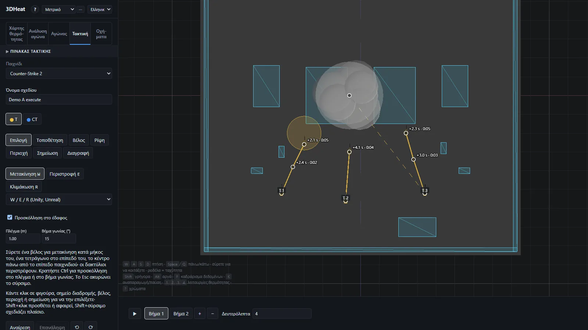

# Πίνακας τακτικής

Η καρτέλα **Τακτική** είναι ένας πίνακας σχεδίασης για ένα σχέδιο ομάδας: τοποθετείτε μικρές φιγούρες πάνω σε έναν χάρτη, σχεδιάζετε βέλη για το πού πηγαίνουν, και πατάτε αναπαραγωγή για να το δείτε να συμβαίνει. Χρησιμοποιήστε το για να σχεδιάσετε έναν γύρο ή μια επίθεση πριν παίξετε. Μοιράζεται τον καμβά, την κάμερα και το [επίπεδο](levels.md) με τις άλλες καρτέλες και τίποτα άλλο· ένα σχέδιο δεν είναι δεδομένα και δεν σχεδιάζει θερμότητα.

## Το πρώτο σας σχέδιο {#your-first-plan}

1. Ανοίξτε την καρτέλα **Τακτική**. Διαλέξτε το **Παιχνίδι** (για παράδειγμα Counter-Strike 2) και, για Valorant, πατήστε **Φόρτωση χαρτών Valorant** και διαλέξτε **Χάρτης**. Ή φορτώστε πρώτα ένα [επίπεδο](levels.md).
2. Διαλέξτε **Πλευρά** (ορίζει το χρώμα) και πατήστε **Κάτοψη**.
3. Επιλέξτε **Σημείο**, διαλέξτε μια φιγούρα στις **Φιγούρες** (χρησιμοποιήστε την **Αναζήτηση φιγούρων** για να τη βρείτε) και κάντε κλικ στον χάρτη. Τοποθετήστε δύο ή τρεις.
4. Επιλέξτε **Βέλος**, κάντε κλικ σε μια φιγούρα, κάντε κλικ κατά μήκος της διαδρομής που πρέπει να ακολουθήσει, και πατήστε **Enter** για να τελειώσει το βέλος.
5. Πατήστε **+** κάτω από την προβολή για να προσθέσετε το βήμα 2. Κάθε φιγούρα ξεκινά εκεί που τελείωσε το βέλος της. Σχεδιάστε εκεί περισσότερα βέλη.
6. Πατήστε **▶** (ή `K`) για να παίξετε το σχέδιο από το εμφανιζόμενο βήμα μέχρι το τέλος.
7. Δώστε όνομα στο σχέδιο στο **Όνομα σχεδίου** και πατήστε **Αποθήκευση**.

## Ξεκινώντας ένα σχέδιο {#starting-a-plan}

| Στοιχείο ελέγχου | Τι κάνει |
|---|---|
| **Παιχνίδι** | Διαλέγει τις πλευρές και τις φιγούρες που προσφέρει η παλέτα: Counter-Strike 2 (T, CT· παίκτες και εξοπλισμός), Valorant (Επίθεση, Άμυνα· παίκτες και γενικές ικανότητες), Battlefield, Squad, Arma (πεζικό, χερσαία οχήματα, αεροσκάφη, σκάφη), DCS / War Thunder / IL-2 (τζετ, αεροσκάφη με έλικα, ελικόπτερα, αντιαεροπορικά, έδαφος, πλοία, όπλα) και Άλλο. Ένα σχέδιο που έχει ήδη φιγούρες κρατά τις πλευρές του όταν αλλάζει το παιχνίδι. |
| **Όνομα σχεδίου** | Το όνομα με το οποίο αποθηκεύεται το σχέδιο. |
| **Χάρτης**, **Φόρτωση χαρτών Valorant** | Με επιλεγμένο το Valorant: το **Φόρτωση χαρτών Valorant** παίρνει τη λίστα χαρτών από το [valorant-api.com](https://valorant-api.com)· ο **Χάρτης** στη συνέχεια βάζει το minimap του επιλεγμένου χάρτη ως επίπεδο, πλαισιωμένο από πάνω. Η εικόνα φορτώνεται όταν επιλεγεί και δεν συνοδεύεται ποτέ από το πρόγραμμα. Η ειδοποίηση της Riot εμφανίζεται όσο είναι στην οθόνη (βλ. παρακάτω). |
| **Πλευρά** | Η πλευρά στην οποία ανήκει η επόμενη φιγούρα, βέλος ή περιοχή· παίρνει το χρώμα της πλευράς. |

Χωρίς επίπεδο, ο πίνακας είναι το επίπεδο έδαφος. Φορτώστε ένα επίπεδο στο **Επίπεδο** για να σχεδιάσετε σε πραγματικό χάρτη: έναν χάρτη CS2 εξαγμένο με το εργαλείο CS2, ένα επίπεδο από τη βιβλιοθήκη, ή μια εικόνα χάρτη.

## Εργαλεία {#tools}

| Εργαλείο | Κλικ | Σημειώσεις |
|---|---|---|
| **Επιλογή** | Μια φιγούρα, ένα σημείο διαδρομής, ένα βέλος, μια περιοχή ή μια σημείωση την επιλέγει. | Shift+κλικ προσθέτει ή αφαιρεί· Shift+σύρσιμο σχεδιάζει ένα κουτί γύρω από ό,τι θα προστεθεί. Η επιλογή παίρνει μια λαβή μετασχηματισμού (βλ. παρακάτω)· το `Delete` ή `Backspace` την αφαιρεί. Το `M` μετακινεί την επιλεγμένη φιγούρα στο επόμενο κλικ. |
| **Σημείο** | Αφήνει κάτω την επιλεγμένη φιγούρα. | Η φιγούρα επιλέγεται στην παλέτα **Φιγούρες** (με **Αναζήτηση φιγούρων**). Χωρίς επιλογή, το `R` γυρίζει την επόμενη φιγούρα κατά 15° πριν τοποθετηθεί (το `Shift+R` προς την άλλη κατεύθυνση). |
| **Βέλος** | Κάθε κλικ προσθέτει ένα σημείο· το Enter, ένα διπλό κλικ ή ένα δεξί κλικ το τελειώνει, το Esc το πετάει. | **Μετακίνηση**, **Επίθεση** (ευρύτερη κεφαλή) ή **Παρακολούθηση** (λεπτή γραμμή στο ύψος των ματιών). Ένα βέλος που ξεκινά από φιγούρα είναι η διαδρομή αυτής της φιγούρας σε αυτό το βήμα: όταν παίζεται, η φιγούρα την περπατά, και το επόμενο βήμα ξεκινά εκεί που τελείωσε. |
| **Ρίψη** | Ο ρίπτης, και μετά το σημείο προσγείωσης. | Ένα διακεκομμένο τόξο από το ένα στο άλλο, και η επιλεγμένη ικανότητα (καπνός, λάμψη, μολότοφ, ...) εμφανίζεται εκεί που προσγειώνεται και μένει από αυτό το βήμα και μετά. |
| **Περιοχή** | Το κέντρο, και μετά η άκρη. | Ένας δίσκος στο χρώμα της πλευράς. |
| **Σημείωση** | Πού πάει η σημείωση· ζητά το κείμενό της. | Φαίνεται ως καρφίτσα, και το κείμενό της πάνω της. |
| **Διαγραφή** | Μια φιγούρα, βέλος, περιοχή ή σημείωση. | Την αφαιρεί από αυτό το βήμα και μετά· στο πρώτο της βήμα, την αφαιρεί εντελώς. |

Το **Αναίρεση** και το **Επανάληψη** (`Ctrl+Z`· `Ctrl+Y` ή `Ctrl+Shift+Z`) κινούνται σε κάθε αλλαγή. Μια γραμμή κάτω από το σχέδιο δείχνει πόσες φιγούρες, βέλη και βήματα έχει. Το **Κάτοψη** κοιτάζει κατακόρυφα προς τα κάτω (ορθογραφική), το **Προβολή 3D** επιστρέφει στην προοπτική, το **Καρέ** χωράει το σχέδιο, ή το επίπεδο όταν το σχέδιο είναι άδειο.

Το **Μέγεθος φιγούρας** κλιμακώνει κάθε φιγούρα του πίνακα· το 1× είναι το πραγματικό μέγεθος, που από πολύ ψηλά είναι μερικά pixel για έναν άνθρωπο.

## Μετακίνηση, περιστροφή και κλιμάκωση {#moving-turning-and-scaling}

Τα πάντα στον πίνακα μπορούν να μετακινηθούν όπως σε έναν τρισδιάστατο επεξεργαστή: φιγούρες, ικανότητες, δείκτες, μεμονωμένα σημεία διαδρομής και ολόκληρα βέλη, περιοχές και σημειώσεις. Ό,τι είναι επιλεγμένο παίρνει ένα gizmo στο κέντρο του:

| Λειτουργία | Πλήκτρα | Λαβές |
|---|---|---|
| **Μετακίνηση** | W (ή G) | Ένα βέλος για κάθε άξονα (X κόκκινο, Y πράσινο και προς τα πάνω, Z μπλε) μετακινεί κατά μήκος του· ένα τετράγωνο μετακινεί στο επίπεδό του· το κέντρο μετακινεί πάνω στο επίπεδο κάτω από τον δείκτη. |
| **Περιστροφή** | E (ή R) | Ένας δακτύλιος για κάθε άξονα περιστρέφει γύρω του. Οι δακτύλιοι μιας μεμονωμένης φιγούρας είναι η δική της εκτροπή, κλίση και κύλιση· μια ομάδα περιστρέφεται γύρω από τους άξονες του κόσμου, γύρω από το κέντρο της. |
| **Κλιμάκωση** | R (ή S) | Απλώνει ή μαζεύει την επιλογή από το κέντρο της κατά έναν άξονα ή προς όλες τις κατευθύνσεις· η ακτίνα μιας περιοχής μεγαλώνει μαζί της. |

Τα **Πλήκτρα** αλλάζουν ανάμεσα σε W / E / R (Unity, Unreal) και G / R / S (Blender)· τα πλήκτρα επιλέγουν τη λειτουργία μόνο όταν κάτι είναι επιλεγμένο, και αλλιώς κινούν την κάμερα. Έτσι το `R` σημαίνει **Κλιμάκωση** με τα πλήκτρα W / E / R και **Περιστροφή** με τα πλήκτρα G / R / S όταν κάτι είναι επιλεγμένο, και γυρίζει την επόμενη φιγούρα για τοποθέτηση όταν δεν είναι. Όλα τα πλήκτρα του πίνακα είναι στην [αναφορά πληκτρολογίου](keyboard-reference.md#tactics-board). Κρατήστε πατημένο το **Ctrl** όταν σύρετε για να κουμπώσει μια μετακίνηση στο **Κάνναβος** (μέτρα) ή μια περιστροφή στο **Βήμα γωνίας**. Το **Προσκόλληση στο έδαφος** (ενεργό από προεπιλογή) βάζει τα μετακινημένα άτομα, οχήματα, δείκτες, σημεία διαδρομής και περιοχές στην επιφάνεια του επιπέδου· τα αεροσκάφη και τα ελικόπτερα κρατούν το ύψος τους, και μια σύρση κατά το βέλος Y δεν προσκολλά ποτέ. Η σύρση μιας λαβής δεν μετακινεί ποτέ την κάμερα. Το **Esc** ακυρώνει μια σύρση, και κάθε αλλαγή είναι ένα βήμα του Αναίρεση.

Τα σημεία διαδρομής φαίνονται ως κουκκίδες στα βέλη του εμφανιζόμενου βήματος: κάντε κλικ σε ένα για να το επιλέξετε, σύρετέ το για να το μετακινήσετε, Delete για να το βγάλετε. Η ενότητα **Επιλεγμένες** δείχνει τη θέση της επιλογής σε μέτρα, την εκτροπή, την κλίση και την κύλιση μιας φιγούρας σε μοίρες, και την ακτίνα μιας περιοχής, με δυνατότητα πληκτρολόγησης του καθενός.

## Χρονομέτρηση {#timing}

Η διαδρομή μιας φιγούρας χρονίζεται: κάθε τμήμα παίρνει το μήκος του πάνω στο επίπεδο - δειγματοληπτημένο στην επιφάνεια κάθε δύο μέτρα περίπου, ώστε ένας λόφος ή μια σκάλα ανάμεσα σε δύο σημεία να μετράει - με την ταχύτητα της **λειτουργίας** κίνησης της φιγούρας σε εκείνο το παιχνίδι, συν οποιαδήποτε **αναμονή** σε σημείο διαδρομής. Το πεζικό σέρνεται, σκύβει, περπατά (αθόρυβα), τρέχει ή σπριντάρει· τα οχήματα και τα σκάφη σέρνονται, πάνε προσεκτικά, κανονικά ή βιάζονται· τα αεροσκάφη και τα ελικόπτερα πετούν αργά, σε ταξίδι, σε ταχύτητα μάχης ή στη μέγιστη. Μια λειτουργία που δεν έχει το παιχνίδι (το CS2 δεν έχει σπριντ) παίρνει την πλησιέστερη που έχει. Το πώς επιβραδύνει μια ανηφόρα εξαρτάται από το παιχνίδι: στο CS2 και στο Valorant μετράει μόνο η οριζόντια απόσταση, όπως στα παιχνίδια· τα mil-sims επιβραδύνουν το πεζικό στην ανηφόρα (συνάρτηση πεζοπορίας του Tobler) και τα οχήματα ανάλογα με την κλίση.

Οι ταχύτητες προέρχονται από πίνακες ανά παιχνίδι με τις πηγές τους (βλ. [Ταχύτητες κίνησης](tactics-speeds.md)): το CS2 ανά όπλο που κρατά, από τους ορισμούς όπλων του παιχνιδιού· το Valorant ανά όπλο· το Battlefield, το Squad, το Arma και τα παιχνίδια αέρος ανά τύπο και κλάση οχήματος. Το **Κινείται ως** επιλέγει το προφίλ μιας φιγούρας (ένα όπλο, ένας τύπος οχήματος)· το **Δικό σας (m/s)** παρακάμπτει οποιαδήποτε λειτουργία για εκείνη τη φιγούρα. Οι λειτουργίες ονομάζονται όπως τις δείχνει ο πίνακας: *Σέρνεται*, *Σκύβει*, *Περπατά (αθόρυβα)*, *Τρέχει*, *Σπριντ*· *Προσεκτικά*, *Κανονικά*, *Βιαστικά*· *Αργά*, *Σε ταξίδι*, *Μάχη*, *Μέγιστη*.

Κάθε σημείο διαδρομής δείχνει τον χρόνο από το προηγούμενο και τον χρόνο από την αρχή του σχεδίου («+3,9 s · 0:12»). Η διαδρομή της επιλεγμένης φιγούρας απαριθμεί κάθε τμήμα με τη λειτουργία του, το μήκος και τον χρόνο του, την αναμονή και την άφιξη. Το **Αφίξεις** κάτω από τη **Χρονομέτρηση** βάζει κάθε φιγούρα με διαδρομή σε μία γραμμή χρόνου, με την πρώτη άφιξη πάνω. Με το **Αναπαραγωγή σε πραγματικό χρόνο** (ενεργό από προεπιλογή) ένα βήμα διαρκεί μέχρι να φτάσει η πιο αργή διαδρομή του και κάθε φιγούρα κινείται με τη δική της ταχύτητα· τότε το **Δευτερόλεπτα** είναι το ελάχιστο μήκος του βήματος. Το **Μονάδες επιπέδου ανά μέτρο** λέει τι είναι το επίπεδο: 39,37 για χάρτες CS2 (μονάδες παιχνιδιού), 1 για χάρτες σε μέτρα.

## Σύγκριση με δεδομένα αγώνων {#compare-with-match-data}

Το **Φόρτωση αρχείων αγώνων…** διαβάζει πίνακες αγώνων CS2 για τον χάρτη (τα αρχεία Parquet του εργαλείου CS2, όσα θέλετε· μόνο οι στήλες που χρειάζονται, στο παρασκήνιο)· το **Χρήση φορτωμένων δεδομένων** παίρνει τα δεδομένα που έχουν φορτωθεί στον περιηγητή. Μετά:

- Η **Πρώιμη άφιξη στον χάρτη** βάφει τον χάρτη με τον χρόνο από την αρχή του γύρου που έφτασε πρώτος ένας παίκτης σε κάθε σημείο - το κουμπί **Ταχύτερος** δείχνει το ταχύτερο από όλους τους γύρους, το **Τυπικός (διάμεσος)** τον μεσαίο γύρο - από πράσινο (νωρίς) σε κόκκινο (αργά), για τη μία πλευρά ή και τις δύο. Δείχνει τι είναι δυνατό και πότε.
- Η επιλεγμένη διαδρομή συγκρίνεται με ό,τι πέτυχαν οι παίκτες από την αρχή της (ή από την αρχή του γύρου) ως το τέλος της, με κάθε τέλος ως δίσκο της ορισμένης ακτίνας: «Ταχύτερος παρατηρημένος 14,2 s, p10 15,0 s, διάμεσος 18,3 s σε 41 προσπάθειες· το σχέδιό σας 15,1 s».
- Οι ταχύτητες με τις οποίες κινήθηκαν πραγματικά οι παίκτες - τρέχοντας, περπατώντας, σκυμμένοι, από τις στήλες περπατήματος και σκυψίματος των πινάκων - σε m/s.

## Βήματα {#steps}

Η μπάρα κάτω από την προβολή κρατά τα βήματα. Ένα σχέδιο ξεκινά με ένα· το **+** προσθέτει ένα, και κάθε φιγούρα ξεκινά εκεί που τελείωσε η διαδρομή της στο τελευταίο βήμα· το **−** αφαιρεί το εμφανιζόμενο. Το **Δευτερόλεπτα** είναι πόσο διαρκεί το εμφανιζόμενο βήμα όταν παίζεται. Το **▶** (K) παίζει από το εμφανιζόμενο βήμα μέχρι το τέλος: οι φιγούρες με διαδρομή την περπατούν, οι φιγούρες που μετακινήθηκαν σε νέα θέση στο επόμενο βήμα γλιστρούν εκεί, οι υπόλοιπες στέκονται. Όσο φαίνεται ένα βήμα, η θέση κάθε φιγούρας στο επόμενο βήμα σχεδιάζεται ως αχνό φάντασμα, και τα βέλη του τελευταίου βήματος αχνά κάτω από τα βέλη αυτού.

## Αποθήκευση {#saving}

Η ενότητα **Αρχείο** έχει τα **Αποθήκευση**, **Άνοιγμα** και **Εκκαθάριση**. Το **Αποθήκευση** γράφει το σχέδιο ως `<όνομα>.h3dplan.json` (απλό JSON: πλευρές, βήματα, φιγούρες με μία θέση ανά βήμα, βέλη, περιοχές, σημειώσεις)· το **Άνοιγμα** το διαβάζει ξανά. Ένα αρχείο άλλης έκδοσης, ή που δεν είναι σχέδιο, απορρίπτεται με τον λόγο. Το **Εκκαθάριση** αδειάζει το σχέδιο· το Αναίρεση το επαναφέρει.

## Φιγούρες {#figures}

Κάθε φιγούρα φτιάχνεται από τον ίδιο τον περιηγητή: απλά σχήματα στις δημοσιευμένες διαστάσεις ενός τύπου, με τα χαρακτηριστικά που τον ξεχωρίζουν από τους γείτονές του - οι ερπύστριες και ο πυργίσκος ενός τανκ, τα κανόνια, οι πύραυλοι και τα ραντάρ ενός αντιαεροπορικού οχήματος, το σχέδιο της πτέρυγας, της ουράς και των κινητήρων ενός αεροσκάφους, οι έλικες και οι κοντές πτέρυγες ενός ελικοπτέρου. Τίποτα δεν παίρνεται από κάποιο παιχνίδι. Ένα σχέδιο που το εφηύρε ένα παιχνίδι δείχνεται ως η γενική φιγούρα της κλάσης του. Βλ. [Φιγούρες](figures.md#which-figure-a-unit-gets) για το πώς τα δεδομένα βρίσκουν τη φιγούρα τους.

## Η ειδοποίηση της Riot {#riots-notice}

Οι χάρτες του Valorant εμφανίζονται με βάση την πολιτική της Riot Games «Legal Jibber Jabber», που επιτρέπει σε ελεύθερα κοινοτικά έργα να τους χρησιμοποιούν και ζητά αυτή την ειδοποίηση όπου εμφανίζονται: *Το 3DHeat δημιουργήθηκε με βάση την πολιτική «Legal Jibber Jabber» της Riot Games, χρησιμοποιώντας περιουσιακά στοιχεία που ανήκουν στη Riot Games. Η Riot Games δεν εγκρίνει και δεν χορηγεί αυτό το έργο.* Οι ικανότητες στον πίνακα είναι γενικά σχήματα, όχι έργα τέχνης της Riot.
