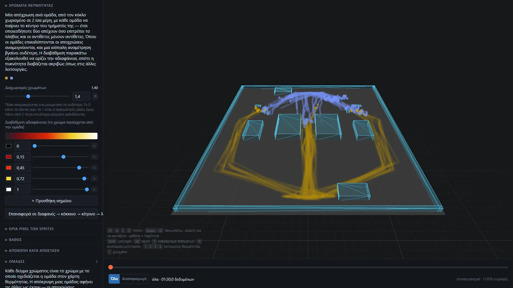

# Θερμότητα ομάδων

Η θερμότητα ομάδων δείχνει πού βρισκόταν κάθε ομάδα, με κάθε ομάδα στο δικό της χρώμα. Όπου οι ομάδες επικαλύπτονται, τα χρώματα αναμειγνύονται.

Η **Θερμότητα ομάδων** (πλήκτρο 3) είναι το πεδίο πυκνότητας της [Θερμότητας](heat.md) με κάθε [ομάδα](glossary.md) να έχει τη δική της απόχρωση. Όπου οι ομάδες επικαλύπτονται, οι αποχρώσεις τους αναμειγνύονται· μια ισόπαλη σύγκρουση βγαίνει ουδέτερη. Η αδιαφάνεια εξακολουθεί να φέρει την πυκνότητα ακριβώς όπως και στις άλλες λειτουργίες, οπότε η εικόνα απαντά ταυτόχρονα στο *πόσο* και στο *ποιανού*. Χρειάζεται στήλη ομάδας.

Δεν είναι η [επικάλυψη φιγούρων](box-replay.md): εκείνη σχεδιάζει μία φιγούρα για κάθε πρόσωπο· αυτή είναι ένα πεδίο θερμότητας χρωματισμένο από την ίδια στήλη.

## Πώς να το χρησιμοποιήσετε {#how-to-use-it}

1. Πατήστε `3` (ή επιλέξτε **Θερμότητα ομάδων** στη γραμμή λειτουργιών).
2. Ανοίξτε τα **Χρώματα θερμότητας**. Τα δείγματα δείχνουν το χρώμα κάθε ομάδας· πάνω σε ένα δείγμα με τον δείκτη βλέπετε το όνομα της ομάδας.
3. Αν όλα φαίνονται γκρι, αυξήστε τον **Διαχωρισμό χρωμάτων**.
4. Ξετικάρετε μια ομάδα στη [Λίστα ομάδων](teams-list.md) για να τη βγάλετε έξω· τα υπόλοιπα χρώματα μένουν εκεί που ήταν.

## Στοιχεία ελέγχου {#controls}

Στην ενότητα **Χρώματα θερμότητας**:

| Στοιχείο ελέγχου | Προεπιλογή | Σημασία |
|---|---|---|
| Δείγματα | | Το χρώμα κάθε ομάδας, για τις πρώτες 12 ομάδες, και μετά *+N ακόμα*. Με τον δείκτη βλέπετε το όνομα της ομάδας και το χρώμα. |
| **Διαχωρισμός χρωμάτων** | 1,4 | Πόσο απομακρύνεται ένα μείγμα από το ουδέτερο, 0-4. Το 0 κάνει τα πάντα γκρι· το 1 είναι ο πραγματικός μέσος όρος· πέρα από περίπου 2 τα πιο φωτεινά μείγματα βγαίνουν από το εμφανίσιμο εύρος και περικόπτονται ανά κανάλι, πράγμα που μετατοπίζει την απόχρωσή τους. |
| **Διαβάθμιση αδιαφάνειας (το χρώμα προέρχεται από την ομάδα)** | η προεπιλεγμένη διαβάθμιση θερμότητας | Χρησιμοποιείται εδώ μόνο το **άλφα** της διαβάθμισης: διαφανές όπου δεν υπάρχει τίποτα, αδιαφανές στην κορυφή. Τα χρώματά της αγνοούνται. |

Όλα τα υπόλοιπα στοιχεία θερμότητας - σχήμα, κορεσμός, απόκριση, ελάχιστη θερμότητα, βάθος, αποκοπή - λειτουργούν όπως στη [Θερμότητα](heat.md).

Η [Λίστα ομάδων](teams-list.md) δείχνει το χρώμα θερμότητας ομάδων κάθε ομάδας ως δείγμα της σε αυτή τη λειτουργία. Η απόκρυψη μιας ομάδας αφήνει το χρώμα κάθε άλλης ομάδας εκεί που ήταν: οι αποχρώσεις προέρχονται από το συνολικό πλήθος ομάδων, όχι από το ποιες είναι ενεργοποιημένες, οπότε δύο εικόνες μένουν συγκρίσιμες.

## Η παλέτα {#the-palette}

Από το [`colors.ts`](https://github.com/Holdi601/3DHeat/blob/main/src/render/colors.ts):

- Τα χρώματα ζουν στο επίπεδο χρωμάτων **Oklab** με σταθερή φωτεινότητα (0,7) και χρωματικότητα (0,115), ώστε κάθε ομάδα να είναι εξίσου φωτεινή και μια κόκκινη ομάδα να μη φαίνεται πιο καυτή από μια μπλε.
- Με *n* ομάδες, ο κύκλος των αποχρώσεων χωρίζεται σε *n* ίσα μέρη και η ομάδα *i* παίρνει το **κέντρο** του μέρους της, `(i + 0,5) / n` μιας στροφής. Δύο οποιεσδήποτε ομάδες απέχουν όσο επιτρέπει το πλήθος, και οι αντίθετες μένουν αντίθετες όποιο κι αν είναι το πλήθος.
- Χρησιμοποιούνται το πολύ **16** διακριτές αποχρώσεις. Με περισσότερες ομάδες, τα id τοποθετούνται με διαδοχικό διχοτόμηση (αντίστροφα ως προς τα bits: 0, ½, ¼, ¾, ⅛, …) ώστε γειτονικά id να μη μοιράζονται απόχρωση· οι ομάδες πέρα από το 16 αναγκαστικά μοιράζονται.
- Μια ομάδα της οποίας η ετικέτα σημαίνει «καμία ομάδα» - `0`, κενό, `none`, `unknown`, `null` ή `-1`, χωρίς διάκριση πεζών - σχεδιάζεται **ουδέτερο γκρι** αντί να πάρει ένα κομμάτι του κύκλου. Μόνο η πρώτη τέτοια ετικέτα στη λίστα ομάδων αντιμετωπίζεται έτσι.

Ο προεπιλεγμένος διαχωρισμός είναι 1,4 και όχι 1, επειδή στο 1 ένα μείγμα πέντε ομοιόμορφα κατανεμημένων αποχρώσεων *είναι* γκρι: σωστό και δυσανάγνωστο. Ένα μικρό ποσό πάνω από το 1 κρατά τις ισοπαλίες ειλικρινείς και κάνει ορατή μια κατανομή 60/40.

## Πώς λειτουργεί {#how-it-works}

Ο στόχος θερμότητας έχει σε αυτή τη λειτουργία τέσσερα κανάλια. Κάθε sprite προσθέτει την πυκνότητά του *v* στο πρώτο κανάλι και *v* × τις συντεταγμένες Oklab *a* και *b* της ομάδας του στο δεύτερο και στο τρίτο. Τη στιγμή της σύνθεσης, το μείγμα του εικονοστοιχείου είναι ο σταθμισμένος με πυκνότητα μέσος όρος: *a* = G / R, *b* = B / R, κλιμακωμένα με τον διαχωρισμό χρωμάτων και μετατρεπόμενα σε sRGB στη φωτεινότητα της παλέτας. Η διαίρεση με τη συσσωρευμένη πυκνότητα κρατά την απόχρωση ανεξάρτητη από το πόσα δεδομένα υπάρχουν, και γι' αυτό κάθε στοιχείο ελέγχου πυκνότητας συνεχίζει να επηρεάζει μόνο την αδιαφάνεια.

Ο τετρακάναλος στόχος κοστίζει στη μνήμη GPU τετραπλάσια από τον μονοκάναλο στόχο θερμότητας στην ίδια ανάλυση.
