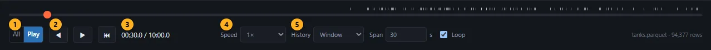

# Χρονολόγιο και αναπαραγωγή

Η μπάρα κάτω από την εικόνα μοιάζει με βιντεοπρογραμματιστή: μπορείτε να παίξετε τα δεδομένα σαν ταινία, να τα σταματήσετε, να πηδήξετε και να αλλάξετε την ταχύτητα.

Η μπάρα κάτω από την προβολή είναι το χρονολόγιο ([`Timeline.tsx`](https://github.com/Holdi601/3DHeat/blob/main/src/ui/Timeline.tsx)). Αποφασίζει ποιες γραμμές είναι ορατές κάθε στιγμή. Χρειάζεται στήλη χρόνου· χωρίς αυτήν όλη η μπάρα είναι ανενεργή, η προβολή μένει στο **Όλα**, και η πλαϊνή στήλη το λέει: *Δεν υπάρχει στήλη χρόνου σε αυτά τα δεδομένα - το χρονολόγιο είναι ανενεργό και κάθε σημείο δεδομένων εμφανίζεται ταυτόχρονα.*

## Όλα και Αναπαραγωγή {#all-and-play}

Δύο λειτουργίες ανώτερου επιπέδου, επειδή απαντούν σε διαφορετικές ερωτήσεις.

- **Όλα** (η προεπιλογή σε κάθε φόρτωση) αγνοεί εντελώς τον δρομέα αναπαραγωγής και δείχνει κάθε γραμμή που περνά από τα φίλτρα. Είναι η προβολή «πού συμβαίνει αυτό», και δεν είναι το ίδιο με το να μετακινήσετε τον δρομέα μέχρι το τέλος. Ο δρομέας είναι ανενεργός και το ρολόι δείχνει `όλα · <διάστημα> δεδομένων`.
- **Αναπαραγωγή** παίζει τα δεδομένα σαν επιταχυμένο βίντεο. Εμφανίζονται ο δρομέας, τα κουμπιά μεταφοράς και οι ρυθμίσεις ιστορικού.

Η επιλογή **Όλα** σταματά και την αναπαραγωγή.

## Τα στοιχεία ελέγχου {#the-controls}

| Στοιχείο ελέγχου | Προεπιλογή | Σημασία |
|---|---|---|
| Δρομέας | η αρχή | Ο δρομέας αναπαραγωγής. Σύρετε για να μετακινηθείτε· 20.000 βήματα σε όλο το εύρος. |
| **Όλα** / **Αναπαραγωγή** | Όλα | Βλ. παραπάνω. |
| ▶ / ❚❚ | σε παύση | Αναπαραγωγή ή παύση· επίσης `K`. |
| ◀ **Αναπαραγωγή προς τα πίσω (J)** | | Παίζει τα δεδομένα αντίστροφα. Εμφανίζεται μόνο στη λειτουργία **Επικάλυψη φιγούρων**· το ίδιο πλήκτρο `J` λειτουργεί και εκεί (βλ. [Πληκτρολόγιο](#keyboard)). |
| ⏮ | | Πίσω στην αρχή του εύρους. |
| Ρολόι | | `περασμένος / σύνολο` ως `mm:ss.s` (ή `h:mm:ss`), και, όταν η στήλη χρόνου είναι απόλυτη χρονοσφραγίδα, η ώρα της ημέρας του δρομέα ως `HH:MM:SSZ` (UTC). |
| **Ταχύτητα** | 1× | Δευτερόλεπτα δεδομένων ανά πραγματικό δευτερόλεπτο. Το μενού έχει 17 βήματα από 0,01× έως 1800× (0,01, 0,02, 0,05, 0,1, 0,25, 0,5, 1, 2, 4, 8, 16, 32, 64, 128, 256, 600, 1800), και την **Προσαρμογή…**: πληκτρολογήστε οποιαδήποτε ταχύτητα από 0,001× έως 3600× (για παράδειγμα 0,3 ή 12) και πατήστε Enter· το Esc κρατά την τρέχουσα ταχύτητα. Η τελευταία ταχύτητα θυμάται για την επόμενη επίσκεψη (βλ. [Αποθηκευμένες ρυθμίσεις](ref-settings-storage.md)). |
| **Ιστορικό** | Αθροιστικό | Τι μετράει ως ορατό στον δρομέα: *Αθροιστικό*, *Παράθυρο* ή *Διάρκεια ζωής* (παρακάτω). |
| **Διάστημα** (Παράθυρο· στη λειτουργία Γραμμές και Διάρκεια ζωής) | 30 s | Μήκος του παραθύρου που τελειώνει στον δρομέα· τουλάχιστον 0,01 s. Στη [Θερμότητα γραμμών](line-heat.md#playback) είναι το μήκος της ουράς. |
| **Εφεδρική διάρκεια ζωής** (μόνο Διάρκεια ζωής, όχι στη λειτουργία Γραμμές) | 10 s | Πόσο μένει ορατό ένα σημείο δεδομένων που δεν έχει επόμενο δείγμα του προσώπου του. |
| **Σβήσιμο** (μόνο Διάρκεια ζωής, όχι στη λειτουργία Γραμμές) | 0,4 | Το κλάσμα της ζωής κάθε σημείου δεδομένων που αφιερώνεται στο σβήσιμο, 0-1. |
| **Βρόχος** | ενεργός | Στο τέλος, ξεκινά ξανά· αν είναι ανενεργός, σταματά στο τέλος. |
| Δεξιά πλευρά | | Το όνομα του συνόλου δεδομένων. |

Το **εύρος** είναι το χρονικό διάστημα του συνόλου δεδομένων - ή, στην [επικάλυψη φιγούρων](box-replay.md) με επιλεγμένη συνεδρία, το διάστημα αυτής της συνεδρίας.

## Ιστορικό {#history}

Στη λειτουργία Αναπαραγωγή:

- **Αθροιστικό** - όλα από την αρχή του εύρους μέχρι τον δρομέα. Η θερμότητα χτίζεται καθώς παίζει.
- **Παράθυρο** - ένα σταθερό διάστημα ιστορικού που τελειώνει στον δρομέα (*Διάστημα*).
- **Διάρκεια ζωής** - κάθε σημείο δεδομένων ζει μέχρι το **επόμενο δείγμα του ίδιου προσώπου** (στην ίδια συνεδρία), ώστε ακριβώς μία θέση ανά πρόσωπο να είναι τρέχουσα τη στιγμή. Ένα σημείο δεδομένων του οποίου το πρόσωπο δεν εμφανίζεται ξανά - θάνατος, αποσύνδεση, τέλος του αρχείου καταγραφής - δεν έχει επόμενο δείγμα, και ζει για την *Εφεδρική διάρκεια ζωής* αντί να εξαφανιστεί αμέσως ή να μείνει για πάντα. Τα σημεία δεδομένων **σβήνουν** στο τελευταίο *Σβήσιμο* κλάσμα της ζωής τους αντί να πεταχτούν έξω: με ένα ζωντανό δείγμα ανά πρόσωπο, ένα σημείο που εξαφανίζεται ανάμεσα σε δύο καρέ κάνει ολόκληρο το πεδίο να τρεμοπαίζει με τον ρυθμό δειγματοληψίας. Το *Σβήσιμο* 0 επαναφέρει το απότομο κόψιμο.

Η Διάρκεια ζωής χρειάζεται στήλη προσώπου εκτός από τη στήλη χρόνου· χωρίς αυτήν, το ιστορικό επιστρέφει στο Αθροιστικό κατά τη φόρτωση. Στη [Θερμότητα γραμμών](line-heat.md#playback) το ιστορικό ορίζει πόσο μένει ορατή η ουρά μιας διαδρομής· στην [επικάλυψη φιγούρων](box-replay.md) η *Εφεδρική διάρκεια ζωής* είναι πόσο κρατιέται ένα πρόσωπο που δεν έχει άλλα δείγματα.

## Συμπεριφορά αναπαραγωγής {#playback-behaviour}

Από τον βρόχο καρέ ([`engine.ts`](https://github.com/Holdi601/3DHeat/blob/main/src/render/engine.ts)):

- Ο δρομέας προχωρά κατά *χρόνο καρέ × ταχύτητα*. Ο χρόνος καρέ περιορίζεται στα 0,1 s, ώστε η αλλαγή καρτέλας να μην μεταφέρει τον δρομέα.
- Αν πατήσετε αναπαραγωγή ακριβώς στο τέλος του εύρους, ξεκινά από την αρχή, όπως κάνει ένας αναπαραγωγός πολυμέσων. Σε κάθε φόρτωση ο δρομέας στέκεται στην αρχή, οπότε το πρώτο πάτημα της αναπαραγωγής παίζει.
- Στο τέλος του εύρους ο δρομέας πηδά πίσω στην αρχή (Βρόχος ενεργός) ή σταματά εκεί και τελειώνει η αναπαραγωγή (Βρόχος ανενεργός).
- Ο δρομέας διαβάζει απευθείας τον δρομέα της μηχανής σε κάθε καρέ· η κατάσταση της εφαρμογής ενημερώνεται στις μετακινήσεις, στις εκκινήσεις, στις παύσεις και στους βρόχους.
- Η επιλογή συνεδρίας στον επιλογέα Συνεδρία μεταφέρει τον δρομέα στην αρχή εκείνης της συνεδρίας.

## Γιατί η αναπαραγωγή είναι ομαλή και φθηνή {#why-playback-is-smooth-and-cheap}

Οι γραμμές αποθηκεύονται ταξινομημένες κατά χρόνο, οπότε ένα χρονικό παράθυρο είναι δύο δυαδικές αναζητήσεις πάνω στη στήλη χρόνου: η μετακίνηση του δρομέα μετακινεί δύο ακέραιους και δεν αγγίζει καμία γραμμή, και το κόστος της αναπαραγωγής ακολουθεί το πλήθος των γραμμών στο παράθυρο, όχι το μέγεθος του συνόλου δεδομένων.

Το πώς διατηρείται σταθερή η θερμότητα καθώς κινείται το παράθυρο εξαρτάται από το ιστορικό ([Συσσώρευση](accumulation.md)):

- Το **Αθροιστικό** μόνο αυξάνεται, οπότε κάθε καρέ προσθέτει μόνο τις γραμμές που έγιναν ορατές από το προηγούμενο, με πλήρες βάρος. Το πεδίο χτίζεται μονότονα και η παύση δεν αλλάζει τίποτα, γιατί δεν μένει τίποτα να φτάσει. (Αν αντί γι' αυτό επανεκτιμούσαμε, κάθε καρέ θα φωτιζόταν από διαφορετικό τυχαίο υποσύνολο και μετά θα έσβηνε, κάτι που φαίνεται σαν εκρήξεις που αναβοσβήνουν και χάνονται.)
- Το **Παράθυρο** και η **Διάρκεια ζωής** αλλάζουν πραγματικά σε κάθε καρέ και επανεκτιμώνται, αναμειγμένα ως εκθετικός κινούμενος μέσος όρος (βάρος 0,34 για το νέο καρέ), που είναι αμερόληπτος στη σταθερή κατάσταση και πολύ πιο ήσυχος από το να ξεκινάμε από το μηδέν.
- Στη λειτουργία Διάρκεια ζωής, οι υποψήφιες γραμμές είναι εκείνες από *δρομέας - max(η μεγαλύτερη κενή περίοδος των δεδομένων, Εφεδρική διάρκεια ζωής)* μέχρι τον δρομέα· ο shader στη συνέχεια αφαιρεί κάθε γραμμή της οποίας η ίδια ζωή τελείωσε και εφαρμόζει το σβήσιμο.

Η εναλλαγή ανάμεσα σε Όλα και Αναπαραγωγή, ή η αλλαγή ιστορικού, ξεκινά ξανά τη συσσώρευση.

## Πληκτρολόγιο {#keyboard}

| Πλήκτρο | Αποτέλεσμα |
|---|---|
| `K` | Αναπαραγωγή / παύση |
| `J` | Αναπαραγωγή προς τα πίσω· ένα ακόμα πάτημα σταματά (μόνο Επικάλυψη φιγούρων) |
| `L` | Αναπαραγωγή προς τα εμπρός· ένα ακόμα πάτημα σταματά (μόνο Επικάλυψη φιγούρων) |

Το `J` και το `L` μεταβάλλουν επίσης το χρονολόγιο σε **Αναπαραγωγή**. Τα πλήκτρα αγνοούνται όταν έχει εστίαση ένα πλαίσιο κειμένου ή μενού. Στην καρτέλα Ανάλυση αγώνα το `K` ελέγχει την ίδια την επανάληψη της καρτέλας.
