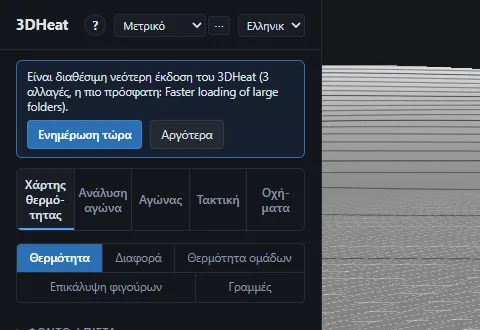

# Ενημερώσεις

Ο περιηγητής σας λέει πότε υπάρχει νεότερη έκδοση, και ενημερώνεται μόνος του μόνο όταν το πείτε εσείς. Τίποτα δεν αλλάζει στον υπολογιστή σας χωρίς τη δική σας απάντηση.

## Ενημέρωση του περιηγητή {#update-the-viewer}

1. **Στη σελίδα.** Όταν υπάρχει νεότερη έκδοση, εμφανίζεται ένα πλαίσιο κάτω από το όνομα στην κορυφή της πλαϊνής στήλης: «Είναι διαθέσιμη νεότερη έκδοση του 3DHeat». Κάντε κλικ στο **Ενημέρωση τώρα**. Η σελίδα ανανεώνεται μόνη της όταν τελειώσει. Το **Αργότερα** κρύβει το πλαίσιο μέχρι να ανανεώσετε τη σελίδα.
2. **Αν λέει να εκτελέσετε το restart.bat**, κλείστε το παράθυρο του διακομιστή (το μαύρο παράθυρο που άνοιξε το `start.bat`) και κάντε διπλό κλικ στο `restart.bat`.
3. **Όταν ξεκινάτε τον περιηγητή.** Το `start.bat` ελέγχει επίσης. Αν υπάρχει νεότερη έκδοση, ρωτά **Ενημέρωση τώρα; [Y/N]**. Πατήστε `Y` για ενημέρωση. Πατήστε `N`, ή περιμένετε 60 δευτερόλεπτα χωρίς απάντηση, για να ξεκινήσει η έκδοση που έχετε.



Ένα αντίγραφο με δικές σας αλλαγές δεν ενημερώνεται ποτέ αυτόματα· το πλαίσιο απλώς λέει ότι μια ενημέρωση περιμένει, και ζητά να κάνετε commit ή stash στις αλλαγές σας και να εκτελέσετε `git pull`. Ένα αντίγραφο που δεν εγκαταστάθηκε με git (ένα zip, για παράδειγμα) δεν δείχνει τίποτα.

Πώς γίνεται ο έλεγχος, βήμα προς βήμα:

```
page ---(after 4 s, then every 6 h)---> dev server ---> git fetch
   behind?  no  -> nothing is shown
            yes -> your own changes or commits?  yes -> tell you only
                                                 no  -> [Update now] -> git pull
                                                        -> reload, or "run restart.bat"
```

## Οι κανόνες ασφαλείας {#the-safety-rules}

- **Μόνο fast-forward** (`git pull --ff-only`): μια ενημέρωση δεν συγχωνεύει, δεν κάνει rebase και δεν ξαναγράφει τίποτα.
- **Χωρίς τοπικές αλλαγές**: ένα αντίγραφο με μη αποθηκευμένες αλλαγές σε παρακολουθούμενα αρχεία (`git status --porcelain --untracked-files=no` μη κενό) δεν ενημερώνεται ποτέ αυτόματα - η δουλειά κάποιου δεν είναι κάτι που μια ενημέρωση πρέπει να αντικαταστήσει. Απλώς ενημερώνεται ότι περιμένει μια ενημέρωση. Τα μη παρακολουθούμενα αρχεία (δεδομένα, εξαγωγές) δεν μετράνε ως αλλαγές.
- **Χωρίς τοπικά commits**: ένα αντίγραφο με commits που δεν έχει το upstream («αποκλίνον») δεν ενημερώνεται - ένα fast-forward δεν μπορεί να το φέρει στη νέα έκδοση, και η συγχώνευση ανήκει στο `git pull` που κάνετε με το χέρι. Η σελίδα και το `start.bat` το λένε με τις ίδιες λέξεις, και το `start.bat` ξεκινά την έκδοση που υπάρχει εκεί.
- **Μόνο από την ίδια τη σελίδα**: το αίτημα ενημέρωσης του διακομιστή ανάπτυξης πρέπει να φέρει μια προσαρμοσμένη κεφαλίδα και, όταν ο περιηγητής στέλνει `Origin`, να προέρχεται από τον ίδιο υπολογιστή του διακομιστή (παρακάτω).
- Ενημερώνεται μόνο ένα αντίγραφο git με upstream κλάδο· οτιδήποτε άλλο (αντίγραφο χωρίς `.git`, χωρίς εγκατεστημένο git, στατικό build) μένει ανέγγιχτο και δεν λέει τίποτα.

## Τι κάνει το start.bat {#what-startbat-does}

Το `start.bat` (κάντε διπλό κλικ· το παράθυρο είναι ο διακομιστής) κάνει, με τη σειρά:

1. Βρίσκει το Node.js - στο `PATH`, αλλιώς στα `%ProgramFiles%\nodejs`, `%ProgramFiles(x86)%\nodejs` ή `%LOCALAPPDATA%\Programs\nodejs` - και προσφέρεται να το εγκαταστήσει με `winget install -e --id OpenJS.NodeJS.LTS` όταν λείπει (ρωτά, Y/N· μετά πρέπει να ξανανοίξετε το παράθυρο ώστε τα Windows να πάρουν το νέο `PATH`).
2. **Ενημερώσεις**, όταν είναι εγκατεστημένο το git και ο φάκελος έχει `.git`:
   - `git fetch --quiet` (χωρίς δίκτυο ή χωρίς upstream: παρακάμπτεται αθόρυβα)·
   - μετράει το `git rev-list --count HEAD..@{u}`· αν δεν υπάρχει τίποτα πίσω, δεν λέει τίποτα·
   - τοπικές αλλαγές: «Είναι διαθέσιμη νεότερη έκδοση του 3DHeat (N αλλαγές), αλλά αυτό το αντίγραφο έχει τοπικές αλλαγές, οπότε δεν ενημερώνεται. Κάντε commit ή stash, και μετά εκτελέστε git pull.»· και ξεκινά την έκδοση που υπάρχει εκεί·
   - δικά του commits (`git rev-list --count @{u}..HEAD` διάφορο του 0): «Είναι διαθέσιμη νεότερη έκδοση του 3DHeat (N αλλαγές), αλλά αυτό το αντίγραφο έχει δικά του commits που η νεότερη έκδοση δεν έχει, οπότε δεν ενημερώνεται. Ενημερώστε το με git pull.»· και ξεκινά την έκδοση που υπάρχει εκεί·
   - αλλιώς «Είναι διαθέσιμη νεότερη έκδοση του 3DHeat (N αλλαγές).» και η ερώτηση **Ενημέρωση τώρα; [Y/N]**. Το `N`, ή καμία απάντηση για 60 δευτερόλεπτα, τυπώνει «Δεν ενημερώθηκε· ξεκινά η έκδοση που έχετε.» και ξεκινά την έκδοση που υπάρχει εκεί. Με `Y`: «Ενημέρωση...», σημειώνει αν αλλάζουν τα `package.json` ή `package-lock.json`, εκτελεί `git pull --ff-only` (αν αποτύχει ακόμα - π.χ. λόγω δικτύου: «Η ενημέρωση δεν ολοκληρώθηκε· ξεκινά η έκδοση που έχετε.»), μετά `git submodule update --init` (τα καρφιτσωμένα εργαλεία, βλ. [Συντήρηση της τεκμηρίωσης](maintaining.md#the-tools-under-exporters)), μετά `npm install` όταν άλλαξαν τα αρχεία πακέτου και υπάρχει το `node_modules`, και «Ενημερώθηκε.»
3. Αρνείται να ξεκινήσει δεύτερο διακομιστή: όταν κάτι ακούει ήδη στη θύρα **5273**, το λέει και σας στέλνει στο `restart.bat` / `stop.bat`.
4. Στην πρώτη εκτέλεση (χωρίς `node_modules`), ρωτά πριν κατεβάσει τις εξαρτήσεις (περίπου 300 MB μέσα στο `node_modules\`, τίποτα σε επίπεδο συστήματος).
5. Ξεκινά τον διακομιστή ανάπτυξης στο `127.0.0.1:5273` (`--strictPort`) και ανοίγει τον περιηγητή όταν είναι έτοιμος.

Το `restart.bat` σταματά τον διακομιστή (με τη θύρα) και ξανατρέχει το `start.bat`, οπότε ρωτά την ίδια ερώτηση. Το `stop.bat` μόνο σταματά.

## Για προγραμματιστές {#for-developers}

### Όσο τρέχει: η διαδρομή ενημέρωσης {#while-it-runs-the-update-route}

Ο διακομιστής ανάπτυξης (το πρόσθετο Vite `heat3d-self-update` στο `vite.config.ts`) σερβίρει το `/__heat3d/update`. Υπάρχει μόνο στον διακομιστή ανάπτυξης - όχι σε στατικό build και όχι στο `vite preview`.

**`GET /__heat3d/update`** απαντά αν το αντίγραφο έχει μείνει πίσω:

```json
{ "checkout": true, "upstream": "origin/main", "behind": 3, "ahead": 0, "dirty": false, "latest": "the newest commit's subject" }
```

- `checkout: false` όταν ο φάκελος δεν είναι αντίγραφο git·
- τρέχει `git fetch --quiet` **το πολύ κάθε 30 λεπτά** (τα αιτήματα ανάμεσα απαντώνται με βάση το τελευταίο fetch)·
- `behind` / `ahead` από `git rev-list --count HEAD..@{u}` / `@{u}..HEAD`, το `dirty` από `git status --porcelain --untracked-files=no`, το `latest` είναι το θέμα του νεότερου commit του upstream·
- χωρίς upstream κλάδο, `upstream: null` και `behind: 0`.

**`POST /__heat3d/update/apply`** φέρνει το αντίγραφο στη νέα έκδοση:

1. Απορρίπτεται με `403 { ok: false, reason: "forbidden" }` αν το αίτημα δεν έχει την κεφαλίδα `X-Heat3d-Update: 1` και, όταν φέρει `Origin`, ο host της προέλευσης δεν είναι ο `Host` του αιτήματος. Μια φόρμα από άλλο site δεν μπορεί να στείλει προσαρμοσμένη κεφαλίδα χωρίς preflight CORS, και αυτός ο διακομιστής δεν επιτρέπει ποτέ κάτι τέτοιο.
2. Τίποτα να γίνει (όχι αντίγραφο git, χωρίς upstream, δεν υπάρχει πίσω): `{ ok: true, updated: false }`.
3. Τοπικές αλλαγές: `{ ok: false, reason: "dirty" }`· τοπικά commits: `{ ok: false, reason: "diverged" }`.
4. Αλλιώς: σημειώνει τα αρχεία που αλλάζουν (`git diff --name-only HEAD @{u}`), `git pull --ff-only` (χρονικό όριο 2 λεπτά), `git submodule update --init` (η αποτυχία αγνοείται), `npm install` όταν άλλαξαν τα `package.json` ή `package-lock.json` (χρονικό όριο 15 λεπτά), και απαντά `{ ok: true, updated: true, restart }` - το `restart` λέει γιατί ο τρέχων διακομιστής δεν μπορεί να πάρει την ενημέρωση: `"dependencies"` όταν εγκαταστάθηκαν ξανά οι εξαρτήσεις, `"config"` όταν άλλαξε μόνο ένα αρχείο `vite.config`, `false` όταν δεν χρειάζεται επανεκκίνηση.
5. Μια αποτυχημένη εντολή git ή npm απαντά `{ ok: false, reason: "<το σφάλμα, έως 300 χαρακτήρες>" }`.

Οι απαντήσεις είναι JSON με `Cache-Control: no-store`. Ο διακομιστής ακούει μόνο στο `127.0.0.1`, οπότε η διαδρομή δεν είναι προσβάσιμη από το δίκτυο.

### Η ειδοποίηση στη σελίδα {#the-notice-in-the-page}

Το `UpdateBanner`, κάτω από το όνομα στην κορυφή της πλαϊνής στήλης:

- Ρωτά τη διαδρομή **4 δευτερόλεπτα** μετά τη φόρτωση της σελίδας (όχι τα πρώτα δευτερόλεπτα: η σελίδα έχει σύνολο δεδομένων να φορτώσει και GPU να ξεκινήσει) και ξανά **κάθε 6 ώρες** όσο μένει ανοιχτή η σελίδα.
- Δεν δείχνει **τίποτα** όταν δεν υπάρχει η διαδρομή (στατικό build), ο φάκελος δεν είναι αντίγραφο, ή δεν υπάρχει τίποτα νεότερο - μια ειδοποίηση σε κάθε εκκίνηση είναι κάτι που οι άνθρωποι μαθαίνουν να αγνοούν.
- Πίσω από την έκδοση, χωρίς τοπικές αλλαγές: «Είναι διαθέσιμη νεότερη έκδοση του 3DHeat (N αλλαγές, η νεότερη: <θέμα>).» με **Ενημέρωση τώρα** και **Αργότερα** (το *Αργότερα* το κρύβει μέχρι να ανανεωθεί η σελίδα).
- Πίσω από την έκδοση, με τοπικές αλλαγές: η ίδια πρόταση και «Αυτό το αντίγραφο έχει τοπικές αλλαγές, οπότε δεν ενημερώνεται αυτόματα· κάντε commit ή stash, και μετά εκτελέστε git pull.» - χωρίς κουμπί.
- Το **Ενημέρωση τώρα** στέλνει αίτημα στο `/apply` («Ενημέρωση...»). Μετά:
  - «Ενημερώθηκε. Η σελίδα ανανεώνεται.» - και ανανεώνεται 1,5 δευτερόλεπτο αργότερα (ο διακομιστής σερβίρει ήδη τα νέα αρχεία)·
  - όταν εγκαταστάθηκαν ξανά οι εξαρτήσεις: «Ενημερώθηκε. Οι εξαρτήσεις του άλλαξαν: κλείστε το παράθυρο του διακομιστή και εκτελέστε το **restart.bat** για να ολοκληρωθεί.»·
  - όταν άλλαξαν μόνο οι ρυθμίσεις του διακομιστή: «Ενημερώθηκε. Οι ρυθμίσεις του διακομιστή του άλλαξαν: κλείστε το παράθυρο του διακομιστή και εκτελέστε το **restart.bat** για να ολοκληρωθεί.»·
  - τελικά δεν υπάρχει τίποτα να φέρει (`updated: false` - το αντίγραφο ενημερώθηκε στο μεταξύ, π.χ. από το `start.bat`): «Τίποτα για ενημέρωση: αυτό το αντίγραφο είναι ήδη η νεότερη έκδοση.» - και καμία ανανέωση·
  - απορρίφθηκε: η πρόταση για τις *τοπικές αλλαγές*, ή «Αυτό το αντίγραφο έχει δικά του commits που η νεότερη έκδοση δεν έχει· ενημερώστε το με git pull.», ή «Η ενημέρωση δεν ολοκληρώθηκε: <αιτία>».
