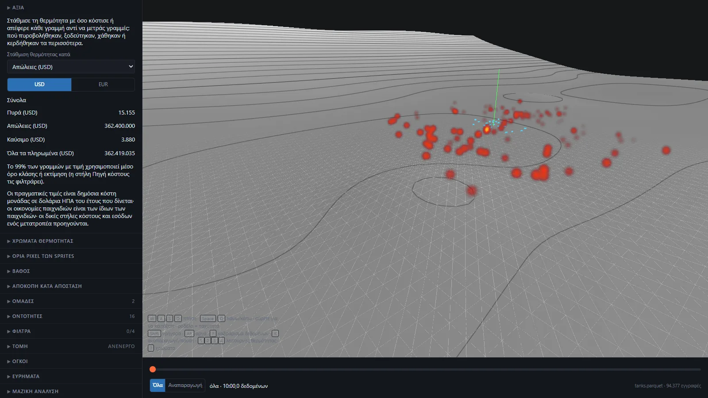

# Στάθμιση αξίας

Κάθε βολή, κάθε πυρομαχικό, κάθε χαμένο όχημα και κάθε λίτρο καυσίμου έχει τιμή. Ο περιηγητής υπολογίζει τι κόστισε ή τι κέρδισε κάθε γραμμή, και μπορεί να σταθμίσει τη θερμότητα με αυτή την τιμή, ώστε ο χάρτης να δείχνει **πού πήγαν τα χρήματα** και όχι πού βρίσκονται οι γραμμές.

## Πώς χρησιμοποιείται {#how-to-use-it}

1. Φορτώστε δεδομένα με γεγονότα (βολές, φόνοι, θάνατοι) και ονόματα οχημάτων ή όπλων.
2. Ανοίξτε την **Τιμή** στην πλαϊνή στήλη της Θερμότητας.
3. Διαλέξτε **Στάθμιση θερμότητας κατά**, για παράδειγμα *Απώλειες (USD)*. Η θερμότητα προσθέτει τώρα την τιμή κάθε γραμμής αντί για 1.
4. Διαβάστε τα **Σύνολα**: το άθροισμα κάθε στήλης τιμής για ό,τι φαίνεται (τα φίλτρα και το παράθυρο χρόνου ισχύουν).
5. Όπου οι τιμές είναι πραγματικά χρήματα, εμφανίζεται ένας διακόπτης **USD / EUR**.

Διαλέξτε την κενή πρώτη επιλογή του μενού για να μετρήσετε ξανά τις γραμμές.

## Τι μπορεί να σταθμιστεί {#what-can-be-weighed}

Οι στήλες τιμής προστίθενται κατά τη φόρτωση, μία για κάθε είδος και νόμισμα:

| Είδος | Γραμμές όπου πέφτει | Πώς τιμολογείται |
|---|---|---|
| **Πυρά** | βολές και εκτοξεύσεις | το όπλο, αλλιώς ένας μέσος όρος για το είδος του πυρομαχικού |
| **Δαπάνες** | αγορές, εμφανίσεις | οι στήλες χρημάτων του παιχνιδιού (για παράδειγμα ο μενού αγορών ενός shooter) |
| **Απώλειες** | θάνατοι, καταστροφές | το δικό του όχημα, αλλιώς ο μέσος όρος της κατηγορίας του |
| **Καταστράφηκαν** | φόνοι | το όχημα του στόχου |
| **Βλάβη που προκλήθηκε** | χτυπήματα | ένα μερίδιο της αξίας του στόχου |
| **Καύσιμο** | θέσεις | καύσιμο που καταναλώθηκε, από μια στήλη καυσίμου ή εκτιμημένο από την κατηγορία και τον χρόνο |
| **Όλα τα πληρωμένα** | | fired + spent + lost + fuel |
| **Κέρδη** | ανταμοιβές | οι δικές του στήλες ανταμοιβών του παιχνιδιού (`earn_…`) |
| **Καθαρό** | | earned μείον paid· σχεδιάζεται ως θερμότητα με πρόσημο (θετική βαθμίδα όπου κερδήθηκε περισσότερο, αρνητική όπου πληρώθηκε περισσότερο) |

Τα ονόματα των στηλών είναι `cost_<kind>_<currency>`, `earn_<currency>` και `net_<currency>`. Ένας μετατροπέας που γνωρίζει το δικό του νόμισμα του παιχνιδιού (για παράδειγμα ένας μετατροπέας replay που γράφει σε credits του παιχνιδιού) υπερισχύει των ενσωματωμένων πινάκων τιμών.

## Οι πίνακες τιμών {#the-price-tables}

| Πίνακας | Νόμισμα |
|---|---|
| Πραγματικός στρατός: πύραυλοι, βόμβες, βλήματα, αντίμετρα, αεροσκάφη, ελικόπτερα, χερσαία οχήματα, πλοία, καύσιμο | USD (EUR = USD × 0,92, η σταθερά `EUR_PER_USD` στο [`cost.ts`](https://github.com/Holdi601/3DHeat/blob/main/src/data/cost.ts)· δεν είναι ζωντανή ισοτιμία) |
| Μενού αγοράς shooter και ανταμοιβές φόνων | τα credits του παιχνιδιού |
| Παιχνίδια με τανκ και πλοία | τα credits του παιχνιδιού |
| Παιχνίδια στρατηγικής (πολλοί πόροι) | μία στήλη για κάθε πόρο και μία συνδυασμένη |
| Παιχνίδια πολέμου | πόντοι |

Το παιχνίδι αναγνωρίζεται από τα ονόματα μέσα στα δεδομένα. Οι τιμές σε πραγματικά χρήματα προέρχονται από δημόσιες πηγές (έγγραφα προϋπολογισμού, εγκυκλοπαίδειες) ή σημειώνονται ως εκτιμήσεις· δεν είναι διορθωμένες για τον πληθωρισμό. Η παραγόμενη λίστα των πινάκων βρίσκεται στο [Πίνακες τιμών](ref-value-tables.md).

## Εκτιμήσεις {#estimates}

Η επιπλέον στήλη κατηγορίας **Cost source** λέει πώς τιμολογήθηκε κάθε γραμμή: `table`, `class average`, `estimate` ή `none`. Η ενότητα Value δείχνει ποιο μερίδιο των τιμολογημένων γραμμών είναι μέσοι όροι ή εκτιμήσεις. Για να κρατήσετε μόνο γραμμές με ακριβή τιμή, αποεπιλέξτε το *estimate* και το *class average* στο **Cost source** στα [Φίλτρα](filters.md).

## Πού αλλού εμφανίζεται η αξία {#where-else-value-shows}

- [Ευρήματα](insights.md): τα ευρήματα *Costly ground* και *Earning ground*.
- [Ανάλυση ανά κατηγορία](breakdown.md): χρήματα Κέρδη, Απώλειες και Καθαρό ανά ομάδα, παίκτη ή όπλο.
- [Όγκοι και σύγκριση](volumes.md): στήλες αξίας στα στατιστικά και στη σύγκριση.
