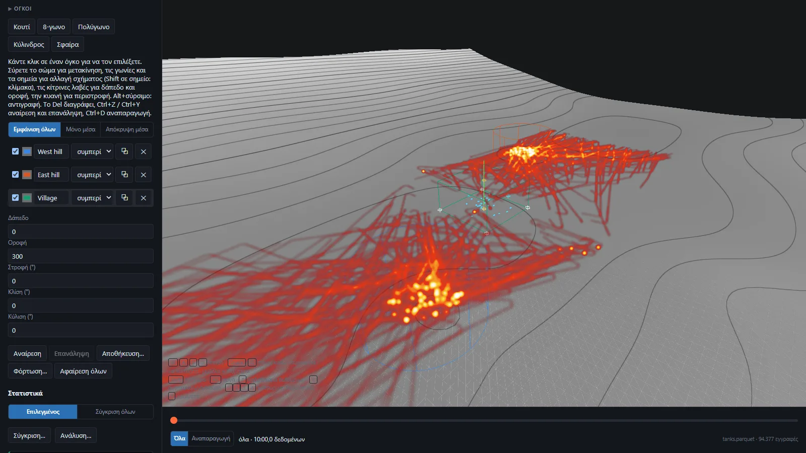
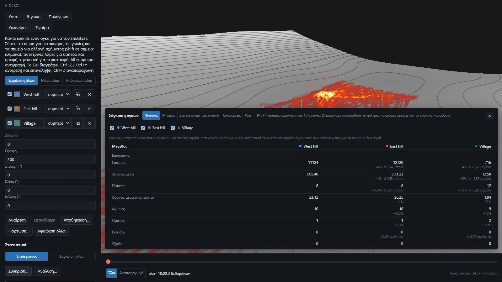
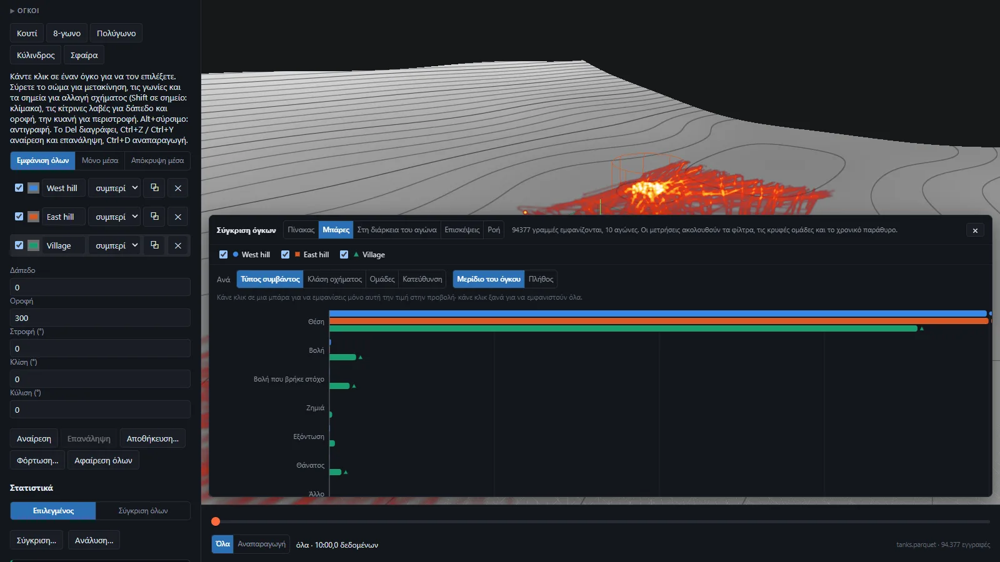

# Όγκοι και σύγκριση

Ένας **όγκος** είναι ένα αόρατο κουτί (ή κύλινδρος, ή σφαίρα) που σχεδιάζετε γύρω από έναν τόπο, για να ρωτήσετε: τι συνέβη εδώ μέσα; Χρησιμοποιήστε το για να μετρήσετε φόνους σε μια γέφυρα, για να συγκρίνετε δύο λόφους, ή για να δείξετε μόνο τη δραστηριότητα σε μία περιοχή.

```
 άποψη από πάνω          Σχεδιάζετε ένα σχήμα ->  ο περιηγητής μετράει
 +------------+          τι υπάρχει μέσα:
 |   ( A )    |           γραμμές, παίκτες, φόνοι, χρόνος ...
 |        [B] |          Συγκρίνετε το A με το B, δίπλα-δίπλα.
 +------------+
```



Οι όγκοι μετράνε τι συμβαίνει μέσα τους, φιλτράρουν την προβολή σε αυτούς, εξάγουν τις γραμμές τους και συγκρίνονται δίπλα-δίπλα. Βλ. επίσης το [γλωσσάρι](glossary.md) για γραμμή, πρόσωπο και αγώνα.

## Σχεδιάστε έναν όγκο {#draw-a-volume}

1. Ανοίξτε τους **Όγκους** στην πλαϊνή στήλη.
2. Διαλέξτε ένα εργαλείο και σχεδιάστε στην τρισδιάστατη προβολή ή στον δισδιάστατο χάρτη. Το δάπεδο και η οροφή ξεκινούν από τα δεδομένα κάτω από αυτά. Το Esc ακυρώνει.
3. Κάντε κλικ στον όγκο για να τον επιλέξετε· εμφανίζονται τα **Στατιστικά** του.

| Εργαλείο | Πώς σχεδιάζεται |
|---|---|
| **Κουτί** | Σύρετε ένα ορθογώνιο (Shift: τετράγωνο). Ένα κλικ τοποθετεί ένα προεπιλεγμένο κουτί. |
| **n-gon** | Σύρετε από το κέντρο (το Shift το κρατά κανονικό). Το *Γωνίες* ορίζει το n, από 3 έως 64 (προεπιλογή 8, οπότε το κουμπί γράφει **8-gon**). |
| **Πολύγωνο** | Κάντε κλικ στις γωνίες· κλείστε με διπλό κλικ, Enter ή κλικ στην πρώτη γωνία. Το Backspace αφαιρεί την τελευταία γωνία. |
| **Κύλινδρος** | Σύρετε την ακτίνα. |
| **Σφαίρα** | Σύρετε την ακτίνα· στέκεται πάνω στο έδαφος. |

## Επεξεργασία {#edit}

- Κάντε κλικ σε έναν όγκο για να τον επιλέξετε. Σύρετε το σώμα του για να τον μετακινήσετε, τις γωνίες για να τον αναδιαμορφώσετε (το Shift σε γωνία κάνει κλιμάκωση).
- Οι **κίτρινες** λαβές ορίζουν δάπεδο και οροφή, η **κυανή** λαβή τον περιστρέφει.
- Alt+σύρσιμο αντιγράφει, Del αφαιρεί, Ctrl+Z / Ctrl+Y αναιρεί και επαναλαμβάνει, Ctrl+D διπλασιάζει. Το **Αφαίρεση όλων** διαγράφει κάθε όγκο.
- Ακριβείς τιμές: Floor, Ceiling, Turn / Pitch / Roll (κουτιά), Radius (σφαίρες, κύλινδροι).

Κάθε γραμμή όγκου έχει πλαίσιο εμφάνισης, ένα χρώμα, ένα όνομα, **συμπερίληψη** ή **εξαίρεση**, αντίγραφο και διαγραφή. Οι όγκοι αποθηκεύονται στον περιηγητή για κάθε σύνολο δεδομένων, και τα **Αποθήκευση…** / **Φόρτωση…** γράφουν και διαβάζουν ένα αρχείο `volumes.json`.

## Φιλτράρετε την προβολή {#filter-the-view}

| Φίλτρο | Αποτέλεσμα |
|---|---|
| **Εμφάνιση όλων** (προεπιλογή) | Οι όγκοι μόνο μετρούν. |
| **Μόνο μέσα** | Η θερμότητα, η επανάληψη και η [ανάλυση χτυπημάτων](hit-analysis.md) σχεδιάζουν μόνο ό,τι βρίσκεται μέσα στους συμπεριλαμβανόμενους όγκους και έξω από τους εξαιρούμενους. |
| **Απόκρυψη μέσα** | Το αντίθετο. |

Το φίλτρο GPU δέχεται έως 8 όγκους με 64 σημεία περιγράμματος συνολικά· ένα «!» σημαίνει ότι ένας όγκος ξεπερνά το όριο. Τα στατιστικά και η εξαγωγή τον μετράνε κανονικά.

## Στατιστικά {#statistics}

Η περιοχή **Στατιστικά** ακολουθεί τα φίλτρα, το χρονικό παράθυρο και τις κρυφές ομάδες. Το *Επιλεγμένος* δείχνει τον επιλεγμένο όγκο, το *Σύγκρινε όλους* βάζει κάθε όγκο δίπλα-δίπλα. Δείχνει:

- τα **Γραμμές μέσα (εμφανιζόμενες)** και **Γραμμές μέσα (όλα τα δεδομένα)**, **Παίκτες**, **Ομάδες**, **Αγώνες**, **Χρόνος μέσα**, **Είσοδοι / έξοδοι**, **Μέγιστη θερμότητα**, **Μέση θερμότητα**, **Όγκος / αποτύπωμα** και ένα ιστόγραμμα **Πότε**·
- **Ποσοστό νικών**, όπου τα δεδομένα λένε ποιος κέρδισε ([στήλες αποτελέσματος](data-formats.md#outcome-columns)): από τους γύρους με έναν παίκτη μέσα, με τον γύρο κάθε παίκτη μετρημένο μία φορά, το μερίδιο που κέρδισε η πλευρά του - με έλξη προς το ποσοστό σε όλα όσα εμφανίζονται κατά 4 γύρους, όπως κάνει η [ανάλυση](breakdown.md) - μαζί με τους γύρους που κερδήθηκαν και παίχτηκαν και αυτό το συνολικό ποσοστό·
- ανά στήλη: κατηγορίες με **Lift** (το μερίδιο μέσα διαιρεμένο με το μερίδιο σε όλα τα εμφανιζόμενα δεδομένα), και αριθμούς με εύρος, διάμεσο και εκατοστημόρια 5ο-95ο.

Το **Στατιστικά ως CSV / JSON** τα αποθηκεύει. Το **Εξαγωγή των δεδομένων μέσα** γράφει τις γραμμές που βρίσκονται μέσα ως CSV ή Parquet (το *Μόνο οι εμφανιζόμενες γραμμές* είναι ενεργό από προεπιλογή)· έναν όγκο ή όλους, με μια στήλη που λέει ποιος όγκος περιέχει κάθε γραμμή.

## Σύγκριση όγκων {#compare-volumes}

Με δύο ή περισσότερους ορατούς όγκους, πατήστε **Σύγκριση…**.

1. Σχεδιάστε τρεις όγκους, για παράδειγμα Δυτικός λόφος, Ανατολικός λόφος και Χωριό.
2. Πατήστε **Σύγκριση…** κάτω από τα Στατιστικά.
3. Στον **Πίνακα**, διαβάστε τη διαφορά κάθε τιμής από τον πρώτο όγκο.
4. Περάστε στις **Μπάρες** για να δείτε τα μερίδια ως μπάρες.



| Προβολή | Δείχνει |
|---|---|
| **Πίνακας** | Γραμμές, χρόνος μέσα, παίκτες, αγώνες, ομάδες, είσοδοι, έξοδοι, επισκέψεις, διάρκεια επίσκεψης, φόνοι, θάνατοι, φόνοι ανά θάνατο, φόνοι ανά λεπτό, χρόνος ανά παίκτη, στήλες αξίας· ομαδοποιημένα κατά γεγονότα, κλάση οχήματος, παίκτη ή ΤΝ, ομάδα και κατεύθυνση. Κάθε τιμή δείχνει τη διαφορά της από τον πρώτο όγκο και ένα μέγεθος επίδρασης (αμελητέο, μικρό, μεσαίο, μεγάλο). Κάντε κλικ στην κεφαλίδα ενός όγκου για ταξινόμηση κατά απόσταση από τον πρώτο. |
| **Μπάρες** | Πλήθη ή μερίδια ανά γεγονός, κλάση, παράγοντα, ομάδα ή κατεύθυνση. Κάντε κλικ σε μια μπάρα για να φιλτράρετε την προβολή σε αυτήν. |
| **Στη διάρκεια του αγώνα** | Ένα διάγραμμα για κάθε όγκο στα λεπτά του αγώνα: παρουσία, γραμμές ή φόνοι. Κάντε κλικ για να πάτε εκεί. |
| **Επισκέψεις** | Διαγράμματα κουτιού και βιολιού για τη διάρκεια των επισκέψεων (λογαριθμική κλίμακα). |
| **Ροή** | Πού πηγαίνουν οι διαδρομές αφού φύγουν από κάθε όγκο: ένας πίνακας μεταβάσεων ή κορδέλες ροής. |



## Συμβουλές {#tips}

- Ξεκινήστε από ένα εύρημα: στα [Ευρήματα](insights.md), το **Όγκος εδώ** προσθέτει έναν κύλινδρο γύρω από τον τόπο του ευρήματος.
- Το **Ανάλυση…** ανοίγει την [Ανάλυση ανά κατηγορία](breakdown.md) για τον επιλεγμένο όγκο: ποιος και τι τα πάει καλύτερα μέσα του.
- Η [κατευθυντική θερμότητα](directional-heat.md) μπορεί να σχεδιάσει τις κατευθύνσεις μέσα στον επιλεγμένο όγκο.
- Η [καρτέλα Οχήματα](hit-analysis.md#restrict-to-an-area) χρησιμοποιεί τους ίδιους όγκους ως φίλτρο περιοχής.
