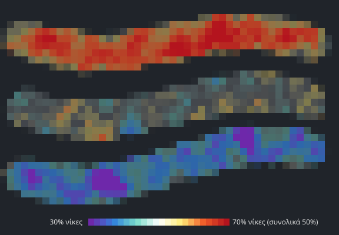

# Ποσοστό νικών: πόσο συχνά κερδίζει ένα σημείο, μια διαδρομή ή μια κίνηση

Πού στέκεται ένας παίκτης, προς τα πού πηγαίνει, από πού ρίχνει τις χειροβομβίδες του - και πόσο συχνά η πλευρά του κερδίζει μετά τον γύρο. Ο **χάρτης ποσοστού νικών** χρωματίζει κάθε σημείο με το μερίδιο των γραμμών εκεί που ανήκουν σε γύρους που κέρδισε η πλευρά της γραμμής, σε σύγκριση με το μερίδιο σε όλα όσα εμφανίζονται: θερμό όπου είναι μεγαλύτερο, ψυχρό όπου είναι μικρότερο, τίποτα όπου είναι ίδιο.

*Η εικόνα έχει φανταστικά δεδομένα: τρεις διαδρομές σε ένα άδειο επίπεδο, με το 68%, το 50% και το 33% των γραμμών τους σε κερδισμένους γύρους.*

Χρειάζεται δεδομένα που λένε ποιος κέρδισε: τις [στήλες αποτελέσματος](data-formats.md#outcome-columns) (`won`, `matchWon`, `roundEndReason`). Οι μετατροπείς για CS2 και War Thunder τις γράφουν, και ο μετατροπέας Tacview για τις εκστρατείες ενός διακομιστή DCS ([Διακομιστές DCS](tacview-acmi.md#dcs-servers-who-won-and-how-each-sortie-ended))· οποιοδήποτε αρχείο μπορεί να τις έχει.

## Δοκιμάστε το {#try-it}

1. Φορτώστε αγώνες με στήλη αποτελέσματος και πατήστε `2` (**Διαφορά**).
2. Στο **Διαχωρισμός διαφοράς**, πατήστε **Ποσοστό νικών ανά γύρο** (ή **Ποσοστό νικών ανά αγώνα**). Βάζει τους κερδισμένους γύρους στο **+** και τους χαμένους στο **−** και γυρίζει τον πίνακα σε **Μερίδιο του +**.
3. Διαβάστε τα χρώματα. Ο πίνακας λέει το συνολικό μερίδιο: *Συνολικά 52,0% από 1.200.000 γραμμές είναι στο +.*
4. Περιορίστε το με τα [φίλτρα](filters.md): μία πλευρά (T ή CT), έναν τύπο γεγονότος (*Θέση* για το πού στέκονταν οι παίκτες, *Βολή* ή *Εκτόξευση (πύραυλος, ρουκέτα, βόμβα)* για το από πού πυροβόλησαν ή έριξαν), μία αγορά, έναν χάρτη.

Ένα σημείο θερμό με γραμμές *Θέση* είναι σημείο όπου όσοι το κρατούσαν κέρδιζαν πιο συχνά τον γύρο. Με γραμμές *Εξόντωση* είναι σημείο όπου οι εξοντώσεις που έγιναν οδήγησαν σε κερδισμένους γύρους.

## Οι ρυθμίσεις {#the-settings}

| Ρύθμιση | Τι κάνει | Προεπιλογή |
|---|---|---|
| **Διαφορά** / **Μερίδιο του +** | η ίδια η διαφορά, ή το μερίδιο της πλευράς + από τις γραμμές και των δύο πλευρών | Διαφορά |
| **Πλήρες χρώμα στο** | πόσο πάνω ή κάτω από το συνολικό μερίδιο εμφανίζεται ένα σημείο με πλήρες χρώμα, σε μονάδες | ± 20 μονάδες |
| **Ελάχιστες γραμμές για να χρωματιστεί ένα σημείο** | ένα σημείο με λιγότερες γραμμές δεν χρωματίζεται· το χρώμα εμφανίζεται σταδιακά από το μισό αυτού του αριθμού | 12 |
| **Έλξη προς το συνολικό μερίδιο (γραμμές)** | κάθε σημείο ξεκινά με τόσες γραμμές στο συνολικό μερίδιο, ώστε ένα σημείο με 3 γραμμές, όλες κερδισμένες, να μην εμφανίζεται ως 100% | 12 |

Και οι τρεις επιδρούν στην τελική εικόνα: όταν τις σύρετε, η συσσώρευση δεν ξεκινά ποτέ από την αρχή.

Το μερίδιο μπορεί να είναι οποιουδήποτε διαχωρισμού, όχι μόνο των νικών: το *Μερίδιο του +* με διαχωρισμό ανά πλευρά δείχνει πού οι T ήταν το μεγαλύτερο μέρος της παρουσίας, και με διαχωρισμό ανά αρχεία δύο χαρτών πού οι γραμμές του ενός αρχείου υπερτερούν του άλλου.

## Γραμμές, όχι γύροι {#rows-not-rounds}

Ο χάρτης μετρά γραμμές. Ένας παίκτης που στέκεται σε ένα σημείο για είκοσι δευτερόλεπτα προσθέτει μια γραμμή σε κάθε δείγμα, όλες από τον ίδιο γύρο. Άρα η μαρτυρία σε ένα σημείο είναι οι γραμμές κοντά του, όχι οι γύροι. Γι' αυτό το ελάχιστο και η έλξη είναι σε γραμμές, και γι' αυτό είναι μεγαλύτερα από έναν γύρο.

Για τους ίδιους τους γύρους:

- **[Ανάλυση](breakdown.md)** σε ένα σημείο, στην προβολή ή σε έναν όγκο: το *Νίκες %* μετρά τον γύρο κάθε παίκτη μία φορά, με έλξη προς το συνολικό ποσοστό του σημείου με τον ίδιο τρόπο (4 γύροι).
- Στατιστικά **[Όγκων](volumes.md)**: *Ποσοστό νικών* - οι γύροι με έναν παίκτη μέσα στον όγκο, ο καθένας μία φορά, με έλξη προς το ποσοστό σε όλα όσα εμφανίζονται, μαζί με τους αριθμούς.

## Φίλτρα αποτελέσματος {#outcome-filters}

Ο πίνακας [Φίλτρα](filters.md) δείχνει τις στήλες αποτελέσματος αμέσως μετά τις δικές του στήλες του προγράμματος προβολής: **Αποτέλεσμα γύρου** και **Αποτέλεσμα αγώνα** (*Οποιοδήποτε*, *Νίκη*, *Ήττα*) και **Πώς έληξε ο γύρος** (εξόντωση, η βόμβα εξερράγη, η βόμβα εξουδετερώθηκε, ο χρόνος τελείωσε, παράδοση, ισοπαλία, στόχος, κρατημένες ζώνες, χαμένα εισιτήρια, χάθηκαν όλα τα οχήματα), στη γλώσσα του προγράμματος προβολής.

## Για προγραμματιστές {#for-developers}

Το πέρασμα θερμότητας γράφει τρία αθροίσματα στον στόχο τεσσάρων καναλιών που χρησιμοποιεί η θερμότητα ομάδων: τη θερμότητα `R = Σ|v|`, τη θερμότητα της πλευράς + `P` και `S = Σ v²/w`, με `w` το βάρος του περάσματος (βάρος δειγματοληψίας επί κέρδος καρέ). Η σύνθεση διαβάζει το μερίδιο `P/R` (ένας μέσος όρος σταθμισμένος με τον πυρήνα) και τις γραμμές στις οποίες στηρίζεται, `n = R²/S` (το ενεργό μέγεθος δείγματος του Kish), έλκει το μερίδιο προς το συνολικό, `p = (n·P/R + m·r0)/(n + m)`, και χρωματίζει `p - r0` στο εύρος με τις κλίμακες διαφοράς.

Το `n` απαλείφει κάθε παράγοντα κοινό στις γραμμές ενός pixel - το κέρδος καρέ, το βάρος δειγματοληψίας, το βάρος εμβαδού ενός περιορισμένου sprite - ώστε η εικόνα να είναι ίδια σε κάθε ζουμ και πυκνότητα δειγματοληψίας, και τα καρέ με κάθε k-οστή γραμμή να ενώνονται στο σύνολο χωρίς να πηδούν τα χρώματα. Το συνολικό μερίδιο προέρχεται από τις μετρήσεις πλευρών στη CPU, με ακρίβεια δεκάτου του τοις εκατό· τίποτα δεν διαβάζεται πίσω από τη GPU. Η αριθμητική και οι έλεγχοί της: [`render/rateMap.ts`](https://github.com/Holdi601/3DHeat/blob/main/src/render/rateMap.ts) και το τεστ του.

Κοστίζει όσο η θερμότητα ομάδων: ο στόχος τεσσάρων καναλιών τετραπλασιάζει το εύρος ζώνης ανάμειξης του περάσματος θερμότητας, μόνο όσο είναι ενεργό το *Μερίδιο του +*.
