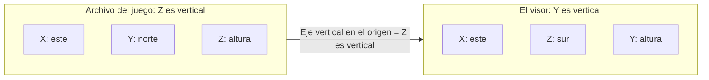

# Ejes, unidades y tiempo

Los juegos y los mapas no se ponen de acuerdo en qué dirección es arriba, cuánto mide una unidad, ni cómo se escribe el tiempo. Esta página muestra los tres ajustes que hacen que tus datos se sostengan, tengan la escala y se reproduzcan en la dirección correcta.

Si tu mapa se ve como un muro en lugar de tumbado como un suelo, cambia **Eje vertical en el origen**.

Con un **Eje vertical en el origen** equivocado, el mapa se ve como un muro; con el correcto, se ve tumbado como un suelo.

## El mundo en el que dibuja el visor {#the-world-the-viewer-draws-in}

El mundo del visor es **Y vertical**: X y Z son el plano del suelo, e Y es la altura. La mayoría de los motores de juego son **Z vertical**: para ellos X e Y son el suelo, y Z es la altura. Algunos motores además están reflejados (de mano izquierda). La asignación indica cómo convertir los ejes del archivo en los del visor. (Técnicamente, el visor es de mano derecha, la convención de three.js.)

### Eje vertical {#up-axis}

**Eje vertical en el origen** en la [Asignación de columnas](column-mapping.md):

| Ajuste | El archivo (x, y, z) pasa a ser el mundo (X, Y, Z) |
|---|---|
| *Z es vertical (la mayoría de motores de juego)* - por defecto | (x, **z**, **y**): la Z del archivo pasa a ser la altura, y la Y del archivo pasa a ser la Z del mundo |
| *Y es vertical (convención gráfica)* | (x, y, z) sin cambios |

En datos con Z vertical, las tres matrices se renombran en lugar de copiarse ([`remapAxesInPlace`](https://github.com/Holdi601/3DHeat/blob/main/src/data/ingest.ts)), lo que ahorra cientos de megabytes en cargas grandes. La suposición se hace con la muestra: la columna Y o Z con menor dispersión es la vertical.

### Inversiones {#flips}

**Invertir X**, **Invertir Y** e **Invertir Z** niegan el eje *del archivo* con ese nombre, antes del renombrado; así que con Z vertical, *Invertir Y* niega lo que acaba siendo la Z del mundo. Una inversión cambia los datos cargados: las coordenadas que muestran la [regla](measure.md), el corte y la pose de la cámara son las invertidas.

Para dibujar un mundo reflejado en el sentido correcto **sin** cambiar los datos, usa en su lugar **Cámara y escena → Invertir eje del mundo** ([Cámara](camera.md#invert-world-axis)). Es la mejor opción para juegos cuyo mundo es de mano izquierda, porque cada coordenada que muestran las herramientas sigue siendo la del juego.

### Escala de unidades {#unit-scale}

**Escala de unidades** multiplica cada posición. *1 (m)* pone 1; *0,01 (cm→m)* pone 0,01 (las unidades de Unreal Engine son centímetros, así que usa 0,01; las unidades del motor Source son pulgadas, así que usa 0,0254; ninguna de las dos son metros); y el cuadro acepta cualquier valor. Un 0 escrito o un valor que no es un número se sustituye por 1.

El visor etiqueta las distancias en metros (radio del sprite, distancias de recorte, la regla, la velocidad de vuelo), y eso solo es cierto cuando la unidad del mundo, ya escalada, es un metro. Nada se rompe si no lo es; las etiquetas simplemente dicen «m» para lo que sea la unidad.

## Tiempo {#time}

### Unidades de tiempo {#time-units}

Regla práctica: valores como 17000000000 (diez dígitos o más) son una marca de tiempo Unix; valores como 0, 0,25, 0,5 son segundos desde el inicio.

| Unidad de tiempo (etiqueta del menú) | Se lee como | Hora del reloj que se muestra |
|---|---|---|
| *Segundos (relativo)* | valor × 1 s | no |
| *Milisegundos (relativo)* | valor × 0,001 s | no |
| *Microsegundos (relativo)* | valor × 10^-6 s | no |
| *Nanosegundos (relativo)* | valor × 10^-9 s | no |
| *Marca de tiempo Unix (s)* | segundos desde 1970-01-01 UTC | sí |
| *Marca de tiempo Unix (ms)* | milisegundos desde 1970-01-01 UTC | sí |
| *Cadena de fecha ISO-8601* | texto como `2026-03-14T18:02:11.250Z`, analizado con `Date.parse` del navegador | sí |

Con una unidad absoluta (las tres últimas), el conjunto de datos conserva el instante de reloj de su primera fila, y la línea de tiempo muestra la hora UTC actual (`HH:MM:SSZ`) junto al cabezal de reproducción.

**Las columnas `TIMESTAMP` y `DATE` de Parquet** se decodifican como instantes reales, así que su ajuste de unidad se ignora y el panel lo dice. Una columna `DATE` es un día entero: todas las filas de un día comparten un instante, y la reproducción salta un día cada vez, algo que el panel advierte.

**Las cadenas ISO-8601 funcionan igual en CSV que en Parquet.** Una columna de tiempo en texto con la unidad ISO se analiza una vez por cada cadena distinta; si ninguna se analiza, la carga falla con *No hay marcas de tiempo ISO-8601 analizables en la columna de tiempo asignada.*, y la asignación ya se niega a empezar si ninguno de los valores de la muestra se analiza. Una columna `TIMESTAMP` de Parquet se lee como marca de tiempo con cualquier unidad, y una columna numérica de Parquet con la unidad ISO se lee como milisegundos Unix. Una columna de tiempo en texto con una unidad numérica se rechaza antes de cargar: todos los valores se leerían como NaN.

### Cómo se guarda el tiempo {#how-time-is-stored}

Mientras se combinan los archivos, los tiempos son segundos de 64 bits, así que una época absoluta conserva su detalle de fracciones de segundo. Cuando están todos los archivos, el tiempo más temprano de toda la selección pasa a ser 0, y cada fila guarda segundos de 32 bits desde ahí. Un float de 32 bits tiene 24 bits de mantisa: los intervalos de hasta algo más de un día y medio se resuelven con mejor precisión que 1/100 s, y los de medio año, con una precisión de aproximadamente un segundo. Una fila cuyo tiempo falta o no es un número se coloca en 0, el inicio.

Después, las filas se ordenan por tiempo, y eso es lo que hace barata la línea de tiempo: una ventana de tiempo se encuentra con dos búsquedas binarias (mira [Muestreo y presupuestos](sampling-and-budgets.md)).

### Tiempo transcurrido frente a hora del reloj {#elapsed-time-versus-wall-clock}

Una columna de tiempo como `match_time` o `round_time` cuenta desde el inicio de cada partida. Elegirla pone a todas las partidas en un mismo eje compartido, lo que sirve para comparar lo que pasa en el minuto 3 de cada partida, y el panel lo señala. Una columna de hora del reloj muestra las partidas en el orden en que ocurrieron de verdad, solapadas donde se solaparon.

## Dirección de la mirada {#look-direction}

La dirección de la mirada solo la usa la [repetición de cajas](box-replay.md) (los rayos de cada caja). Se guarda como dos ángulos, guiñada y cabeceo, en radianes.

- Las **columnas de guiñada / cabeceo** se leen tal cual, convertidas desde grados cuando se elige *Grados*. No se ajustan al eje vertical ni a las inversiones.
- Las **columnas de vector de dirección** pasan por el mismo renombrado e inversiones que las posiciones, y luego se convierten en guiñada = atan2(x, -z) y cabeceo = atan2(y, √(x² + z²)) en ejes del mundo; así el rayo apunta hacia donde mira la caja también en un mundo reflejado.

Si las columnas de guiñada / cabeceo salen apuntando en la dirección equivocada después de una inversión, de un vector de dirección o de ángulos ajustados, esa es la solución.
