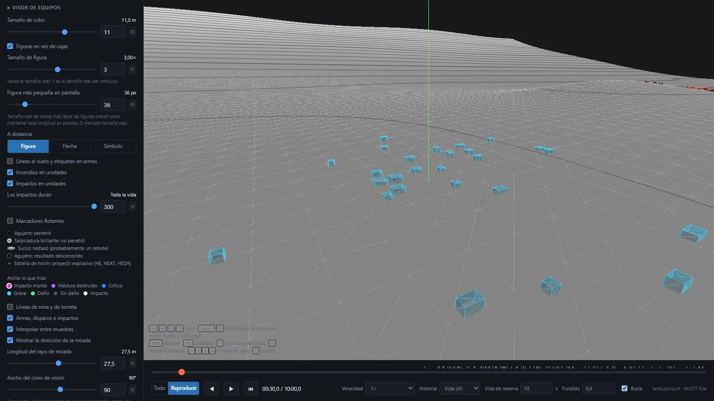

# Superposición de figuras (repetición de cajas)

Una pequeña película: una figura por cada persona, moviéndose a medida que avanza el tiempo, con una estela detrás.

El modo se llama **Figuras superpuestas** en la barra de modos. Esta página se llamaba antes «repetición de cajas», porque antes de que existieran las figuras cada persona era una caja; «repetición con figuras» y «repetición de cajas» significan lo mismo. **Figuras superpuestas** no tiene tecla numérica: elígelo en la barra de modos. Dibuja una figura (o caja) por [persona](glossary.md), moviéndose a lo largo de la [línea de tiempo](timeline.md), con rayos de mirada y estelas opcionales. Es reproducción y no densidad: *quién estaba dónde, y cuándo*. Necesita una columna de persona; sin columna de tiempo, cada muestra se dibuja de una vez.

## Cómo se usa {#how-to-use-it}

1. Carga datos con una columna de persona y una columna de tiempo.
2. Elige **Figuras superpuestas** en la barra de modos.
3. Pon la línea de tiempo en **Reproducir** y pulsa reproducir (`K`).
4. Abre **Visor de equipos** para cambiar la **Longitud de la estela**, el tamaño de las figuras o los rayos de mirada.

En este modo no se dibuja calor, y el presupuesto adaptativo de sprites está inactivo.

Por defecto, cada persona se dibuja como la figura de lo que es, y no como una caja: mira [Figuras](figures.md) para saber qué figura recibe cada unidad, y [Repetición de partida](match-replay.md) para las etiquetas, la cámara de seguimiento, la medida entre dos unidades y la lista de eventos.

## El panel Visor de equipos {#the-team-viewer-panel}

Se muestra en lugar de los paneles de calor en este modo.

| Control | Por defecto | Rango (tirador) | Significado |
|---|---|---|---|
| **Figuras en vez de cajas** | activado | | Cada persona como la figura de lo que es: un soldado a pie, el tanque o la aeronave que nombran los datos. Lo que los datos no dicen se queda como caja. |
| **Tamaño de figura** | 1× | | 1× es el tamaño real. |
| **Figura más pequeña en pantalla** | 36 px | 0 = siempre tamaño real | Tamaño real de cerca; las figuras más lejanas crecen para seguir midiendo estos píxeles de largo. |
| **Armas, disparos e impactos** | activado | | Armas en vuelo con humo, trazadores, impactos, aciertos y muertes. Los trazadores deducidos de un impacto aparecen con trazos. |
| **Tamaño de cubo** | tamaño de la entidad, o extensión / 500, al cargar | 0,05-200 m, logarítmico (5000) | Longitud de arista de cada caja. Mira [tamaño de la entidad](sessions-persons-groups.md#entity-size). |
| **Interpolar entre muestras** | activado | | Entre dos muestras de la misma persona en la misma sesión, coloca la caja en proporción entre ellas. Nunca cruza el límite de una sesión. |
| **Mostrar la dirección de la mirada** | activado | | Un rayo desde cada caja en la dirección en que mira la persona (necesita [columnas de mirada](axes-units-and-time.md#look-direction)). |
| **Longitud del rayo de mirada** | tamaño de la entidad × 4, o extensión / 200, al cargar | 0,5-500 m, logarítmico (20.000) | Se muestra mientras la dirección de la mirada está activada. |
| **Longitud de la estela** | 8 s | 0-300 s (86.400); 0 = apagado | Segundos de historial que se dibujan detrás de cada persona. |
| **Dibujar cada muestra en bruto** | desactivado | | Una caja por cada muestra guardada en la ventana, en lugar de una caja interpolada por persona. Se submuestrea para que siga siendo interactivo. |

Las indicaciones del panel explican que la interpolación y las estelas unen muestras solo dentro de una misma sesión, y, cuando la carga tiene [nombres compartidos](sessions-persons-groups.md#names-worn-by-several-things-at-once), cuántos nombres se dibujan como muestras sueltas.

## La sesión que se reproduce {#the-session-being-played}

Con una columna de sesión, el selector **Sesión** en la parte superior de la barra lateral ([Sesiones](sessions-persons-groups.md#the-session-picker)) decide qué partida se reproduce. Al cargar se elige la más activa. Solo las filas de esa sesión se convierten en cajas y estelas, y la línea de tiempo recorre el intervalo de esa sesión en lugar de todo el conjunto de datos. *Todas las sesiones* reproduce todas a la vez, sin unir nunca muestras entre sesiones.

## Qué se dibuja y cuándo {#what-is-drawn-when}

De [`TrackCursor`](https://github.com/Holdi601/3DHeat/blob/main/src/data/tracks.ts):

**Cajas en vivo** (modo Reproducir, muestras en bruto desactivadas). Para cada persona visible, su última muestra en o antes del cabezal de reproducción:

- Si la persona tiene una muestra siguiente, está en la misma sesión y el nombre no es compartido, la caja se coloca entre las dos muestras en proporción al tiempo, con la guiñada interpolada por el camino más corto y el cabeceo de forma lineal (cuando *Interpolar* está activado).
- Si no, la caja se queda en la última muestra durante la **Vida de reserva** de la línea de tiempo (por defecto 10 s) y luego se quita, para que los jugadores eliminados no se queden rezagados.

**El modo Todo** ignora el cabezal de reproducción y dibuja cada muestra del intervalo como una caja.

**Muestras en bruto** dibuja una caja por cada muestra guardada en la ventana: el *Intervalo* con el historial *Ventana*, y en otro caso todo hasta el cabezal de reproducción. Como máximo 65.536 cajas; si hay más muestras, se dibuja una de cada *k*.

**Estelas** (cuando la longitud de la estela es mayor que 0 y no se dibujan muestras en bruto): una línea entre cada par de muestras consecutivas de una persona dentro de los últimos *longitud de la estela* segundos hasta el cabezal de reproducción, que se desvanece desde una opacidad de 80 % hasta la transparencia con la edad. Una estela se detiene en un cambio de sesión y no se dibuja para nombres compartidos. Como máximo 131.072 vértices; si hay más, las filas se saltan de manera uniforme.

**Quién es visible:** una persona queda oculta cuando su grupo está desmarcado en la [lista de equipos](teams-list.md) (su grupo es el de su primera fila), cuando un filtro de grupo la excluye, o cuando el panel [Entidades](entities.md) tiene una selección que no la incluye. Los [filtros](filters.md) de columna no se aplican a las cajas.

## Colores {#colours}

Una familia de tonos por grupo y un matiz por miembro, para que de un vistazo sepas de qué bando es cada uno ([`teamMemberColor`](https://github.com/Holdi601/3DHeat/blob/main/src/render/colors.ts)). Los tonos de grupo recorren una lista fija de diez: azul, rojo, verde, ámbar, violeta, cian, magenta, lima, naranja, índigo; y los miembros de un grupo se reparten entre una claridad de 42-76 % y una saturación de 90-65 %.

## Notas {#notes}

- La superposición de figuras reconstruye sus figuras solo cuando algo cambia; un fotograma en reposo vuelve a dibujar las últimas.
- La línea *Cubos* de la [superposición de estadísticas](performance-and-stats.md) cuenta las cajas en pantalla.
- La superposición de figuras dibuja en la misma escena que el nivel, así que la [profundidad de campo](camera.md#depth-of-field) difumina las cajas pero nunca el calor.
