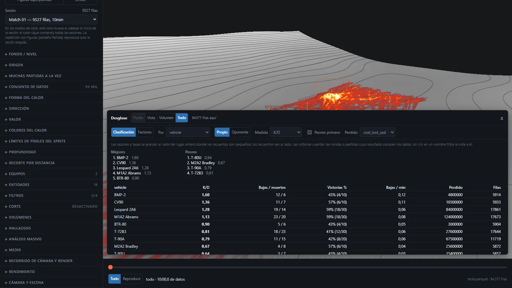
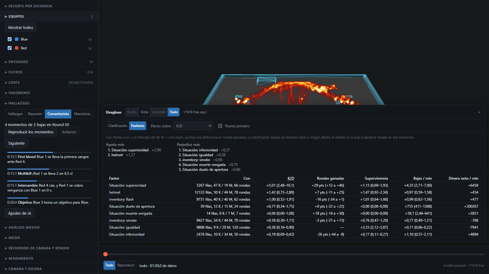

# Desglose: quién y qué funciona mejor en cada sitio

El **Desglose** responde a una pregunta: en este lugar, ¿qué vehículo, jugador o arma funciona mejor? Úsalo para encontrar el tanque que gana en el puente, o para ver si ponerse un casco de verdad ayuda.

Ordena lo que pasa en un lugar (un punto elegido, la vista, un volumen o todo lo que se muestra) por cualquier categoría, y mide cada factor de estado con y sin.

## Pruébalo {#try-it}

1. Carga una partida con bajas y muertes, y abre **Volúmenes**.
2. Dibuja un volumen alrededor del lugar que te interesa y selecciónalo.
3. Pulsa **Desglose…** bajo Estadísticas.
4. En **Por**, elige *Vehículo*, y elige la medida *K/D* (bajas por muerte).
5. Lee la lista, la mejor primero. Pulsa **Peores primero** para darle la vuelta. Haz clic en un nombre para filtrar la vista a él; haz clic otra vez para soltarlo.

## Abrirlo {#open-it}

| Desde | Región con la que empieza |
| --- | --- |
| **Desglose…** en [Volúmenes](volumes.md) (Estadísticas) | el volumen seleccionado |
| **Desglose aquí** en la tarjeta de selección, tras hacer clic en un punto | una esfera alrededor de ese punto (**Radio**, por defecto 3 % del tamaño de los datos) |
| el panel de división de **Diferencia** | la vista |

La cabecera cambia la región: **Punto**, **Vista** (lo que vio la cámara en el último recuento; **Contar de nuevo** tras moverla), **Volumen** (elige uno) o **Todo**. Cuenta en segundo plano; la línea de estado dice cuántas filas hay en la región.

## Clasificación {#ranking}

Elige por qué ordenar y una medida:

| Medida | Qué es |
| --- | --- |
| A, B | filas a cada lado del mapa de diferencia, divididas como las divide el calor |
| A / B, A - B, A / (A + B) | las dos capas una contra otra |
| K/D | bajas contra muertes |
| Victorias % | rondas (o partidas) ganadas, cuando los datos dicen quién ganó |
| Bajas / min | bajas por minuto presentes (huecos entre las muestras de movimiento) |
| Ganado, Perdido, Dinero neto | sumas de las columnas `earn_*` y `cost_*`; un selector elige la moneda |

Bajas, muertes, presencia, victorias y dinero cuentan cada fila que la vista muestra en el lugar, en cualquier lado de la división o en ninguno.

Los cocientes y las tasas se atraen hacia el valor de todo el lugar cuando los recuentos son pequeños, así que 2 bajas en 1 vida no encabezan la lista. Los recuentos se muestran junto a ellos.

Puedes ordenar por grupos, jugadores y partidas, cualquier columna de categoría (un vehículo, un arma, un bando, un tipo de compra, un agente o un equipo), cualquier columna numérica por rangos (blindaje, el valor de un equipo), la **clase** de una columna de arma (fusil, francotirador, subfusil, pistola...) y cuántas piezas de **utilidad** contiene una columna de lista como `inventory`.

**Propio** ordena por el valor de la propia fila. **Oponente** ordena por el valor de la otra parte: el arma de la víctima en una baja, el del asesino en una muerte (necesita una columna `other` / `victim` que los nombre).

## Estado en el momento {#state-at-the-time}

El valor de una fila es el suyo propio, salvo que la fila no registre ninguno (una fila de evento sin equipo) o que sea una muerte (cuya columna de arma puede nombrar el arma del asesino); en ese caso es lo que esa misma persona llevaba por última vez antes en la partida.

## Factores: con contra sin {#factors-with-against-without}

Cambia de **Clasificación** a **Factores**, elige **Efecto sobre** y lee *Ayuda más* y *Perjudica más*:

El efecto de cada factor sobre K/D, rondas ganadas, supervivencia (minutos por muerte), bajas por minuto y dinero neto por minuto, con un intervalo del 95 %: los cocientes como x, las rondas ganadas como diferencia de puntos. La clasificación atrae cada estimación hacia la ausencia de efecto según su propia incertidumbre, así que un factor raro necesita un efecto claro para salir alto; el intervalo que se muestra es el no atraído.

Los datos con rondas añaden las **situaciones** de combate cercano ([Combate cercano y rondas](close-quarters.md)), calculadas una vez por conjunto de datos: *cegado* (la columna `state_flashed` de la fila, o un destello enemigo a menos de 15 m en los últimos 3 s), *muerte vengada*, *duelo de apertura*, y *ventaja numérica*, *igualdad* o *desventaja numérica* (jugadores vivos del lado de la fila frente al enemigo). Una muerte cuenta en la situación en la que estaba su víctima justo antes.

Como máximo se miden 256 factores en una sola pasada.

## Para desarrolladores {#for-developers}

### Atraer muestras pequeñas {#pulling-small-samples}

El valor de la clasificación es `(n + m*r0) / (d + m)`: `n` y `d` son los recuentos, `r0` la razón de todo el lugar y `m` el peso de ese prior.

### Para autores de conversores: nombrar las columnas de factores {#for-converter-authors-naming-factor-columns}

Un conversor añade un factor nombrando su columna:

| Columna | Factor |
| --- | --- |
| `state_<nombre>` numérica | activo mientras no sea cero (`state_scoped`, `state_suppressor`) |
| `state_<nombre>` de categoría | un factor por valor (`state_ammo` = AP, HE...) |
| `active_<nombre>` | igual, para algo activado o usado hace poco: una habilidad, un ultimate, un artilugio, un refuerzo (`active_ult`, `active_stim`) |
| columna de lista (`inventory`, `loadout`, `perks`, `abilities`, `attachments`, `modules`, `buffs`, `debuffs`, `upgrades`, o un nombre `state_`/`active_` que termine en `s`) | un factor por elemento de un valor `a\|b\|c` |
| indicadores de equipo ya habituales (`helmet`, `defuser`, `armor`, `scoped`, `airborne`, `duck`, `flashed`...) | activo mientras no sea cero |
| `ammoType`, `shellType`, `ammoName` | la munición disparada por última vez |

Resultados: una columna `won` de 0/1 (el lado de la fila ganó la ronda o la partida) y una columna `round`, las [columnas de resultado](data-formats.md#outcome-columns); cuando un archivo tiene tanto `won` como `matchWon`, *Victorias %* cuenta rondas. Dinero: `earn_<moneda>` y `cost_<tipo>_<moneda>`; un ingreso solo por tipo (`earn_round_cs2`, las recompensas exactas por ronda de un conversor) reemplaza solo el ingreso de ese tipo del modelo de coste (`round` también cubre plantados y desactivados), y el modelo sigue valorando el resto.

El mapeo carga estas columnas por sí mismo, junto a la lista propia del archivo: cada columna `state_*`, `active_*`, `won`, `round` y de lista, excepto las que las estadísticas de un archivo Parquet muestran con un único valor en todo el archivo (cada columna cargada ocupa 4 bytes por fila).
