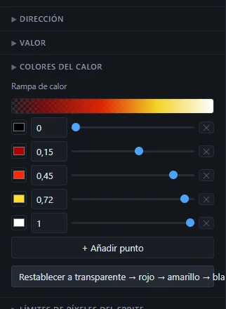

# Color y exposición

Estos controles deciden qué cantidad de calor recibe cada color. **Punto de saturación** es cuánto calor cuenta como blanco ardiente.

## Arreglos rápidos {#quick-fixes}

- Todo es blanco: sube **Punto de saturación**, o pulsa **Autoexposición a partir del campo**.
- No se ve nada: baja **Punto de saturación**, o pulsa **Autoexposición a partir del campo**.
- Solo se ven algunos puntos sueltos: sube **Calor mínimo**.

Cada control de esta página actúa cuando el calor se convierte en color. Por eso, al arrastrar cualquiera de ellos la imagen se redibuja al momento, y **nunca reinicia la acumulación**.

## Punto de saturación {#saturation-point}

**Punto de saturación** (sección Forma del calor): el calor acumulado que se convierte en la parte alta de la rampa de colores (con la respuesta *Lineal*; mira abajo las otras). Deslizador logarítmico de 0,1 a 4000; el tirador llega hasta 10.000.000, porque el calor acumulado crece con el número de filas. Por defecto 24; en cada carga, primero una **estimación analítica** y luego **medido** a partir de la imagen.

Acertar con este valor marca la diferencia entre un mapa de calor y una pantalla en blanco (o blanca). No se puede deducir con fiabilidad: la telemetría se agrupa tanto (un punto de aparición, una puerta, un cuello de botella) que la razón entre la densidad máxima y la media varía un orden de magnitud entre conjuntos de datos y entre ángulos de cámara.

## Autoexposición {#auto-exposure}

**Autoexposición a partir del campo** mide el campo que el shader ha generado de verdad. Ignora los píxeles vacíos, toma el percentil 98 de los iluminados y lo coloca al 85 % del camino hacia el punto de saturación. Así la parte alta de la rampa queda reservada para los picos reales.

El panel muestra entonces *medido X % del marco; percentil 98 R colocado cerca de la parte alta de la rampa*. Con la respuesta *Saturante*, un valor al 85 % del punto de saturación cae en torno al 57 % de la rampa, no al 85 %.

También se ejecuta **automáticamente**:

- 8 fotogramas renderizados después de cargar un conjunto de datos;
- 8 fotogramas después de cambiar los [filtros](filters.md) (filtrar cada posición hasta cien eventos cambia la densidad en órdenes de magnitud);
- 8 fotogramas después de cambiar entre calor de punto y [calor de línea](line-heat.md), o al cambiar qué rutas dibuja el calor de línea. Una línea deposita mucho menos calor por muestra que un sprite.

Cuando no hay nada iluminado, la ejecución automática deja la saturación como está. El botón recurre entonces a la estimación analítica y dice *nada iluminado que medir - se usó la estimación analítica*.

### Seguir la vista {#follow-the-view}

**Seguir la vista** (sección Forma del calor, activado por defecto) vuelve a medir cada vez que la cámara se detiene. Así, una región a la que vuelas usa toda la rampa de colores en lugar de la escala medida para todo el mapa. Los cambios pequeños se ignoran, y la escala se desliza en lugar de saltar. Funciona en los cuatro modos de calor, no en la superposición de figuras.

Desmárcalo para fijar la escala y comparar lugares en una sola escala. Arrastrar **Punto de saturación** a mano también la fija.

## Respuesta a la densidad {#density-response}

**Respuesta a la densidad**: cómo *k* (calor / saturación) se traslada a la rampa.

| Respuesta | Fórmula | Uso |
|---|---|---|
| **Saturante** (por defecto) | t = 1 - e^(-k) | Se acerca a la parte alta de la rampa de forma asintótica, como lo hacen los sprites translúcidos apilados. Nada llega a blanco plano, así que es el valor seguro por defecto con datos desconocidos. |
| **Lineal** | t = k | La única correspondencia en la que el mismo color significa el mismo número. Úsala para comparar dos conjuntos de datos o dos ventanas de tiempo. |
| **Log** | t = log₂(1 + 7k) / 3 | Comprime una cola larga, así que un punto caliente extremo deja de aplastar el resto hasta el fondo de la rampa. Aclara las zonas dispersas. |

## Calor mínimo {#minimum-heat}

**Calor mínimo** (por defecto desactivado, 0-100 %): cada píxel con algo de calor se sube al menos a este punto de la rampa. Súbelo, y baja el radio del sprite, para ver *dónde ha pasado algo alguna vez*. Así los datos aislados se ven claramente, en lugar de quedar apenas por encima de la transparencia. Déjalo desactivado al juzgar la densidad, porque aplana la parte baja de la rampa a propósito. El umbral (k > 0,0001) mantiene vacíos los píxeles realmente vacíos.

## El editor de la rampa {#the-ramp-editor}

En la sección **Colores del calor**. Su etiqueta dice para qué sirve la rampa: *Rampa de calor* en Calor y Líneas, *Positivo (equipos aditivos)* en Diferencia, y *Rampa de opacidad (el color viene del grupo)* en [Calor por equipo](team-heat.md), donde solo se usa su alfa.



La barra de arriba muestra una vista previa de la rampa. Debajo hay una fila por punto:

| Parte | Significado |
|---|---|
| Muestra de color | El color del punto (el selector de color del navegador). |
| Número | La posición del punto a lo largo de la rampa, de 0 a 1 (0 = sin calor). |
| Deslizador | La opacidad del punto, 0-100 %. |
| ✕ | Quita el punto. Está desactivado cuando solo quedan dos. |

**+ Añadir punto** añade un punto a mitad de camino entre los dos últimos, con el color y la opacidad del último. **Restablecer a transparente → rojo → amarillo → blanco** devuelve la rampa por defecto.

Los puntos pueden darse en cualquier orden; se ordenan al construir la rampa. El **alfa** es lo que mezcla el calor con la escena, por eso el extremo cero de la rampa por defecto es totalmente transparente.

### Las rampas por defecto {#the-default-ramps}

| Posición | Positiva (Calor, Líneas, Diferencia +) | Negativa (Diferencia −) |
|---|---|---|
| 0.00 | negro, alfa 0 | negro, alfa 0 |
| 0.15 | rgb(180, 0, 0), alfa 0.55 | rgb(0, 170, 60), alfa 0.55 |
| 0.45 | rgb(255, 40, 0), alfa 0.85 | rgb(0, 190, 200), alfa 0.85 |
| 0.72 | rgb(255, 220, 40), alfa 0.95 | rgb(40, 80, 255), alfa 0.95 |
| 1.00 | blanco, alfa 1 | rgb(170, 60, 255), alfa 1 |

## Mientras la cámara se mueve {#while-the-camera-moves}

Cuando la cámara se mueve, la acumulación se reinicia en cada fotograma. Con **Dibujar todas las filas en cada fotograma** activado (por defecto), cada fotograma en movimiento sigue siendo exacto. Desactivado, un fotograma en movimiento muestra una estimación muestreada (grumos más brillantes, con peso) que converge a la imagen real, más suave, cuando te detienes. Es lo esperado; mira [Acumulación](accumulation.md).

## Para desarrolladores {#for-developers}

### El paso de composición {#the-composite-pass}

Después de acumular el calor, el valor de cada píxel se convierte en color en un único paso de composición ([`COMPOSITE_FS`](https://github.com/Holdi601/3DHeat/blob/main/src/render/webgl2/shaders.ts)). Los pasos son:

```
k = |heat| / saturation point
t = response(k)                         clamped to 0..1
if minimum heat > 0 and k > 0.0001:  t = minimum + (1 - minimum) × t
colour, alpha = ramp(t)                  (the negative ramp when heat < 0, Difference only)
pixel = mix(scene, colour, alpha)
```

### La estimación analítica {#the-analytic-estimate}

**La estimación analítica** ([`estimateSaturation`](https://github.com/Holdi601/3DHeat/blob/main/src/data/calibrate.ts)) supone que las filas se reparten sobre la huella X-Z de los datos: calor medio = filas × (π r² / área de la huella) × 1/3 × intensidad del centro (el 1/3 es el promedio sobre el disco de una rampa lineal). Eso se multiplica por una razón supuesta de pico a media de 25, y el resultado se limita a 0,1-1.000.000. Solo tiene que estar dentro de un orden de magnitud del valor correcto.

### Medición {#metering}

[`exposure.ts`](https://github.com/Holdi601/3DHeat/blob/main/src/render/exposure.ts):

1. el objetivo de calor se lee de vuelta desde la GPU, submuestreado a como mucho 40.000 valores;
2. los píxeles vacíos (calor ≤ 0,0001) se descartan: la mayor parte de un campo de calor está vacía, y promediarlos dejaría todo subexpuesto, igual que un fotómetro apuntando a un fondo negro;
3. el percentil 98 de los píxeles iluminados es la referencia;
4. el punto de saturación pasa a ser referencia / 0,85. Así la referencia queda al 85 % del camino hacia el punto de saturación, y la parte alta de la rampa se reserva para los picos reales.

### La tabla de colores {#the-colour-table}

La rampa se hornea en una tabla RGBA de 256 × 2 (la rampa positiva en la primera fila, la negativa en la segunda) ([`buildColorLut`](https://github.com/Holdi601/3DHeat/blob/main/src/render/colors.ts)). Los colores se interpolan en luz lineal y se guardan como sRGB; la opacidad se interpola de forma lineal.
