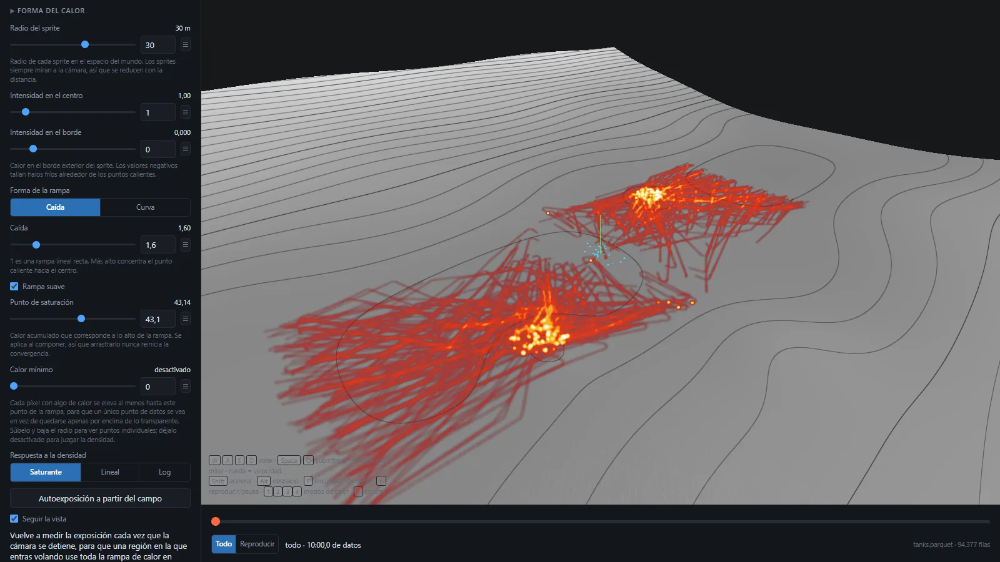
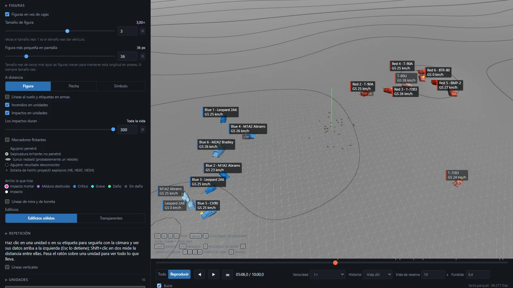

# Datos de demostración: prueba el visor en cinco minutos



¿Aún no tienes datos propios? El repositorio los genera. Todo es inventado: un valle, un patio, y partidas de tres estilos de juego ficticios con jugadores llamados *Blue 1* o *Red 3*. Todas las imágenes de este sitio se hicieron con ellos.

## Generarlos {#make-it}

```bash
node tools/demo-data.mjs
```

Esto escribe en `tools/.shots/demo/`:

| Archivo | Qué es |
|---|---|
| `demo-valley.glb` | un valle de 12 km con dos colinas y un pueblo, como nivel 3D |
| `demo-yard.glb` | un patio amurallado de 160 m con edificios, como nivel 3D |
| `tanks.parquet` | 10 partidas de tanques, 8 contra 8: movimiento, disparos, impactos con el lugar en el casco, incendios, bajas, restos, puntería de torreta, ganadores |
| `tanks/match-NN.parquet` | las mismas partidas, un archivo por cada una, para [muchas partidas a la vez](many-matches.md) |
| `air.parquet` | un combate aéreo de 4 contra 4 con misiles, bengalas, bajas y fallos |
| `shooter.parquet` | 12 rondas de 5 contra 5 a pie: disparos, bajas, un plantado, créditos ganados y gastados, cascos y utilidades |
| `mass/` | una carpeta con pequeñas partidas `.3dheat`, para el [análisis masivo](mass-analysis.md) |
| un conjunto de vueltas de carrera | dos vueltas de un coche en un circuito ficticio, para [Análisis de carrera](race-analysis.md) |

Cada tabla indica sus propias columnas en su pie, así que se carga sin ninguna asignación.

## Pruébalo {#try-it}

1. Inicia el visor (`start.bat` en Windows, o `npm install` una vez y después `npm run dev` en cualquier sistema) y abre `http://127.0.0.1:5273/`.
2. **Fondo / nivel → Modelo 3D…** y elige `demo-valley.glb`.
3. **Origen → Archivos…** y elige `tanks.parquet`.
4. Pulsa `F` para encuadrar los datos. Verás el [calor](heat.md) de diez partidas.
5. Prueba la barra de modos: **Diferencia** (Blue contra Red), **Calor por equipo**, **Líneas**.
6. Abre **Hallazgos** (en la barra lateral de Mapa de calor): encuentra los lugares donde se disparó, impactó y destruyó mucho más que en otros - alrededor de las dos colinas.
7. Abre la pestaña **Partida**; en **Partidas de la repetición** elige *Match 01*; pulsa **Reproducir** en la línea de tiempo: la [repetición](match-replay.md).



Para el juego de disparos, carga `demo-yard.glb` y `shooter.parquet`; para el combate aéreo, `air.parquet` (las figuras se ven mejor con **Tamaño de figura** 4, un control deslizante en el panel **Visor de equipos** de la barra lateral de Mapa de calor).

## Las capturas de pantalla {#the-screenshots}

Las imágenes del sitio las genera un script a partir de estos datos, en cualquiera de los idiomas del visor:

```bash
node tools/demo-data.mjs
HEAT3D_FIGURE_PACK=none npx vite --port 5321 --strictPort --host 127.0.0.1   # PowerShell: $env:HEAT3D_FIGURE_PACK="none"; npx vite ...
node tools/docs-shots.mjs --lang en
```

El servidor de capturas funciona sin paquete local de figuras, así que solo se muestra el catálogo público de figuras. Las imágenes van a `docs/assets/img/<idioma>/`. Véase [Mantenimiento de la documentación](maintaining.md).
