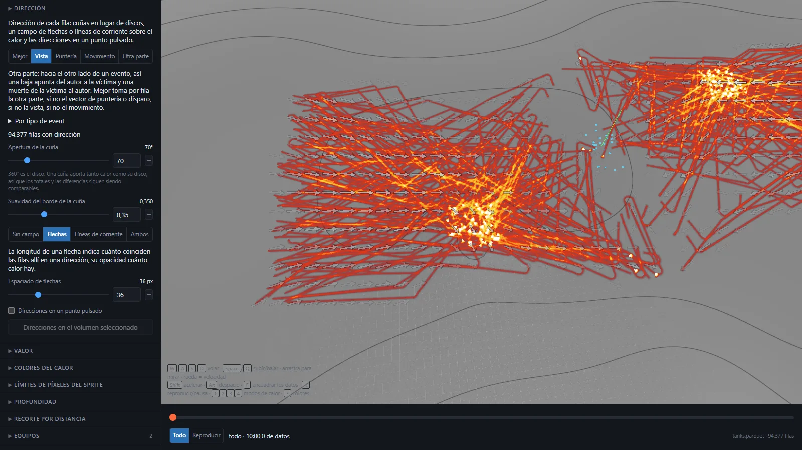

# Calor direccional

El calor normal dice **dónde** pasan las cosas. El calor direccional dice además **hacia dónde**: hacia dónde miraba la gente, apuntaba o se movía, o dónde estaba el otro bando de una pelea.

Un sprite normal es un disco completo (360 grados). Con una **Apertura de la cuña** de 70 grados, el mismo sprite se convierte en una cuña estrecha que apunta hacia donde miraba la fila, y suma el mismo calor total.

## Cómo se usa {#how-to-use-it}

1. Carga datos con una dirección (mira [Qué da a una fila una dirección](#what-gives-a-row-a-direction)).
2. Elige **Calor**, **Diferencia** o **Calor por equipo** en la barra de modos.
3. Abre la sección **Dirección** de la barra lateral.
4. Elige una **fuente** (qué dirección usar) y luego activa el dibujo:
   - baja la **Apertura de la cuña** por debajo de 360° para dibujar cada fila como una cuña que apunta en su dirección, en lugar de un disco;
   - elige un **Campo** para dibujar flechas o líneas de corriente sobre el calor;
   - marca **Direcciones en un punto pulsado** y haz clic en el calor para obtener un gráfico polar de ese punto.

La línea de estado indica cuántas filas tienen una dirección de la fuente elegida.

## Ajustes {#settings}

| Ajuste | Por defecto | Qué hace |
|---|---|---|
| Fuente: **Mejores**, **Vista**, **Puntería**, **Movimiento**, **Otra parte** | Mejores | Qué dirección recibe cada fila. *Mejores* toma, por fila, la otra parte; si no, la puntería; si no, la vista; si no, el movimiento. |
| **Por tipo de evento** | como arriba | Una fuente distinta para cada tipo de evento, por ejemplo *Otra parte* para las bajas y *Vista* para las posiciones. Se muestra cuando los datos tienen una columna de evento con como máximo 40 valores. |
| **Apertura de la cuña** | 360° | 360° es el disco normal (desactivado). Un valor menor es una cuña más estrecha. Una cuña suma tanto calor como su disco, así que los totales y las diferencias siguen siendo comparables. |
| **Suavidad del borde de la cuña** | 0,35 | 0 es una cuña de borde nítido, 1 es un abanico suave. |
| **Campo**: Sin campo, Flechas, Líneas de corriente, Ambos | Sin campo | Flechas: la longitud de una flecha indica cuánto coinciden las filas de ese lugar en una dirección, y su opacidad, cuánto calor hay. Las flechas solo aparecen donde hay calor. |
| **Espaciado de flechas** | 28 px | Distancia entre flechas en la pantalla. |
| **Animar las líneas de corriente** | activado | Las líneas de corriente fluyen mientras está activado. |
| **Direcciones en un punto pulsado** | desactivado | Haz clic en el calor para ver las direcciones en ese punto (abajo). |
| **Direcciones en el volumen seleccionado** | | El mismo gráfico para todo lo que hay dentro del [volumen](volumes.md) seleccionado. |

## El gráfico polar de un punto {#the-polar-chart-at-a-spot}

Con **Direcciones en un punto pulsado** activado, haz clic en el calor. Las filas cercanas a ese punto (a menos de 1,5 radios de sprite) se reúnen en una rosa de 24 sectores de 15°:

- pétalos **naranjas**: direcciones salientes (hacia donde apuntan las filas);
- pétalos **azules**: direcciones entrantes (de donde vinieron);
- el **área** de un pétalo crece con su recuento; una flecha muestra la dirección principal;
- las líneas bajo el gráfico dan el rumbo principal, cuánto coinciden las filas (R, de 0 a 1), la dispersión en grados y el número de filas.

0° está arriba en el gráfico, que es −Z del mundo (el norte en las grabaciones de Tacview). El punto también se marca en la vista 3D con una flecha y un anillo.

## Qué da a una fila una dirección {#what-gives-a-row-a-direction}

| Fuente | Necesita en los datos |
|---|---|
| Vista | una columna de guiñada (asignada como dirección de la mirada): `yaw`, `heading`, `azimuth`, `view_yaw`, `rot_z` |
| Puntería | pares de números como `aim_x`/`aim_y`, `shot_x`/`shot_y`, `fire_x`/`fire_y`, `hit_dir_x`/`hit_dir_y` (y opcionalmente `…_z`) |
| Movimiento | nada más: el paso desde la muestra anterior de la misma persona (como máximo 10 s antes, la misma sesión) |
| Otra parte | una columna que nombra la otra parte de un evento (`other`, `victim`, `target`, `killer`, `attacker`, `shooter`, `other_player`...) cuyos valores son nombres de personas; una baja apunta del asesino a la víctima, una muerte de la víctima al asesino |

## Consejos {#tips}

- Las cuñas necesitan cierto tamaño en la pantalla; por debajo de unos pocos píxeles se dibujan de nuevo como discos.
- Usa *Otra parte* en las filas de bajas para ver **desde dónde** se ganaron los combates, y *Vista* en las filas de posición para ver **dónde mira la gente**.
- Con **Diferencia**, las cuñas de los dos bandos apuntan en sus propias direcciones, así que las líneas de tiro disputadas destacan.
