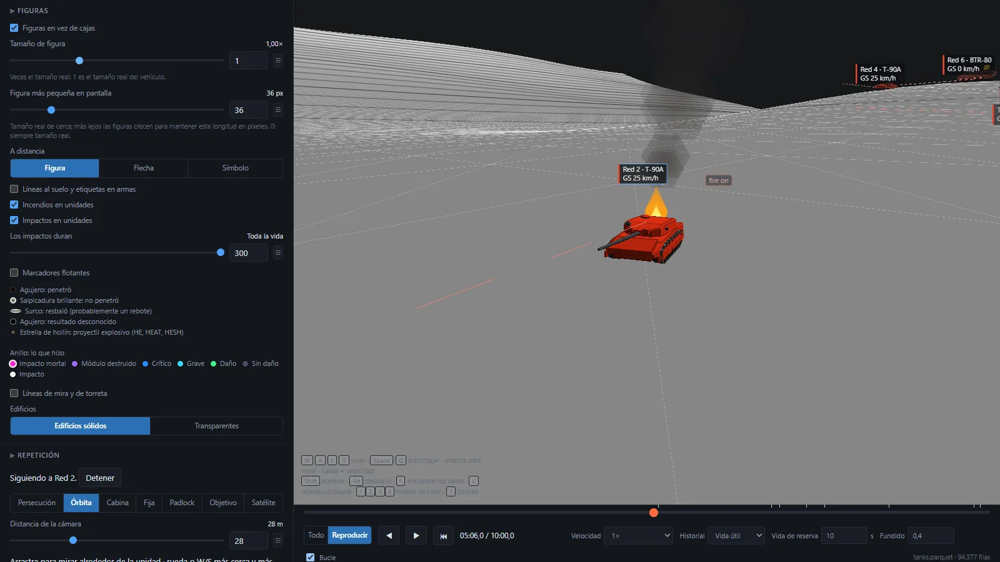

# Figuras

Una **figura** es un pequeño modelo 3D de lo que es realmente una unidad: un tanque, un caza, un barco, un soldado. La [repetición](match-replay.md) dibuja cada unidad como su figura a tamaño real, en lugar de una caja simple.

Hay unos 2.000 vehículos, aviones, barcos, armas y soldados con nombre, todos construidos por el propio visor.

## Qué hay en el catálogo {#what-is-in-the-catalogue}

| Ámbito | Ejemplos |
|---|---|
| Personas | soldado de pie, agachado o tumbado; francotirador, antitanque, sanitario, tripulación |
| Tierra | tanques, vehículos de combate de infantería, defensa antiaérea, artillería, camiones y coches, trenes y tranvías |
| Aire | cazas, aviones de ataque, bombarderos, transportes, helicópteros, desde biplanos hasta reactores modernos |
| Mar | buques de guerra por clase, portaaviones, submarinos, lanchas, mercantes |
| Armas | misiles, cohetes, bombas, torpedos, bengalas y chaff |
| Marcadores | granadas de humo, de destello y de fuego, bombas colocadas, banderas, puntos de aparición, puntos de ruta |
| Combate cercano | soldados con portaplacas y fusil de asalto, subfusil, escopeta, DMR, LMG, pistola o escudo; drones, cámaras, alambre de espino, escudos, refuerzos de pared, barricadas, cargas de brecha, trampas, ventanas, granadas, el desactivador |

## Cómo se hacen las figuras {#how-the-figures-are-made}

- **Construidas a partir de dimensiones publicadas.** La mayoría de las figuras las hace el propio constructor de figuras del visor, a partir de cifras públicas: longitud, anchura, altura, ruedas de rodadura, torreta y cañón, alas y cola. Después, su forma se ajusta con fotografías, planos y dimensiones públicas. No se usan modelos de ningún juego.
- **Modelos libres.** Algunas figuras usan modelos 3D libres (CC0 o CC BY) cuando son más fieles, a veces combinados con el casco construido. Los autores de las obras CC BY se acreditan en [Créditos de las figuras](figure-credits.md); las obras CC0 no necesitan crédito y no se listan allí.
- Cada figura tiene una versión completa, una simplificada y una lejana (niveles de detalle, LOD), para que se puedan dibujar miles a la vez.

## Qué figura recibe una unidad {#which-figure-a-unit-gets}

El visor mira las columnas propias de los datos:

1. **Nombres**: las columnas llamadas *Name*, *Vehicle*, *Unit*, *Unit type*, *Model*, *Aircraft*, *Plane*, *Tank*, *Ship*, *Craft*, *Loadout*, *Kit* o *Figure* se comparan con el catálogo: exactamente, mediante unos 4.000 alias (ids de unidad de varios juegos), por el inicio conocido más largo (`F-16C_50` es el F-16C), o por el nombre de figura más corto que empieza igual.
2. Un nombre cuya figura no encaja con el **tipo** de la unidad no se usa (un camión llamado *Typhoon* no es el caza).
3. **Tipos**: las columnas llamadas *Type*, *Class*, *Kind*, *Category*, *Icon*, *Role* o *Domain* dan una figura de clase: etiquetas de Tacview (`Air+FixedWing`, `Ground+Heavy+Armor+Vehicle+Tank`, `Sea+Watercraft+Warship`, `Weapon+Missile`), iconos de mapa o palabras sueltas (tank, helicopter, infantry).
4. Los datos sin ninguna de las dos cosas son datos de personas: todos son soldados.

Así que la forma más fácil de obtener las figuras correctas es una columna `vehicle` con los nombres reales, o una columna `type` con etiquetas de Tacview.

**Mi unidad aparece como una caja o un soldado.** Añada una columna `vehicle` con el nombre real, o una columna `type` con una etiqueta de Tacview. Pase el ratón sobre la unidad para ver qué nombre se encontró. Los datos que tienen columnas así pero no dicen nada de una unidad la dejan como caja; los datos sin ninguna de ellas se dibujan como soldados.

## Figuras de combate cercano (Rainbow Six Siege) {#close-quarters-figures-rainbow-six-siege}

Las tablas escritas como las del lector de repeticiones de Rainbow Six Siege (columnas `operator`, `pawn`, `primaryClass`, `side`) reciben figuras propias:

- **Los jugadores** son su operador: cada uno de los 78 operadores tiene una figura propia, de unos 1,8 m de alto, con su propia ropa. Dos o tres colores para la chaqueta, el pantalón y el equipo siguen su aspecto público habitual (negro, oliva, arena, gris urbano, blanco, azul marino, con equipo rojo, naranja o verde azulado). Además tiene sus propias formas, un tercio más grandes que en la realidad donde deben verse desde arriba: lo que lleva en la cabeza (cascos, un visor o casco pesado, gorras, gorros, boinas, un sombrero de ala ancha o un gorro de piel, capuchas, bufandas, pelo), la cara (gafas protectoras, una máscara de gas, gafas, una máscara, barba, gafas de tres lentes), una complexión ligera, media o pesada (los pesados son anchos, con grandes hombreras y un cuello), un abrigo largo o un traje, un traje ghillie, lo que lleva a la espalda (un martillo, cargas, drones, bidones, un depósito de combustible, un tubo lanzador, una ballesta, paneles, un inhibidor, un escudo) o en el brazo (un lanzador, un brazo de metal), su propio escudo (uno alto, uno antidisturbios, uno con luces) y un color de acento en los hombros. Sostiene la clase de su arma principal. Un operador que el visor no conoce es un soldado sencillo con portaplacas, del color del equipo.
- **El bando** se ve aparte de la ropa: un anillo en el suelo bajo cada operador, **ámbar para el ataque, cian claro para la defensa**, con el color del equipo dentro, y brazaletes y cintas en la cabeza del mismo color. Una columna `stance` (stand, crouch, prone) les da la postura; sin ella, están de pie.
- **Distinguibles a distancia de repetición:** dibujados a 48 píxeles de alto, desde arriba y en vista de tres cuartos, dos operadores cualesquiera de un mismo bando se distinguen por una clara diferencia de color o por una forma distinta (lo comprueban las pruebas del visor).
- **Las etiquetas** dicen el jugador y el operador que juega en ese momento, con el rol del operador como símbolo: ✸ brecha dura, ⚒ brecha blanda, ➤ entrada, ✦ fragger, ✚ apoyo, ⬟ escudo, ◉ información, ◇ flexible, ↺ vigía de flanco, ⚓ ancla, ✕ trampero, ⇄ merodeador, ↯ antiartilugios, ▣ antibrecha.
- **Los drones** son un dron de dos ruedas que se lanza, de unos 30 cm de ancho. Cada uno es una pista propia, con el nombre de su dueño ("Ash · drone 2").
- **Los artilugios colocados** están donde se pusieron, desde ese momento hasta el final de la ronda. Cada uno es la figura de lo que hace: una cámara, alambre de espino, un escudo desplegable, una carga de brecha, una carga de brecha dura, una pequeña carga adhesiva, una trampa de suelo, una claymore con su láser de activación, una ventana de un solo sentido, un panel blindado, una granada, un bote de gas, un inhibidor, un sensor, una barrera láser, una caja de suministros. Una sola figura sirve para todos los artilugios que hacen el mismo trabajo. Un artilugio cuyo tipo no dicen los datos es un pequeño aparato con una luz.
- **El desactivador** está donde se colocó durante sus 45 segundos.

Cada dron y cada artilugio se convierte en una pista propia al cargar el archivo. Así, la figura del jugador se queda en su cuerpo. Los operadores son formas simplificadas según sus descripciones e ilustraciones públicas (lo que llevan, el aparato que es su habilidad). Los artilugios tienen la forma de lo que hacen. Todo esto son diseños propios del visor al tamaño real del objeto (una claymore de unos 22 cm de ancho, un panel del tamaño de una puerta de 1 m por 2,1 m), no modelos del juego.

## Ajustes {#settings}

La sección **Figuras** de la barra lateral de la repetición fija el tamaño, el tamaño mínimo en pantalla, en qué se convierten las unidades lejanas (figura, flecha, símbolo) y los efectos que se dibujan sobre ellas. Véase [Repetición de partida](match-replay.md#figures). Humo, fuego y otros efectos temporizados: [Figuras en el modo de figuras superpuestas](figure-replay.md).

## Un paquete local de figuras opcional {#an-optional-local-figure-pack}

Puede guardar en su propio equipo un paquete opcional de figuras propias. Sus figuras ocupan el lugar de las figuras del catálogo con los mismos nombres. Nunca forma parte del repositorio ni de una versión publicada; sin él, no cambia nada.
