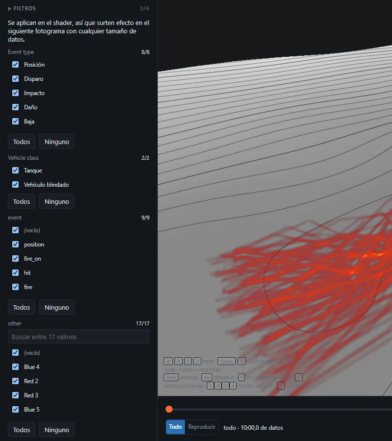
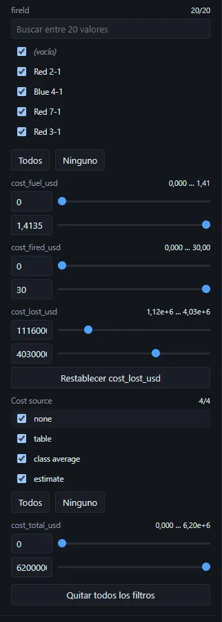

# Filtros

Los **Filtros** ocultan las filas que no te interesan, como una clase de vehículo o un tipo de evento, y la imagen se actualiza al momento. El panel lista las columnas guardadas al cargar bajo *Conservar para filtrar* ([Asignación de columnas](column-mapping.md)), más *Archivo de origen* cuando se cargaron varios archivos.

## Pruébalo {#try-it}

1. Carga un conjunto de datos y abre **Filtros** en la barra lateral.
2. En **Clase de vehículo**, desmarca *Tanque*. La imagen cambia al momento.
3. Pulsa **Quitar todos los filtros** para deshacerlo.

Las primeras filas son las columnas propias del visor (abajo). Las filas siguientes vienen de tu archivo.

## Columnas que añade el visor {#columns-the-viewer-adds}

Al cargar, el visor deduce cuatro columnas propias y las lista **primero**, con nombres y valores en tu idioma, para que el mismo filtro funcione con cada juego y fuente de datos:

| Columna | Valores | Se deduce de |
|---|---|---|
| **Tipo de evento** | 23 tipos: Posición, Disparo, Lanzamiento (misil, cohete, bomba), Impacto, Fallo (el arma terminó lejos de cualquier objetivo), Explosión, Daño, Baja, Muerte, Destruido, Estrellado, Eyección / salto en paracaídas, Aparición, Desaparición, Despegue, Aterrizaje, Contacto con el suelo, Parada en el suelo, Rearme / repostaje, Captura / objetivo, Señuelo, Mensaje, Otro | una columna llamada `event`, `events`, `event_type` o `event_name`; las palabras propias de cada juego (`shot`, `burst`, `fired`, `struck`, `flare`, `plant` ...) se asignan a estos tipos. La tabla completa: [Tipos y clases de eventos](ref-event-types.md). |
| **Jugador o IA** | Jugador, IA | una columna `ai`, `is_ai`, `bot` o `actor`; si no, `is_player` / `human`; si no, un id de cuenta (`user_id`, `steam_id`; vacío o 0 es IA); en grabaciones de Tacview, si el objeto tiene piloto |
| **Clase de vehículo** | 17 clases: Caza, Avión de ataque, Bombardero, Otra aeronave, Helicóptero, Tanque, Vehículo blindado, Defensa antiaérea, Artillería, Camión / coche, Barco, Submarino, Infantería, Arma, Señuelo, Estructura, Otro | el nombre del vehículo o de la unidad (comparado con el [catálogo de figuras](figures.md)) y las columnas de tipo |
| **Clase de objetivo** | las mismas clases | el vehículo de la otra parte (`other_vehicle`, `target_vehicle`, `victim_type` ...) |

Justo después vienen las [columnas de resultado](data-formats.md#outcome-columns), cuando los datos las tienen: **Resultado de la ronda** y **Resultado de la partida** (*Todos*, *Ganada*, *Perdida*) y **Cómo terminó la ronda**, con sus valores en tu idioma. Filtra por ellas, o divide el calor según ellas como un [mapa de tasa de victoria](win-rate.md).

Solo se listan los tipos que aparecen. Las columnas de valor (`cost_*`, `earn_*`, `net_*` y *Fuente del coste*, véase [Ponderación de valores](value-weighting.md)) se filtran como cualquier columna numérica: por ejemplo, desmarca *estimación* en *Fuente del coste* para quedarte solo con las filas con precio.

Una lista de categorías con más de 12 valores tiene una caja de búsqueda (*Buscar n valores*) y un botón **Solo estos** que permite exactamente los valores que coinciden.

Qué columnas se pueden filtrar se decide al cargar, porque hay que leerlas entonces. Sin ninguna columna conservada, el panel lo indica y remite a *Conservar para filtrar*.

## Columnas numéricas (rango) {#numeric-columns-range}

| Parte | Significado |
|---|---|
| Nombre, y `mín ... máx` | La columna, y el rango actual (el rango completo de la columna mientras no haya filtro). |
| Primera fila: casilla numérica y deslizador | El límite inferior. Arrastrar el deslizador por encima del límite superior empuja también el límite superior. |
| Segunda fila: casilla numérica y deslizador | El límite superior. Arrastrar por debajo del límite inferior lo empuja también. |
| **Restablecer *columna*** | Quita este filtro. |

Los deslizadores cubren el mínimo a máximo de la columna en 1.000 pasos; las casillas numéricas aceptan cualquier valor. Una fila pasa cuando su valor está dentro del rango, incluidos ambos extremos. Los valores grandes se muestran en notación exponencial (`1.23e6`).

## Columnas de categoría {#category-columns}

| Parte | Significado |
|---|---|
| Nombre, y `permitidos/total` | La columna, y cuántos de sus valores están permitidos. |
| Lista de valores | Una casilla por valor; un valor vacío se muestra como *(vacío)*. |
| **Todo** / **Ninguno** | Permite todos los valores / ninguno. |

Permitir todos los valores quita el filtro.

## Reglas {#rules}

- **Cuatro filtros a la vez.** La cabecera muestra `activos/4`. Un quinto filtro no se aplica, y el panel lo indica. Una selección en [Entidades](entities.md) (o el enfoque de jugador de la pestaña Partida) usa también uno de los cuatro. Un filtro que cubre toda la columna no usa ninguno.
- **Una columna de categoría tiene como máximo 4.096 valores**; una más ancha no se guarda al cargar.
- **Los filtros se combinan con Y**, y con la visibilidad de equipos, la división por diferencia, la ventana de tiempo, el recorte por distancia y el [corte](slice.md).
- **Cambiar un filtro reinicia la acumulación y vuelve a medir la exposición** unos fotogramas después, porque filtrar puede cambiar mucho la densidad ([Color y exposición](colour-and-exposure.md#auto-exposure)).
- **Quitar todos los filtros** elimina todos los filtros de columna. La visibilidad de equipos y las selecciones de jugadores hechas en otro sitio se conservan.
- Los filtros de columna cambian los modos de calor. No cambian las figuras de la [repetición por figuras](box-replay.md), que siguen la visibilidad de equipos y la selección de Entidades. La selección de Entidades cambia ambos.
- En el [calor de línea](line-heat.md) un filtro se evalúa en la fila donde *termina* cada segmento.
- En cada conjunto de datos nuevo, todos los filtros se quitan.

## Para desarrolladores {#for-developers}

**Ranuras.** Cada filtro activo ocupa una de cuatro ranuras de GPU ([`MAX_FILTER_SLOTS`](https://github.com/Holdi601/3DHeat/blob/main/src/render/types.ts)), una textura de 4 bytes por fila. Las ranuras se asignan a los filtros en el orden en que se cambiaron por última vez ([`filterSlots`](https://github.com/Holdi601/3DHeat/blob/main/src/render/filterTables.ts), compartido por el shader y ambos paneles). Más de cuatro, aparece un error: *Solo se aplican los primeros 4 filtros. Quita uno: el resto se ignora, no se combina en silencio*, y los nombres de los filtros extra leen *columna (no aplicado)*. Los filtros se evalúan por fila en el shader de vértices, así que cambiar un umbral no necesita volver a analizar ni a subir datos.

**Filtros que el panel no muestra.** Existen dos tipos más en el estado de la aplicación ([`FilterSpec`](https://github.com/Holdi601/3DHeat/blob/main/src/state/types.ts)):

- un filtro de **grupos**, fijado por la pestaña Partida cuando enfoca un bando. Oculta los demás grupos en todos los modos, incluida una [división por diferencia](difference.md) por columna.
- un filtro de **personas**, fijado por el panel [Entidades](entities.md) y por la pestaña Partida cuando enfoca a un jugador. Restringe la repetición por figuras y los modos de calor. En el calor es un filtro de categoría sobre los ids de persona y ocupa una de las cuatro ranuras. Su máscara guarda 65.536 ids ([`FILTER_MASK_CAPACITY`](https://github.com/Holdi601/3DHeat/blob/main/src/render/types.ts)); una persona más allá de eso no se dibuja en el calor mientras el filtro esté activo, aunque esté seleccionada. La repetición por figuras sigue mostrándolas.
