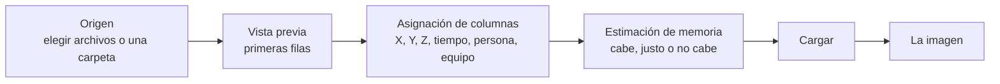

# Cargar datos

Antes de que 3DHeat pueda dibujar nada necesita una tabla: cada fila indica dónde estuvo algo y, si lo tienes, cuándo y quién. Esta sección muestra cómo un archivo se convierte en una imagen. ¿Aún no tienes datos? Prueba los [datos de demostración](demo-data.md).

**Haz esto ahora:**

1. En la barra lateral de Mapa de calor abre **Origen** y pulsa **Archivos…** (o suelta un archivo o una carpeta en la zona de carga).
2. Mira **Asignación de columnas**: las casillas suelen estar ya rellenadas.
3. Comprueba que **Estimación de memoria** dice *cabe*.
4. Pulsa **Cargar**.

Todo lo que muestra la pestaña Mapa de calor sale de un único **conjunto de datos**: una tabla de filas, cada una con una posición y, opcionalmente, un tiempo, una persona, un grupo, una sesión, una dirección de mirada y cualquier número de columnas extra guardadas para filtrar. Esta sección explica cómo se crea un conjunto de datos.

## El camino de los archivos a la imagen {#the-path-from-files-to-picture}

1. **Elige archivos** en el panel **Origen**: uno, varios, un árbol de carpetas, o soltándolos. Se aceptan Parquet, CSV, Tacview, trayectorias GPS y más; la lista completa está en [Formatos de datos](data-formats.md#files). Véase [Cargar archivos](loading-files.md).
2. **Vista previa.** Se abre el primer archivo de la selección: sus nombres de columna, sus primeras 50 filas, qué columnas parecen numéricas y (Parquet) el tipo lógico de cada columna y las propias instrucciones de lectura del archivo, la entrada de pie `heat3d`.
3. **Asignación automática.** Las columnas se asignan a funciones - X, Y, Z, tiempo, persona, sesión, grupo, dirección de mirada - y unas pocas se guardan para filtrar. Cada suposición se muestra en el panel **Asignación de columnas** y puede cambiarse. Véase [Asignación de columnas](column-mapping.md) y [Ejes, unidades y tiempo](axes-units-and-time.md).
4. **Contar.** Se lee el número de filas de cada archivo (exacto en los pies de Parquet, estimado en CSV), así que el panel puede indicar antes de cargar nada cuánta memoria necesita la carga y si cabe. Si no cabe, propone cargar una de cada *N* filas. Véase [Memoria y presupuestos](memory-and-budgets.md).
5. **Cargar.** Un trabajador en segundo plano analiza solo las columnas asignadas de cada archivo - varios archivos a la vez, hasta el presupuesto de [hilos de análisis](memory-and-budgets.md#parser-threads) - y los combina, en el orden de la selección, en un único conjunto de datos: un diccionario compartido de personas, grupos y sesiones en todos los archivos, un origen de tiempo común, y todas las filas ordenadas por tiempo. Véase [Sesiones, personas y grupos](sessions-persons-groups.md).
6. **Subir.** El hilo principal anuncia «Subiendo N filas a la GPU» durante un fotograma, y luego empaqueta las filas en la memoria de la GPU dentro del presupuesto de GPU. Véase [Permanencia de memoria de GPU](gpu-memory.md).
7. **Primera imagen.** La cámara encuadra los datos, el radio y la saturación del sprite se fijan según la extensión de los datos y su número de filas, y tras 8 fotogramas renderizados la saturación se mide a partir de la propia imagen ([Color y exposición](colour-and-exposure.md)).

## Requisitos, comprobados antes de cargar {#requirements-checked-before-a-load}

| Necesidad | Qué pasa sin ella |
|---|---|
| **Al menos dos de X / Y / Z** | La carga se rechaza. Con exactamente dos, el tercer eje es 0 y los datos se dibujan como un plano en la escena 3D - que es lo que quiere un mapa de calor visto desde arriba. |
| Una columna de tiempo | Opcional. Sin ella la línea de tiempo se desactiva, la vista se queda en modo **Todo** y la barra lateral lo indica. |
| Una columna de persona | Opcional. Necesaria para la [superposición de figuras](box-replay.md) (una figura por persona), el [calor de línea](line-heat.md) (la ruta que siguió cada persona), la interpolación, las estelas y el historial de **Vida útil**. |
| Una columna de grupo | Opcional. Necesaria para el [calor por equipo](team-heat.md) y el modo de [diferencia](difference.md) (al menos dos grupos). |

Un modo que los datos cargados no pueden admitir aparece atenuado en la barra de modos; al pasar el ratón por encima se indica el motivo.

## Sin datos propios {#without-your-own-data}

El panel **Conjunto de datos** (debajo de **Origen**) tiene un [generador sintético](synthetic-generator.md) que produce un conjunto de datos con forma de battle royale de cualquier tamaño, útil para probar el visor y para comprobar lo que aguanta una máquina.

## Páginas de esta sección {#pages-in-this-section}

- [Cargar archivos](loading-files.md) - selectores, carpetas, arrastrar y soltar, combinación de varios archivos, la regla del archivo de movimiento, progreso y cancelación
- [Asignación de columnas](column-mapping.md) - cada campo del panel de asignación, cómo adivina la asignación automática, las pistas `heat3d`
- [Ejes, unidades y tiempo](axes-units-and-time.md) - eje vertical, inversiones, escala de unidades, unidades de tiempo, dirección de mirada
- [Sesiones, personas y grupos](sessions-persons-groups.md) - qué hace cada uno, los límites, nombres compartidos, tamaño de entidades, el panel Conjunto de datos
- [Generador sintético](synthetic-generator.md)
- [Memoria y presupuestos](memory-and-budgets.md) - el modelo de huella, la comprobación de ajuste, el submuestreo, el límite de ordenación, los presupuestos de recursos
